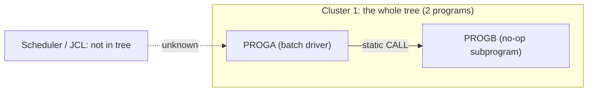

# 02 Coupling

The full edge list is in `02a-edge-tables.md`. This file holds the argument. The tree is very small:
two COBOL programs, one call edge, no datasets, no JCL, no scheduler, no copybooks
(`modernization-assessment/graph.json:20-29`).

## Open edges

The extractor left nothing to settle. There are no computed calls, no `resolved: false` edges, and no
`medium` or `low` confidence edges. That is far below the roughly 20 edges that would justify the
`dependency-cartographer` agent, so I did not start it. I read both source files to check for what the
extractor does not model.

| Check | Result | Evidence | Confidence |
|---|---|---|---|
| Computed calls (`?dynamic:`) | None. The only CALL uses a literal name. | `app/cbl/PROGA.cbl:6` | high |
| Medium or low confidence edges | None. The one edge is `high`. | `app/cbl/PROGA.cbl:6` | high |
| EXEC CICS RETURN TRANSID, START, SEND MAP | None in either source. | inference | medium |
| Job submitted through the internal reader | None visible in either source. | inference | medium |
| Files, SQL, MQ or IMS access | None. Neither source opens a file or names a dataset. | inference | medium |
| Parameters passed on the CALL | None. No `USING` on the CALL, and no `LINKAGE SECTION` in the callee. | `app/cbl/PROGB.cbl:3` | high |

## The coupling patterns that constrain the sequence

1. **One static call, and nothing else.** PROGA calls PROGB unconditionally by literal name
   (`app/cbl/PROGA.cbl:6`). Fan-in of PROGB is 1 and fan-out of PROGA is 1
   (`modernization-assessment/graph.json:88-92`). The two programs are one deployable unit. Splitting
   them gains nothing, because the boundary between them carries no data and no parameters.
2. **The real coupling is outside the tree.** The tree holds no JCL, no scheduler definition and no
   shell wrapper, so there is no temporal edge and no entry point
   (`modernization-assessment/graph.json:72`, `modernization-assessment/graph.json:109`). The
   client said the nightly batch cycle must not break. Whatever starts PROGA, and whatever runs
   before and after it, is not in what we were given. Every ordering constraint on this system is
   unknown. This is the biggest gap in the assessment, not a footnote.
3. **A message and an exit path that a harness must pin.** PROGA prints `CALL FAILED IF WE GET HERE`
   on every run, before the call, whether or not the call fails (`app/cbl/PROGA.cbl:5`). It then
   ends with `STOP RUN` and sets no return code (`app/cbl/PROGA.cbl:7`). Inference: an operator, a
   log scraper or a scheduler condition may key off that output or off the return code.

## Cluster graph

## Structure computed from the graph

| Fact | Result | Evidence |
|---|---|---|
| Strongly connected components | None. No wave split can break one. | `modernization-assessment/graph.json:95` |
| Self recursive programs | None. | `modernization-assessment/graph.json:96` |
| God modules | None. | `modernization-assessment/graph.json:94` |
| Articulation points | None. There is no natural wave boundary inside the tree. | `modernization-assessment/graph.json:97` |
| Data hubs | None. No dataset appears in the graph. | `modernization-assessment/graph.json:99` |

Note on basis: with no entry points, the extractor computed these over all programs, not only reachable
ones (`modernization-assessment/graph.json:87`). With two programs, the result is the same either way.

## The honest boundary

There are no computed calls, so the call graph inside the tree is complete. The boundary of the
analysis is the tree itself. The extractor reads only Control-M XML and shell wrappers as schedulers
(`modernization-assessment/graph.json:18`), and it found none. A scheduler in another product (for
example CA-7 or TWS), a JCL library, or other programs that call PROGA from outside would all be
invisible. Any claim that PROGA and PROGB are "the nightly batch cycle" is inference.
