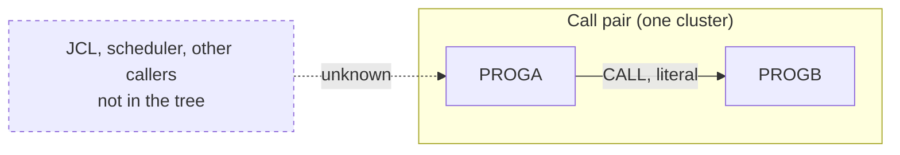

# 02 Coupling

`02a-edge-tables.md` holds every edge the extractor found. There is one. This file is the argument
about what it means for the sequence, and about what the tree cannot tell us.

No edge was left open. `analysis.unresolved_dynamic` is empty, and the one edge is `resolved: true` with
`high` confidence. That is far below the 20 open edges that would call for the `dependency-cartographer`
agent, so no edge work was handed off.

## The coupling patterns that constrain the sequence

| Pattern | Finding | Confidence | Evidence |
|---|---|---|---|
| Call coupling | PROGA calls PROGB with a literal target. PROGB is a leaf: it has one caller and calls nothing. PROGA has no caller in the tree. | high | `app/cbl/PROGA.cbl:6`, `app/cbl/PROGB.cbl:4` |
| Data coupling | None found. Neither program names a file, dataset, VSAM cluster or DB2 table, and the tree has no JCL to map a DD to. `analysis.data_hubs` is empty. | high for these two files, none for the system around them | `app/cbl/PROGA.cbl:3`, `app/cbl/PROGB.cbl:3` |
| Contract coupling | None found, because there are no datasets. | high for these two files | analysis: `edge_counts` holds only `call` |
| Temporal coupling | None found. The tree holds no JCL, Control-M XML or shell wrapper, so step order and job order are invisible. The must-not-break item, the nightly batch cycle, is a temporal structure, and it is the one thing this tree cannot show. | low | analysis: `warnings`, `meta.files_seen` all zero except cobol |

The pattern that will most constrain the sequence is the last row. The two programs are coupled to each
other by one call, and that is the whole of what is provable. Whatever couples them to the nightly batch
cycle lives in JCL and a scheduler that are not here. Inference.

## Cluster graph

The tree is one cluster. The dashed box is what the tree does not contain.

## Strongly connected components

None. `analysis.sccs` is empty and `analysis.self_recursive` is empty. Nothing constrains a wave cut here.

## God modules

None. `analysis.god_modules` is empty. Two programs cannot have a top-decile fan-in.

## Articulation points

None. `analysis.articulation_points` is empty. There is no boundary to cut a wave at, so the pair moves as
one unit.

## The honest boundary

- **No computed calls.** `analysis.unresolved_dynamic` is empty and `analysis.embedded_jcl` is empty. That
  bounds only these two files. It says nothing about callers in code that is not in the tree. Inference.
- **No entry points.** `analysis.entry_points` is empty. Every structural fact in `graph.json` was computed
  over all programs, because no reachable subset exists (`analysis.structure_basis`).
- **Static or dynamic link is not visible.** The target is a literal, so the extractor resolves it
  (`app/cbl/PROGA.cbl:6`). Whether the load module is bound in or loaded at run time depends on the DYNAM
  compiler option, which is not in the tree. Inference.
- **PROGA prints before it calls.** The DISPLAY at `app/cbl/PROGA.cbl:5` runs on every execution, ahead of the
  CALL. Its text says the call failed. It does not say that on any path the code takes. Anything that scrapes
  the job log for that string will see it on every run. Inference about downstream consumers, fact about the
  statement order.
- **Nothing handles a failed CALL.** There is no ON EXCEPTION on `app/cbl/PROGA.cbl:6`. Inference: if PROGB
  cannot be found at run time, the run abends rather than continuing.
