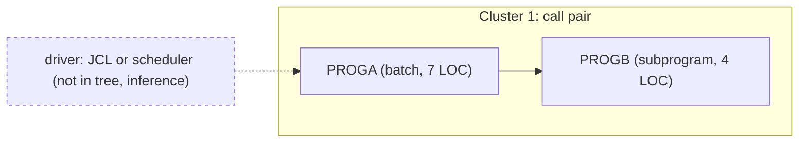

# 02 Coupling

The full edge list is in `02a-edge-tables.md`. This file holds the argument. The tree is two COBOL
programs, so the argument is short. Most of what matters here is what the tree does not contain.

Target state: refactor. What must not break: "the nightly batch cycle".

## Open edges

The extractor left nothing open. It found no computed calls, no edge below high confidence, no
unresolved edge and no unparsed file (`analysis` fields `unresolved_dynamic`, `edge_counts` and
`unparsed`). There were fewer than 20 open edges, so the `dependency-cartographer` work was done
inline. It reduced to reading the one call site and checking both source files for things the
extractor does not model.

| Item checked | Result | Confidence | Evidence |
|---|---|---|---|
| The only call is a literal, not a computed name | `CALL 'PROGB'` names its target in quotes. The edge is resolved and high confidence. | high | `app/cbl/PROGA.cbl:6` |
| Any `EXEC CICS` RETURN TRANSID, START or SEND MAP chain | None in either file. | high | `app/cbl/PROGA.cbl:1-7`, `app/cbl/PROGB.cbl:1-4` |
| Any job submitted through the internal reader, or any `EXEC SQL` | None in either file. This is inference from reading all 11 lines. | high | inference |
| Any `COPY` member | None. No layout is shared through a copybook. | high | `app/cbl/PROGA.cbl:1-7` |

## The coupling patterns that constrain the sequence

1. **One static call, and nothing else.** PROGA calls PROGB. This is the only edge in the graph, and it
   is a `call` edge of high confidence (`app/cbl/PROGA.cbl:6`). PROGB's fan-in is 1 and PROGA's fan-out
   is 1. A call edge means the caller cannot run correctly unless the callee is present and
   equivalent. The two programs move in the same wave, or PROGB moves first behind an interface that
   PROGA still calls. PROGB is a single `GOBACK` (`app/cbl/PROGB.cbl:4`), so the second option
   costs almost nothing.

2. **No data coupling and no contract coupling.** No dataset, VSAM file or DB2 table is read or
   written, and no record layout is shared. `analysis.edge_counts` holds only `call: 1`, and
   `analysis.data_hubs` is empty. This is a fact about the tree. Whether it is a fact about the running
   system depends on whether all the source was supplied, which is an open question (see
   `00-summary.md`).

3. **Temporal coupling is the constraint that matters, and the tree cannot show it.** You told us the
   nightly batch cycle must not break. A batch cycle is defined by job order, condition codes and
   the scheduler. The tree holds no JCL, no PROC, no scheduler export and no shell wrapper
   (`meta.files_seen` in `graph.json` is zero for `jcl`, `proc`, `controlm` and `shell`). So the graph
   has no `temporal` edge and no entry point (`analysis.entry_points` is empty). The order in which
   the cycle runs is unknown, and so is whether PROGA belongs to it. This is inference from what the
   tree lacks. It is not a finding about the system.

## Clusters

At cluster level there is one cluster, the PROGA to PROGB call pair. The driver that starts PROGA is
not in the tree and is drawn dotted.

## Structure

| Structure | Result | Confidence | Evidence |
|---|---|---|---|
| Strongly connected components | None. A wave plan has nothing to keep whole. | high | analysis field `sccs` |
| Self recursive programs | None. | high | analysis field `self_recursive` |
| God modules | None. With two programs the top decile is not meaningful. | high | analysis field `god_modules` |
| Articulation points | None reported. With two nodes and one edge this says nothing about where to cut. | medium | analysis field `articulation_points` |

## The honest boundary

There are no computed calls (`analysis.unresolved_dynamic` is empty), so no unknown program is held
open by one. The boundary of this analysis is not computed calls. It is the missing source. The
tree may be a fragment. A program outside it could call PROGA or PROGB, and the extractor can only
see callers that are in the tree. Nothing here proves that PROGA and PROGB have no other callers,
or that PROGA is or is not the entry to the nightly batch cycle.
