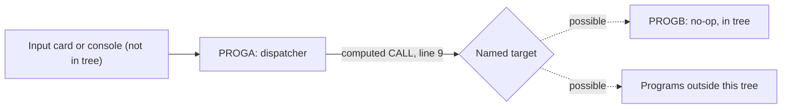

# 02 Coupling

The full edge list is in `02a-edge-tables.md`. This file is the argument. The tree is two COBOL programs and nothing else (`graph.json` `meta.files_seen`: 2 COBOL files, no JCL, no copybooks, no scheduler, no CSD). The extractor found one edge.

## The coupling patterns that constrain the sequence

| # | Pattern | What it does to the sequence | Confidence | Evidence |
|---|---|---|---|---|
| 1 | Computed call. PROGA ACCEPTs an 8 character name and CALLs it, with no USING and no ON EXCEPTION. | The callee set cannot be read from the source. Whatever the port replaces this CALL with must reach every program that has ever been named on the input card, including programs that are not in this tree. Until that set is known, no program anywhere in the system can be called dead or ported in isolation. | high (the edge is a fact; its reach is unknown) | `app/cbl/PROGA.cbl:8`, `app/cbl/PROGA.cbl:9` |
| 2 | Missing run context. Nothing in the tree says who starts PROGA, with what input, or in what order relative to other jobs. | Temporal and data coupling cannot be assessed. The must-not-break item, the nightly batch cycle, cannot be tied to either program from this tree. That is a gap in what was supplied, not a finding that the coupling is absent. | high | inference |
| 3 | No shared data. Neither program declares a file, a copybook or a dataset. | No contract edges, no data hubs. The only interface PROGA has with its callee is the CALL itself. With no USING, any target must take no parameters, or read its own inputs. | medium | `app/cbl/PROGA.cbl:9` |

## Cluster graph

There is one cluster. A node per program would add nothing.

## Structure computed from the call graph

| Fact | Result | Evidence |
|---|---|---|
| Strongly connected components | none. No wave can split one. | inference (`graph.json` `analysis.sccs` is empty) |
| Self recursive programs | none | inference (`graph.json` `analysis.self_recursive` is empty) |
| God modules | none. Fan-in and fan-out are empty because the only call is computed. | inference (`graph.json` `analysis.god_modules` is empty) |
| Articulation points | none. With one unresolved edge there is no boundary to find. | inference (`graph.json` `analysis.articulation_points` is empty) |

The extractor computed these over all programs, because it found no entry point (`graph.json` `analysis.structure_basis`). It is a structural fact about an incomplete tree, not evidence that the real system is flat.

## The honest boundary

`unresolved_dynamic` holds one entry, `?dynamic:PROGA:9`. The extractor resolves a computed target only from VALUE clauses and literal MOVEs in the same program (`graph.json` `meta.limits`). Here the name comes from ACCEPT (`app/cbl/PROGA.cbl:8`), so there is nothing to resolve. Read the source and I get the same answer: the value is supplied at run time by whatever starts the job. Working the edge by hand ("inference"):

- The set of programs it can reach is not bounded by the source. PROGB is the only in-tree candidate (`app/cbl/PROGB.cbl:4`).
- The value comes from outside the tree. To bound it we need the JCL SYSIN card, or the operator procedure, that feeds the ACCEPT.
- The 8 byte field (`app/cbl/PROGA.cbl:5`) limits the name length. It does not limit the set of names.

Because of this one edge, the extractor kept both programs in the unknown dead-code bucket (`05-dead-code.md`).

The `dependency-cartographer` agent was not needed. It is for more than about 20 open edges, and there is one.
