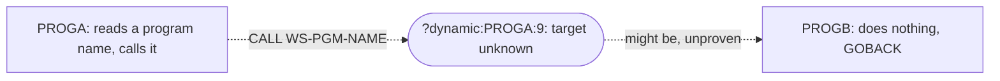

# 02 Coupling

The tree holds two COBOL programs, `PROGA` and `PROGB`, and nothing else. No copybook, no JCL, no
CSD, no scheduler and no dataset was found (`modernization-assessment/graph.json` `meta.files_seen`).
The graph has one edge. That edge is a computed call, and it is the only coupling in the system that
the extractor could see. All edge facts are in `02a-edge-tables.md`. This file is the argument.

I worked the one open edge myself. It is far below the 20 edges that would justify the
`dependency-cartographer` agent, so nothing here is delegated. What I add beyond the extractor is
labeled `inference`.

## The coupling patterns that constrain the sequence

| # | Pattern | What it does to the sequence | Confidence | Evidence |
|---|---|---|---|---|
| 1 | One computed call. `PROGA` does `CALL WS-PGM-NAME`, and `WS-PGM-NAME` is filled by `ACCEPT` at run time. | The set of programs `PROGA` can start is not knowable from this source. Any program in the tree with no static caller could be the target, which is `PROGA` itself and `PROGB`. A program outside the tree could be a target too. Nothing reachable from `PROGA` can be called dead, and `PROGA` cannot be placed in a wave that hides what it starts. | high that the call is computed, low on where it goes | `app/cbl/PROGA.cbl:8`, `app/cbl/PROGA.cbl:9` |
| 2 | No entry point. No JCL job, CSD transaction, scheduler job or wrapper names either program. | Nothing can be proven reachable or unreachable, and no order between programs is enforced by anything the extractor read. There is no temporal coupling to respect because there is no scheduler in the tree. That is a gap in what was supplied, not proof that no ordering exists. | high | analysis (`entry_points` is empty, warning "No entry points were found") |
| 3 | No data coupling. No program in the tree reads or writes a dataset, VSAM file or DB2 table. | There are no contract edges and no data hubs, so no record layout is an undocumented API inside this tree. Whatever `PROGA` starts through the computed call may still share files with programs we cannot see. | medium | analysis (`data_hubs` and `edge_counts` show no data edge); inference for the last sentence |

## The unresolved computed call

| Caller | Node | What the source shows | What is still open | Confidence | Evidence |
|---|---|---|---|---|---|
| `PROGA` | `?dynamic:PROGA:9` | `WS-PGM-NAME` is declared `PIC X(8)` with no `VALUE` clause and is set only by `ACCEPT`. No `MOVE` of a literal to it exists in the program. | Where the `ACCEPT` reads from (SYSIN, console, a job parameter) and which names are ever supplied. The target set cannot be bounded from the source. | low | `app/cbl/PROGA.cbl:5`, `app/cbl/PROGA.cbl:8`, `app/cbl/PROGA.cbl:9` |
| `PROGA` | (no `ON EXCEPTION` on the call) | The `CALL` has no `ON EXCEPTION` or `ON OVERFLOW` phrase. If the name given matches no program, the run ends in a run-time error that depends on the compiler. This is not stated in the source. | Whether the client's runtime abends, sets a return code, or continues. | low | inference: `app/cbl/PROGA.cbl:9` |

## Strongly connected components, god modules, articulation points

There are none. `sccs`, `god_modules`, `articulation_points` and `self_recursive` are all empty in the
`analysis` block. With two programs and one unresolved edge that says nothing about the real system.
It says only that the fragment supplied has no cycle and no hub.

| Structure | Result | Confidence | Evidence |
|---|---|---|---|
| Strongly connected components | none | high | analysis (`sccs`) |
| God modules | none | high | analysis (`god_modules`) |
| Articulation points | none, so no natural wave boundary is visible | high | analysis (`articulation_points`) |
| Self recursive programs | none as far as the extractor can see. `PROGA` could name itself in the computed call, and that is not modeled | low | inference: `app/cbl/PROGA.cbl:9` |

## Top level clusters

At cluster level there is one cluster, the two programs, and one edge that leaves the known graph.
A dashed line marks the computed call. The extractor could not resolve it, so it does not point at
`PROGB`.

## The honest boundary

This assessment stops at the computed call. Because `PROGA` calls a name it reads at run time:

- `PROGB` is in the unknown dead-code bucket, not unreachable (see `05-dead-code.md`).
- No wave can be cut, because no unit is reached from an entry point (see `03-waves.md`).
- The thing the client said must not break, the nightly batch cycle, cannot be tied to either
  program. Nothing in the tree says either program is part of it, and I have not assumed it.

Resolving the boundary needs three things from the client: the JCL that runs `PROGA` with its SYSIN
or PARM, a list of the program names that reach the `ACCEPT` over a full business cycle, and the load
library or source list that says which programs those names can match.
