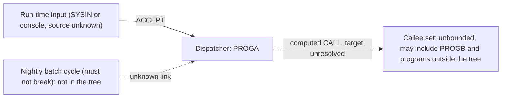

# 02 Coupling

`02a-edge-tables.md` holds every edge. This file holds the argument. The graph is one call edge and nothing else (analysis field `edge_counts`). There are 1 computed call and 0 data, contract, include or temporal edges.

There were fewer than 20 open edges, so I worked the one open edge myself, inline, in the way the `dependency-cartographer` agent would. What follows from reading the source is inference and is labeled so.

## The computed call

| Caller | Node | What the source shows | Set of programs reachable | Confidence | Evidence |
|---|---|---|---|---|---|
| PROGA | ?dynamic:PROGA:9 | `WS-PGM-NAME` is declared `PIC X(8)` with no VALUE clause. Its only assignment is `ACCEPT WS-PGM-NAME`. The `CALL` uses it as the target with no `ON EXCEPTION` and no check on the value. | Cannot be bounded from source. It is whatever the input names. `PROGB` is the only other program in the tree, and it could be one target, but nothing proves it. | low | `app/cbl/PROGA.cbl:5`, `app/cbl/PROGA.cbl:8`, `app/cbl/PROGA.cbl:9`. Inference on the reachable set. |

Saying "cannot be bounded from the source" is the finding. The value comes from outside the tree (inference: `ACCEPT` reads SYSIN or the console, and the JCL that would feed it is not here).

## Contract edges

None. No program in the tree reads or writes a dataset (analysis field `data_hubs` is empty; analysis field `edge_counts` lists only `call`).

## The coupling patterns that will constrain the sequence

1. **Run-time dispatch.** `PROGA` couples to an unknown, input-defined set of programs (`app/cbl/PROGA.cbl:9`). This is the only coupling the tree shows, and it is also the one that matters most: any wave plan for the rest of the system has to treat every program without a static caller as a possible callee of `PROGA`. That is why the extractor put both programs in the unknown bucket.
2. **Coupling with no visible source.** The must-not-break item is the nightly batch cycle. The tree has no scheduler, JCL or dataset, so the order, the shared files and the contract layouts that a real wave plan needs are all outside what was supplied. Inference, from analysis fields `entry_points`, `unscheduled_jobs` and `data_hubs` all being empty.
3. **Input-defined behavior.** What `PROGA` does depends on data fed to it (`app/cbl/PROGA.cbl:8`), not on code. A port has to keep that dispatch, and the harness has to replay the same inputs (`06-test-strategy.md`).

## Clusters

The dotted edges are unresolved. Cluster level only: the tree is too small for anything finer to mean anything.

## Structure computed from the call graph

| Fact | Result | Evidence |
|---|---|---|
| Strongly connected components | none | analysis field `sccs` |
| Self recursive programs | none | analysis field `self_recursive` |
| Articulation points (natural wave boundaries) | none | analysis field `articulation_points` |
| God modules | none | analysis field `god_modules` |
| Structure basis | all programs, because no entry points were found | analysis field `structure_basis` |

With no strongly connected component, no god module and no articulation point, nothing in the graph forces two units into one wave or gives a place to cut a wave. The only reason to keep `PROGA` and `PROGB` together is the computed call.

## The honest boundary

One computed call is unresolved (analysis field `unresolved_dynamic`, `app/cbl/PROGA.cbl:9`). Because it is unresolved, nothing in the tree can be proven unreachable (`05-dead-code.md`), and every claim in this assessment about what `PROGA` does not touch is provisional.
