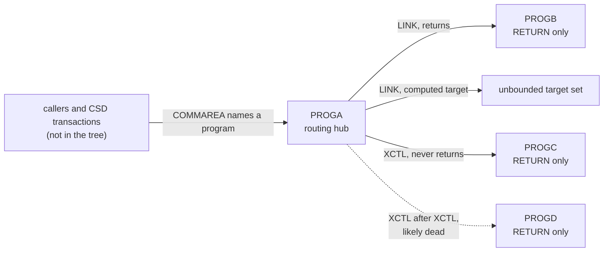

# 02 Coupling

Facts are in `02a-edge-tables.md`. This file holds the argument. The tree is small: four COBOL programs, all CICS, no copybook, no dataset, no JCL, no CSD and no scheduler (`01-inventory.md`). Every coupling here is a call. There is no data, contract or temporal coupling to find.

Open edges: two computed calls and one medium confidence static call. That is far below the 20 that would justify the `dependency-cartographer` agent, so I worked them by hand from the source. What follows about them is inference and is labeled that way.

## The coupling patterns that constrain the sequence

1. **One hub, three leaves.** PROGA is the only caller in the tree. It makes three static calls and two computed calls. PROGB, PROGC and PROGD each have exactly one caller, PROGA, and call nothing (analysis: `fan_in`, `fan_out`). PROGA is the only articulation point (analysis: `articulation_points`).
2. **LINK and XCTL are different couplings, and the graph draws them the same.** LINK returns to the caller. XCTL hands the task over and never returns. The extractor records both as `call` edges and does not model control flow (`meta.limits`). Reading the source shows the difference matters here: see the table below.
3. **A target chosen by the caller's COMMAREA.** PROGA moves its COMMAREA into a variable and links to whatever program that names. The value is set by a program or transaction outside the tree.

## Open edges, worked by hand

Everything in this table is **inference** from reading the source. The graph facts are in `02a-edge-tables.md`.

| Site | What the extractor said | What the source shows | Set of targets | Confidence | Evidence |
|---|---|---|---|---|---|
| LINK PROGRAM(WS-ANY-PGM) | Computed call, unresolved, low confidence | WS-ANY-PGM is set once, by `MOVE DFHCOMMAREA TO WS-ANY-PGM`. DFHCOMMAREA is the linkage item PROGA receives. Nothing in the tree calls PROGA, so nothing in the tree sets it. No check of the COMMAREA length or content appears before the LINK. | Cannot be bounded from the source. Any program the region can load, including PROGB, PROGC, PROGD and programs outside the tree. | low | `app/cbl/PROGA.cbl:9`, `app/cbl/PROGA.cbl:15`, `app/cbl/PROGA.cbl:16` (inference) |
| XCTL PROGRAM(WS-NEXT-PGM) | Two entries: a medium confidence call to PROGC and a low confidence computed call | WS-NEXT-PGM is assigned once, by `MOVE 'PROGC'`, on the line just before the XCTL. No branch sits between the two lines. Both extractor entries describe the same statement. | PROGC only, provable inside PROGA | medium (a full read of PROGA finds no other assignment) | `app/cbl/PROGA.cbl:6`, `app/cbl/PROGA.cbl:19`, `app/cbl/PROGA.cbl:20` (inference) |
| XCTL PROGRAM(LIT-PGM-D) | High confidence call to PROGD, via a constant | The constant is `'PROGD'`, so the target is right. But this statement follows an unconditional XCTL to PROGC. XCTL does not return, so this one runs only if the first XCTL fails. The EXEC CICS RETURN at line 26 is in the same position. | PROGD, but the edge is very likely dead by control flow | medium: the name is certain, the execution is not | `app/cbl/PROGA.cbl:5`, `app/cbl/PROGA.cbl:20`, `app/cbl/PROGA.cbl:23`, `app/cbl/PROGA.cbl:26` (inference) |

A failed XCTL (for example a missing program) does not fall through when the statement names no RESP option and the program has no HANDLE CONDITION. The default is that the task ends abnormally. Neither appears in PROGA. That is inference from standard CICS condition handling, not from anything in the tree.

## What the coupling does to the sequence

There is no sequence to give. `analysis` reports no entry points, so there are no waves (`03-waves.md`). What the coupling does say:

- PROGB, PROGC and PROGD can be ported in any order relative to each other. Each is a bare RETURN with one caller (`app/cbl/PROGB.cbl:4`, `app/cbl/PROGC.cbl:4`, `app/cbl/PROGD.cbl:4`).
- PROGA cannot be cut over until its LINK target set is known. A refactor that replaces LINK with a service call needs either a table of the permitted names or a router that keeps the dynamic lookup.
- XCTL has no direct equivalent in a call-and-return service model. A port that turns it into a plain call and then runs the next statement would run the PROGD transfer that the original never reaches. This is a behavior difference to write into the Deviation Register or to avoid on purpose (`06-test-strategy.md`).

## Cluster view

Cluster level only. The whole tree is one cluster.

## Strongly connected components

None (analysis: `sccs`). Nothing forces two programs to move together.

## God modules

None (analysis: `god_modules`). PROGA has the highest fan-out, 3, but the tree is too small for a top-decile test to mean anything.

## Articulation points

PROGA (analysis: `articulation_points`). In a tree this small it is trivially the only connector. If the real system is larger, this result does not carry over.

## The honest boundary

- Two computed calls are open (analysis: `unresolved_dynamic`, `app/cbl/PROGA.cbl:16`, `app/cbl/PROGA.cbl:20`). One of them, at line 20, I can close from the source. The one at line 16 I cannot. It keeps PROGB, PROGC and PROGD from being called unreachable, and would do so even if an entry point existed.
- No CSD, JCL, scheduler or copybook was supplied. The extractor read only COBOL (`meta.files_seen`, analysis). The tree may be a fragment of a larger system, and the coupling above holds only for these four files.
- `EXEC CICS RETURN TRANSID`, `START` and `SEND MAP` are not edges (`meta.limits`). None appears in these four files. Every RETURN is a plain RETURN, for example `app/cbl/PROGA.cbl:26`.
