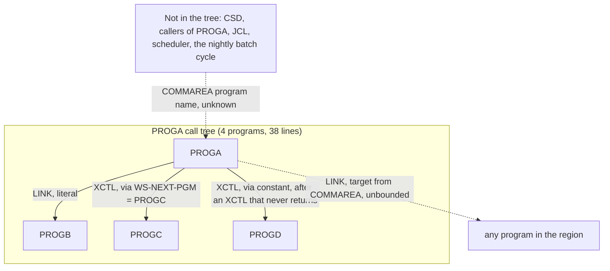

# 02 Coupling

The full edge list is in `02a-edge-tables.md`. This file is the argument. The tree is small: four COBOL
programs, no copybooks, no JCL, no CICS system definition, no scheduler. All five edges are `call`
edges. There are no `data`, `contract` or `temporal` edges. That is a limit of the tree, not a finding
that the system has none (see "The honest boundary").

## The three patterns that constrain the sequence

| Pattern | What it does to the sequence | Confidence | Evidence |
|---|---|---|---|
| Caller-controlled dispatch. PROGA copies its COMMAREA into WS-ANY-PGM and LINKs to whatever name it holds. | The set of programs PROGA can reach cannot be bounded from this tree. No program in the CICS region can be proven outside PROGA's reach, so nothing can be proven unreachable, and PROGA cannot be ported without a facade that keeps the program-name contract. | low | `app/cbl/PROGA.cbl:15`, `app/cbl/PROGA.cbl:16` |
| Hub and spoke around one articulation point. PROGA has fan-out 3 and no caller in the tree. PROGB, PROGC and PROGD each have fan-in 1 and call nothing. | The tree cannot be cut anywhere except at PROGA. Splitting the leaves from PROGA needs a facade in one direction or the other. It moves as one wave. | high | analysis: `articulation_points`, `fan_in`, `fan_out`; `app/cbl/PROGA.cbl:12`, `app/cbl/PROGA.cbl:19-20`, `app/cbl/PROGA.cbl:23` |
| Control flow the extractor does not model. The XCTL at line 20 never returns, so the XCTL to PROGD at line 23 and the RETURN at line 26 cannot run after it. | The PROGA to PROGD edge is a high confidence call edge that probably never fires. The graph overstates this coupling. It does not make PROGD dead, because the COMMAREA-driven LINK could still reach it. | medium | inference: `app/cbl/PROGA.cbl:20`, `app/cbl/PROGA.cbl:23-26` |

## Cluster graph

There is one cluster. What sits outside it is drawn as unknown, because nothing in the tree shows it.

## Strongly connected components

None. `sccs` is empty. No call cycle exists, so no wave is forced to keep a group together on that
ground (analysis: `sccs`).

## God modules

None. `god_modules` is empty. PROGA has the most fan-out but only 3 (analysis: `god_modules`,
`fan_out`).

## Articulation points

PROGA is the only one. It is the natural boundary, and it is also the unit whose target set is open
(analysis: `articulation_points`; `app/cbl/PROGA.cbl:16`).

## The honest boundary

Two computed calls remain open in `graph.json` (analysis: `unresolved_dynamic`). This is what I found by
reading the source at each. It is inference, by the `dependency-cartographer` method, done inline
because there are far fewer than 20 open edges.

| Computed call | Variable | What the source shows | Set it can reach | Confidence | Evidence |
|---|---|---|---|---|---|
| `?dynamic:PROGA:16` | WS-ANY-PGM | Set only by `MOVE DFHCOMMAREA TO WS-ANY-PGM`. DFHCOMMAREA is the caller's COMMAREA, filled outside this tree. | Cannot be bounded from the source. Any program in the region. | low | `app/cbl/PROGA.cbl:7`, `app/cbl/PROGA.cbl:15`, `app/cbl/PROGA.cbl:16` |
| `?dynamic:PROGA:20` | WS-NEXT-PGM | Referenced only at its declaration, at the one `MOVE 'PROGC'` and at the XCTL. No copybook, no other assignment. | PROGC, and only PROGC. The extractor kept it open, and kept the PROGA to PROGC edge at medium confidence, because it cannot rule out other assignments. In this program there are none. | medium | inference: `app/cbl/PROGA.cbl:6`, `app/cbl/PROGA.cbl:19`, `app/cbl/PROGA.cbl:20` |

Other things the extractor does not model, which matter here (inference):

- **Missing target.** Neither LINK nor XCTL carries RESP or NOHANDLE, and the source has no HANDLE
  CONDITION. A name that is not installed would raise PGMIDERR and abend the task (`app/cbl/PROGA.cbl:12`,
  `app/cbl/PROGA.cbl:16`, `app/cbl/PROGA.cbl:20`).
- **No EIBCALEN test.** Line 15 reads DFHCOMMAREA without checking whether a COMMAREA was passed
  (`app/cbl/PROGA.cbl:9`, `app/cbl/PROGA.cbl:15`). If PROGA is started with none, or with fewer than 8
  bytes, the value in WS-ANY-PGM is not the name a caller meant.
- **No transaction chain.** No `RETURN TRANSID`, `START` or `SEND MAP` exists in the four programs, so
  no other transaction is chained from here. That is only what these files show.

What this means for the rest: because line 16 is open, every program in the region that has no static
caller is in the unknown bucket, not the unreachable one. Here that is all four programs, and also
every program outside this tree that PROGA might reach.

Limits from `meta.limits` that touch this system: a variable target is resolved only from VALUE clauses
and literal MOVEs in the same program (lines 16 and 20); LINK and XCTL are both plain call edges and
control flow is not modeled (line 23); RETURN TRANSID, START and SEND MAP are not edges (analysis:
`meta.limits`).
