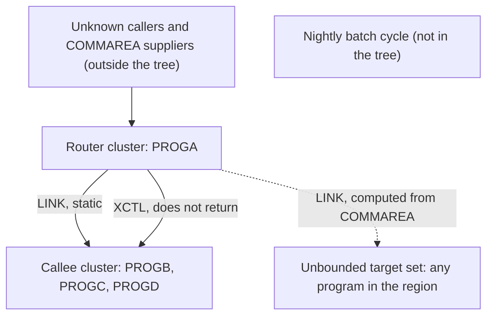

# 02 Coupling

`02a-edge-tables.md` holds every edge the extractor found. This file is the argument. The tree holds
four COBOL programs and nothing else: no JCL, no scheduler, no copybooks, no datasets, no CSD.
The graph has 5 call edges and no data, contract, include or temporal edges.

## The patterns that constrain the sequence

### 1. A computed LINK whose target comes from the caller's COMMAREA

PROGA copies its COMMAREA into `WS-ANY-PGM` and then LINKs to whatever name that holds. The set of
programs it can reach cannot be bounded from this tree. The callers that fill the COMMAREA are not in it.

| Finding | Confidence | Evidence |
|---|---|---|
| `WS-ANY-PGM` is loaded from `DFHCOMMAREA`, a caller supplied 8 byte field | high | `app/cbl/PROGA.cbl:9`, `app/cbl/PROGA.cbl:15` |
| `EXEC CICS LINK PROGRAM(WS-ANY-PGM)` targets that value. No table, VALUE clause or literal MOVE bounds it | high | `app/cbl/PROGA.cbl:16-18` |
| Nothing tests the COMMAREA length first, so a call with no COMMAREA reaches the MOVE with no data area to read. Likely an abend. Not proven from source | low | inference |
| No `RESP` option and no `HANDLE CONDITION` on any command, so a blank or unknown program name likely abends the task | medium | `app/cbl/PROGA.cbl:12-25` |

What it does to the sequence: the four programs cannot be split into independently provable waves,
because the computed LINK can reach any of them, and any program in the region. A port that resolves
this call statically would silently drop reachable programs. The dispatch contract (which names callers
send) is an undocumented API and has to be recovered from the callers or from captured traffic.

### 2. LINK and XCTL are both edges of kind `call`, but XCTL never returns

`EXEC CICS LINK` returns control to the caller. `EXEC CICS XCTL` does not. The extractor stores both as
`call`, so the graph cannot show the difference. Read from source:

| Finding | Confidence | Evidence |
|---|---|---|
| The XCTL at line 20 goes to PROGC and control does not come back to PROGA | high | `app/cbl/PROGA.cbl:20-22` |
| `WS-NEXT-PGM` has no VALUE clause and is set only by `MOVE 'PROGC'` at line 19. Nothing else in the program writes it. So the "computed" XCTL at line 20 always goes to PROGC. This settles the edge the extractor left open at line 20 | high | inference, `app/cbl/PROGA.cbl:6`, `app/cbl/PROGA.cbl:19-20` |
| The XCTL to PROGD at line 23 and the RETURN at line 26 follow an XCTL that does not return. They run only if the XCTL at line 20 fails and the failure is handled. Nothing handles it, so the edge PROGA to PROGD (high confidence in the graph) is probably never taken | medium | inference, `app/cbl/PROGA.cbl:20-26` |
| The two XCTLs pass no COMMAREA option, so PROGC and PROGD would start with no COMMAREA | medium | `app/cbl/PROGA.cbl:20-25` |

What it does to the sequence: a port that turns XCTL into a plain call and continues would run the
PROGD transfer and the RETURN, which the legacy never reaches. That changes behavior. The
equivalence harness must assert that control does not come back after XCTL.

### 3. No coupling to a batch cycle

The stated must-not-break item is the nightly batch cycle. Nothing in the tree touches it.

| Finding | Confidence | Evidence |
|---|---|---|
| PROGA holds no file, SQL, COPY or dataset statement. It only issues CICS LINK, XCTL and RETURN | high | `app/cbl/PROGA.cbl:1-26` |
| PROGB, PROGC and PROGD are four lines each and only issue RETURN | high | `app/cbl/PROGB.cbl:4`, `app/cbl/PROGC.cbl:4`, `app/cbl/PROGD.cbl:4` |
| No JCL, scheduler definition or dataset is in the tree, so no job order or shared file layout can be shown | high | inference |

Data, contract and temporal coupling to the batch cycle are therefore not assessed. That is a gap in what
was supplied, not evidence that no coupling exists. A CICS transaction can share a VSAM file, a DB2 table or
a queue with the batch cycle through resources that are defined outside the source.

## Cluster view

Cluster level only. The tree has one call chain, so the graph is small.

## Strongly connected components

None. Nothing calls back into PROGA and no program calls itself. No component can be split by a wave
plan, so the plan holds no such constraint. The computed LINK at line 16 could name PROGA itself, which
would make PROGA self-recursive at run time. The extractor cannot see that.

## God modules

None. PROGA has three outgoing edges and PROGB, PROGC and PROGD have one incoming edge each. On four
programs this ranking carries no information.

## Articulation points

The extractor lists PROGA. It is the only program that calls anything, so removing it disconnects the
other three. That is a property of a four node star. There is nothing behind PROGA to cut into a second
wave, so PROGA is not a useful wave boundary here.

## The honest boundary

The extractor could not resolve two computed calls, and found no entry point. Every program is in the
unknown bucket.

| Computed call | What the source shows | Status | Confidence | Evidence |
|---|---|---|---|---|
| `?dynamic:PROGA:16`, LINK on `WS-ANY-PGM` | Target comes from `DFHCOMMAREA`. Cannot be bounded | Still open | low | `app/cbl/PROGA.cbl:15-16` |
| `?dynamic:PROGA:20`, XCTL on `WS-NEXT-PGM` | Only assignment is `MOVE 'PROGC'` at line 19, so the target is PROGC | Settled by reading the 26 line program. `graph.json` still lists it as unresolved, because it holds extractor output only | high | inference, `app/cbl/PROGA.cbl:19-20` |

Two open computed calls would normally go to a hand off. With two, and both in one 26 line program, I
settled them inline. Both are inference, labeled as such.

Limits that touch this system: the extractor resolves a computed target only from VALUE clauses and
literal MOVEs in the same program. That is why it kept line 20 open, and why line 16 cannot be closed
by any script. `EXEC CICS RETURN TRANSID`, START and SEND MAP are not edges. I read all four programs and
none of them uses TRANSID, START or SEND MAP, so no chain is hidden in this tree
(`app/cbl/PROGA.cbl:26`, `app/cbl/PROGB.cbl:4`, `app/cbl/PROGC.cbl:4`, `app/cbl/PROGD.cbl:4`). Transaction to
program mapping lives in the CSD, which is not in the tree, so the extractor found no entry point.
