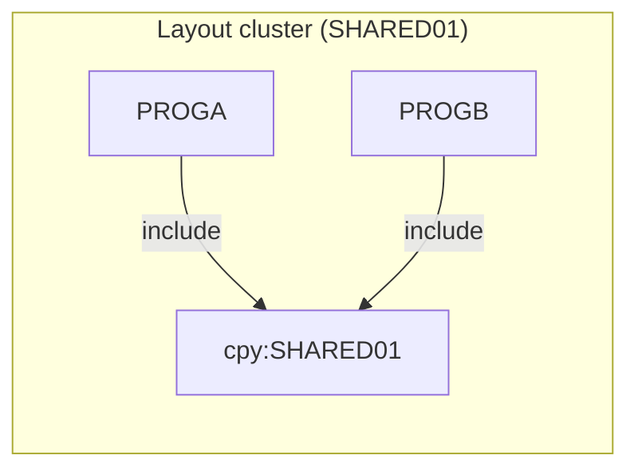

# 02 Coupling

The full edge list is in `modernization-assessment/02a-edge-tables.md`. This file holds the argument.

There are two edges in the tree and both are `include`. There is no call, data, contract or temporal edge. The dependency-cartographer step was not needed: `analysis.unresolved_dynamic` is empty and every edge is `high` confidence and resolved, so no edge was left open.

## Coupling patterns that constrain the sequence

| # | Pattern | Effect on the migration sequence | Confidence | Evidence |
|---|---|---|---|---|
| 1 | Layout coupling. PROGA and PROGB both COPY SHARED01 | The copybook belongs to two owners, so PROGA and PROGB should move in the same wave. If they split, the layout has to be versioned or copied, and the two copies can drift | high (the edges), medium (the sequencing advice) | `app/cbl/PROGA.cbl:5`, `app/cbl/PROGB.cbl:5` |
| 2 | The shared layout carries packed decimal money. `SH-BALANCE` is `PIC S9(9)V99 COMP-3` | A target type for that field is a decision that hits both programs. It must be a decimal type with zero tolerance. Today neither program reads it | high | `app/cpy/SHARED01.cpy:3` |
| 3 | No runtime data flows between the programs. Each MOVE writes to its own working storage, and neither program opens a file | The two programs are independent at run time. The only thing they share is the source of a layout. Whether the same layout appears on a file elsewhere is not visible | medium (inference) | `app/cbl/PROGA.cbl:7`, `app/cbl/PROGB.cbl:7` |

## What the coupling does to the sequence

1. **Call coupling.** None. No program calls another (`analysis.fan_in` and `analysis.fan_out` are empty).
2. **Data coupling.** None found. There is no dataset node, so `analysis.data_hubs` is empty. This is a gap, not a finding. The tree holds no JCL, so no DD could map a dataset to a program. Inference: a real batch program in a nightly cycle reads or writes files, so the tree is probably an excerpt.
3. **Contract coupling.** None found, for the same reason. Two programs that share a layout copybook are the setup for a `high` contract edge, but no dataset connects a writer to a reader (`modernization-assessment/02a-edge-tables.md`, section "Contract edges", is empty).
4. **Temporal coupling.** None found. No JCL step order, no Control-M condition and no wrapper exists in the tree. The order of the nightly cycle is unknown, and a plan built without it is not a plan.

## Clusters

The tree holds one cluster. The graph is at program level only because it has two programs.

## Structure computed from the graph

| Fact | Units | Evidence |
|---|---|---|
| Strongly connected components | none, so no move-together constraint from a call cycle | analysis (field `sccs`) |
| God modules | none | analysis (field `god_modules`) |
| Articulation points (candidate wave boundaries) | none | analysis (field `articulation_points`) |
| Data hubs | none | analysis (field `data_hubs`) |
| Self recursive programs | none | analysis (field `self_recursive`) |

Because there is no call cycle and no articulation point, no wave boundary can be drawn from the structure. The only constraint is the pattern 1 advice above, which is an inference.

## The honest boundary

- Computed calls: none (`analysis.unresolved_dynamic` is empty). That is an accurate statement about this tree. It says nothing about programs outside it.
- Not parsed: nothing was skipped.
- Not in the tree: JCL, CSD, scheduler, datasets, and every other program of the nightly batch cycle. Every statement about the whole system is therefore inference or an open question. See `modernization-assessment/00-summary.md`.
