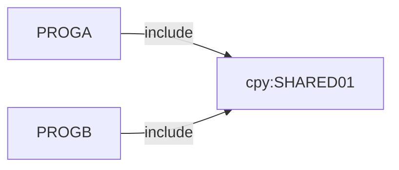

# 02 Coupling

The edge tables are in `02a-edge-tables.md`. This file is the argument. The tree is very small: two programs and one copybook. The extractor found two edges, both `include`, both high confidence and resolved (`analysis`, field `edge_counts`). It found no call, no dataset, no scheduler and no computed call. There were no open edges, so the `dependency-cartographer` agent was not needed. It is for more than about 20 open edges. I read the two programs and the copybook myself. They total 19 lines.

## The coupling patterns that constrain the sequence

| # | Pattern | What it does to the sequence | Confidence | Evidence |
|---|---|---|---|---|
| 1 | Layout coupling through one copybook. PROGA and PROGB both COPY SHARED01. | They share one record layout, so a change to it reaches both. In a refactor the copybook becomes a shared schema or library. Both programs must take the new definition together, or a compatibility layer must sit between them. Treat them as one unit of movement. | high | `app/cbl/PROGA.cbl:5`, `app/cbl/PROGB.cbl:5` |
| 2 | The layout carries a packed decimal money field. | SH-BALANCE is `S9(9)V99 COMP-3`. Neither program touches it here. Any file or record that carries this layout is outside the tree. A port that turns it into a float, or changes its scale, breaks the reader silently. | medium | `app/cpy/SHARED01.cpy:3` |
| 3 | The nightly batch cycle is not in the tree. | The must-not-break item cannot be tied to any program. No JCL, scheduler or dataset was supplied, so there is no ordering to keep and no writer to reader path to protect. The order of PROGA and PROGB in the cycle, if they are in it, is unknown. | low | inference |

## Cluster graph

The whole tree is one cluster. There are no calls and no dataset edges.

## Structure computed from the graph

| Fact | Units | Evidence |
|---|---|---|
| Strongly connected components | none. There is nothing to split. | analysis, field `sccs` |
| Self recursive programs | none | analysis, field `self_recursive` |
| God modules | none | analysis, field `god_modules` |
| Articulation points | none. With no call or data edges between programs, the only seam is the copybook. A copybook is not a movable unit, so it moves with its owners. | analysis, field `articulation_points` |
| Data hubs | none. No dataset appears in the tree. | analysis, field `data_hubs` |
| Fan-in and fan-out | empty. No program calls another. | analysis, fields `fan_in` and `fan_out` |

## The honest boundary

- There are no computed calls (`analysis`, field `unresolved_dynamic` is empty). That is not the boundary here.
- The boundary is what the tree lacks. It has no entry point: no CSD transaction, JCL job, scheduler job or wrapper (`analysis`, field `entry_points` is empty). The extractor could not say whether either program runs, who runs it, or in what order. Every dead-code and wave statement rests on that gap. See `05-dead-code.md`.
- The extractor sees a shared layout only when two programs include it. It does not read DCB, LRECL or RECFM, so it cannot compare a dataset record length with SHARED01 even if a JCL file arrives (`meta.limits` in `graph.json`).
- Inference: the copybook is a customer record with a balance. It has SH-CUST-ID and SH-BALANCE. This is a guess from the field names. No file in the tree uses it. It should be confirmed with the client's engineers.
