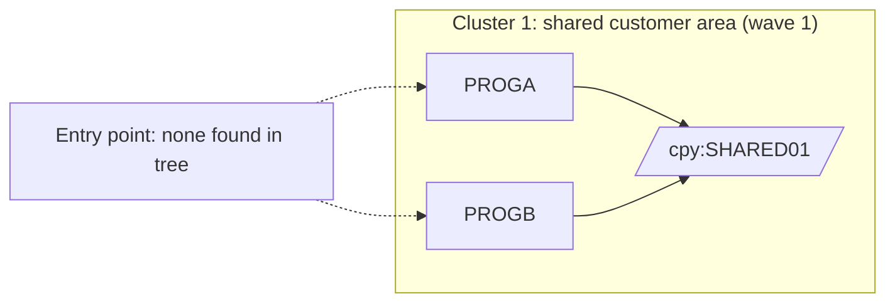

# 02 Coupling

The full edge list is in `02a-edge-tables.md`. This file is the argument. The graph is tiny: three nodes and two edges, both `include`, both `high` confidence, none unresolved (`graph.json` `analysis`).

## Coupling patterns that constrain the sequence

| # | Pattern | What it does to the sequence | Confidence | Evidence |
|---|---|---|---|---|
| 1 | **Shared layout copybook.** PROGA and PROGB both `COPY SHARED01` in WORKING-STORAGE. | Any change to `SHARED-AREA` (`SH-CUST-ID PIC 9(9)`, `SH-BALANCE PIC S9(9)V99 COMP-3`) hits both programs. They must be ported in the same wave so the layout has one definition in the target. | high | `app/cbl/PROGA.cbl:5`, `app/cbl/PROGB.cbl:5`, `app/cpy/SHARED01.cpy:1-3` |
| 2 | **Packed decimal in the shared layout.** `SH-BALANCE` is `COMP-3` with two implied decimals. Neither program reads or writes it. | It is latent, not active. The moment any program moves or compares `SH-BALANCE`, the target needs a decimal type with zero tolerance. The port must carry the field faithfully even though the two visible programs never touch it. | high | `app/cpy/SHARED01.cpy:3` |
| 3 | **Undeclared external interface (inference).** A `01` level record named `SHARED-AREA` with a customer id and a balance looks like a record layout for a file or a message. The tree has no `SELECT`, `FD`, `EXEC CICS`, `CALL` or JCL that would carry it anywhere. | If the layout crosses a file or call boundary outside the tree, that boundary is a contract edge the extractor could not see. It would be the most dangerous coupling in the system, and it is not in the graph. | low | inference |

Data coupling, contract coupling and temporal coupling are absent from the graph, and that absence is a limit of the tree, not a finding about the system. There are no dataset edges (`analysis.data_hubs` is empty) and no scheduler or JCL step edges (`meta.files_seen` shows 0 jcl, 0 proc, 0 controlm, 0 shell). The stated must-not-break item is "the nightly batch cycle". That cycle is defined by JCL and a scheduler, and neither is in the tree. The temporal order the harness must keep cannot be read from here.

The two programs write different literals to the same field: PROGA moves 1 and PROGB moves 2 to `SH-CUST-ID`. Whether these are test stubs or real hardcoded customer ids is unknown. This is an undocumented business rule candidate. Evidence: `app/cbl/PROGA.cbl:7`, `app/cbl/PROGB.cbl:7`.

## Cluster view

One cluster. Node-per-program detail is the same as the cluster here, so nothing is hidden by keeping it small.

The dotted edges are not in the graph. They show the gap: nothing in the tree starts either program.

## Structure

| Fact | Result | Evidence |
|---|---|---|
| Strongly connected components | none. `analysis.sccs` is empty, so no wave split can violate one. | `app/cbl/PROGA.cbl:5` |
| Self recursive programs | none | inference |
| God modules | none. There are no call edges, so fan-in and fan-out are empty. | inference |
| Articulation points | none. The graph has no call or data edges, only includes. | inference |
| Data hubs | none. No program names a dataset. | inference |

`structure_basis` in `graph.json` reads "all programs (no entry points were found)". Every structural measure was computed over all programs because there is nothing to compute reachability from.

## The honest boundary

- Computed calls (`unresolved_dynamic`): none. There is no `CALL`, `LINK` or `XCTL` in either program (`app/cbl/PROGA.cbl:6-8`, `app/cbl/PROGB.cbl:6-8`). Nothing is left open on that front.
- The boundary that remains open is the missing surroundings. No entry point, no JCL, no datasets, no scheduler. The graph is complete for the two files given and says almost nothing about how they run. Treat every "no coupling found" here as "not visible in this tree".
- The dependency-cartographer step was done inline. It had no unresolved computed calls, no `medium` or `low` edges and no `resolved: false` edges to settle, so its output is the list above.
