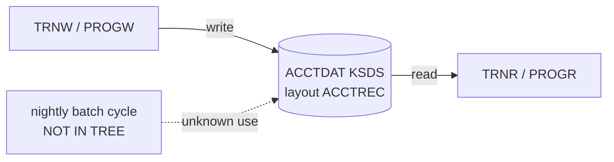

# 02 Coupling

The tree holds two CICS programs, one copybook, and one CSD file. The extractor found no program calls, no computed calls, no JCL, and no scheduler. All the coupling there is runs through one file. Every edge is in `02a-edge-tables.md`. This file is the argument about what the coupling does to the sequence.

## The patterns that constrain the sequence

| # | Pattern | What it does to the plan | Confidence | Evidence |
|---|---|---|---|---|
| 1 | Contract coupling. PROGW writes the ACCTDAT KSDS and PROGR reads it, and both use the ACCTREC layout. | The record layout (an 11 digit key, then a signed packed decimal balance) is the API between the two waves. A port that changes one byte of it breaks the other side silently. | high | `app/cbl/PROGW.cbl:7`, `app/cbl/PROGR.cbl:7`, `app/cpy/ACCTREC.cpy:3` |
| 2 | Data coupling through one dataset. The KSDS `SPARQ.TEST.ACCTDAT.KSDS` has one writer and one reader in the tree. It is the only data hub and the only articulation point. | The file, not the programs, is the real unit of migration. Waves 1 and 2 are cut at the file, so the ported PROGR reads a file the legacy PROGW still writes until wave 2 lands. | high | `app/csd/DEMO.CSD:1-3`, analysis field `data_hubs` and `articulation_points` |
| 3 | Shared copybook. Both programs include ACCTREC. | Both programs use one layout definition. It moves with the first user (wave 1). Wave 2 must reuse that mapping, not rewrite it. | high | `app/cbl/PROGR.cbl:5`, `app/cbl/PROGW.cbl:5` |
| 4 | Temporal coupling to a nightly batch cycle that is not in the tree. | The client says the nightly batch cycle must not break. The tree has no JCL, proc, scheduler definition or batch program, so no ordering edge exists and none can be tested. A plan built without the scheduler is not a plan. This is a gap, not a detail. | low | analysis field `meta.files_seen` (jcl 0, proc 0, controlm 0, shell 0), analysis field `unscheduled_jobs` |

The first two rows are facts the extractor computed. Row 4 rests on an absence, and the absence is the finding.

## What the programs do not show (inference)

These are read from the source. They are inference, not edges in the graph.

| Observation | Why it matters for the sequence | Confidence | Evidence |
|---|---|---|---|
| Neither program sets the key it uses. `ACCT-ID` has no `VALUE`, there is no LINKAGE SECTION or COMMAREA, and there is no RECEIVE. | The source shown cannot say where the key comes from. The behavior a port must reproduce is not visible here, and a test harness has no input to replay. | medium | `app/cbl/PROGR.cbl:4-9`, `app/cbl/PROGW.cbl:4-9`, inference |
| Neither EXEC CICS call has a RESP option or a HANDLE CONDITION. | An unhandled NOTFND (read) or DUPREC (write) ends the task in an abend. That abend is behavior, and the port has to decide whether to keep it. | medium | `app/cbl/PROGR.cbl:7-10`, `app/cbl/PROGW.cbl:7-10`, inference |
| PROGW uses WRITE and no REWRITE. | It can only add records. A record with an existing key gives a duplicate key condition. The tree contains no path that updates a balance. | medium | `app/cbl/PROGW.cbl:7`, inference |
| The FILE definition sets no ADD, READ or UPDATE attribute. | The installed file attributes decide what the two programs may do. They come from the CSD defaults or the live definition, and neither is in the tree. Verify them. | low | `app/csd/DEMO.CSD:1-3`, inference |
| The file name is `SPARQ.TEST.ACCTDAT.KSDS`. | The name says TEST. The production file name, and whether production uses this CSD group, are not known. | low | `app/csd/DEMO.CSD:2`, inference |
| Both programs end with a plain `EXEC CICS RETURN`. | The task ends with an implicit syncpoint. The write commits or backs out as one unit. The port must give the same all-or-nothing behavior. | medium | `app/cbl/PROGW.cbl:11`, inference |

## Strongly connected components

None. `sccs` is empty, and no program calls another. Nothing has to move as a unit because of a cycle. Evidence: analysis field `sccs`.

## God modules

None. `god_modules` is empty. Neither program has fan-in or fan-out. Evidence: analysis fields `god_modules`, `fan_in`, `fan_out`.

## Articulation points

One: the dataset `ds:SPARQ.TEST.ACCTDAT.KSDS`. It is the natural wave boundary, and it is the boundary used in `03-waves.md`. Evidence: analysis field `articulation_points`.

## Cluster view

One cluster. The two transactions meet at one file.

## The honest boundary

The extractor reports `unresolved_dynamic: []`, no embedded JCL, and nothing not parsed. Inside the tree there is no computed call to settle, so the `dependency-cartographer` work had nothing to do: fewer than 20 open edges, in fact none, and no `medium` or `low` edge. Evidence: analysis fields `unresolved_dynamic` and `embedded_jcl`, and the `unparsed` list.

The real boundary is the edge of the tree. The batch cycle the client named cannot be seen, so the counts "1 writer, 1 reader" on the data hub are a lower bound. Any job or program outside the tree that touches the KSDS is a coupling this assessment cannot name. Evidence: inference.
