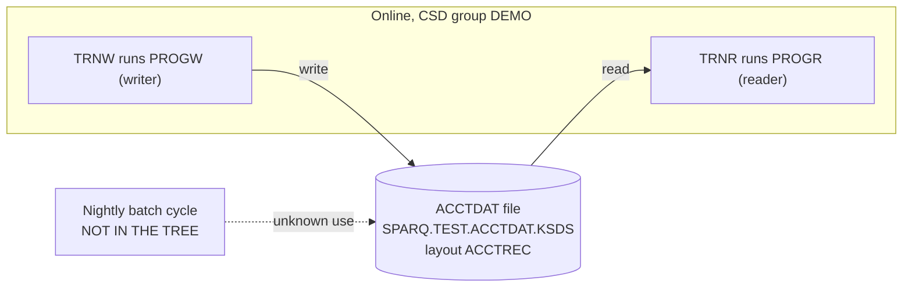

# 02 Coupling

The tree is two CICS programs, one copybook and one CSD file. It has one coupling, and it is data plus contract. The rest of the argument is about what the tree cannot show.
No open edges exist (`unresolved_dynamic` is empty at `modernization-assessment/graph.json:185`, and every edge is `high` confidence), so the `dependency-cartographer` agent was not needed. The edge tables are in `02a-edge-tables.md`.

## The patterns that constrain the sequence

| # | Pattern | What it does to the sequence | Confidence | Evidence |
|---|---|---|---|---|
| 1 | Data and contract coupling on the ACCTDAT file. PROGW writes it and PROGR reads it, and both use the layout copybook ACCTREC. | The file is the boundary between wave 1 and wave 2. The new reader must read the legacy file while the legacy writer still writes it. | high | `app/cbl/PROGW.cbl:7`, `app/cbl/PROGR.cbl:7`, `app/cbl/PROGW.cbl:5`, `app/cbl/PROGR.cbl:5`, `app/csd/DEMO.CSD:2` |
| 2 | The record is an undocumented API with a packed decimal field. ACCT-ID is an 11 digit display key, and ACCT-BAL is a signed packed decimal with two decimals. | Any port must encode and decode COMP-3 exactly. A float here is a defect. | high | `app/cpy/ACCTREC.cpy:2`, `app/cpy/ACCTREC.cpy:3` |
| 3 | The nightly batch cycle that must not break is not in the tree. No JCL, PROC or scheduler file was seen. | Nothing about batch order or batch use of the ACCTDAT file can be sequenced. If the batch touches the file, it is a third party to the contract that the extractor cannot see. | low | inference; `files_seen` counts zero for jcl, controlm and shell at `modernization-assessment/graph.json:30` |

The contract edge is `high` because both programs COPY the same layout. The extractor says that means shared layout, not proven equal (`modernization-assessment/graph.json:21`). Here both programs read the record into the whole ACCT-REC group and never redefine it (`app/cbl/PROGR.cbl:8`, `app/cbl/PROGW.cbl:8`), so for these two programs the layouts are the same. That says nothing about a program outside the tree.

Temporal coupling: no scheduler defines an order here, and the extractor reads only Control-M XML and shell wrappers (`modernization-assessment/graph.json:19`). Between the two transactions the only ordering is that a record must exist before TRNR can read it. That is inference from the read and write modes at `app/cbl/PROGR.cbl:7` and `app/cbl/PROGW.cbl:7`.

## Clusters

The dashed edge is inference. The tree has no evidence for it, and no evidence against it.

## Structure

| Fact | Result | Evidence |
|---|---|---|
| Strongly connected components | none, so nothing must move as a unit | analysis: `sccs` at `modernization-assessment/graph.json:193` |
| God modules | none | analysis: `god_modules` at `modernization-assessment/graph.json:192` |
| Articulation points | the dataset `ds:SPARQ.TEST.ACCTDAT.KSDS`. It is the natural wave boundary. | analysis: `articulation_points` at `modernization-assessment/graph.json:195` |
| Data hubs | one file, one writer and one reader | analysis: `data_hubs` at `modernization-assessment/graph.json:199` |

## The honest boundary

- Computed calls: none. Neither program has a CALL, LINK or XCTL, only a plain RETURN (`app/cbl/PROGR.cbl:6-11`, `app/cbl/PROGW.cbl:6-11`). The extractor does not model RETURN TRANSID, START or SEND MAP as edges (`modernization-assessment/graph.json:18`). Another program outside the tree could still start TRNR or TRNW. That is inference.
- The key of the file is unknown. No IDCAMS DEFINE CLUSTER is in the tree, so the key offset, key length and record length are not stated anywhere. The extractor does not compare record lengths with copybooks (`modernization-assessment/graph.json:20`). The layout adds to 17 bytes (11 for the key, 6 for the packed balance). That is inference from `app/cpy/ACCTREC.cpy:2-3`.
- Neither program moves a value into ACCT-ID or ACCT-BAL before it uses them (`app/cbl/PROGR.cbl:6-11`, `app/cbl/PROGW.cbl:6-11`). The source cannot show where the key and the record come from. Either the source is a stub or a front-end program is missing. That is an open question.
