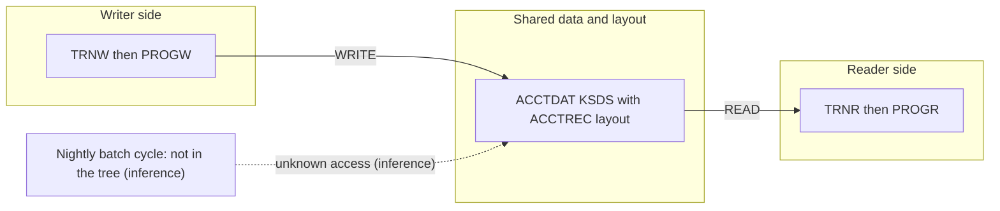

# 02 Coupling

Facts are in `02a-edge-tables.md`, generated from `graph.json`. This file is the argument. Anything
that is my reading rather than the extractor's output is labeled `inference`.

The system in the tree is two CICS transactions over one keyed file. The extractor found 4 nodes and
5 edges: 1 contract, 2 data, 2 include. It found no call edges, no computed calls, no strongly
connected components, no god modules and no scheduler artifact. All five edges are high confidence.

## The coupling patterns that constrain the sequence

1. **One contract through one file.** PROGW writes the ACCTDAT file and PROGR reads it, and both use
   the same layout copybook. Writer: `app/cbl/PROGW.cbl:7`. Reader: `app/cbl/PROGR.cbl:7`. Layout
   copybook on both sides: `app/cbl/PROGW.cbl:5`, `app/cbl/PROGR.cbl:5`. The CSD maps ACCTDAT to the
   dataset `SPARQ.TEST.ACCTDAT.KSDS` at `app/csd/DEMO.CSD:2`. The contract is the record in
   `app/cpy/ACCTREC.cpy:1-3`: an 11 digit display key at `app/cpy/ACCTREC.cpy:2` and a signed packed
   decimal balance, `S9(9)V99 COMP-3`, at `app/cpy/ACCTREC.cpy:3`. From the PICTURE clauses that is a
   17 byte record (11 bytes of key digits plus 6 bytes of packed balance). That length is `inference`
   from the PICTURE clauses. The KSDS definition itself, with its key offset and record size, is not in
   the tree.
2. **A copybook that both programs and any other reader must agree with.** A byte level change to
   `cpy:ACCTREC`, or to how the target encodes COMP-3, breaks the reader and the writer together. In
   the tree both include it (`app/cbl/PROGR.cbl:5`, `app/cbl/PROGW.cbl:5`). Any program outside the
   tree that reads ACCTDAT by offset is a third consumer of this contract, and `inference` says there
   is one (see pattern 3).
3. **The nightly batch cycle is named as must-not-break and is not in the tree.** The tree has 0 JCL
   files, 0 procs, 0 scheduler files and 0 shell wrappers, and no batch program (`graph.json`
   `meta.files_seen`). Every program here is an online transaction, entered through the CSD at
   `app/csd/DEMO.CSD:4` and `app/csd/DEMO.CSD:6`. So the dependency of the batch cycle on ACCTDAT
   cannot be seen, and neither can its temporal ordering against the online writes. That is `inference`
   about what exists outside the tree. The extractor's fact is only that no temporal edge exists.

## Cluster view

## Strongly connected components

None. `analysis.sccs` is empty. No wave can split one, so the plan is free of that constraint.

## God modules

None. `analysis.god_modules` is empty and `analysis.fan_in` is empty. There are no call edges, so no
program has a caller.

## Articulation points

The extractor lists one: `ds:SPARQ.TEST.ACCTDAT.KSDS`. It is the only thing joining the two programs
(`app/cbl/PROGW.cbl:7`, `app/cbl/PROGR.cbl:7`). That makes the dataset the seam between the writer
side and the reader side. In a system this small it is not a reason to cut two waves. It is where you
would cut if the system were ten times larger (see `03-waves.md`).

## The honest boundary: computed calls

`analysis.unresolved_dynamic` is empty. Neither program contains a CALL, a LINK or an XCTL
(`app/cbl/PROGR.cbl:6-11`, `app/cbl/PROGW.cbl:6-11`). The extractor left 0 edges open, and there is no
medium or low confidence edge. So the fewer-than-20 rule applies and I worked the open items myself
inline. The `dependency-cartographer` agent was not needed.

## Review of what the extractor does not model

Checked against the source. All labeled `inference`, because the extractor does not model them.

| Item | What the source shows | Evidence |
|---|---|---|
| `EXEC CICS RETURN TRANSID` chains | Both programs end with a plain RETURN and no TRANSID. No chaining to another transaction. | `app/cbl/PROGR.cbl:11`, `app/cbl/PROGW.cbl:11` (inference) |
| `EXEC CICS START` and `SEND MAP` | Neither appears. No terminal output and no BMS map in the tree. | `app/cbl/PROGR.cbl:6-11`, `app/cbl/PROGW.cbl:6-11` (inference) |
| Internal reader job submission | None in either program. | `app/cbl/PROGW.cbl:6-11` (inference) |
| DB2, IMS, MQ | No EXEC SQL, no DL/I, no MQ call. | `app/cbl/PROGR.cbl:6-11` (inference) |
| Input to the transactions | Neither program has a LINKAGE SECTION or a RECEIVE. ACCT-REC and the key ACCT-ID are never set before the READ or the WRITE. | `app/cbl/PROGR.cbl:4-9`, `app/cbl/PROGW.cbl:4-9` (inference) |
| Error handling | The READ and the WRITE have no RESP or HANDLE CONDITION. A not found or duplicate key becomes an abend. | `app/cbl/PROGR.cbl:7-10`, `app/cbl/PROGW.cbl:7-10` (inference) |
| File attributes in the CSD | The FILE definition names the dataset and STATUS only. It sets no ADD, UPDATE, READ, BROWSE or DELETE attribute. PROGW performs a WRITE. Whether the real definition permits it needs a CICS engineer to confirm. | `app/csd/DEMO.CSD:1-3` (inference) |
| Key inside the INTO area | PROGR uses ACCT-ID as RIDFLD while ACCT-ID is a field inside the INTO record. The READ overwrites it. The source of the key value is not in the tree. | `app/cbl/PROGR.cbl:7-9`, `app/cpy/ACCTREC.cpy:2` (inference) |

Reading these together, `inference`: the two programs look like skeletal or test stubs. Real business
logic, real key entry and real error handling are not in the tree. The port difficulty scores in
`risks.json` are scores of the code that is here. If the production programs differ, the scores are
wrong. The dataset name contains the word TEST (`app/csd/DEMO.CSD:2`), which points the same way.
