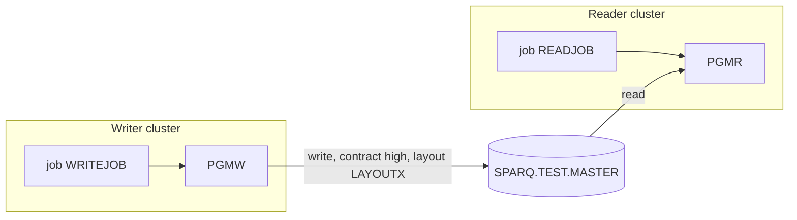

# 02 Coupling

The edge tables are in `modernization-assessment/02a-edge-tables.md`. This file holds the argument.

## What the extractor left open

Nothing. The graph has 9 edges and every one is `high` confidence and resolved. There are no computed
calls, so `analysis.unresolved_dynamic` is empty. No edge was handed to the dependency-cartographer,
because there was nothing to settle. Fewer than 20 open edges means the assessor works them by hand, and
here that is zero.

## The three patterns that constrain the sequence

There are no program-to-program calls in this tree. The only call edges are JCL steps running a program
(`app/jcl/READJOB.jcl:2`, `app/jcl/WRITEJOB.jcl:2`). All of the constraint comes from data, contract and
missing temporal coupling.

### 1. Contract coupling through SPARQ.TEST.MASTER

PGMW writes the dataset and PGMR reads it. Both COPY `LAYOUTX` (`app/cbl/PGMW.cbl:11`,
`app/cbl/PGMR.cbl:11`) and both bind the dataset by DD (`app/jcl/WRITEJOB.jcl:3`,
`app/jcl/READJOB.jcl:3`). The extractor rates the contract edge `high`. That means the two sides share a
layout copybook. It does not mean the layout is proven equal on disk. The extractor does not read DCB,
LRECL or RECFM (`meta.limits` in `modernization-assessment/graph.json`), and the writer's DD says
`LRECL=80` (`app/jcl/WRITEJOB.jcl:4`).

By hand from the copybook, the record is a 10 byte key and a packed decimal amount of 9 digits, which is
5 bytes: 15 bytes in all (`app/cpy/LAYOUTX.cpy:2`, `app/cpy/LAYOUTX.cpy:3`). This is an inference. The DD
says 80. The 65 bytes between the two are unexplained. A port that agrees with the copybook but not with
the bytes on disk breaks silently.

### 2. Data coupling: one hub, one articulation point

`ds:SPARQ.TEST.MASTER` has 1 writer and 1 reader (`analysis`, field `data_hubs`). It is also the only
articulation point (`analysis`, field `articulation_points`). Removing it splits the writer side from the
reader side. That is where the wave cut goes.

### 3. Temporal coupling: required but not enforced

The reader needs the dataset to exist and be cataloged. The writer creates it with
`DISP=(NEW,CATLG,DELETE)` (`app/jcl/WRITEJOB.jcl:3`), and the reader opens it with `DISP=SHR`
(`app/jcl/READJOB.jcl:3`). So WRITEJOB must run before READJOB. This is an inference. No temporal edge
exists in the graph, and no scheduler artifact was parsed (`analysis`, field `warnings`). Nothing in the
tree says the order is enforced, or in which order the jobs run in the nightly cycle.

A second inference follows. `NEW` fails at allocation when the dataset already exists. Something outside
this tree must delete it before each run, or the nightly cycle fails on its second night.

## Facts and where they come from

| Fact | Value | Confidence | Evidence |
|---|---|---|---|
| Contract edge PGMW to PGMR on SPARQ.TEST.MASTER | high, shared copybook LAYOUTX | high | `app/cbl/PGMW.cbl:11`, `app/cbl/PGMR.cbl:11` |
| Layout length by hand | 15 bytes (10 + 5) | medium | inference from `app/cpy/LAYOUTX.cpy:2`, `app/cpy/LAYOUTX.cpy:3` |
| DD record length on the writer | LRECL=80 | high | `app/jcl/WRITEJOB.jcl:4` |
| Order WRITEJOB before READJOB | required, not enforced | medium | inference from `app/jcl/WRITEJOB.jcl:3`, `app/jcl/READJOB.jcl:3` |
| Strongly connected components | none | high | analysis, field `sccs` |
| God modules | none | high | analysis, field `god_modules` |
| Articulation points | ds:SPARQ.TEST.MASTER | high | analysis, field `articulation_points` |
| Computed calls | none | high | analysis, field `unresolved_dynamic` |

## Clusters

Two clusters share one dataset. The graph is at cluster level. It is small enough that this is close to
the whole graph.

## What this means for the plan

- No strongly connected component exists, so no unit is forced to move with another because of a call
  cycle (analysis, field `sccs`).
- No god module exists, so nothing needs a facade to move (analysis, field `god_modules`).
- The one articulation point is the dataset. The waves are cut on either side of it. The dataset is
  the boundary the harness compares at.

## The honest boundary

The graph is complete for what the extractor reads. It has no computed calls and no JCL text inside COBOL
(analysis, fields `unresolved_dynamic` and `embedded_jcl`). What it cannot see:

- Any scheduler. No parsed scheduler exists, so the order of jobs across the nightly cycle is unknown.
- The record length on disk, because DCB and LRECL are not compared with the copybook.
- Consumers of SPARQ.TEST.MASTER outside this tree, such as other jobs or transfers to partners.
  Inference: nothing in the tree shows them, and nothing rules them out.
