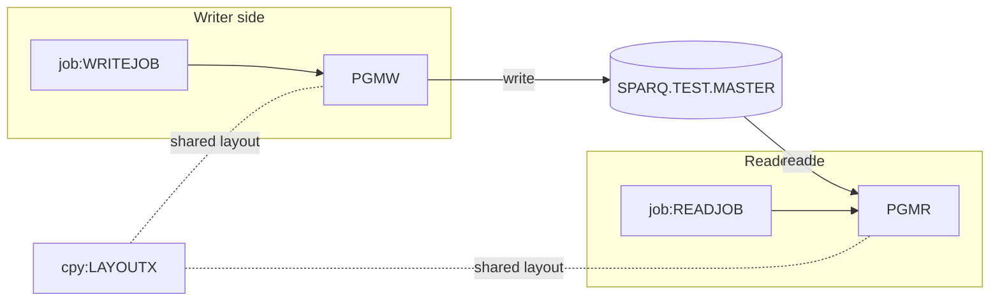

# 02 Coupling

The full edge list is in `02a-edge-tables.md`. This file is the argument. The tree is small: two programs, one copybook, one dataset and two single step jobs. There is no call edge between programs, no cycle, and no computed call. All of the coupling is through one dataset.

## The coupling patterns that will constrain the sequence

### 1. Contract coupling through SPARQ.TEST.MASTER (high confidence)

PGMW writes the dataset and PGMR reads it. Both include the same layout copybook, so the extractor rates the contract edge PGMW to PGMR as high confidence. The layout is `LR-KEY PIC X(10)` and `LR-AMT PIC S9(7)V99 COMP-3` (`app/cpy/LAYOUTX.cpy:2`, `app/cpy/LAYOUTX.cpy:3`). Both programs pull it in with the same COPY (`app/cbl/PGMR.cbl:11`, `app/cbl/PGMW.cbl:11`). The writer opens the dataset for output (`app/cbl/PGMW.cbl:13`) and the reader opens it for input (`app/cbl/PGMR.cbl:13`).

Arithmetic: X(10) is 10 bytes, and S9(7)V99 is 9 digits, which packs into 5 bytes, so the logical record is 15 bytes (inference, computed from `app/cpy/LAYOUTX.cpy:2`).

This is the one edge that constrains everything. A port that changes the byte encoding of the packed amount, or the record padding, breaks the reader without any abend.

### 2. The physical format lives in JCL, not in the copybook (inference, medium confidence)

The only place that states how the file is laid out on disk is the writer's DD: `RECFM=FB,LRECL=80` with `DISP=(NEW,CATLG,DELETE)` (`app/jcl/WRITEJOB.jcl:3`, `app/jcl/WRITEJOB.jcl:4`). The reader's DD names the same dataset with `DISP=SHR` and no DCB (`app/jcl/READJOB.jcl:3`). It takes its attributes from the catalog entry the writer created.

So the copybook says 15 bytes and the JCL says 80. Which one governs the bytes on disk depends on the compiler and runtime options, which are not in the tree. This is the largest unknown in the contract. It is an inference, and the engineers can settle it in minutes by listing the real dataset (see Open Questions in `00-summary.md`).

### 3. Temporal coupling is invisible (gap)

The reader is only correct if the writer has run first. Nothing in the tree enforces that. The extractor found no scheduler artifact and reports zero temporal edges (`02a-edge-tables.md`). Each job is a single step, so there is no step order to read either. The order writer before reader is derived from the data hub rule "every writer runs before its readers". It is inference, not a fact from a scheduler. The nightly cycle named in the scoping answer is not in the tree in any form I can identify.

## Structure computed by the extractor

| Fact | Result | Evidence |
|---|---|---|
| Strongly connected components | none | inference (extractor `sccs` is empty) |
| Self recursive programs | none | inference (extractor `self_recursive` is empty) |
| God modules | none | inference (extractor `god_modules` is empty) |
| Articulation points | `ds:SPARQ.TEST.MASTER` | `app/cbl/PGMW.cbl:13`, `app/cbl/PGMR.cbl:13` |
| Data hubs | `ds:SPARQ.TEST.MASTER`, 1 writer, 1 reader | `app/jcl/WRITEJOB.jcl:3`, `app/jcl/READJOB.jcl:3` |
| Unresolved computed calls | none | inference (extractor `unresolved_dynamic` is empty) |

No strongly connected component exists, so no wave can split one. No god module exists, so nothing needs a facade for size reasons. The single articulation point is the dataset. It is the natural boundary for the test harness, because it is the one place where the two halves meet. A dataset is not a movable unit, so it cannot be a wave in its own right. The unit that owns it in each direction is.

## Cluster view

## The honest boundary

- **Computed calls.** There are none, so there are no unresolved dynamic edges and no reason to hand edges to the `dependency-cartographer` agent. That is far below the threshold of about 20.
- **What the graph cannot show.** The extractor does not follow jobs submitted through the internal reader, nested PROCs, or anything outside COBOL, copybooks, JCL, CICS definitions, Control-M XML and shell wrappers. Any other consumer of SPARQ.TEST.MASTER outside this tree is invisible. Its existence would change the blast radius of PGMW, so it is the first thing to ask (inference).
- **Reachability is by construction.** The extractor marks every JCL job as an entry point (`app/jcl/READJOB.jcl:1`, `app/jcl/WRITEJOB.jcl:1`). With no scheduler, "reachable" does not prove either job actually runs.

## Coupling findings

| Finding | Confidence | Evidence |
|---|---|---|
| PGMW writes and PGMR reads SPARQ.TEST.MASTER with the same copybook | high | `app/cbl/PGMW.cbl:13`, `app/cbl/PGMR.cbl:13`, `app/cpy/LAYOUTX.cpy:1` |
| Physical format (FB, LRECL=80) is declared only on the writer DD; layout is 15 bytes | medium | `app/jcl/WRITEJOB.jcl:4`, `app/cpy/LAYOUTX.cpy:3` |
| Writer before reader order is not enforced anywhere in the tree | low | inference |
| PGMW writes LAYOUT-REC with no MOVE, so field values are never set in this tree | medium | `app/cbl/PGMW.cbl:14` |
| PGMR reads one record and stops, with no AT END, no loop and no FILE STATUS | medium | `app/cbl/PGMR.cbl:14` |
