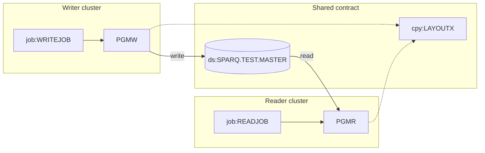

# 02 Coupling

Scoping: target state `refactor`, must-not-break "the nightly batch cycle", telemetry `none`.

The extractor found 8 nodes and 9 edges in a tree of two COBOL programs, one copybook and two JCL
jobs (`modernization-assessment/graph.json:1`). It found no computed calls, no strongly connected
components and no god modules. There were fewer than 20 open edges (zero), so the
`dependency-cartographer` agent was not needed. I read the source for the three points below.

## Coupling patterns that constrain the sequence

| # | Pattern | What it means for the sequence | Confidence | Evidence |
|---|---|---|---|---|
| 1 | Contract: PGMW writes SPARQ.TEST.MASTER and PGMR reads it through the same copybook LAYOUTX | The reader must keep decoding what the writer produces. Port the reader first, against the legacy writer. The layout is the API. | high (shared copybook) | `app/cbl/PGMW.cbl:11`, `app/cbl/PGMR.cbl:11`, `app/cpy/LAYOUTX.cpy:1`, `app/jcl/WRITEJOB.jcl:3`, `app/jcl/READJOB.jcl:3` |
| 2 | The copybook and the JCL disagree on record length: LAYOUTX describes 15 bytes, the writer DD asks for LRECL=80 | High confidence on this edge means both sides copy one layout. It does not mean the bytes on disk match it. The extractor does not read DCB (limit: "DCB, LRECL and RECFM are not read"). Which of the two governs on the mainframe must be settled before a port fixes the record length. | low | `app/cpy/LAYOUTX.cpy:2`, `app/cpy/LAYOUTX.cpy:3`, `app/jcl/WRITEJOB.jcl:4`, inference |
| 3 | Temporal: nothing in the tree says WRITEJOB runs before READJOB, or when either runs | The data edge implies the writer runs first. No scheduler was parsed, so the "nightly batch cycle" the client named cannot be located in the tree. | low | `analysis` field `warnings`, `app/jcl/WRITEJOB.jcl:1`, `app/jcl/READJOB.jcl:1` |

Detail on pattern 2. The record is a 10 byte key (`LR-KEY PIC X(10)`) and a packed decimal amount
(`LR-AMT PIC S9(7)V99 COMP-3`), which is 9 digits and so 5 bytes: 15 bytes in all
(`app/cpy/LAYOUTX.cpy:2`, `app/cpy/LAYOUTX.cpy:3`). The FD names no RECORD CONTAINS clause
(`app/cbl/PGMW.cbl:10`, `app/cbl/PGMR.cbl:10`). The writer DD says `RECFM=FB,LRECL=80`
(`app/jcl/WRITEJOB.jcl:4`). The reader DD names no DCB and takes what the catalog holds
(`app/jcl/READJOB.jcl:3`). This is inference: I did not run anything, and I do not know whether the
runtime pads, truncates or rejects the file at OPEN.

Two more facts from the source, both inference:

- PGMW writes `LAYOUT-REC` with no MOVE to any field before it (`app/cbl/PGMW.cbl:14`). What it writes
  depends on what the runtime leaves in the buffer.
- The DD is `DISP=(NEW,CATLG,DELETE)` (`app/jcl/WRITEJOB.jcl:3`). A second night's run would try to
  create a dataset that already exists, unless something outside this tree removes it first.

## Cluster graph

Evidence for the graph: `app/jcl/WRITEJOB.jcl:2`, `app/jcl/READJOB.jcl:2`, `app/cbl/PGMW.cbl:13`,
`app/cbl/PGMR.cbl:13`, `app/cbl/PGMW.cbl:11`, `app/cbl/PGMR.cbl:11`.

## Structure computed by the extractor

| Fact | Units | Evidence |
|---|---|---|
| Strongly connected components | none | `analysis` field `sccs` |
| Self recursive programs | none | `analysis` field `self_recursive` |
| God modules | none. Fan-in is zero for both programs, so there is nothing to strangle behind a facade. | `analysis` fields `god_modules`, `fan_in` |
| Articulation points | `ds:SPARQ.TEST.MASTER`. It is the natural wave boundary and the plan cuts there. | `analysis` field `articulation_points`, `app/cbl/PGMW.cbl:13`, `app/cbl/PGMR.cbl:13` |
| Data hubs | `ds:SPARQ.TEST.MASTER`, one writer, one reader | `analysis` field `data_hubs` |

The articulation point is a dataset, not a program. The basis is "call edges between programs plus data
edges from programs to datasets" (`analysis` field `articulation_basis`), so the boundary sits on a
file that both waves touch. Wave 1 and wave 2 share it. That is the reason wave 1 must be a reader.

## The honest boundary

- Computed calls: none found (`analysis` field `unresolved_dynamic`). The extractor resolves a variable
  target only from VALUE clauses and literal MOVEs in the same program. Neither program has a CALL at
  all (`app/cbl/PGMR.cbl:12`, `app/cbl/PGMW.cbl:12`).
- No CICS, no scheduler, no DB2, no copybook beyond LAYOUTX. Files seen: 2 COBOL, 1 copy, 2 JCL
  (`modernization-assessment/graph.json:1`).
- Anything that reads or writes SPARQ.TEST.MASTER outside this tree is invisible. The tree cannot
  tell us whether PGMR is the only reader.
- The dataset is named `SPARQ.TEST.MASTER`. That is a test name. If production uses another name, the
  JCL here may not be the JCL that runs the nightly cycle. Inference. It is in Open Questions.
