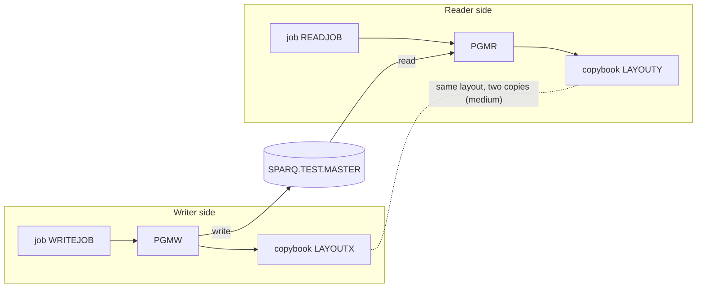

# 02 Coupling

The full edge list is in `02a-edge-tables.md`. This file is the argument. The system is small: two
jobs, two programs, two copybooks and one dataset. There are 9 edges in `graph.json`. Only one of
them is medium confidence, so the open edges were worked by hand here rather than handed to the
`dependency-cartographer` agent. What that work found is labeled `inference` where it goes past what
the extractor read.

## The three patterns that constrain the sequence

### 1. One dataset is the whole coupling

`PGMW` writes `SPARQ.TEST.MASTER` and `PGMR` reads it. There is no call between the two programs.
The link is the dataset alone, so it does not appear in any call graph.

| Fact | Evidence |
|---|---|
| WRITEJOB creates the dataset with `DISP=(NEW,CATLG,DELETE)` | `app/jcl/WRITEJOB.jcl:3` |
| READJOB reads the same name with `DISP=SHR` | `app/jcl/READJOB.jcl:3` |
| PGMW opens it for output and writes one record | `app/cbl/PGMW.cbl:13`, `app/cbl/PGMW.cbl:14` |
| PGMR opens it for input and reads one record | `app/cbl/PGMR.cbl:13`, `app/cbl/PGMR.cbl:14` |

The dataset is the only articulation point in `graph.json`. It is the natural wave boundary if the
system were bigger. Here it is the reason the two halves stay together.

### 2. The record layout is written down twice

This is the contract edge the extractor marked `medium`. The writer includes `cpy:LAYOUTX`. The
reader includes `cpy:LAYOUTY`. They are two files, so nothing ties them together.

The extractor said "Verify by hand". I compared them field by field:

| Offset | Length | Writer field (`LAYOUTX`) | Reader field (`LAYOUTY`) | Picture | Evidence |
|---|---|---|---|---|---|
| 0 | 10 | `LR-KEY` | `LY-ID` | `PIC X(10)` | `app/cpy/LAYOUTX.cpy:2`, `app/cpy/LAYOUTY.cpy:2` |
| 10 | 5 | `LR-AMT` | `LY-VALUE` | `PIC S9(7)V99 COMP-3` | `app/cpy/LAYOUTX.cpy:3`, `app/cpy/LAYOUTY.cpy:3` |

Result: the layouts are byte for byte the same today. Fifteen bytes: ten characters, then nine
digits and a sign packed into five bytes (inference, from the usual COMP-3 storage rule, not from
anything in the tree). Only the field names differ, and the names differ in meaning too: a key
becomes an "id", an amount becomes a "value".

So the mismatch is not a defect today. It is a defect waiting to happen. Two hand-kept copies of one
record format will drift the first time someone edits one of them. Nothing in the tree, no test and
no shared copybook, would catch it. In a refactor this is the cheapest fix available: one shared
copybook, owned by neither program.

### 3. Job order exists only in someone's head

`READJOB` is correct only after `WRITEJOB` has run. `graph.json` holds no temporal edge between the
two jobs, because no scheduler artifact was parsed. The extractor warned about this: "2 JCL job(s)
are in the tree but no scheduler artifact was parsed." (`analysis.warnings` in `graph.json`).

The only order the extractor could read is step order inside each single job. Each job has one
step (`app/jcl/WRITEJOB.jcl:2`, `app/jcl/READJOB.jcl:2`), so that gives nothing.

Your brief says the nightly batch cycle must not break. Nothing in this tree shows that either job
belongs to it. That is an open question, not a finding. See `00-summary.md`.

## Cluster map

## Structure computed from the call graph

| Fact | Result | Evidence |
|---|---|---|
| Strongly connected components | none. Nothing has to move as a unit because of a cycle | `graph.json` `analysis.sccs` is empty (inference: the list is empty, so no source line applies) |
| God modules | none. Fan-in and fan-out are both empty | `graph.json` `analysis.god_modules` is empty (inference: same reason) |
| Articulation points | `ds:SPARQ.TEST.MASTER` | `app/jcl/WRITEJOB.jcl:3`, `app/jcl/READJOB.jcl:3` |
| Self recursive programs | none | inference: `graph.json` `analysis.self_recursive` is empty |

The strongly connected component rule and the god module rule do not constrain anything here.

## The honest boundary

**Computed calls.** There are none. `unresolved_dynamic` is empty. Neither program contains a
`CALL` at all. That is a fact about this tree. It says nothing about programs that may run outside
it.

**What the extractor could not see, and what this file did not settle:**

| Item | Why it matters | Evidence |
|---|---|---|
| Record length. The DD says `LRECL=80` but the copybook record is 15 bytes | On z/OS a fixed length file whose declared and program record lengths differ can fail on open, or it can pad. I cannot tell which from source (inference). The extractor does not read DCB parameters | `app/jcl/WRITEJOB.jcl:4`, `app/cpy/LAYOUTX.cpy:3` |
| No `FILE STATUS` clause on either file | A failed open cannot be handled in the program, so it ends the step (inference) | `app/cbl/PGMW.cbl:6`, `app/cbl/PGMR.cbl:6` |
| PGMW writes `LAYOUT-REC` without filling any field | The bytes it writes depend on what the record area held (inference). The legacy output may not be the same on two runs | `app/cbl/PGMW.cbl:14`, `app/cpy/LAYOUTX.cpy:2` |
| PGMR does not test for end of file | An empty dataset would leave the step without a handler (inference) | `app/cbl/PGMR.cbl:14` |
| Other readers of `SPARQ.TEST.MASTER` outside this tree | Each one is a further undocumented contract on the same 15 bytes | inference: the tree holds two jobs and the extractor reads only what is in the tree |
| IDCAMS, SORT or other utility steps that touch the file | The extractor does not read in-stream control cards | inference: `meta.limits` in `graph.json` lists this as unread |
