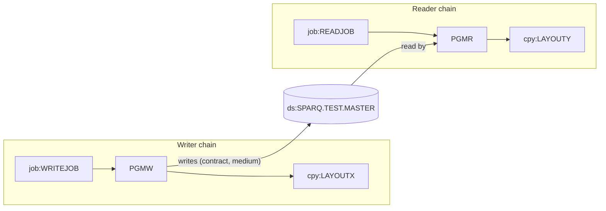

# 02 Coupling

The full edge list is in `02a-edge-tables.md`. This file is the argument. The tree is small: two batch
programs, two copybooks, two JCL jobs and one shared dataset. Almost all of the coupling sits in one
place, the file `SPARQ.TEST.MASTER`.

## The patterns that constrain the sequence

| # | Pattern | What it does to the plan | Confidence | Evidence |
|---|---|---|---|---|
| 1 | Contract coupling. PGMW writes `SPARQ.TEST.MASTER` and PGMR reads it. They describe the record with two different copybooks, LAYOUTX and LAYOUTY. | The extractor scored the contract edge medium, not high. The layouts are byte compatible today (see the comparison below), but nothing keeps them so. Any port that changes one side and not the other breaks the file silently. The two waves have to meet at this file. | medium | `app/cbl/PGMW.cbl:11`, `app/cbl/PGMR.cbl:11`, `app/cpy/LAYOUTX.cpy:1`, `app/cpy/LAYOUTY.cpy:1` |
| 2 | Data and order coupling. The writer job creates the dataset, the reader job reads it, so the writer has to run first. No scheduler was supplied, so the real order is not known. | The wave boundary is the dataset, which `analysis.articulation_points` lists. The nightly cycle order cannot be checked. | medium | `app/jcl/WRITEJOB.jcl:3`, `app/jcl/READJOB.jcl:3`, analysis: `articulation_points` and `warnings` in `modernization-assessment/graph.json` |
| 3 | File attributes live in the JCL, not in the code. WRITEJOB sets RECFM=FB and LRECL=80. The copybook describes 15 bytes. Neither COBOL file description states a record length. | A port has to decide the record length on purpose. The extractor does not read DCB, so this is not an edge in `graph.json`. | inference | `app/jcl/WRITEJOB.jcl:4`, `app/cbl/PGMW.cbl:10`, `app/cbl/PGMR.cbl:10` |

### Work on the one medium contract edge (dependency-cartographer method)

There are fewer than 20 open edges (one medium contract edge, no computed calls), so this was worked by
hand and not handed to an agent. It compares the two layouts field by field. This is inference from
reading the source, not a fact from the extractor.

| Field | Offset | Length | Writer layout LAYOUTX | Reader layout LAYOUTY | Verdict | Evidence |
|---|---|---|---|---|---|---|
| 01 record name | n/a | n/a | `LAYOUT-REC` | `LAYOUT-REC` | Same name, so a source scan does not tell the two copybooks apart | `app/cpy/LAYOUTX.cpy:1`, `app/cpy/LAYOUTY.cpy:1` |
| key | 0 | 10 | `LR-KEY PIC X(10)` | `LY-ID PIC X(10)` | Same bytes, different name | `app/cpy/LAYOUTX.cpy:2`, `app/cpy/LAYOUTY.cpy:2` |
| amount | 10 | 5 | `LR-AMT PIC S9(7)V99 COMP-3` | `LY-VALUE PIC S9(7)V99 COMP-3` | Same bytes: nine digits and a sign in packed decimal is 5 bytes. Different name | `app/cpy/LAYOUTX.cpy:3`, `app/cpy/LAYOUTY.cpy:3` |
| total record | n/a | 15 | 15 bytes | 15 bytes | Compatible today. There is no `REDEFINES` in either copybook | `app/cpy/LAYOUTX.cpy:1`, `app/cpy/LAYOUTY.cpy:1` |

What this shows, and what it does not:

- The two layouts are compatible byte for byte. The extractor's medium score is right for the reason it
  gives (two copybooks), not because the layouts differ. Evidence: the table above.
- The names differ (`LR-KEY` and `LY-ID`, `LR-AMT` and `LY-VALUE`). Whether `LR-AMT` and `LY-VALUE`
  mean the same thing to the business is not something the source can show. Inference.
- The layout is 15 bytes but WRITEJOB asks for LRECL=80. Neither program has a `RECORD CONTAINS` clause,
  so what happens at open, and what the other 65 bytes hold, cannot be settled from the source. Inference.
  Evidence: `app/jcl/WRITEJOB.jcl:4`, `app/cbl/PGMW.cbl:10`. It is the first thing to check against a real
  job log.
- PGMW writes `LAYOUT-REC` without moving anything into it, so the content it writes is undefined. Inference.
  Evidence: `app/cbl/PGMW.cbl:14`. The output of the legacy job may not be repeatable byte for byte.
- PGMR reads one record and never uses it. Nothing in the tree consumes the value. Evidence:
  `app/cbl/PGMR.cbl:14`.
- Neither file has a `FILE STATUS`, so a failed open or read ends the job. Evidence:
  `app/cbl/PGMR.cbl:6`, `app/cbl/PGMW.cbl:6`.

### Other things the extractor does not model

- WRITEJOB allocates the dataset as `NEW,CATLG,DELETE` under a fixed name. A second run would very likely
  fail at allocation unless something outside this tree deletes the dataset first. Inference. Evidence:
  `app/jcl/WRITEJOB.jcl:3`. This matters for any claim that WRITEJOB is a nightly job.
- The dataset name contains `TEST`. Whether this is a test copy or the production master is not shown by the
  tree. Inference. Evidence: `app/jcl/WRITEJOB.jcl:3`.

## Cluster graph

Evidence for the graph: `app/jcl/WRITEJOB.jcl:2`, `app/jcl/READJOB.jcl:2`, `app/cbl/PGMW.cbl:11`,
`app/cbl/PGMR.cbl:11`, `app/jcl/WRITEJOB.jcl:3`, `app/jcl/READJOB.jcl:3`.

## Structure

| Fact | Units | Confidence | Evidence |
|---|---|---|---|
| Strongly connected components | none, so no cycle constrains the cut | high | analysis: `sccs` in `modernization-assessment/graph.json` |
| God modules | none. There are no program to program calls, so fan-in is empty | high | analysis: `god_modules` and `fan_in` in `modernization-assessment/graph.json` |
| Articulation points | `ds:SPARQ.TEST.MASTER`. This is the natural wave boundary and the plan cuts there | high | analysis: `articulation_points` in `modernization-assessment/graph.json` |
| Data hubs | `ds:SPARQ.TEST.MASTER`, one writer and one reader | high | `app/cbl/PGMW.cbl:6`, `app/cbl/PGMR.cbl:6` |
| Computed calls | none. `unresolved_dynamic` is empty, so no program can be reached by a call the extractor could not see | high | analysis: `unresolved_dynamic` in `modernization-assessment/graph.json` |

## The honest boundary

The extractor found no computed calls, so the call graph is complete for what it parses. The boundary of
this assessment is what is not in the tree, not what could not be resolved:

- No scheduler was supplied, so the order of the two jobs, and whether either is part of the nightly cycle,
  is unknown. Evidence: analysis: `warnings` in `modernization-assessment/graph.json`.
- DCB, LRECL and RECFM are not compared with the copybooks. Evidence: `meta.limits` in
  `modernization-assessment/graph.json`. The one place it matters is `app/jcl/WRITEJOB.jcl:4`.
- Any consumer of `SPARQ.TEST.MASTER` outside this tree is invisible. Inference.
