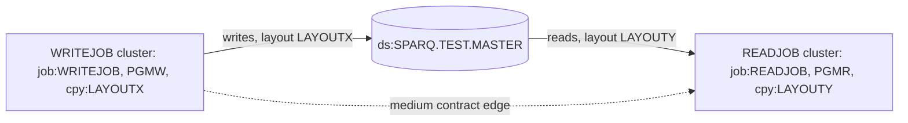

# 02 Coupling

This file holds the argument. The edge lists are in `02a-edge-tables.md`. The system is small: two batch programs, two copybooks, two jobs and one dataset. Every edge was resolved. The extractor listed no computed calls and no unparsed files.

Facts come from `graph.json`. Where I read source to settle an edge the extractor rated medium, the finding is labeled `inference`, as the plugin asks, and it cites the lines I read.

## The three patterns that constrain the sequence

### 1. One contract edge, medium confidence: PGMW to PGMR through SPARQ.TEST.MASTER

PGMW writes the dataset (`app/cbl/PGMW.cbl:6`, `app/cbl/PGMW.cbl:14`, `app/jcl/WRITEJOB.jcl:3`). PGMR reads it (`app/cbl/PGMR.cbl:6`, `app/cbl/PGMR.cbl:14`, `app/jcl/READJOB.jcl:3`). The writer describes the record with `LAYOUTX` (`app/cbl/PGMW.cbl:11`). The reader describes it with `LAYOUTY` (`app/cbl/PGMR.cbl:11`). They are two copybooks, so the extractor rated the edge medium, and asks for a hand check.

I made the hand check, field by field:

| Field | LAYOUTX (writer) | LAYOUTY (reader) | Same? | Evidence |
|---|---|---|---|---|
| Key or id | `LR-KEY PIC X(10)` | `LY-ID PIC X(10)` | Same type and length, different name | `app/cpy/LAYOUTX.cpy:2`, `app/cpy/LAYOUTY.cpy:2` |
| Amount or value | `LR-AMT PIC S9(7)V99 COMP-3` | `LY-VALUE PIC S9(7)V99 COMP-3` | Same picture and usage, different name | `app/cpy/LAYOUTX.cpy:3`, `app/cpy/LAYOUTY.cpy:3` |
| Record name | `LAYOUT-REC` | `LAYOUT-REC` | Same | `app/cpy/LAYOUTX.cpy:1`, `app/cpy/LAYOUTY.cpy:1` |

Result (inference, from the PIC clauses): the two layouts are compatible. Both are 10 bytes of text followed by a 9 digit signed packed decimal, which is 5 bytes, so 15 bytes in all. There is no `REDEFINES`, no offset difference and no length difference. The medium rating is a real hazard, and it is not a present defect. The hazard is that two hand maintained copies of one record layout exist, with different field names, and nothing links them. A change to one copybook will not reach the other, and no program or job would fail to compile or run when they drift.

Two things I could not settle from the source:

- **Record length on the DD.** The output DD says `RECFM=FB,LRECL=80` (`app/jcl/WRITEJOB.jcl:4`). Both copybooks describe 15 bytes. The extractor does not read DCB values (see `meta.limits`), so this was never compared. The source cannot say whether the file is 15 byte records, or 80 byte records with padding, or an open error at run time. Whoever reads the file outside this tree, if anyone does, would see the difference. This is an open question for the client's engineers.
- **What PGMW writes.** PGMW writes `LAYOUT-REC` and never moves a value into it (`app/cbl/PGMW.cbl:13`, `app/cbl/PGMW.cbl:14`). So the bytes in the dataset are whatever the record area holds. The packed field may not be a valid packed number. This is inference. A port that validates packed decimal would reject a file the legacy programs are happy with.

PGMR reads one record and looks at no field of it (`app/cbl/PGMR.cbl:13`, `app/cbl/PGMR.cbl:14`, `app/cbl/PGMR.cbl:15`). So the layout contract is declared and never exercised in this tree. Any real consumer of this dataset is outside the tree.

### 2. Data coupling: one dataset, one writer, one reader

`analysis.data_hubs` lists SPARQ.TEST.MASTER with 1 writer and 1 reader. The hub is small, and it is the only thing that joins the two halves of the system. The data edges are at `app/cbl/PGMW.cbl:6` and `app/cbl/PGMR.cbl:6`.

The name has a `TEST` qualifier (`app/jcl/WRITEJOB.jcl:3`). Nothing in the tree says whether this is a test fixture or a real production master. That changes the whole meaning of the assessment, so it is the first question in `00-summary.md`.

### 3. Temporal coupling: required by the data, defined nowhere

The reader can only run after the writer has created the dataset. That order is required by the data edge, and no artifact enforces it. The extractor found no scheduler and warned about it (`analysis.warnings`). Both jobs are entry points, and `unscheduled_jobs` is empty, which here means only that there is no scheduler to compare against. The two jobs are separate JCL members with no job to job dependency (`app/jcl/WRITEJOB.jcl:1`, `app/jcl/READJOB.jcl:1`).

The writer's DD makes the order more fragile:

- `DISP=(NEW,CATLG,DELETE)` (`app/jcl/WRITEJOB.jcl:3`) creates the dataset new each run. Inference: a second run with the dataset still cataloged fails on the duplicate name, so something must delete it between runs, and no job in the tree does.
- The third DISP subparameter deletes the dataset when the step abends. Inference: a failed WRITEJOB leaves nothing for READJOB, and READJOB then fails when it looks for the dataset.

The reader uses `DISP=SHR` (`app/jcl/READJOB.jcl:3`).

The user named "the nightly batch cycle" as the thing that must not break. The word nightly appears nowhere in the tree, and neither does a schedule. I read the cycle as WRITEJOB followed by READJOB. That reading is inference.

## Cluster view

## Structure computed from the graph

| Item | Result | Evidence |
|---|---|---|
| Strongly connected components | None. No wave here can split one. | analysis (field `sccs`) |
| God modules | None. There is no call between the two programs at all, so fan-in and fan-out are empty. | analysis (fields `god_modules`, `fan_in`, `fan_out`) |
| Articulation points | `ds:SPARQ.TEST.MASTER`. It is the only link between the two clusters, so it is the natural wave boundary. The two waves are cut there. | analysis (field `articulation_points`) |
| Computed calls | None. The extractor found no computed call, so nothing here keeps the unknown dead-code bucket open. | analysis (field `unresolved_dynamic`) |

## The honest boundary

- No computed calls and no unparsed files, so the call graph is complete for what is in the tree.
- What the tree does not hold: any scheduler, any consumer of SPARQ.TEST.MASTER other than PGMR, any DB2, IMS or MQ use, and any other job. Anything outside the tree is unseen. That is an open question, not a finding.
- The extractor does not compare DCB values with copybook lengths, does not model `COND=` or `IF/THEN/ELSE`, and reads no in-stream control cards (`meta.limits`). None of those appear in this small tree, apart from the LRECL question above.

## Edges settled by hand (dependency-cartographer work, done inline)

There was one open edge, far below the 20 that call for a hand off. The report is labeled inference.

| Edge | Finding | Confidence | Evidence |
|---|---|---|---|
| PGMW to PGMR, contract, medium | Layouts compatible by PIC clause: 15 bytes each, differing only in field names. Drift hazard, no present mismatch. | medium | `app/cpy/LAYOUTX.cpy:2`, `app/cpy/LAYOUTY.cpy:2`, inference |
| PGMW output DD, LRECL 80 | Cannot be reconciled with a 15 byte layout from the source. Unsettled. | low | `app/jcl/WRITEJOB.jcl:4`, inference |
| PGMW record content | Record written without being filled in. Content undefined. | medium | `app/cbl/PGMW.cbl:14`, inference |
