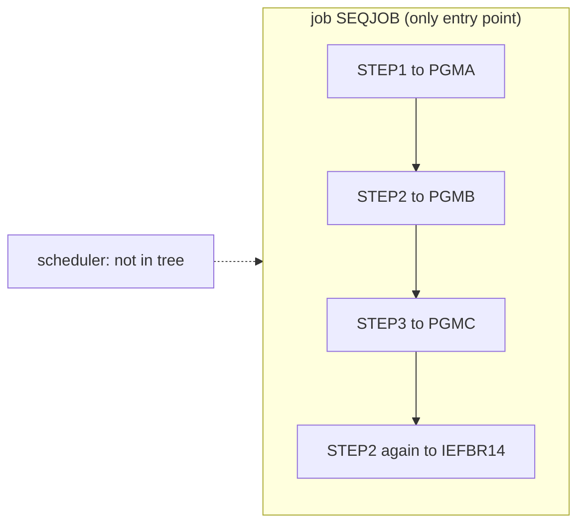

# 02 Coupling

The full edge list is in `02a-edge-tables.md`. This file is the argument. The tree is one JCL job
and three empty COBOL programs. Nine nodes, eleven edges: four `call`, four `include`, three
`temporal` (`graph.json`, `analysis.edge_counts`). There are no `data` edges and no `contract` edges.

## The coupling that constrains the sequence

| # | Pattern | What it does to the plan | Confidence | Evidence |
|---|---|---|---|---|
| 1 | **Temporal coupling by JCL step order.** SEQJOB runs PGMA, then PGMB, then PGMC, then IEFBR14. The extractor emitted three `temporal` edges: STEP1 to STEP2, STEP2 to STEP3, STEP3 to the last step. | Order is the only behavior this tree encodes. The three programs and the job that sequences them cannot be split across waves. A port must reproduce the order or say why not. | high | `app/jcl/SEQJOB.jcl:2`, `app/jcl/SEQJOB.jcl:3`, `app/jcl/SEQJOB.jcl:4`, `app/jcl/SEQJOB.jcl:5` |
| 2 | **Step name STEP2 is declared twice.** Line 3 runs PGMB. Line 5 runs IEFBR14. The extractor kept both and named the second `step:SEQJOB.STEP2#2`. That suffix is the extractor's own label. It is not in the source. | Anything that addresses a step by name (a restart, a COND test, a scheduler condition) is ambiguous. Duplicate step names in one job are, to my knowledge, a JCL error on z/OS, so either this file is not what runs in production, or it is damaged, or it was hand-edited. Inference. | medium | `app/jcl/SEQJOB.jcl:3`, `app/jcl/SEQJOB.jcl:5` |
| 3 | **No data coupling.** No program opens a file, includes a copybook, or calls another program. The job has no DD statements. | Nothing ties PGMA, PGMB and PGMC together except step order. If a real dataset link exists, it is outside this tree. The order may matter for reasons the source cannot show. | medium | `app/cbl/PGMA.cbl:3`, `app/cbl/PGMB.cbl:3`, `app/cbl/PGMC.cbl:3`, `app/jcl/SEQJOB.jcl:1` |

Pattern 1 in one sentence: the JCL is the program. The COBOL is a set of empty stubs. The order the
JCL imposes is the behavior the harness has to preserve.

## Cluster graph

There is one cluster. A node per program would add nothing.

The dotted edge is inference. `analysis.warnings` says a JCL job is in the tree and no scheduler
artifact was parsed. Something starts SEQJOB, and we cannot see what.

## Structure computed from the graph

| Fact | Result | Confidence | Evidence |
|---|---|---|---|
| Strongly connected components | none. No wave can split one. | high | `app/jcl/SEQJOB.jcl:2` |
| Self recursive programs | none | high | `app/cbl/PGMA.cbl:3` |
| God modules | none. No program has a caller or a callee. | high | `app/cbl/PGMB.cbl:3` |
| Articulation points | none. The extractor computes them over program calls and program to dataset edges. There are none of either, so the empty result says nothing about how loosely coupled the system is. | medium | inference |
| Data hubs | none. No dataset is named anywhere. | high | `app/jcl/SEQJOB.jcl:1` |

If the system were larger, the natural wave boundary would be the job. Steps and their programs
move with their job.

## The honest boundary

- **Computed calls: none.** `unresolved_dynamic` is empty, so no computed call keeps any bucket open.
  Evidence: `app/cbl/PGMA.cbl:4`, `app/cbl/PGMB.cbl:4`, `app/cbl/PGMC.cbl:4`.
- **IF/THEN/ELSE and COND=** are not modeled by the extractor. The file has none, so file order is the
  run order here. Evidence: `app/jcl/SEQJOB.jcl:2` to `app/jcl/SEQJOB.jcl:5`.
- **Scheduler missing.** The order across jobs, and what triggers SEQJOB, is unknown. The extractor
  reads only Control-M XML and shell wrappers. Ask for the scheduler export. Evidence: inference.
- **The programs are four-line stubs.** Either this is a reduced tree, or the real program source is
  somewhere else. Every claim about business logic is limited to what the tree holds, which is none.
  Evidence: `app/cbl/PGMA.cbl:4`.
- **Dependency cartographer not needed.** The extractor left no unresolved edge and no `medium` or
  `low` confidence edge, so there was nothing to hand off. The duplicate step name was worked here.
