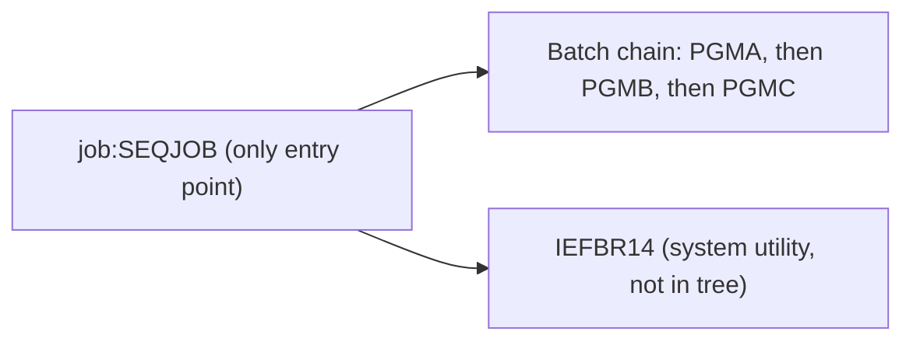

# 02 Coupling

Facts are in `modernization-assessment/02a-edge-tables.md`. This file holds the argument.

## What couples this system

There are three programs, one job and no datasets. The coupling is thin. Two patterns matter.

| Pattern | What it constrains | Confidence | Evidence |
|---|---|---|---|
| Temporal coupling by step order inside SEQJOB. PGMA runs before PGMB, and PGMB before PGMC. | The three programs cannot be reordered or split across jobs without changing the batch order. | high | `app/jcl/SEQJOB.jcl:2`, `app/jcl/SEQJOB.jcl:3`, `app/jcl/SEQJOB.jcl:4` |
| The step name STEP2 is used twice. Line 3 runs PGMB and line 5 runs IEFBR14. | Any reference to STEP2 (a COND, a restart at a step, a scheduler condition) is ambiguous. On z/OS a repeated step name in one job is a JCL error (inference), so the job may not run as written. | medium | `app/jcl/SEQJOB.jcl:3`, `app/jcl/SEQJOB.jcl:5` |

The extractor named the second step `STEP2#2` and ordered it last, by file order. That name is the
extractor's, not the source's. See `modernization-assessment/graph.json` field `warnings` under `analysis`.

## What is absent

| Kind of coupling | Finding | Confidence | Evidence |
|---|---|---|---|
| Call coupling between programs | None. No program calls another. | high | `app/cbl/PGMA.cbl:4`, `app/cbl/PGMB.cbl:4`, `app/cbl/PGMC.cbl:4` |
| Data coupling | None. No program reads or writes a dataset. No data hub. | high | `analysis` field `data_hubs` is empty |
| Contract coupling | None. There is no writer and reader pair. | high | `analysis` field `edge_counts` has no contract edge |
| Copybooks | None in the tree. | high | `analysis` field `node_counts` |

This is unusual for a batch system. Either the programs are stubs and the real logic is elsewhere, or
the tree is a sample. Every program body is one GOBACK statement (`app/cbl/PGMA.cbl:4`). Ask which.

## Cluster graph

## Structure computed from the call graph

| Fact | Units | Evidence |
|---|---|---|
| Strongly connected components | none | `analysis` field `sccs` |
| God modules | none | `analysis` field `god_modules` |
| Articulation points | none | `analysis` field `articulation_points` |
| Computed calls | none | `analysis` field `unresolved_dynamic` |
| Embedded JCL in COBOL | none | `analysis` field `embedded_jcl` |

With no cycle, no god module and no articulation point, there is nothing that forces a cut. One
wave holds everything.

## The honest boundary

- No computed calls, so no call target is hidden.
- No scheduler was parsed. The job's place in a nightly cycle is unknown (`analysis` field `warnings`).
- Step order is file order. `IF/THEN/ELSE` and `COND=` are not modeled (`modernization-assessment/graph.json:1` field `meta.limits`), though this job has none in its five lines (`app/jcl/SEQJOB.jcl:1`).
- I did not run the `dependency-cartographer` work. `graph.json` lists no unresolved computed call and no low or medium edge, so there was nothing for it to settle.
