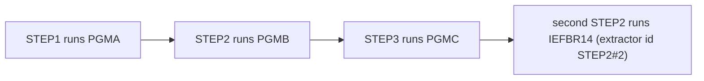

# 02 Coupling

The full edge list is in `02a-edge-tables.md`. This file is the argument. The tree is small: three COBOL
programs and one JCL job. The extractor found 11 edges: 4 call, 4 include and 3 temporal. It found no
`data` edge, no `contract` edge, no dataset, no copybook and no computed call (`analysis` fields
`edge_counts`, `unresolved_dynamic`).

## Open edges, and who worked them

Every one of the 11 edges is `resolved: true` and `high` confidence (`analysis`, field `edge_counts`, and
the edge list in `graph.json`). There are no computed calls and nothing was left unparsed. That is far
below the threshold of about 20 open edges, so I did not hand anything to the `dependency-cartographer`
agent. I did its pass by hand: I read the five lines of JCL and the four lines of each program, looking
for the things the extractor does not model (a transaction chain, an internal reader submit, `IF` or
`COND=`, IMS, DB2, MQ). There are none. Each program holds only `GOBACK`
(`app/cbl/PGMA.cbl:4`, `app/cbl/PGMB.cbl:4`, `app/cbl/PGMC.cbl:4`). The JCL holds four `EXEC` cards and
nothing else (`app/jcl/SEQJOB.jcl:2`, `app/jcl/SEQJOB.jcl:3`, `app/jcl/SEQJOB.jcl:4`,
`app/jcl/SEQJOB.jcl:5`).

## The coupling patterns that constrain the sequence

| Pattern | What it does to the migration | Confidence | Evidence |
|---|---|---|---|
| Temporal: one job fixes the order of four steps | The only defined behavior in the tree is the order PGMA, PGMB, PGMC, then IEFBR14. A port must keep that order. The order is file order, because the extractor does not model `COND=` or `IF` (`meta.limits`). | high for file order, low for real run order | `app/jcl/SEQJOB.jcl:2`, `app/jcl/SEQJOB.jcl:3`, `app/jcl/SEQJOB.jcl:4`, `app/jcl/SEQJOB.jcl:5` |
| Temporal, with a repeated step name | The name STEP2 is used twice. The first STEP2 runs PGMB. The second runs IEFBR14, after STEP3. The extractor labels the second one `STEP2#2`. That label is its own and is not in the source. Any restart at STEP2, any `COND=` that names STEP2, or any reference by step name is ambiguous. In JCL a step name is meant to be unique inside a job, so the job may not run as written. | medium | `app/jcl/SEQJOB.jcl:3`, `app/jcl/SEQJOB.jcl:5`. The uniqueness rule is inference from JCL rules, not from this tree. |
| Call coupling: job to program only | Each program is called by exactly one step. No program calls another. There is no fan-in, no fan-out and no shared code, so no program is tied to another by a call. | high | `app/jcl/SEQJOB.jcl:2`, `app/jcl/SEQJOB.jcl:3`, `app/jcl/SEQJOB.jcl:4` |
| Data coupling: none visible | No DD statement, no dataset and no file access is in the tree. Data coupling, the usual cause of a broken port, cannot be assessed. This is a hole in the evidence and does not mean the programs are independent. | low | `app/jcl/SEQJOB.jcl:2`, `app/cbl/PGMA.cbl:3`, `app/cbl/PGMB.cbl:3`, `app/cbl/PGMC.cbl:3` |
| Cross-job order: unknown | One JCL job is in the tree and no scheduler artifact was parsed. Which job runs before or after SEQJOB is unknown. The nightly cycle the client named cannot be rebuilt from this tree. | high that it is missing | `analysis` field `warnings` (scheduler warning) |

Contract coupling does not exist in this tree. No dataset is written or read, so there is no writer and
reader pair (`02a-edge-tables.md`, section Contract edges, is empty).

## Clusters

The tree is one cluster: one job and its programs, in step order. The arrows below are `temporal` edges, in
file order.

## Strongly connected components

None (`analysis` field `sccs`). No wave split can break one.

## God modules

None (`analysis` field `god_modules`). No program has fan-in or fan-out, so nothing needs a facade
(`analysis` fields `fan_in`, `fan_out`).

## Articulation points

None (`analysis` field `articulation_points`). The extractor computes them from program-to-program calls and
program-to-dataset edges. This tree has neither, so the empty list says the graph offers no wave boundary.
It does not say a boundary is unwise. The only natural boundaries are the step boundaries in the job, and
those are temporal.

## The honest boundary

- Computed calls: none (`analysis` field `unresolved_dynamic`). Nothing in the source is computed
  (`app/cbl/PGMA.cbl:4`).
- Not parsed: nothing (`unparsed` in `graph.json` is empty). The extractor reads only COBOL, copybooks, JCL,
  PROCs, CICS definitions, Control-M XML and shell wrappers. Anything else the client runs is invisible.
- The extractor does not model `IF/THEN/ELSE` or `COND=`. This file has none of either
  (`app/jcl/SEQJOB.jcl:1`). Production JCL for a nightly cycle often does, so this limit may hide real order
  logic if the copy differs from production. That is inference.
- The extractor reads no DCB, LRECL or RECFM, and the job names no DD, so no record layout is known
  (`app/jcl/SEQJOB.jcl:2`).
- No scheduler was parsed, so order between jobs is unknown (`analysis` field `warnings`).
- Every program is four lines and holds only `GOBACK` (`app/cbl/PGMA.cbl:4`). If these are stand-ins for
  the real programs, every finding here about coupling is void. Ask.
