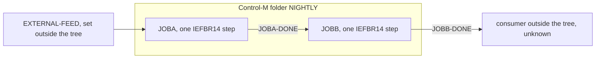

# 02 Coupling

The full edge list is in `02a-edge-tables.md`. This file is the argument. The tree is small: two JCL
jobs (`app/jcl/JOBA.jcl`, `app/jcl/JOBB.jcl`) and one Control-M file (`app/scheduler/nightly.xml`). There is no COBOL, no
copybook, no proc and no CSD. The extractor found 7 nodes and 7 edges: 4 call, 2 include, 1 temporal
(analysis field `edge_counts` in `modernization-assessment/graph.json`).

## What kinds of coupling exist here

| Coupling kind | Present | Confidence | Evidence |
|---|---|---|---|
| Call | Scheduler entry to job, and each step to IEFBR14 | high | `app/scheduler/nightly.xml:4`, `app/scheduler/nightly.xml:8`, `app/jcl/JOBA.jcl:2`, `app/jcl/JOBB.jcl:2` |
| Include | Each job holds one step | high | `app/jcl/JOBA.jcl:2`, `app/jcl/JOBB.jcl:2` |
| Data | None found. Neither job has a DD card | high | `app/jcl/JOBA.jcl:2`, `app/jcl/JOBB.jcl:2` |
| Contract | None found, because no dataset is shared | high | analysis: `data_hubs` is empty |
| Temporal | JOBA before JOBB through condition JOBA-DONE | high | `app/scheduler/nightly.xml:6`, `app/scheduler/nightly.xml:9` |

An absence of data and contract edges is a fact about this tree, not proof about production. Two jobs whose only step
is IEFBR14 (a program that does nothing) look like stubs or placeholders (inference). If the real members hold more steps, this table is wrong.

## The coupling patterns that constrain the sequence

1. **Temporal coupling through one Control-M condition, JOBA-DONE.** JOBA sets it (`app/scheduler/nightly.xml:6`), JOBB waits for it
   (`app/scheduler/nightly.xml:9`), and JOBB then deletes it (`app/scheduler/nightly.xml:10`). This is the only order in the system. It is
   not in the code. It lives in the scheduler, so a plan built from the jobs alone would lose it. Because JOBB
   clears the condition, a second run of JOBB does not start until JOBA runs again or someone adds the condition by hand. That
   is a Control-M rule and not something the file states (inference). A port to another scheduler must reproduce it, or state that it changed.
2. **An input from outside the tree, EXTERNAL-FEED.** JOBA waits for it (`app/scheduler/nightly.xml:5`) and no job in the tree sets it. The extractor
   raised this as a warning (analysis field `warnings`). Something outside the tree starts the nightly cycle: a file watcher, another
   scheduler folder, or an operator. That is the real trigger, and it is not in the scope we were given.
3. **An output nobody in the tree reads, JOBB-DONE.** JOBB sets it (`app/scheduler/nightly.xml:11`) and nothing in the tree waits for it.
   Either a downstream folder outside the tree uses it or it is dead. We cannot tell which (inference). It is the outward edge of the nightly cycle.

## Cluster graph

There is one cluster. A node per program would add nothing here.

The edge from EXTERNAL-FEED and the edge to the outside consumer are inference from the condition names. The JOBA to JOBB edge is a fact
(`app/scheduler/nightly.xml:6`, `app/scheduler/nightly.xml:9`).

## Strongly connected components, god modules, articulation points

| Structure | Result | Evidence |
|---|---|---|
| Strongly connected components | none | analysis: `sccs` is empty |
| Self recursive programs | none | analysis: `self_recursive` is empty |
| God modules | none | analysis: `god_modules` is empty |
| Articulation points | none. There are no programs, so no call graph between programs exists | analysis: `articulation_points` is empty |

With no strongly connected component there is nothing that must move as a cycle. The one pair that must stay together is
JOBA and JOBB, and that comes from the temporal edge, not from a call cycle.

## The honest boundary

- Computed calls: none. `unresolved_dynamic` is empty (analysis field), and there is no COBOL to hold one.
- Nothing was skipped: `unparsed` is empty (`modernization-assessment/graph.json`, `unparsed` field).
- The extractor does not model JCL `IF/THEN/ELSE` or `COND=` (`meta.limits` in `modernization-assessment/graph.json`). Neither job has either (`app/jcl/JOBA.jcl:1-2`, `app/jcl/JOBB.jcl:1-2`), so this limit does not touch this tree.
- The extractor does not read the Control-M ODATE attribute as a rule. Both conditions use ODATE="ODAT" (`app/scheduler/nightly.xml:5`, `app/scheduler/nightly.xml:6`, `app/scheduler/nightly.xml:9`, `app/scheduler/nightly.xml:10`, `app/scheduler/nightly.xml:11`). Conditions are dated by the scheduler's order date, so a run that crosses midnight
  or a rerun on a later date could behave differently (inference).
- No `dependency-cartographer` hand-off was needed. The agent takes over when more than about 20 edges are open. Here the open
  edge count is 0: no edge has `resolved: false` or a confidence below high (`modernization-assessment/02a-edge-tables.md`).
