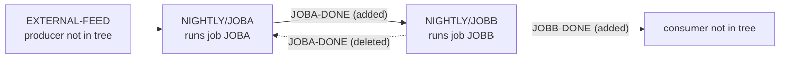

# 02 Coupling

Facts come from `graph.json` and `02a-edge-tables.md`. Anything I add on top is labeled `inference`.

## What the extractor found

The tree is two JCL jobs and one Control-M folder. There are 7 edges: 4 call, 2 include and 1 temporal. There are no programs, no copybooks, no datasets, no contract edges, no computed calls, no strongly connected components, no god modules and no articulation points. Nothing was left unparsed. All the coupling in this system is temporal, and it lives in the scheduler, not in the code.

## The coupling patterns that constrain the sequence

| # | Pattern | What it means for a refactor | Confidence | Evidence |
|---|---|---|---|---|
| 1 | JOBB waits for the condition JOBA-DONE, which JOBA adds. This is the one temporal edge, `sch:NIGHTLY/JOBA` to `sch:NIGHTLY/JOBB`. | The order is enforced by condition name, not by job name and not by anything in the JCL. Renaming a condition, or re-homing the jobs in another folder, breaks it without any compile or run error. | high | `app/scheduler/nightly.xml:6`, `app/scheduler/nightly.xml:9` |
| 2 | JOBB deletes JOBA-DONE (`SIGN="-"`) as it finishes, then adds JOBB-DONE. The extractor makes no edge for a delete, so this is not in `graph.json`. | JOBA-DONE is a one-shot token: one JOBA run allows one JOBB run. A rerun of JOBB needs a fresh JOBA run. A refactor that adds a second consumer of JOBA-DONE, or splits JOBB in two, races with this delete. | medium | `app/scheduler/nightly.xml:10`, `app/scheduler/nightly.xml:11` |
| 3 | JOBA waits for the condition EXTERNAL-FEED. No job in the tree adds it. The extractor made no edge and raised no warning for it. | Something outside this tree gates the whole nightly cycle. It has to be found and kept. Whoever posts it is a dependency of every wave. | medium | `app/scheduler/nightly.xml:5` |
| 4 | JOBB adds JOBB-DONE and nothing in the tree waits for it. | Either the cycle continues in a tree we were not given, or the condition is dead. The cycle boundary is unknown. | low | `app/scheduler/nightly.xml:11` |
| 5 | Both jobs have one step that runs IEFBR14 with no DD statements. The jobs coupled only by the scheduler do nothing that shares a file. | No data or contract coupling is visible. That is a statement about this tree, not about the real cycle: a no-op utility cannot be the whole nightly batch. `inference` | low | `app/jcl/JOBA.jcl:2`, `app/jcl/JOBB.jcl:2` |

## Cluster graph

## Structure from the graph

| Fact | Result | Evidence |
|---|---|---|
| Strongly connected components | none, so no unit is forced to move with another by a cycle | `modernization-assessment/graph.json:236` |
| God modules | none. There are no programs to have fan-in | `modernization-assessment/graph.json:235` |
| Articulation points | none reported (`modernization-assessment/graph.json:238`). The natural cut here is the JOBA-DONE condition, and this plan does not cut there. `inference` | inference |
| Data hubs | none. No dataset is named anywhere in the tree | `modernization-assessment/graph.json:240` |

## Honest boundary

- `unresolved_dynamic` is empty. There is no COBOL, so there are no computed calls to resolve.
- Open edges were fewer than 20 and all high confidence, so I did not need the dependency-cartographer agent. I worked the two things it would have looked at, the condition delete and the external condition, by reading the 14 line XML myself. Both are `inference` in the table above where the extractor is silent.
- The XML holds no schedule criteria: no time, no calendar days, no cycle. The folder is called NIGHTLY (`app/scheduler/nightly.xml:3`), and that name is the only evidence of when this runs. `inference`
- Conditions are dated ODAT (`app/scheduler/nightly.xml:5`). A feed that lands after the order date rolls over is a case this tree cannot answer. `inference`
- The graph being quiet on data coupling is not evidence that there is none. The steps run a no-op utility, so the files the real jobs touch are invisible here.
