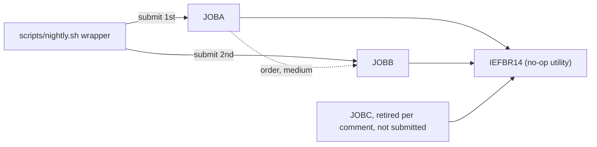

# 02 Coupling

Facts come from `graph.json` and `02a-edge-tables.md`. Anything I added by reading source is labeled
inference. The extractor found 9 edges: 5 call, 3 include, 1 temporal. It found no data edge and no
contract edge. The tree has no application program, no copybook and no dataset.

## What the tree holds

Every JCL step runs `IEFBR14`, a system program that does nothing, and none of the three jobs has a
DD statement. The only call edges point at `ext:IEFBR14`.

| Fact | Detail | Evidence |
|---|---|---|
| JOBA runs only IEFBR14 | one step, no DD | `jcl/JOBA.jcl:2` |
| JOBB runs only IEFBR14 | one step, no DD | `jcl/JOBB.jcl:2` |
| JOBC runs only IEFBR14 | one step, no DD | `jcl/JOBC.jcl:2` |
| COBOL, copybooks, datasets, procs | none scanned | analysis (`meta.files_seen` in `modernization-assessment/graph.json`) |

## The coupling patterns that constrain the sequence

### 1. Temporal coupling held only by line order in a shell wrapper

| Before | After | Confidence | Why it matters | Evidence |
|---|---|---|---|---|
| job:JOBA | job:JOBB | medium | The order is the order of two `submit` lines. Nothing in either JCL member states it. A port that treats the two jobs as independent tasks can run them in parallel or in reverse with no abend. | `scripts/nightly.sh:4`, `scripts/nightly.sh:5` |

The extractor rates this edge `medium` because it is a submit order. Whether JOBB starts after JOBA
ends, or only after JOBA is submitted, depends on what `submit` does. `submit` is not defined in the
tree. That is inference, and it is the largest open question of the assessment.

### 2. Failure coupling the graph does not model

| Item | What the source shows | Confidence | Evidence |
|---|---|---|---|
| `set -e` | The wrapper stops if a `submit` command fails, so JOBB is not submitted when the JOBA submit fails. It says nothing about JOBA ending with a bad return code. | low | `scripts/nightly.sh:3` |

This is inference. The extractor does not model shell control flow, so no edge carries it. A target
scheduler must say which of the two behaviors it keeps: stop on a failed submit, or stop on a failed job.

### 3. No data, call or contract coupling

There is nothing to sequence around: no shared dataset, no shared layout, no program calling
another. This is also a gap. A nightly cycle that touches no data has no business purpose the tree
can show, so the real work is probably not in this tree. See the open questions in `00-summary.md`.

## Cluster view

## Structure computed from the graph

| Fact | Value | Evidence |
|---|---|---|
| Strongly connected components | none, so no unit is forced to move with another | analysis (`sccs`) |
| God modules | none | analysis (`god_modules`) |
| Articulation points | none | analysis (`articulation_points`) |
| Data hubs | none | analysis (`data_hubs`) |

The structure facts are computed over programs, and the tree has zero programs (`reachable_programs`
is 0). Empty here means there was nothing to measure. It does not show that the system is flat.

## Edges the extractor left open, worked by hand

There are no computed calls (`unresolved_dynamic` is empty). One edge has confidence below high, the
JOBA to JOBB order above. That is far fewer than 20, so I worked it myself and did not hand it to the
`dependency-cartographer` agent. I followed that agent's method inline.

Computed calls:

| Caller | Node | Reaches | Evidence |
|---|---|---|---|
| none | none | nothing to resolve | analysis (`unresolved_dynamic` is empty) |

Medium and low confidence edges:

| Edge | What the source shows | Still open | Evidence |
|---|---|---|---|
| job:JOBA to job:JOBB, temporal | JOBA is submitted on line 4 and JOBB on line 5, with `set -e` set before both. | Whether `submit` waits for job end, and which return code it passes back. Inference: the source cannot settle this. | `scripts/nightly.sh:4`, `scripts/nightly.sh:5`, `scripts/nightly.sh:3` |

Things the extractor does not model, checked by reading:

| Item | Found | Evidence |
|---|---|---|
| JCL `IF/THEN/ELSE` or `COND=` | none in the three members | `jcl/JOBA.jcl:2` |
| A job submitted from a program through the internal reader | no program exists to do it | analysis (`reachable_programs` is 0) |
| CICS `RETURN TRANSID`, `START`, `SEND MAP` chains | no CICS source in the tree | analysis (`meta.files_seen` shows 0 COBOL) |
| A commented-out submit of JOBC | not an edge, and not proof the job is dead | `scripts/nightly.sh:6` |

## The honest boundary

The graph is complete for what was scanned, and what was scanned is small. Four things sit outside it.
The definition of `submit`. Any scheduler other than this wrapper: only Control-M XML and shell
wrappers that name JCL files are read. Any JCL, proc or program that was not delivered. And the real
content of jobs that here do nothing.
