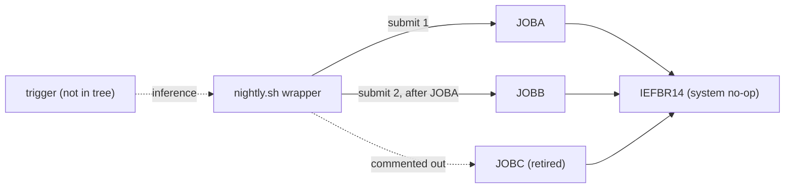

# 02 Coupling

The full edge list is in `02a-edge-tables.md`. This file is the argument. The tree is small: 3 JCL jobs, 3 steps, 1 shell wrapper, and one external system program (IEFBR14). There are no COBOL programs, copybooks, datasets, or computed calls, so the extractor found no call, data or contract coupling among application code. Every finding below is either an extractor fact with a citation or is labeled inference.

## Pattern 1. Temporal coupling is the only real coupling, and it lives in a shell wrapper

`scripts/nightly.sh:4` submits JOBA and `scripts/nightly.sh:5` submits JOBB. The extractor records this as one temporal edge, `job:JOBA` to `job:JOBB`, at medium confidence. Nothing in the JCL says JOBB needs JOBA (`jcl/JOBA.jcl:2`, `jcl/JOBB.jcl:2`). The order exists only because of the line order in the wrapper. A port that reads the JCL alone would lose it.

Two details make this edge weaker than it looks.

- `set -e` at `scripts/nightly.sh:3` aborts the wrapper if a `submit` command fails. So JOBB is never submitted when the JOBA submit fails.
- The `submit` command is not defined anywhere in the tree. If it returns when the job is queued, the order guaranteed is order of submission, not order of completion, and `set -e` sees the submit status, not JOBA's return code. If it waits and returns the job's return code, the order is a real completion dependency. The source does not say which. Inference, and the first thing to ask the client.

## Pattern 2. One retired job left behind

`scripts/nightly.sh:2` says JOBC is retired and `scripts/nightly.sh:6` has its submit commented out. `jcl/JOBC.jcl:1` is still in the tree. The extractor lists `job:JOBC` under `unscheduled_jobs` and keeps it as an entry point, because a job no scheduler names may be run by hand. Whether anything else runs it cannot be settled from the tree. It is a dead-code question (see `05-dead-code.md`), not a wave question.

## Pattern 3. What is absent

There are no `data` or `contract` edges. All three steps run `IEFBR14` (`jcl/JOBA.jcl:2`, `jcl/JOBB.jcl:2`, `jcl/JOBC.jcl:2`), a system utility that does nothing, and none has a DD statement. Either the tree is a skeleton and the real programs and datasets live elsewhere, or these jobs are placeholders. That is an open question, not a finding. It bounds everything else in this assessment: the coupling that matters for a real nightly cycle, such as shared VSAM files and record layouts, cannot be seen here.

## Cluster view

## Structure the extractor computed

| Fact | Result | Evidence |
|---|---|---|
| Strongly connected components | none, so no wave can split one | inference |
| God modules | none, there is no program fan-in | inference |
| Articulation points | none | inference |
| Data hubs | none, no datasets | inference |
| Computed calls (`unresolved_dynamic`) | none | inference |
| Unscheduled jobs | `job:JOBC` only | `scripts/nightly.sh:6` |

The evidence cells for the rows that say inference record an absence. The extractor found nothing, and the limits in `graph.json` `meta.limits` (no IF/THEN/ELSE or COND, no internal-reader submits, only shell wrappers that name JCL files) mean an absence is only an absence in what it reads.

## Dependency-cartographer work, done inline

There were 0 unresolved computed calls, 0 low confidence edges, and 1 medium confidence edge (the temporal edge above). That is under the threshold for a hand-off, so I worked it myself. Findings on the medium edge are in Pattern 1 and are inference.

## The honest boundary

- What starts `scripts/nightly.sh` is not in the tree (cron, an enterprise scheduler, or an operator). It is an entry point with no caller. Inference.
- The extractor does not follow jobs submitted from inside programs, and there are no programs here to submit any.
- `IEFBR14` is the only thing the jobs execute. If production jobs run other programs, the tree is not the system.
