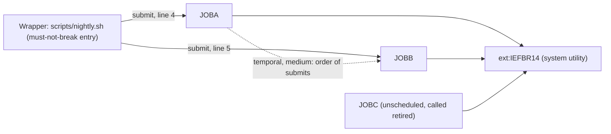

# 02 Coupling

The tree holds three JCL jobs and one shell wrapper. It holds no COBOL, no copybook, no proc, no CSD
and no dataset (`meta.files_seen` in graph.json, analysis). Every edge is in `02a-edge-tables.md`. This file
is the argument about what the coupling does to the sequence.

I did the open-edge work myself, as the skill allows for fewer than about 20 edges. There are none
unresolved and no computed calls (`analysis.unresolved_dynamic` is empty). One edge is below high
confidence: the temporal edge from job:JOBA to job:JOBB.

## What constrains the sequence

| # | Pattern | What it does to the plan | Confidence | Evidence |
|---|---|---|---|---|
| 1 | Order enforced by a shell wrapper. The wrapper submits JOBA and then JOBB. | JOBA must precede JOBB in the new platform, or the harness must show the order never mattered. Ported as parallel jobs, it breaks silently. | medium | `scripts/nightly.sh:4`, `scripts/nightly.sh:5` |
| 2 | The wrapper stops on the first failed command. | A failed JOBA submit must keep JOBB from running. This is behavior to reproduce, and no JCL line says it. | medium | `scripts/nightly.sh:3` |
| 3 | The wrapper is the only scheduler and the only caller of JOBA and JOBB. | The wrapper and its two jobs move together. The must-not-break nightly cycle is exactly this set. | high | `scripts/nightly.sh:2`, `scripts/nightly.sh:4`, `scripts/nightly.sh:5` |
| 4 | JOBC has no caller. The wrapper comment calls it retired and the submit is commented out. | It cannot be sequenced by dependency. It is a question, not a unit of work. | low | `scripts/nightly.sh:2`, `scripts/nightly.sh:6` |
| 5 | All three jobs run IEFBR14, a system utility outside the tree, with no DD statement. | There is no data or contract coupling anywhere in the tree. This says nothing about the real system. | high | `jcl/JOBA.jcl:2`, `jcl/JOBB.jcl:2`, `jcl/JOBC.jcl:2` |

### Pattern 1 in detail: the order is weaker than it looks

The extractor made the JOBA to JOBB edge from the order of two lines, and marked it `medium`. It is
a fact that the lines are in that order. Whether the order is enforced at run time is not in the tree.

- `submit` is not defined in the tree. If it is the z/OS UNIX `submit` command, it returns once JES
  accepts the job, not when the job ends (inference). Then the wrapper does not make JOBB wait for JOBA,
  and JES class and initiator availability decide the real order (inference).
- `set -e` on `scripts/nightly.sh:3` stops the script when a `submit` fails. It does not see a job
  that abends after submit (inference, follows from the previous point).
- JOBA and JOBB touch no shared dataset and run only IEFBR14 (`jcl/JOBA.jcl:2`, `jcl/JOBB.jcl:2`). The
  tree gives no reason for the order. The reason may sit in a side effect the tree does not show, or
  the order may be a habit (inference).

The harness in `06-test-strategy.md` has to settle which of these is true before the port drops the
wrapper.

## Cluster graph

The graph is at cluster level. The tree is small enough that clusters and programs are the same thing.
The edges are `scripts/nightly.sh:4`, `scripts/nightly.sh:5`, `jcl/JOBA.jcl:2`, `jcl/JOBB.jcl:2` and
`jcl/JOBC.jcl:2`. JOBC has no inbound edge (`analysis.unscheduled_jobs`).

## Structure computed from the graph

| Fact | Result | Confidence | Evidence |
|---|---|---|---|
| Strongly connected components | none, so nothing has to move as a unit | high | analysis field `sccs` |
| God modules | none | high | analysis field `god_modules` |
| Articulation points | none, so no wave boundary comes from structure | medium | analysis field `articulation_points` |
| Data hubs | none, no dataset is attached to any unit | high | analysis field `data_hubs` |
| Fan-in and fan-out | empty, they are computed over programs and the tree has none | high | analysis fields `fan_in` and `fan_out` |

Read the last two rows with care. The structure fields are computed over programs and datasets
(`analysis.articulation_basis`, analysis). With no program and no dataset in the tree, an empty result is
vacuous. It does not show that the system is flat. It shows that the tree does not contain the system.

## The honest boundary

- There are no computed calls (`analysis.unresolved_dynamic` is empty), and nothing was left unparsed
  (`unparsed` is empty). That is not a clean bill. The application code is not in the tree at all.
- The extractor reads a shell wrapper only for the JCL files it names, and reads step order as file
  order. It does not read `set -e`, functions, conditions or loops. The wrapper is six lines, and I read
  all of them by hand: no condition or loop is present (`scripts/nightly.sh:1` through `scripts/nightly.sh:6`).
- The `submit` command, the scheduler that starts the wrapper, and the host it runs on are not in the
  tree (inference from the absence of any file that defines them).
- No dataset is named anywhere, so no contract edge could exist. Any real record layout that JOBA or
  JOBB touch is invisible here.
