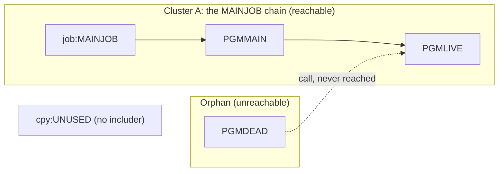

# 02 Coupling

Target state: refactor. Must not break: "the nightly batch cycle". The full edge list is in
`modernization-assessment/02a-edge-tables.md`. This file holds the argument.

The tree is small: 3 COBOL programs, 1 copybook, 1 JCL job. It has 4 edges (3 call, 1 include). It has no
data edges, no contract edges and no temporal edges. That is a fact about the tree, not proof that the
system has none. The tree has no scheduler artifact and no DD statements (see "The honest boundary").

## Open edges: nothing for the cartographer

Every edge in `graph.json` is resolved and has `high` confidence. `analysis.unresolved_dynamic` is empty.
There are no `medium` or `low` edges, so the count is far below the 20 that would justify the
`dependency-cartographer` agent. I did that agent's check inline, in two parts.

1. Computed calls: none. Each `CALL` in the tree names a literal, at `app/cbl/PGMMAIN.cbl:4` and
   `app/cbl/PGMDEAD.cbl:4`.
2. Things the extractor does not model: I read all five source files for CICS `RETURN TRANSID` chains,
   internal reader submits, IMS, DB2 or MQ calls, and JCL `IF` or `COND=`. `app/cbl/PGMLIVE.cbl:4` is a bare
   `GOBACK`. None of the others appear in `app/cbl/PGMMAIN.cbl:4`, `app/cbl/PGMDEAD.cbl:4` or
   `app/jcl/MAINJOB.jcl:2`. This is a statement about an absence, so it is inference.

## The coupling patterns that constrain the sequence

| # | Pattern | Effect on the sequence | Confidence | Evidence |
|---|---|---|---|---|
| 1 | Linear call chain: `job:MAINJOB` runs step S1, S1 runs `PGMMAIN`, `PGMMAIN` calls `PGMLIVE` | The three move as one wave. Cutting the chain leaves a job with no program or a caller with no callee. | high | `app/jcl/MAINJOB.jcl:2`, `app/cbl/PGMMAIN.cbl:4` |
| 2 | A dead caller shares a callee: `PGMDEAD` also calls `PGMLIVE` | No constraint while `PGMDEAD` stays unreachable. If it turns out to run, `PGMLIVE` has two callers and wave 1 must grow to hold whatever runs `PGMDEAD`. | medium | `app/cbl/PGMDEAD.cbl:4` |
| 3 | Missing coupling classes: no dataset, no DD, no scheduler | The plan has no data, contract or temporal edge to keep in order. The nightly cycle's order against other jobs is unknown, not absent. | low | analysis: warnings, `unscheduled_jobs` and `data_hubs` are empty |

Pattern 3 is the one that matters most. The warning "no scheduler artifact was parsed" is a gap. A plan
built without the scheduler is not a plan, and this one covers only the chain the tree contains.

## Clusters

The graph is small enough to draw in full. It is drawn at unit level because there is only one
cluster and one orphan.

## Structure computed by the extractor

| Fact | Value | Confidence | Evidence |
|---|---|---|---|
| Strongly connected components | none, so no unit is forced to move with another | high | analysis: `sccs` is empty |
| Self recursive programs | none | high | analysis: `self_recursive` is empty |
| God modules | none | high | analysis: `god_modules` is empty |
| Articulation points | none, so the tree offers no internal wave boundary | high | analysis: `articulation_points` is empty |
| Fan-in | `PGMLIVE` has 1 caller among reachable programs (`PGMDEAD` is excluded as a dead caller) | high | analysis: `fan_in`, `structure_basis` |
| Data hubs | none | medium | analysis: `data_hubs` is empty |

## The honest boundary

- Computed calls: none. Nothing keeps the unknown dead-code bucket open.
- The extractor parsed nothing it had to skip. `graph.json` lists no `unparsed` file.
- The tree has no scheduler, no PROC, no DD statement and no dataset. So the data, contract and temporal
  classes cannot be assessed from it. `app/jcl/MAINJOB.jcl:2` is the whole job body.
- How `PGMMAIN` reaches `PGMLIVE` at run time (a static link or a dynamic load) depends on compile and link
  options. The tree holds no compile or link deck. It does not change the wave, but the port has to
  reproduce it. Inference.
