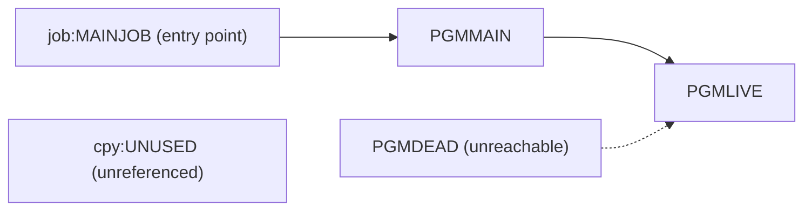

# 02 Coupling

The full edge list is in `02a-edge-tables.md`. This file is the argument. The tree is small: three programs, one job, one copybook, four edges (analysis: `edge_counts`).

## Open edges

The extractor left nothing open. There are no computed calls (analysis: `unresolved_dynamic` is empty), no JCL text inside a COBOL literal (analysis: `embedded_jcl` is empty), and no file listed as not parsed. All four edges are resolved and `high` confidence. That is far below the 20 that would justify the `dependency-cartographer` agent, so I read the source myself. It is five short files, and I read all of them.

What I read confirms the graph and adds three inferences about what the extractor does not model.

| Finding | Kind | Confidence | Evidence |
|---|---|---|---|
| PGMMAIN calls PGMLIVE by a literal name, so the call is static | graph fact | high | `app/cbl/PGMMAIN.cbl:4` |
| PGMDEAD calls PGMLIVE by a literal name, so it is a caller only and nothing calls it | graph fact | high | `app/cbl/PGMDEAD.cbl:4` |
| Step S1 runs PGMMAIN and is the only step of the only job | graph fact | high | `app/jcl/MAINJOB.jcl:2` |
| The JCL has no `IF/THEN/ELSE` and no `COND=`, so step order is not conditional | inference | medium | `app/jcl/MAINJOB.jcl:2` |
| No program uses EXEC CICS, EXEC SQL, an internal reader submit, or a file, so the extractor's blind spots hide nothing here | inference | medium | `app/cbl/PGMMAIN.cbl:4` |
| PGMLIVE holds no logic, only GOBACK, which suggests a stub or an extract of a larger system | inference | low | `app/cbl/PGMLIVE.cbl:4` |

## The coupling patterns that constrain the sequence

1. **One linear call chain from one entry point.** `job:MAINJOB` holds step S1, which runs PGMMAIN, which calls PGMLIVE (`app/jcl/MAINJOB.jcl:2`, `app/cbl/PGMMAIN.cbl:4`). Nothing branches, so there is no way to cut this chain into two waves that each deploy and roll back on their own. It moves as one unit.
2. **A dead caller of a live callee.** PGMLIVE has two static callers, PGMMAIN and PGMDEAD (`app/cbl/PGMMAIN.cbl:4`, `app/cbl/PGMDEAD.cbl:4`). PGMDEAD is unreachable, so the extractor counts fan-in over reachable programs only and gets 1, not 2 (analysis: `structure_basis`, `fan_in`). The dead caller puts no constraint on the sequence. Deleting PGMDEAD does not touch PGMLIVE, because PGMMAIN keeps it live.
3. **No data, contract or temporal coupling is visible, and that is a gap, not a finding.** The tree has no dataset, no `contract` edge and no `temporal` edge (analysis: `data_hubs`, `edge_counts`). It also has no scheduler artifact (analysis: `warnings`). The order in which the real nightly cycle runs its jobs is unknown. Once someone supplies the scheduler export and the real job stream, this is the pattern most likely to constrain the sequence. Until then the wave plan holds only what this tree shows.

## Cluster map

The tree is one cluster, so this graph is at unit level only because there is nothing to group.

## Structure computed from the call graph

| Fact | Units | Confidence | Evidence |
|---|---|---|---|
| Strongly connected components. A wave plan must not split one | none | high | analysis: `sccs` |
| Self recursive programs | none | high | analysis: `self_recursive` |
| God modules. They are strangled behind a facade, never ported wholesale | none | high | analysis: `god_modules` |
| Articulation points. They are the natural wave boundaries | none | high | analysis: `articulation_points` |
| Data hubs | none | high | analysis: `data_hubs` |

With no strongly connected component, no god module and no articulation point, the plan needs no facade and no internal cut.

## The honest boundary

- **Computed calls.** None. The extractor resolved every call by literal name (analysis: `unresolved_dynamic`). A computed call elsewhere in the real system, outside this tree, is invisible to this assessment.
- **Scheduler.** One JCL job is in the tree and no scheduler artifact was parsed (analysis: `warnings`). Cross-job order is unknown.
- **What the tree is.** PGMMAIN and PGMLIVE contain no business logic (`app/cbl/PGMMAIN.cbl:4`, `app/cbl/PGMLIVE.cbl:4`). This may be a fragment of a larger system. Everything below is scoped to the tree as given. That is inference.
