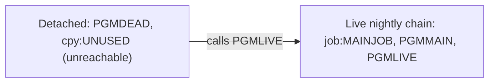

# 02 Coupling

`02a-edge-tables.md` holds every edge. This file holds the argument. Edge facts come from `modernization-assessment/graph.json`. Where I add something the extractor did not compute, it is labeled `inference`.

## What the tree contains

The tree is small: one JCL job with one step, three COBOL programs and one copybook. The extractor found 4 edges: 3 `call` and 1 `include`. It found no `data`, `contract` or `temporal` edge, and it left nothing unresolved (`modernization-assessment/graph.json:171`, `modernization-assessment/graph.json:151`). Nothing was skipped as not parsed. No cartographer hand-off was needed: there are no open edges to settle, against a threshold of about 20.

## The coupling patterns that constrain the sequence

| # | Pattern | What it means for the sequence | Confidence | Evidence |
|---|---|---|---|---|
| 1 | One call chain: job MAINJOB, step S1, PGMMAIN, then PGMLIVE. | The job, PGMMAIN and PGMLIVE are one deployable unit. PGMLIVE has no other live caller, so it cannot move ahead of PGMMAIN without a facade. | high | `app/jcl/MAINJOB.jcl:2`, `app/cbl/PGMMAIN.cbl:4` |
| 2 | PGMDEAD is a second, unreachable caller of PGMLIVE. | The raw edge table shows two callers of PGMLIVE. Only one is live, so the analysis counts fan-in of 1. If PGMDEAD is in fact run from outside the tree, PGMLIVE has two callers and a facade around it must serve both. | medium | `app/cbl/PGMDEAD.cbl:4`, `modernization-assessment/graph.json:172` |
| 3 | No data, contract or temporal coupling is visible. | Nothing constrains the order of work inside the tree. It also means the tree gives no visible input or output for the nightly cycle. That is a gap in what we can see, not proof the cycle has none. The JCL has no DD statement and the programs open no file. | medium | `app/jcl/MAINJOB.jcl:2`, `app/cbl/PGMMAIN.cbl:3`, `modernization-assessment/graph.json:184` |

## Clusters

Cluster level only. There are two clusters and one edge between them.

## Structure computed from the call graph

| Fact | Result | Evidence |
|---|---|---|
| Strongly connected components | none. Nothing has to move as a unit beyond the call chain above. | `modernization-assessment/graph.json:180` |
| Self recursive programs | none | `modernization-assessment/graph.json:181` |
| God modules | none. Nothing needs a facade for being too big. | `modernization-assessment/graph.json:179` |
| Articulation points | none reported. In a three-program chain, PGMMAIN is the natural boundary by inference, but the extractor computed none. | `modernization-assessment/graph.json:182` |
| Data hubs | none | `modernization-assessment/graph.json:184` |
| Unscheduled jobs | none reported, because no scheduler artifact was parsed, so the extractor has no basis to call a job unscheduled | `modernization-assessment/graph.json:185`, `modernization-assessment/graph.json:197` |

## The honest boundary

- **Computed calls.** There are none. Both CALL statements name their target as a literal (`app/cbl/PGMMAIN.cbl:4`, `app/cbl/PGMDEAD.cbl:4`). Because there is no computed call in the tree, the unknown dead-code bucket is empty. That holds for this tree only. A computed call in code outside the tree could still reach PGMDEAD (inference).
- **Scheduler.** No scheduler artifact was parsed. The order jobs run in across jobs is unknown, and so is whether MAINJOB runs nightly (`modernization-assessment/graph.json:197`). Treating MAINJOB as the nightly batch cycle the client named is inference. The JCL says only that it is class A (`app/jcl/MAINJOB.jcl:1`).
- **Not modeled.** `IF/THEN/ELSE` and `COND=` are not modeled, nested PROCs and the internal reader are not followed, and only Control-M XML and shell wrappers are read as schedulers (`modernization-assessment/graph.json:9`). The two-line JCL uses none of these, so they do not change this graph. They do limit what we can say about anything outside the tree.
