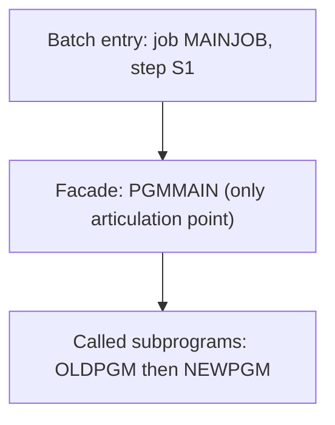

# 02 Coupling

`02a-edge-tables.md` holds every edge. This file holds the argument. The graph is tiny: 5 nodes and 4 edges, of which 3 are call edges and 1 is an include edge (`analysis`, fields `node_counts` and `edge_counts`). Every edge is resolved and has high confidence, so the dependency-cartographer had nothing to settle and I did not call it. I read the four source files only to make the judgments below.

## The coupling patterns that constrain the sequence

| Pattern | What it means for the sequence | Confidence | Evidence |
|---|---|---|---|
| Call coupling: one chain. `job:MAINJOB` runs step S1, S1 runs PGMMAIN, PGMMAIN calls OLDPGM and then NEWPGM. | The four units move together. Neither subprogram has a caller other than PGMMAIN, so neither can be ported, retired or reordered without touching PGMMAIN. | high | `app/jcl/MAINJOB.jcl:2`, `app/cbl/PGMMAIN.cbl:4`, `app/cbl/PGMMAIN.cbl:5` |
| Unconditional, ordered calls. Both CALL statements are plain statements with no test around them. OLDPGM is called first. | OLDPGM is on the live path however old it is. The dormant flag on it does not make it removable. Any port must keep the call order, even though both bodies are empty today. | high | `app/cbl/PGMMAIN.cbl:4`, `app/cbl/PGMMAIN.cbl:5` |
| No data coupling and no temporal coupling are visible. There is no dataset, no contract edge, no scheduler and no second job. | This is an absence of evidence, not evidence of absence. The job has no DD statements, so any file the cycle really uses is invisible. A plan built on this graph cannot see the cycle's order across jobs. | low | `app/jcl/MAINJOB.jcl:2`, `analysis` (fields `data_hubs`, `edge_counts`) |

## Clusters

The tree is one cluster. The graph below shows it at cluster level.

## Strongly connected components

None (`analysis`, field `sccs` is empty). No call cycle exists, so no unit is forced to move with another for that reason. The four units still move together for the reason above: they are one call chain.

## God modules

None (`analysis`, field `god_modules` is empty). PGMMAIN has the highest fan-out, 2, and OLDPGM and NEWPGM each have a fan-in of 1 (`analysis`, fields `fan_out` and `fan_in`). That is far below anything a god module would show.

## Articulation points

One: PGMMAIN (`analysis`, field `articulation_points`). It is the only gateway to OLDPGM and NEWPGM. With a single wave it is not a wave boundary. It is the natural place for a facade under a refactor target: the two subprograms could be swapped behind PGMMAIN without touching MAINJOB. This is inference. The source gives no reason to do it.

## The honest boundary

- Computed calls: none. `unresolved_dynamic` is empty and both CALL targets are literals (`app/cbl/PGMMAIN.cbl:4`, `app/cbl/PGMMAIN.cbl:5`). So no program is in the unknown bucket for that reason.
- That result covers this tree only. Nothing here says the real cycle has no computed calls, JCL text inside COBOL literals, or programs started by name from PARM. The tree is too small to be the whole nightly cycle, and I could not confirm that it is. This is inference.
- The extractor warned that no scheduler artifact was parsed, so the order in which jobs run is unknown (`analysis`, field `warnings`).
- The include edge from the job to its step is containment, not a dependency (`app/jcl/MAINJOB.jcl:2`).
