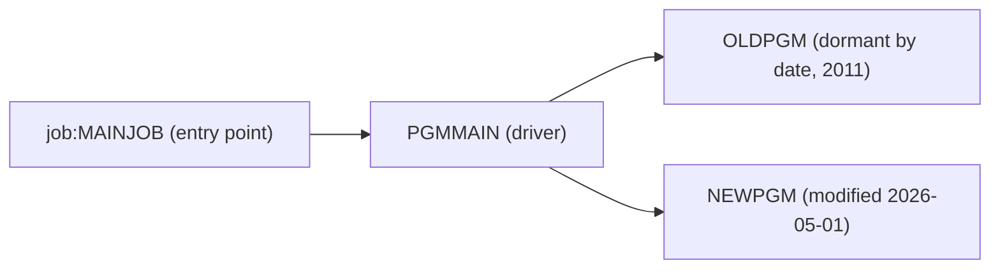

# 02 Coupling

Fact tables are in `02a-edge-tables.md`. This file holds the argument. The tree is small: three COBOL
programs and one JCL job, with four edges (three `call`, one `include`) and no dataset, copybook,
scheduler or computed call (`analysis` block of `graph.json`, fields `edge_counts`, `data_hubs`,
`unresolved_dynamic`). The `dependency-cartographer` agent was not needed: there are no unresolved
edges to work, so nothing here is inference from that agent.

## The patterns that constrain the sequence

| Pattern | What it does to the sequence | Confidence | Evidence |
|---|---|---|---|
| Call coupling through one driver. `PGMMAIN` calls `OLDPGM` and then `NEWPGM`, both unconditionally. It is the only caller of either. | The two subprograms cannot move without `PGMMAIN`, and `PGMMAIN` cannot move without the job that runs it. All four units move as one unit. | high | `app/cbl/PGMMAIN.cbl:4-5`, `app/jcl/MAINJOB.jcl:2` |
| Call order inside the run. `OLDPGM` runs first, `NEWPGM` second. No file or shared field ties them in this tree, so the order is enforced only by statement order. | The port has to keep the order. Whether the order matters is not visible, because a called subprogram could change state that the other reads (EXTERNAL items, files opened elsewhere). | low | `app/cbl/PGMMAIN.cbl:4`, `app/cbl/PGMMAIN.cbl:5` |
| No data coupling is visible, and that is a gap, not a finding. The job has no DD statement and neither COBOL program has a SELECT or an EXEC SQL. | There are no data hubs and no contract edges, so the extractor gives no oracle for the output. Whatever the nightly cycle produces, this tree does not show it. | medium | `app/jcl/MAINJOB.jcl:2`, analysis field `data_hubs` |

## Cluster graph

The whole tree is one cluster. A finer graph would add nothing.

## Structure computed from the graph

| Fact | Units | Evidence |
|---|---|---|
| Strongly connected components | none. Nothing to hold together beyond the call chain. | analysis field `sccs` |
| God modules | none. Fan-in is 1 for both subprograms, fan-out is 2 for `PGMMAIN`. | analysis fields `god_modules`, `fan_in`, `fan_out` |
| Articulation points | `PGMMAIN`. It is the natural boundary if the client later splits the tree. Here it needs no cut, because the seed wave holds only 4 units. | analysis field `articulation_points` |
| Self recursive programs | none | analysis field `self_recursive` |

## The honest boundary

- There are no computed calls (`unresolved_dynamic` is empty) and no JCL text inside a COBOL literal
  (`embedded_jcl` is empty). Inside this tree the call graph is complete. `graph.json` `meta.limits`
  still says a call from outside the tree, such as a job in another repository, would not show.
- No scheduler artifact was parsed, and the extractor warns about it. The order this job runs in relative
  to other jobs is unknown. Temporal coupling, which lives in the scheduler, is therefore not
  assessed. This is an open question for the client (see `00-summary.md`).
- `OLDPGM` and `NEWPGM` contain only `GOBACK`, and `PGMMAIN` only two calls. Either the tree is a
  fragment, or the logic sits elsewhere. inference
