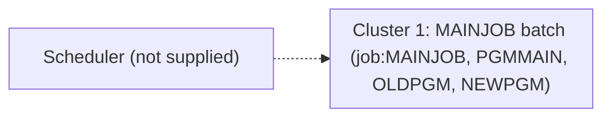

# 02 Coupling

The fact tables are in `02a-edge-tables.md`. This file is the argument. The system is small: one job, one step, one main program and two subprograms. There are no open edges. The extractor reports zero computed calls and every edge is `high` confidence, so no work was handed to the `dependency-cartographer` agent (the threshold is about 20 open edges).

## The coupling patterns that constrain the sequence

| # | Pattern | What it does to the sequence | Confidence | Evidence |
|---|---|---|---|---|
| 1 | Call coupling. PGMMAIN calls OLDPGM, then NEWPGM, both unconditionally and in that order. | The two subprograms cannot be moved without PGMMAIN or a facade in front of them. The call order is the only behavior PGMMAIN has, so a port has to keep it. | high | `app/cbl/PGMMAIN.cbl:4`, `app/cbl/PGMMAIN.cbl:5` |
| 2 | Job to program coupling. The only step of MAINJOB executes PGMMAIN and is the only entry point. | Everything the extractor can reach hangs off one JCL line. Rolling back the wave means rolling back this one step. | high | `app/jcl/MAINJOB.jcl:2` |
| 3 | Temporal coupling across jobs is unknown. No scheduler export was in the tree. | The requirement is that the nightly batch cycle must not break. The tree cannot show where MAINJOB sits in that cycle, or what runs before or after it. Any wave plan here is provisional until the export arrives. | low | inference |

## Data and contract coupling

The extractor found no dataset, VSAM file or DB2 table read or written by any unit. The step has no DD statements, and neither subprogram has any file or data statement (`app/jcl/MAINJOB.jcl:2`, `app/cbl/OLDPGM.cbl:3`, `app/cbl/NEWPGM.cbl:3`). There are no data hubs and no contract edges. This is the usual place a migration plan breaks and here it does not apply. The catch: a system that reads and writes nothing has no output a test can compare, which is a problem for the harness, not the port (see `06-test-strategy.md`).

## Clusters

The whole system is one cluster. Drawing the four nodes separately would add nothing.

## Structure computed from the call graph

| Fact | Units | Evidence |
|---|---|---|
| Strongly connected components | none, so no wave can split one | inference |
| Self recursive programs | none | inference |
| God modules | none. Fan-in is 1 for OLDPGM and NEWPGM, fan-out is 2 for PGMMAIN | `app/cbl/PGMMAIN.cbl:4` |
| Articulation points (natural wave boundaries) | PGMMAIN. It is the root of the call tree, so the boundary it makes is the whole system | `app/cbl/PGMMAIN.cbl:5` |

## The honest boundary

There are no computed calls, so the static call graph is complete for what is in the tree. That says nothing about what is not in the tree. Limits from the extractor that touch this system:

- IF/THEN/ELSE and COND= in JCL are not modeled. MAINJOB has one step, so none is visible, but the production job may differ from this copy (`app/jcl/MAINJOB.jcl:2`).
- Only Control-M XML and shell wrappers that name JCL files are read as schedulers. A CA-7, TWS or other scheduler would not appear.
- Jobs submitted through the internal reader and nested PROC calls are not followed.
