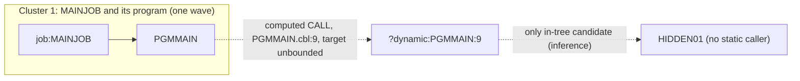

# 02 Coupling

The tree holds three source files: one JCL job, one program the job runs, and one program nothing
names. The full edge list is in `02a-edge-tables.md`. There are no datasets, no copybooks, no
scheduler and no CICS definitions (`modernization-assessment/graph.json:24`, the `files_seen` block
in `meta`). That leaves one coupling pattern that matters, and it is a gap.

The open edge was worked by hand, following `agents/dependency-cartographer.md`. There are fewer than
20 open edges, so the agent was not needed. Everything in the "what the source shows" table below is
`inference`, kept apart from the extractor's facts.

## Pattern 1. A computed CALL whose target is read at run time

| Finding | Kind | Confidence | Evidence |
|---|---|---|---|
| `job:MAINJOB` runs step `S1`, which executes `PGMMAIN` | call (fact) | high | `app/jcl/MAINJOB.jcl:2` |
| `PGMMAIN` calls the program named in `WS-PGM-NAME`, so the edge goes to `?dynamic:PGMMAIN:9` | call (fact, unresolved) | low | `app/cbl/PGMMAIN.cbl:9` |
| `WS-PGM-NAME` is declared with no `VALUE` clause | inference | medium | `app/cbl/PGMMAIN.cbl:5` |
| `WS-PGM-NAME` gets its value from `ACCEPT`, a run-time input, not from a literal or a table | inference | medium | `app/cbl/PGMMAIN.cbl:8` |
| The job has one step, no `SYSIN` DD, no in-stream data and no `PARM`, so the JCL in the tree does not supply the name | inference | medium | `app/jcl/MAINJOB.jcl:2` |
| The set of programs the `CALL` can reach cannot be bounded from the source in this tree | inference | low | `app/cbl/PGMMAIN.cbl:9` |

What this means for the sequence. Every program in the tree that has no static caller is a possible
target. Only one such program exists, `HIDDEN01` (`app/cbl/HIDDEN01.cbl:2`), and it does nothing but
return (`app/cbl/HIDDEN01.cbl:4`). But the name is typed in at run time, so the callee could equally
be a program that is not in the tree. Nothing in the source rules that out. That is why wave 1 cannot
carry `high` confidence (see `03-waves.md`) and why `HIDDEN01` stays in the unknown dead-code bucket
(see `05-dead-code.md`).

Two things the extractor cannot see, and that I did not settle:

- what supplies `WS-PGM-NAME` in production (a `SYSIN` DD, a wrapper, a different JCL member): `inference`
- whether the job abends when no `SYSIN` is present, which would make the program name a required
  input rather than an optional one: `inference`

## Pattern 2. No data coupling and no contract coupling

`analysis.data_hubs` is empty, `analysis.edge_counts` has `call: 2` and `include: 1`, and there are
no `data`, `contract` or `temporal` edges (`analysis`, fields `data_hubs` and `edge_counts` in
`modernization-assessment/graph.json`). Neither program opens a file and neither has a `SELECT`
(`app/cbl/PGMMAIN.cbl:1`, `app/cbl/HIDDEN01.cbl:1`). In this tree there is no shared record layout
that a port could silently break.

That is a property of the tree, not evidence that the system has no data coupling. A real nightly
batch cycle reads and writes something. If the datasets exist, they live in code, JCL or copybooks
that were not supplied. `inference`.

## Pattern 3. No scheduler, so no order across jobs

One JCL job is in the tree and no scheduler artifact was parsed, so the order jobs run in across jobs
is unknown (`analysis`, field `warnings`, in `modernization-assessment/graph.json`). The job has one
step (`app/jcl/MAINJOB.jcl:2`), so the order inside it is trivial. Temporal coupling, which the
skill says decides whether a plan is a plan, cannot be assessed at all.

## Cluster view

One cluster. The dashed line is the honest boundary.

## Structure the extractor computed

| Fact | Result | Confidence | Evidence |
|---|---|---|---|
| Strongly connected components | none, so no unit must move with another | high | `analysis`, field `sccs` |
| Self recursive programs | none | high | `analysis`, field `self_recursive` |
| God modules | none. Fan-in and fan-out are empty because no program calls another by name | high | `analysis`, fields `god_modules`, `fan_in`, `fan_out` |
| Articulation points | none, so this tree offers no natural boundary to cut a wave at | high | `analysis`, field `articulation_points` |
| Data hubs | none | high | `analysis`, field `data_hubs` |

No strongly connected component exists, so no wave plan for this tree can split one. No god module
exists, so nothing needs a facade for size reasons. The only unit that would need a facade is
`PGMMAIN`, because its callee set is open. Whatever it dispatches to would have to be put behind an
interface before the port can be tested at its edge. `inference`.

## The honest boundary

| Limit | What it means here | Confidence | Evidence |
|---|---|---|---|
| One computed call, unresolved | Any program without a static caller may run. `HIDDEN01` is the only such program in the tree. Programs outside the tree are not ruled out | low | `app/cbl/PGMMAIN.cbl:9` |
| No scheduler parsed | Whether `job:MAINJOB` is the nightly cycle, part of it, or unrelated is not shown by the tree | low | `analysis`, field `warnings` |
| `IF/THEN/ELSE` and `COND=` not modeled | The job has one step, so this changes nothing here | high | `modernization-assessment/graph.json:16` (`meta.limits`, item 7) |
| No last-modified dates | The tree is not a git repository, so dormancy was not measured | high | `analysis`, field `warnings` |
