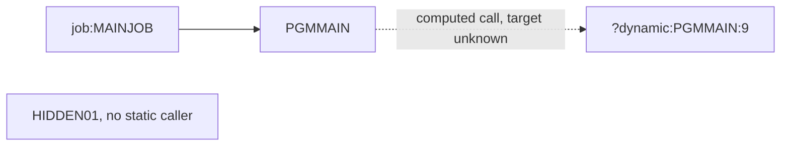

# 02 Coupling

`02a-edge-tables.md` holds every edge the extractor found. This file holds the argument. The tree is
small: two COBOL programs and one JCL job, three edges in all (`analysis`, field `edge_counts`).

## What constrains the migration sequence

| # | Coupling pattern | Kind | Confidence | Evidence |
|---|---|---|---|---|
| 1 | The job step runs PGMMAIN. This is the only way in. | call | high | `app/jcl/MAINJOB.jcl:2` |
| 2 | PGMMAIN calls a program named at run time. The name is read by ACCEPT into a field with no VALUE clause, and CALL has no ON EXCEPTION. Any program in the load library can be the target. | call, computed | low | `app/cbl/PGMMAIN.cbl:9` |
| 3 | No dataset, copybook or scheduler edge exists. The system has no data or contract coupling that the extractor can see. That is a statement about the tree, not about production, because the dispatched program is not known. | data, contract, temporal | low | `analysis`, fields `data_hubs` and `edge_counts` |

Pattern 2 is the constraint that matters. Everything else is trivial. A wave plan for this tree can
be cut in one line, and it is still not safe to ship until pattern 2 is settled.

## Open edge worked inline (dependency-cartographer role)

The extractor left one edge open, far below the 20 that would justify handing this to the agent, so
the edge was worked by reading the source. What follows is inference.

| Computed call | What the code shows | Set of programs it can reach | Still open | Evidence |
|---|---|---|---|---|
| `?dynamic:PGMMAIN:9` | WS-PGM-NAME is declared with no VALUE clause. It is filled only by ACCEPT. The program has no MOVE and no table of names. | Cannot be bounded from source. The only other program in the tree is HIDDEN01, so it is the one candidate that can be named. | The value of the ACCEPT input. Whether the target is inside this tree at all. Whether the input differs by run date. | `app/cbl/PGMMAIN.cbl:5`, `app/cbl/PGMMAIN.cbl:8`, `app/cbl/PGMMAIN.cbl:9` |

Inference, not fact from the graph: an ACCEPT with no FROM clause reads the standard input device.
On z/OS batch that is the SYSIN DD. The job defines no DD statement at all, so the step as written
supplies no input. Either this copy of the job is incomplete, or a proc, an override or the
scheduler supplies the name, or the step would fail at the ACCEPT. The cited lines are
`app/jcl/MAINJOB.jcl:1` and `app/jcl/MAINJOB.jcl:2`. This is the first question for the client.

There is no medium confidence contract edge and no `resolved: false` dataset edge in the graph, so
nothing else needed reading.

Items the extractor does not model, checked by reading all ten lines of PGMMAIN and both lines of
MAINJOB: no EXEC CICS chain, no submit through the internal reader, no IMS, DB2 or MQ, and no
IF/THEN/ELSE or COND= in the JCL. Nothing to report under any of those.

## Clusters

There is one cluster. A node-per-program graph adds nothing here.

## Structure computed from the call graph

| Fact | Units | Evidence |
|---|---|---|
| Strongly connected components | none | `analysis`, field `sccs` |
| Self recursive programs | none | `analysis`, field `self_recursive` |
| Articulation points | none | `analysis`, field `articulation_points` |
| God modules | none | `analysis`, field `god_modules` |
| Data hubs | none | `analysis`, field `data_hubs` |

No SCC means nothing forces two units to move together. No articulation point means there is no
natural place to cut a wave inside the tree. No god module means nothing needs a facade for size
reasons. The facade that this system needs is different: a registry of the programs PGMMAIN may
call, so the port can dispatch by name in the target. That registry does not exist yet and cannot be
built until the names are known. This is inference.

## The honest boundary

The computed call at `app/cbl/PGMMAIN.cbl:9` is the edge of what this analysis knows. Every
statement in this assessment about what wave 1 reads, writes or depends on is a statement about
PGMMAIN and MAINJOB only. Whatever PGMMAIN dispatches to is outside it. The unscheduled and
scheduler questions are in `00-summary.md`, since `analysis` shows a warning that no scheduler
artifact was parsed.
