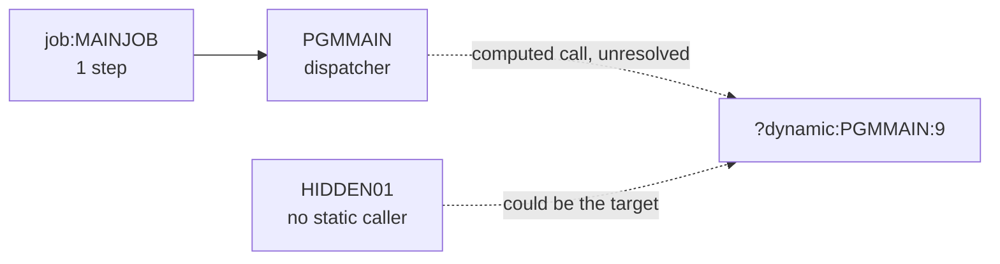

# 02 Coupling

The full edge list is in `02a-edge-tables.md`. This file is the argument. The system is small: one
job, one step, two programs, no copybooks, no datasets. It has three edges, and one of them is the
one that matters.

## Coupling patterns that constrain the sequence

### 1. One computed call decides what the system is

`PGMMAIN` reads a program name with `ACCEPT` and calls it. The target field has no `VALUE` clause
and nothing is ever moved into it, so the extractor could not resolve the call.

| Fact | Evidence | Confidence |
|---|---|---|
| `WS-PGM-NAME` is declared `PIC X(8)` with no `VALUE` clause | `app/cbl/PGMMAIN.cbl:5` | high |
| The name is read by `ACCEPT` | `app/cbl/PGMMAIN.cbl:8` | high |
| The program then calls whatever name it was given | `app/cbl/PGMMAIN.cbl:9` | high |
| The call has no `ON EXCEPTION` clause, so a missing or blank name is not handled in the source | `app/cbl/PGMMAIN.cbl:9` | medium |
| The extractor recorded the call as `?dynamic:PGMMAIN:9`, unresolved, low confidence | `app/cbl/PGMMAIN.cbl:9` | high |

I settled this edge by hand. There was one, so I did not hand it to a separate agent, and I followed
the `dependency-cartographer` steps myself. What that work found is inference:

- The set of programs `PGMMAIN` can reach **cannot be bounded from the source**. I looked for a
  `VALUE` clause, a literal `MOVE`, a table of names and a copybook. The program has none of them
  (inference, `app/cbl/PGMMAIN.cbl:5`).
- The only other program in the tree with no static caller is `HIDDEN01`. It could be a target
  (inference, `app/cbl/HIDDEN01.cbl:1`). So could a program that is not in the tree, such as a
  load module in a library nobody gave us. The tree cannot rule that out (inference).
- `PGMMAIN` could also name itself. That would be a recursive call the source does not mark as
  recursive (inference, `app/cbl/PGMMAIN.cbl:2`).
- The JCL has no `SYSIN` DD. `ACCEPT` with no `FROM` clause reads `SYSIN` on IBM compilers. Either
  the step supplies the name some way that is not in this tree, or the job was copied without its
  input, or the step fails or receives spaces (inference, `app/jcl/MAINJOB.jcl:2`).

What this means for the sequence: no wave plan can be certain about what `PGMMAIN` runs until the
client says which names have ever been supplied. This is the honest boundary.

### 2. Everything hangs off one entry point

`job:MAINJOB` is the only entry point. Its only step runs `PGMMAIN`. Every path in the tree passes
through those two edges.

| Edge | Kind | Evidence | Confidence |
|---|---|---|---|
| `job:MAINJOB` holds `step:MAINJOB.S1` | include | `app/jcl/MAINJOB.jcl:2` | high |
| `step:MAINJOB.S1` runs `PGMMAIN` | call | `app/jcl/MAINJOB.jcl:2` | high |
| `PGMMAIN` calls `?dynamic:PGMMAIN:9` | call | `app/cbl/PGMMAIN.cbl:9` | low |

There is nothing to cut along. No program has two callers, so fan-in is empty, and no structure inside
the tree separates one part from another.

### 3. Temporal and data coupling are not visible at all

- There is no dataset in the tree. The JCL names no DD (`app/jcl/MAINJOB.jcl:2`), and `PGMMAIN`
  has no `SELECT` or `FD` in its ten lines (`app/cbl/PGMMAIN.cbl:1-10`). So there are no data or contract edges, and no data hubs.
  That is a fact about this tree, not a finding that the system has no shared data. Any program
  `PGMMAIN` calls may read and write files that this tree does not show (inference).
- No scheduler artifact was parsed. The extractor warned that the order jobs run in across jobs is
  unknown. The client named "the nightly batch cycle" as what must not break. This tree gives no
  way to tell which jobs make up that cycle, or whether `job:MAINJOB` is one of them (inference,
  `app/jcl/MAINJOB.jcl:1`). This is a gap and it goes in the open questions.

## Cluster view

At cluster level the system is one cluster and one unresolved boundary.

## Structure computed from the graph

| Structure | Result | Evidence |
|---|---|---|
| Strongly connected components | none, so nothing has to move as a unit | inference from `graph.json` analysis |
| Self recursive programs | none found by the extractor | inference from `graph.json` analysis |
| God modules | none. With two programs the fan-in ranking means nothing | inference from `graph.json` analysis |
| Articulation points | none. There is no fork in the call graph | inference from `graph.json` analysis |
| Data hubs | none, because no dataset is mapped | `app/jcl/MAINJOB.jcl:2` |

There is no strongly connected component, so no wave here could split one. There is no god module, so
nothing needs a facade for that reason. The facade in the wave plan is there for the computed call.

## The honest boundary

The extractor lists one unresolved computed call and no unparsed files. It reads COBOL, JCL, PROCs,
CICS definitions, Control-M XML and shell wrappers that name JCL. It found no scheduler and no proc.
Two limits from `meta.limits` touch this system directly:

- A variable call target is resolved only from `VALUE` clauses and literal `MOVE`s in the same
  program. `PGMMAIN` has neither, which is why the call is open.
- A called subprogram gets no DDs from its caller's JCL step. This matters less here, since the step
  has no DDs, but any target `PGMMAIN` calls would inherit an empty set.
