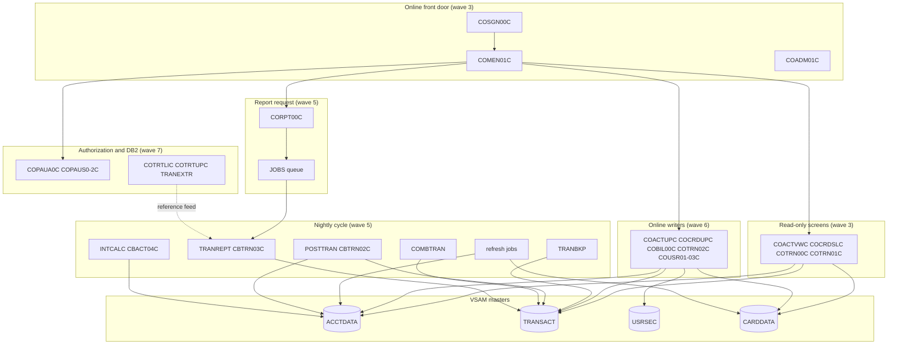

# 02 Coupling

The edge tables are in `modernization-assessment/02a-edge-tables.md`. This file is the argument. Facts come from `modernization-assessment/graph.json`. Anything I read in source to settle an open edge is labeled `inference`.

The graph has 44 programs, 55 JCL jobs and 1,224 edges: 318 call, 62 contract, 235 data, 476 include and 133 temporal (`analysis` block, `edge_counts`). 99 entry points were found.

## The three patterns that constrain the sequence

### 1. The transaction master's history lives in one GDG that three routes write

This is the pattern that most limits the plan, and no edge in `graph.json` shows it whole.

| Step | What happens | Evidence |
|---|---|---|
| TRANBKP unloads the transaction master to a new generation, then deletes and redefines the KSDS empty | The generation is the only copy of history until COMBTRAN reloads it | `app/jcl/TRANBKP.jcl:33`, `app/jcl/TRANBKP.jcl:40`, `app/jcl/TRANBKP.jcl:54` |
| POSTTRAN runs CBTRN02C, which opens the transaction master for OUTPUT | It only works because TRANBKP emptied the file first | `app/cbl/CBTRN02C.cbl:256`, `scripts/run_posting.sh:23`, `scripts/run_posting.sh:26` |
| COMBTRAN sorts generation (0) with SYSTRAN (0) and REPROs the result back | It reads whichever generation is newest at that moment | `app/jcl/COMBTRAN.jcl:23`, `app/jcl/COMBTRAN.jcl:24`, `app/jcl/COMBTRAN.jcl:26` |
| The transaction report job unloads the master into a new TRANSACT.BKUP generation as its first step | Running the report moves generation (0) | `app/jcl/TRANREPT.jcl:26`, `app/jcl/TRANREPT.jcl:33` |
| The online report screen submits JCL text that calls proc TRANREPT, which does the same unload | Any signed-on user can move generation (0) at any time | `app/cbl/CORPT00C.cbl:94`, `app/cbl/CORPT00C.cbl:517`, `app/proc/TRANREPT.prc:31` |
| The generation group keeps five generations and scratches the oldest | Five report runs between TRANBKP and COMBTRAN would scratch the backup | `app/jcl/DEFGDGB.jcl:24`, `app/jcl/DEFGDGB.jcl:26`, `app/jcl/DEFGDGB.jcl:27` |

The report route is `inference` for the collision itself. The graph holds the pieces (the include edges from CORPT00C's literal, the datasets), but not the conclusion that a report run between TRANBKP and COMBTRAN hands COMBTRAN an unload of an empty file. Whether it happens depends on how the client's scheduler serializes these jobs. See Open Questions in `modernization-assessment/00-summary.md`. A port that replaces GDGs with some other versioning has to give every reader the same meaning of "latest".

### 2. Data coupling: shared masters with writers on both sides of the wave line

`analysis.data_hubs` names the datasets with the most programs attached. The contract edges are all `high`, which means both sides copy the same layout copybook. It does not mean they are equal (`meta.limits`).

| Dataset | Writers | Readers | What makes it hard | Evidence |
|---|---|---|---|---|
| Account master ACCTDATA | 4 | 11 | CBTRN02C, CBACT04C, COACTUPC and COBIL00C write it. The refresh job deletes it and rebuilds it from a flat file, so online updates since the flat file was cut are discarded | `app/cbl/CBTRN02C.cbl:51`, `app/cbl/COACTUPC.cbl:573`, `app/jcl/ACCTFILE.jcl:25`, `app/jcl/ACCTFILE.jcl:61` |
| Transaction master TRANSACT | 3 | 11 | Batch posting, online add and bill payment all write it, and each builds keys its own way (last key plus one online) | `app/cbl/CBTRN02C.cbl:34`, `app/cbl/COBIL00C.cbl:217`, `app/cbl/COTRN02C.cbl:449` |
| Sign-on file USRSEC | 3 | 5 | Written by the three user-admin screens, read by sign-on with the same layout. Passwords are eight characters, stored and compared in clear | `app/cbl/COSGN00C.cbl:223`, `app/cpy/CSUSR01Y.cpy:21`, `app/cbl/COUSR01C.cbl:157` |
| Cross reference CARDXREF | 0 | 8 | No program writes it. Every read is a lookup, and posting rejects a card the file lacks | `app/cbl/CBTRN02C.cbl:40`, `app/cbl/CBTRN02C.cbl:385` |
| Category balances TCATBALF | 1 | 4 | CBTRN02C updates it; the refresh job rebuilds it before each posting run | `app/cbl/CBTRN02C.cbl:57`, `app/jcl/TCATBALF.jcl:25`, `scripts/run_posting.sh:20` |
| DB2 table TRANSACTION_TYPE | 3 | 2 | Read by the DB2 screens and unloaded to TRANTYPE.PS for the report | `app/app-transaction-type-db2/cbl/COTRTLIC.cbl:338`, `app/app-transaction-type-db2/cbl/COBTUPDT.cbl:137` |

The readers count in `analysis.data_hubs` includes JCL steps as well as programs. ACCTDATA has ten reading programs and one reading step, and TRANSACT has five reading programs and six reading steps.

The sequence consequence: the seed puts read-only online screens (wave 3) before the batch and online writers (waves 5 and 6). The screens will read masters that legacy programs still write. That needs a shared data path. It is a precondition of wave 3, not a wave of its own.

### 3. Temporal coupling lives in three schedulers that do not agree

The daily cycle is defined in three places, and only two are parsed.

| Source | What it says | Evidence |
|---|---|---|
| Shell wrappers (parsed) | Close files, refresh account master, refresh category balances, TRANBKP, POSTTRAN, TRANIDX, open files, with sleeps of 5 and 10 seconds between submits | `scripts/run_posting.sh:13`, `scripts/run_posting.sh:14`, `scripts/run_posting.sh:27`, `scripts/run_posting.sh:34` |
| Control-M daily folder (parsed) | CLOSEFIL, TRANBKP, WAITSTEP, OPENFIL. It has no POSTTRAN | `app/scheduler/CardDemo.controlm:4`, `app/scheduler/CardDemo.controlm:8`, `app/scheduler/CardDemo.controlm:14`, `app/scheduler/CardDemo.controlm:20` |
| CA-7 listing (not parsed) | CLOSEFIL triggers CBPAUP0J, which triggers POSTTRAN, then WAITSTEP, then OPENFIL. Other chains run TRANTYPE, TRANCATG and TCATBALF. It names no ACCTFILE, CARDFILE, XREFFILE, CUSTFILE, TRANBKP, INTCALC or COMBTRAN | `app/scheduler/CardDemo.ca7:43`, `app/scheduler/CardDemo.ca7:70`, `app/scheduler/CardDemo.ca7:97`, `app/scheduler/CardDemo.ca7:124` |

The CA-7 row is `inference`: the extractor lists that file as not parsed, and I read it by hand. Ordering in the wrappers is by submit time plus a sleep, so it is not an enforced dependency. Two more ordering facts matter:

- A Control-M condition makes the weekly transaction-type refresh (wave 7) run before the weekly disclosure-group folder starts (wave 1): `app/scheduler/CardDemo.controlm:28`, `app/scheduler/CardDemo.controlm:34`. That is an edge from the last wave back to the first.
- The report's reference data flows backwards too. TRANEXTR (wave 7) unloads DB2 to TRANTYPE.PS, job TRANTYPE (wave 5) reloads the VSAM file from it, and CBTRN03C reads that file: `app/app-transaction-type-db2/jcl/TRANEXTR.jcl:19`, `app/jcl/TRANTYPE.jcl:56`, `app/cbl/CBTRN03C.cbl:39`. The graph has no dataset edge for TRANEXTR because its dataset names use the symbol `&HLQ` (`app/app-transaction-type-db2/jcl/TRANEXTR.jcl:34`), so this path is `inference`.

## Cluster map

## Strongly connected components

They move whole. The validator rejects a plan that splits one. `waves.json` keeps all three intact.

| Component | Wave | Why it is a cycle | Evidence |
|---|---|---|---|
| COADM01C, COMEN01C, COSGN00C | 3 | Sign-on sends users to the menus, and both menus can return to sign-on | `app/cbl/COSGN00C.cbl:231`, `app/cbl/COSGN00C.cbl:236`, `app/cbl/COMEN01C.cbl:201` |
| COTRN00C, COTRN01C | 3 | The list and the detail screen return to each other | `app/cbl/COTRN00C.cbl:188`, `app/cbl/COTRN01C.cbl:126` |
| COPAUS0C, COPAUS1C | 7 | The summary and the detail screen return to each other | `app/app-authorization-ims-db2-mq/cbl/COPAUS0C.cbl:316`, `app/app-authorization-ims-db2-mq/cbl/COPAUS1C.cbl:185` |

COCRDLIC and COPAUS0C also call themselves (`analysis.self_recursive`): `app/cbl/COCRDLIC.cbl:538`, `app/app-authorization-ims-db2-mq/cbl/COPAUS0C.cbl:192`.

## God modules

`analysis.god_modules` lists COPAUS0C, COTRN00C and COTRN01C. Treat the list with care. The test is the top decile of fan-in and fan-out in a graph where the largest fan-in among them is 1 (`analysis.fan_in`), so COTRN00C and COTRN01C are flagged for being a two-screen pair, not for being a hub. They move as one cycle in wave 3. COPAUS0C is the real case: 792 lines, self-recursive, six IMS calls, and a cycle with COPAUS1C. It stays in wave 7 and needs a facade in front of the IMS access before it moves (`inference`, from `app/app-authorization-ims-db2-mq/cbl/COPAUS0C.cbl:322`).

The programs that are hubs in the ordinary sense are COMEN01C and COSGN00C, each with 12 callers (`analysis.fan_in`). They are the menu router and the sign-on front door, and every online wave passes through them.

## Articulation points

`analysis.articulation_points` lists 19 nodes, computed over call edges between programs plus data edges from programs to datasets (`analysis.articulation_basis`). Read the list with the basis in mind.

- Six are datasets: ACCTDATA, CARDDATA, CARDXREF, CUSTDATA, EXPORT.DATA and the DB2 table. These are real boundaries. The account master is the strongest: four writers, and it is where waves 5 and 6 meet.
- COSGN00C, COADM01C, COPAUS0C, COPAUS1C and COPAUS2C are real wave boundaries for the online and authorization clusters.
- The batch programs on the list (CBACT01C, CBACT04C, CBEXPORT, CBIMPORT, CBSTM03A, CBTRN02C, CBTRN03C) are flagged mostly because private output datasets hang off them as leaves, for example the three outputs of CBACT01C at `app/cbl/CBACT01C.cbl:35`. That is `inference`. Only CBTRN02C and CBACT04C, which share ACCTDATA and TCATBALF, sit on a boundary that matters.

## The honest boundary: computed calls

28 computed calls (`analysis.unresolved_dynamic`) are all `EXEC CICS XCTL PROGRAM(variable)`. The extractor could not resolve the variable. I read each site and the MOVEs that feed it. Every reach set below comes from literal MOVEs in the same program, from the two menu tables (`app/cpy/COMEN02Y.cpy:28`, `app/cpy/COADM02Y.cpy:29`), or from a field set by the calling program. All of them name online programs. None names a batch program, so none can reach CBTRN01C. Confidence is `high` where a table or a single literal is the only source, and `medium` where a COMMAREA field set by a caller can also feed the target, because the calling chain is not modeled (`meta.limits`: RETURN TRANSID and START are not edges).

| Caller and line | Reach set (inference) | Confidence | Evidence |
|---|---|---|---|
| COACTUPC 956 | COMEN01C, or the program that transferred in | medium | `app/cbl/COACTUPC.cbl:956`, `app/cbl/COACTUPC.cbl:939`, `app/cbl/COACTUPC.cbl:941` |
| COACTVWC 349 | COMEN01C, or the program that transferred in | medium | `app/cbl/COACTVWC.cbl:349`, `app/cbl/COACTVWC.cbl:336`, `app/cbl/COACTVWC.cbl:338` |
| COADM01C 145 | one of the six names in COADM02Y: COUSR00C, COUSR01C, COUSR02C, COUSR03C, COTRTLIC, COTRTUPC | high | `app/cbl/COADM01C.cbl:145`, `app/cpy/COADM02Y.cpy:29`, `app/cpy/COADM02Y.cpy:53` |
| COADM01C 168 | COSGN00C | high | `app/cbl/COADM01C.cbl:168`, `app/cbl/COADM01C.cbl:166` |
| COBIL00C 281 | COSGN00C or COMEN01C | medium | `app/cbl/COBIL00C.cbl:281`, `app/cbl/COBIL00C.cbl:276`, `app/cbl/COBIL00C.cbl:130` |
| COCRDLIC 538 | COCRDLIC, COCRDSLC or COCRDUPC | medium | `app/cbl/COCRDLIC.cbl:538`, `app/cbl/COCRDLIC.cbl:526`, `app/cbl/COCRDLIC.cbl:554` |
| COCRDLIC 566 | COCRDLIC, COCRDSLC or COCRDUPC | medium | `app/cbl/COCRDLIC.cbl:566`, `app/cbl/COCRDLIC.cbl:592`, `app/cbl/COCRDLIC.cbl:600` |
| COCRDSLC 331 | COMEN01C, or the program that transferred in | medium | `app/cbl/COCRDSLC.cbl:331`, `app/cbl/COCRDSLC.cbl:318`, `app/cbl/COCRDSLC.cbl:320` |
| COCRDUPC 473 | COMEN01C, or the program that transferred in | medium | `app/cbl/COCRDUPC.cbl:473`, `app/cbl/COCRDUPC.cbl:451`, `app/cbl/COCRDUPC.cbl:453` |
| COMEN01C 156 | COPAUS0C only, guarded by the WHEN at line 147 | high | `app/cbl/COMEN01C.cbl:156`, `app/cbl/COMEN01C.cbl:147`, `app/cpy/COMEN02Y.cpy:89` |
| COMEN01C 184 | any of the other ten names in COMEN02Y | high | `app/cbl/COMEN01C.cbl:184`, `app/cpy/COMEN02Y.cpy:28`, `app/cpy/COMEN02Y.cpy:83` |
| COMEN01C 201 | COSGN00C | high | `app/cbl/COMEN01C.cbl:201`, `app/cbl/COMEN01C.cbl:199` |
| COPAUS0C 322 | COPAUS1C, COPAUS0C or COMEN01C, all named constants | high | `app/app-authorization-ims-db2-mq/cbl/COPAUS0C.cbl:322`, `app/app-authorization-ims-db2-mq/cbl/COPAUS0C.cbl:316`, `app/app-authorization-ims-db2-mq/cbl/COPAUS0C.cbl:236` |
| COPAUS0C 674 | COSGN00C | high | `app/app-authorization-ims-db2-mq/cbl/COPAUS0C.cbl:674`, `app/app-authorization-ims-db2-mq/cbl/COPAUS0C.cbl:669` |
| COPAUS1C 367 | COPAUS0C, a named constant | high | `app/app-authorization-ims-db2-mq/cbl/COPAUS1C.cbl:367`, `app/app-authorization-ims-db2-mq/cbl/COPAUS1C.cbl:34` |
| CORPT00C 548 | COSGN00C or COMEN01C | medium | `app/cbl/CORPT00C.cbl:548`, `app/cbl/CORPT00C.cbl:543`, `app/cbl/CORPT00C.cbl:188` |
| COTRN00C 192 | COTRN01C | high | `app/cbl/COTRN00C.cbl:192`, `app/cbl/COTRN00C.cbl:188` |
| COTRN00C 518 | COSGN00C or COMEN01C | medium | `app/cbl/COTRN00C.cbl:518`, `app/cbl/COTRN00C.cbl:513`, `app/cbl/COTRN00C.cbl:123` |
| COTRN01C 205 | COSGN00C, COMEN01C or COTRN00C | medium | `app/cbl/COTRN01C.cbl:205`, `app/cbl/COTRN01C.cbl:200`, `app/cbl/COTRN01C.cbl:126` |
| COTRN02C 508 | COSGN00C or COMEN01C | medium | `app/cbl/COTRN02C.cbl:508`, `app/cbl/COTRN02C.cbl:503`, `app/cbl/COTRN02C.cbl:138` |
| COTRTLIC 620 | COADM01C, COTRTUPC, or the program that transferred in | medium | `app/app-transaction-type-db2/cbl/COTRTLIC.cbl:620`, `app/app-transaction-type-db2/cbl/COTRTLIC.cbl:603`, `app/app-transaction-type-db2/cbl/COTRTLIC.cbl:638` |
| COTRTUPC 457 | COADM01C, or the program that transferred in | medium | `app/app-transaction-type-db2/cbl/COTRTUPC.cbl:457`, `app/app-transaction-type-db2/cbl/COTRTUPC.cbl:440`, `app/app-transaction-type-db2/cbl/COTRTUPC.cbl:442` |
| COUSR00C 196 | COUSR02C | high | `app/cbl/COUSR00C.cbl:196`, `app/cbl/COUSR00C.cbl:192` |
| COUSR00C 206 | COUSR03C | high | `app/cbl/COUSR00C.cbl:206`, `app/cbl/COUSR00C.cbl:202` |
| COUSR00C 514 | COSGN00C or COADM01C | medium | `app/cbl/COUSR00C.cbl:514`, `app/cbl/COUSR00C.cbl:509`, `app/cbl/COUSR00C.cbl:126` |
| COUSR01C 175 | COSGN00C or COADM01C | medium | `app/cbl/COUSR01C.cbl:175`, `app/cbl/COUSR01C.cbl:168`, `app/cbl/COUSR01C.cbl:94` |
| COUSR02C 258 | COSGN00C or COADM01C | medium | `app/cbl/COUSR02C.cbl:258`, `app/cbl/COUSR02C.cbl:253`, `app/cbl/COUSR02C.cbl:114` |
| COUSR03C 205 | COSGN00C or COADM01C | medium | `app/cbl/COUSR03C.cbl:205`, `app/cbl/COUSR03C.cbl:200`, `app/cbl/COUSR03C.cbl:113` |

What this means for the rest of the analysis. The 28 calls are bounded, so the online reach is closed: no online program can end in a program outside the 17 named in the two tables plus COSGN00C, COMEN01C, COADM01C. It is not proven, because the caller-set fields are populated across transactions and the chains through EXEC CICS RETURN TRANSID are not in the graph. Waves 3, 5, 6 and 7 hold the callers (CORPT00C is in wave 5), so none of them has `high` confidence.

Other open edges the extractor did not model, all `inference` from reading the cited lines:

- **Internal reader.** CORPT00C builds JCL text and writes it to queue JOBS: `app/cbl/CORPT00C.cbl:94`, `app/cbl/CORPT00C.cbl:517`, `app/csd/CARDDEMO.CSD:499`. The queue is defined as "submit jobs from CICS" and transaction CR00 runs CORPT00C (`app/csd/CARDDEMO.CSD:409`). The extractor noticed the literal and made no edge.
- **Nested procs.** Proc TRANREPT calls proc REPROC at `app/proc/TRANREPT.prc:21`. Nested procs are not followed (`meta.limits`), so the graph does not show that the online report route also runs the REPROC unload.
- **Symbolic dataset names.** `app/app-transaction-type-db2/jcl/TRANEXTR.jcl:34` and seven other lines use `&HLQ`. The graph has no dataset edge for job TRANEXTR at all, although it backs up, deletes and unloads TRANTYPE.PS and TRANCATG.PS (`app/app-transaction-type-db2/jcl/TRANEXTR.jcl:45`, `app/app-transaction-type-db2/jcl/TRANEXTR.jcl:57`). `app/app-transaction-type-db2/jcl/CREADB21.jcl:29` has the same pattern.
- **CICS file state.** CLOSEFIL closes five files in region CICSAWSA and OPENFIL reopens them (`app/jcl/CLOSEFIL.jcl:26`, `app/jcl/OPENFIL.jcl:26`). No edge records that the online region must be quiet while a refresh job runs. CARDFILE and CUSTFILE close their own files through SDSF steps, so the CLOSEFIL list does not include the card and customer masters.
- **Assembler.** COBDATFT and MVSWAIT are called at `app/cbl/CBACT01C.cbl:231` and `app/cbl/COBSWAIT.cbl:38` and their source is in `app/asm/COBDATFT.asm:1` and `app/asm/MVSWAIT.asm:1`, which are not parsed.
- **Scheduler not parsed.** The CA-7 listing names jobs the extractor calls unscheduled: CBPAUP0J, CREASTMT, PRTCATBL, READACCT, READCARD, READCUST, READXREF and TXT2PDF1 (`app/scheduler/CardDemo.ca7:51`, `app/scheduler/CardDemo.ca7:476`, `app/scheduler/CardDemo.ca7:545`, `app/scheduler/CardDemo.ca7:348`, `app/scheduler/CardDemo.ca7:375`, `app/scheduler/CardDemo.ca7:402`, `app/scheduler/CardDemo.ca7:429`, `app/scheduler/CardDemo.ca7:503`). Eight of the 35 unscheduled jobs are therefore scheduled. The other 27 include the transaction report job TRANREPT.
