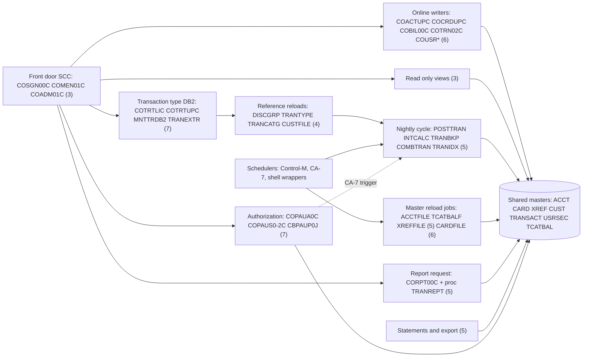

# 02 Coupling

Facts in this file come from `modernization-assessment/graph.json` and are tagged `analysis` when they are computed there. Anything I read from source myself to settle an open edge is tagged `inference` and carries a citation. The open edges were more than 20 (28 computed calls, 16 unmapped DDs, 38 medium confidence call edges between programs), so I did the dependency-cartographer work inline; its findings are in the last section.

## The four patterns that constrain the sequence

### 1. Eight shared datasets are touched from more than one wave, two of them from five

The call graph is small and almost flat: 318 call edges, no god module, three small cycles. The dependencies that matter are the data ones. Eight datasets are read or written by programs that land in more than one wave. Two of them (account and customer) are touched from five waves, and two more (card and cross reference) from four.

| Dataset | Waves whose programs touch it | Writers | Readers | Evidence |
|---|---|---|---|---|
| ACCTDATA.VSAM.KSDS | 2, 3, 5, 6, 7 | 4 | 11 | analysis: `data_hubs`; layout `app/cpy/CVACT01Y.cpy:4` |
| CUSTDATA.VSAM.KSDS | 2, 3, 5, 6, 7 | 1 | 7 | analysis: `data_hubs`; layout `app/cpy/CVCUS01Y.cpy:4` |
| CARDDATA.VSAM.KSDS | 2, 3, 5, 6 | 1 | 6 | analysis: `data_hubs`; layout `app/cpy/CVACT02Y.cpy:4` |
| CARDXREF.VSAM.KSDS | 2, 5, 6, 7 | 0 | 8 | analysis: `data_hubs`; layout `app/cpy/CVACT03Y.cpy:4` |
| TRANSACT.VSAM.KSDS | 3, 5, 6 | 3 | 11 | analysis: `data_hubs`; layout `app/cpy/CVTRA05Y.cpy:4` |
| USRSEC.VSAM.KSDS | 3, 6 | 3 | 5 | analysis: `data_hubs`; layout `app/cpy/CSUSR01Y.cpy:17` |
| CARDXREF alternate index path | 3, 6, 7 | 0 | 5 | analysis: `data_hubs`; `app/jcl/XREFFILE.jcl:90` |
| EXPORT.DATA | 2, 5 | 1 | 1 | analysis: contract edge CBEXPORT to CBIMPORT; `app/cbl/CBEXPORT.cbl:65`, `app/cbl/CBIMPORT.cbl:37` |

All 62 contract edges are `high`: each pair of programs copies the same layout copybook. That is good news for a port and it is the weakest kind of proof; the extractor says high means a shared layout, not proven equal (`meta.limits`). The five record layouts above are the real interfaces of this system, and no document describes them. The wave plan lets each reader move before its writer and read the legacy file through an access facade, which is the only way to move a reader early. The system of record for each master flips in the wave that holds its first writing program.

### 2. The nightly cycle is a chain held together by wrapper order and sleeps

`scripts/run_full_batch.sh` submits the cycle as CLOSEFIL, the refresh jobs, TRANBKP, POSTTRAN, INTCALC, TRANBKP again, COMBTRAN, TRANIDX and OPENFIL (`scripts/run_full_batch.sh:13-66`). It waits with `sleep` (`scripts/run_full_batch.sh:14`, `:48`, `:52`, `:59`, `:63`) and checks no return code. The submit is a `put` to the job entry system, so completion is not awaited. Order is enforced by hope and timing, not by the scheduler (inference).

The data flow inside the chain is just as fragile.

- TRANBKP backs the transaction master up to a new generation, then deletes and redefines it empty (`app/jcl/TRANBKP.jcl:23-33`, `:40-46`, `:54-67`).
- POSTTRAN then runs CBTRN02C, which opens the transaction master for OUTPUT (`app/cbl/CBTRN02C.cbl:256`). That only works on the empty file TRANBKP left behind (inference).
- INTCALC writes a generation of SYSTRAN (`app/jcl/INTCALC.jcl:37-41`).
- COMBTRAN merges `TRANSACT.BKUP(0)` and `SYSTRAN(0)` and loads the result into the master (`app/jcl/COMBTRAN.jcl:23-26`, `:41-48`). Because `run_full_batch.sh` runs TRANBKP twice (`scripts/run_full_batch.sh:29`, `:55`), generation 0 at that point holds only the day's postings, not the history (inference). Ask the client whether that is intended (see Open Questions in `00-summary.md`).
- The generation bases must exist first: `app/jcl/DEFGDGB.jcl:24-59` and `app/jcl/DALYREJS.jcl:24-28`.

The CA-7 listing, which the extractor could not parse, describes a different trigger order: CLOSEFIL triggers CBPAUP0J, and CBPAUP0J triggers POSTTRAN (`app/scheduler/CardDemo.ca7:43`, `:70`). CBPAUP0J is an IMS job that purges expired authorizations (`app/app-authorization-ims-db2-mq/jcl/CBPAUP0J.jcl:25`). So in production the posting job may wait for an IMS job that sits in wave 7 (inference from a file the extractor did not read).

### 3. Batch and online are kept apart by closing files, not by locking

CLOSEFIL issues a CEMT close for five CICS files (`app/jcl/CLOSEFIL.jcl:26-30`). CBTRN02C opens the account master for I-O (`app/cbl/CBTRN02C.cbl:311`) and CBACT04C does the same (`app/cbl/CBACT04C.cbl:291`), while COACTUPC rewrites the same records under a CICS lock (`app/cbl/COACTUPC.cbl:3894-3900`). Nothing else separates them (inference). A target that lets online updates continue during the batch window needs real transactional isolation, and that is a design change, not a port.

### 4. The system is wired partly through text the extractor does not follow

| What is hidden | Where | What it hides | Evidence |
|---|---|---|---|
| JCL inside a COBOL literal | CORPT00C writes job lines to the JOBS queue | The online way to run proc TRANREPT and CBTRN03C | `app/cbl/CORPT00C.cbl:94`, `app/cbl/CORPT00C.cbl:517`, `app/csd/CARDDEMO.CSD:499` |
| Program names in PARM | IMS BMP and DLI jobs | CBPAUP0C, PAUDBLOD, PAUDBUNL, DBUNLDGS | `app/app-authorization-ims-db2-mq/jcl/CBPAUP0J.jcl:25`, `app/app-authorization-ims-db2-mq/jcl/LOADPADB.JCL:27`, `app/app-authorization-ims-db2-mq/jcl/UNLDPADB.JCL:39`, `app/app-authorization-ims-db2-mq/jcl/UNLDGSAM.JCL:27` |
| Program name in TSO input | MNTTRDB2 | COBTUPDT with DB2 plan CARDDEMO | `app/app-transaction-type-db2/jcl/MNTTRDB2.jcl:30` |
| Symbolic dataset names | TRANEXTR uses `&HLQ` | It writes the TRANTYPE and TRANCATG flat files that two reload jobs read | `app/app-transaction-type-db2/jcl/TRANEXTR.jcl:25`, `app/app-transaction-type-db2/jcl/TRANEXTR.jcl:73`, `app/jcl/TRANTYPE.jcl:57` |
| A scheduler file the extractor cannot parse | CA-7 listing | Trigger chains for 17 jobs, including POSTTRAN (two of them, CLOSEFIL1 and CLOSEFIL2, are not in the tree) | `app/scheduler/CardDemo.ca7:43`, `app/scheduler/CardDemo.ca7:70` |
| IDCAMS and SORT control cards | Every reload job | Which side of a dataset is written; a REPRO into a VSAM shows as a read | `app/jcl/ACCTFILE.jcl:61`, `app/jcl/COMBTRAN.jcl:48` |

## Cluster graph

The graph is at cluster level. Numbers are the wave each cluster lands in.

## Strongly connected components

They move whole. The plan keeps each in one wave, and the validator rejects a plan that splits one.

| Component | Members | Wave | Evidence |
|---|---|---|---|
| Front door | COADM01C, COMEN01C, COSGN00C | 3 | analysis: `sccs`; `app/cbl/COSGN00C.cbl:231`, `app/cbl/COSGN00C.cbl:236`, `app/cbl/COMEN01C.cbl:199` |
| Authorization screens | COPAUS0C, COPAUS1C | 7 | analysis: `sccs`; `app/app-authorization-ims-db2-mq/cbl/COPAUS0C.cbl:316` |
| Transaction list and view | COTRN00C, COTRN01C | 3 | analysis: `sccs`; `app/cbl/COTRN00C.cbl:188` |

Self recursive: COCRDLIC and COPAUS0C (analysis: `self_recursive`).

## God modules

None by the extractor's rule (top decile of fan-in and fan-out) (analysis: `god_modules`). Size is the better warning here. COACTUPC is 3,368 lines with 43 REDEFINES and 51 GO TO (`app/cbl/COACTUPC.cbl:4`). No static call edge points at it; users reach it through the menu router or its own transaction id (`app/csd/CARDDEMO.CSD:306`), so it can be strangled behind the menu router rather than ported wholesale.

## Articulation points

| Point | What it separates | Evidence |
|---|---|---|
| CBTRN02C, CBACT04C, CBTRN03C | The batch posting programs from the datasets they share | analysis: `articulation_points` |
| CBACT01C, CBEXPORT, CBIMPORT, CBSTM03A | Extract, export and statement programs from the same datasets | analysis: `articulation_points` |
| COSGN00C, COADM01C | The front door from the online programs behind it | analysis: `articulation_points` |
| COPAUS0C, COPAUS1C, COPAUS2C | The authorization screens from DB2 and IMS | analysis: `articulation_points` |
| ACCTDATA, CARDDATA, CARDXREF, CUSTDATA, EXPORT.DATA | The five datasets that join the most programs | analysis: `articulation_points` |

The basis is call edges between programs plus program to dataset edges, so the natural wave boundaries are the five datasets, which is where the wave plan puts them.

## The honest boundary

- 28 computed calls, all `EXEC CICS XCTL` (analysis: `unresolved_dynamic`). Three take the target from the menu tables and are bounded to 17 online programs (`app/cpy/COMEN02Y.cpy:28`, `app/cpy/COADM02Y.cpy:29`). Two, in COCRDLIC, take it from CCARD-NEXT-PROG, which the program sets from its own literals (`app/cbl/COCRDLIC.cbl:195`, `app/cbl/COCRDLIC.cbl:203`). The other 23 take it from the COMMAREA field CDEMO-TO-PROGRAM and cannot be bounded from source.
- Eight file types are not read: DB2 DCLGEN and DDL, IMS DBD and PSB, DB2 control cards, assembler source and macros, and the CA-7 listing (analysis: `unparsed`). The DB2 tables and the IMS database are therefore not in the graph at all.
- IF, THEN, ELSE and COND in JCL are not modeled (`meta.limits`). Step order is file order. `app/jcl/TRANBKP.jcl:51` has `COND=(4,LT)` on the define step.
- Not one edge exists for EXEC CICS RETURN TRANSID, START or SEND MAP (`meta.limits`), so transaction to transaction flow is missing.
- Extractor warnings I read: two jobs repeat a step name (`app/jcl/DEFCUST.jcl:32`, `app/jcl/TRANREPT.jcl:37`); a real JCL converter may reject that (inference), so TRANREPT as written may not run.

## Findings from the open edges (dependency-cartographer work, inline)

Everything below is inference, labeled and cited.

### Computed calls

| Site | Target field | Reachable set I can prove | Still open | Evidence |
|---|---|---|---|---|
| COMEN01C:156 and :184 | CDEMO-MENU-OPT-PGMNAME | The 11 programs in the menu table (COACTVWC, COACTUPC, COCRDLIC, COCRDSLC, COCRDUPC, COTRN00C, COTRN01C, COTRN02C, CORPT00C, COBIL00C, COPAUS0C) | Nothing; a `DUMMY` option is intercepted at line 149 | `app/cpy/COMEN02Y.cpy:28`, `app/cpy/COMEN02Y.cpy:89`, `app/cbl/COMEN01C.cbl:149` |
| COADM01C:145 | CDEMO-ADMIN-OPT-PGMNAME | The 6 programs in the admin table (COUSR00C to COUSR03C, COTRTLIC, COTRTUPC) | Nothing | `app/cpy/COADM02Y.cpy:29`, `app/cpy/COADM02Y.cpy:53` |
| COCRDLIC:538 and :566 | CCARD-NEXT-PROG | COCRDSLC and COCRDUPC (and COMEN01C on the return path) | Nothing | `app/cbl/COCRDLIC.cbl:195`, `app/cbl/COCRDLIC.cbl:203`, `app/cbl/COCRDLIC.cbl:187` |
| 23 other sites with CDEMO-TO-PROGRAM | COMMAREA field set by the calling screen | The literals the extractor found (COSGN00C, COMEN01C, COADM01C, COTRN00C, COTRN01C, COUSR02C, COUSR03C, COPAUS0C, COPAUS1C, COTRTUPC) | Whether any other program moves a name into the field before an XCTL | `app/cbl/COBIL00C.cbl:276`, `app/cbl/CORPT00C.cbl:543`, `app/cbl/COUSR00C.cbl:196` |

Consequence: I read none of the six batch programs in the unknown bucket as a likely target of these calls. A CICS XCTL to a program that opens native COBOL files or makes IMS batch calls would fail at its first open. That is my reading, not proof, and the validator keeps them in unknown.

### Unmapped DDs

| Program and DD | What I found | Evidence |
|---|---|---|
| CBSTM03B TRNXFILE, XREFFILE, CUSTFILE, ACCTFILE | A called subprogram; its caller CBSTM03A runs in CREASTMT step STEP040, whose DDs serve it | `app/jcl/CREASTMT.JCL:83`, `app/jcl/CREASTMT.JCL:86` |
| CBIMPORT CARDOUT | No DD by that name in the job. The program opens it at start, so the job as written cannot open its outputs | `app/cbl/CBIMPORT.cbl:63`, `app/jcl/CBIMPORT.jcl:33-60` |
| PAUDBLOD INFILE1 and INFILE2 | Mapped in the LOADPADB job to the two IMS export files | `app/app-authorization-ims-db2-mq/jcl/LOADPADB.JCL:36`, `app/app-authorization-ims-db2-mq/jcl/LOADPADB.JCL:38` |
| PAUDBUNL OUTFIL1 and OUTFIL2 | Mapped in UNLDPADB to the same two files, so UNLDPADB writes what LOADPADB reads | `app/app-authorization-ims-db2-mq/jcl/UNLDPADB.JCL:48`, `app/app-authorization-ims-db2-mq/jcl/UNLDPADB.JCL:53` |
| COBTUPDT INPFILE | Mapped in MNTTRDB2 to a dataset literally named INPFILE | `app/app-transaction-type-db2/jcl/MNTTRDB2.jcl:27` |
| CBTRN01C, six DDs | No JCL step runs the program | inference: no job names it |

### Contract edges

There are no `medium` contract edges to compare; all 62 are `high` (analysis: `edge_counts`, contract table in `02a-edge-tables.md`). Two facts the extractor cannot see turn them into risks:

| Fact | Why it matters | Evidence |
|---|---|---|
| COBIL00C and COTRN02C take the highest key plus one to make a transaction id | It can collide with ids that CBTRN02C takes from the daily file | `app/cbl/COBIL00C.cbl:212-219`, `app/cbl/COTRN02C.cbl:444-451` |
| CBACT04C makes ids from its PARM date and a counter | INTCALC hardcodes the PARM | `app/cbl/CBACT04C.cbl:476-479`, `app/jcl/INTCALC.jcl:22` |
| Online bill payment and manual add write a transaction but not the category balance | Posting and interest use that file | `app/cbl/COBIL00C.cbl:233`, `app/cbl/CBTRN02C.cbl:440` |

### Not modeled and worth a look

| Item | Finding | Evidence |
|---|---|---|
| Report request | CORPT00C overrides both the sort window and DATEPARM from the screen; the batch job uses the fixed 2022 window | `app/cbl/CORPT00C.cbl:98-125`, `app/jcl/TRANREPT.jcl:43-44` |
| Batch jobs sent from CICS | The JOBS queue is defined in the CSD | `app/csd/CARDDEMO.CSD:499` |
| Transaction CDV1 | Points to program COCRDSEC, which has no source in the tree | `app/csd/CARDDEMO.CSD:388` |
