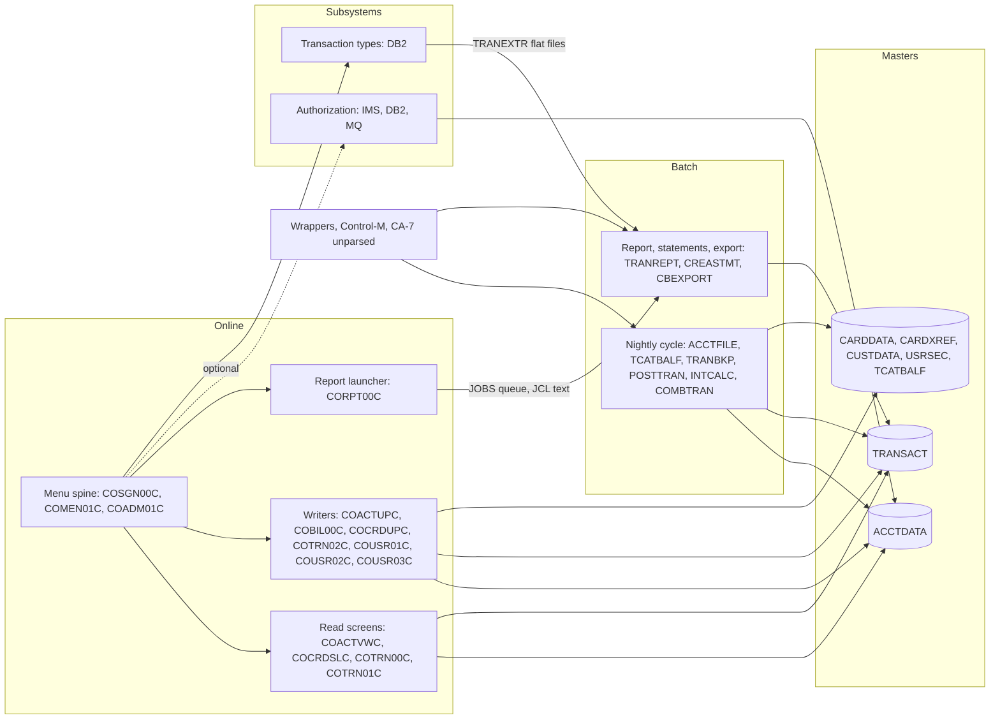

# 02 Coupling

`02a-edge-tables.md` lists every edge the extractor found. This file is the argument about what that coupling does to the sequence. A row marked `inference` is my reading of source, or my counting from `graph.json` and `modernization-assessment/waves.json`. It is not an extractor fact. The extractor made 318 call, 62 contract, 235 data, 476 include and 133 temporal edges (`analysis`, field `edge_counts`).

The work an outside agent would do on open edges (28 computed calls, 17 unmapped DDs, no medium contract edges) is done inline in the last section and labeled inference.

## The three patterns that constrain the sequence

### 1. Contract coupling on the account and transaction masters

Two datasets carry most of the system. `analysis.data_hubs` puts the account master ACCTDATA at 4 writers and 11 readers, and the transaction master TRANSACT at 3 writers and 11 readers. All 62 contract edges are `high`, which the extractor defines as "both sides COPY the same layout". It does not mean the layouts were proven equal (`meta.limits`). No contract edge is `medium`.

The layouts are also written into places the extractor does not read. Each of these is a place a port breaks without an error.

| Hidden contract | What must stay true | Confidence | Evidence |
|---|---|---|---|
| Account record | 300 bytes with an 11 byte key. Four writers and eleven readers share it. | high | `app/cpy/CVACT01Y.cpy:5`, `app/jcl/ACCTFILE.jcl:41` |
| Transaction record | 350 bytes with a 16 byte key. | high | `app/cpy/CVTRA05Y.cpy:5`, `app/jcl/TRANBKP.jcl:59` |
| Report sort offsets | The report JCL sorts by card number at offset 263 for 16 bytes and filters on the date at offset 305 for 10 bytes. Those are byte positions in the transaction record. The same numbers repeat in the proc and inside CORPT00C's JCL literal. | medium: inference, the extractor does not read SORT cards | `app/jcl/TRANREPT.jcl:41`, `app/proc/TRANREPT.prc:39`, `app/cbl/CORPT00C.cbl:100`, `app/cpy/CVTRA05Y.cpy:15` |
| Transaction key space | Three writers invent keys three ways: CBTRN02C copies the id from the daily file, CBACT04C builds a PARM date plus a counter, COBIL00C and COTRN02C read the last key and add one. | medium: inference | `app/cbl/CBTRN02C.cbl:425`, `app/cbl/CBACT04C.cbl:476`, `app/cbl/COBIL00C.cbl:212`, `app/cbl/COTRN02C.cbl:444` |
| Backup generation | TRANBKP and TRANREPT each write `TRANSACT.BKUP(+1)` and COMBTRAN reads `TRANSACT.BKUP(0)`. A report run between a backup and the combine changes what COMBTRAN reads. The group keeps five generations. | medium: inference | `app/jcl/TRANBKP.jcl:33`, `app/jcl/TRANREPT.jcl:33`, `app/jcl/COMBTRAN.jcl:24`, `app/jcl/DEFGDGB.jcl:24` |
| Cycle counters | CBACT04C zeroes the account's cycle credit and debit. CBTRN02C reads the same fields for its overlimit test. Neither program calls the other. | medium: inference | `app/cbl/CBACT04C.cbl:353`, `app/cbl/CBTRN02C.cbl:403` |
| Reference data feed | The type and category files the report reads are unloaded from DB2 by TRANEXTR, a wave 7 job. The file is the contract between wave 7 and wave 5. | high | `app/app-transaction-type-db2/jcl/TRANEXTR.jcl:72`, `app/app-transaction-type-db2/jcl/TRANEXTR.jcl:102`, `app/jcl/TRANREPT.jcl:69` |
| Control card location | The REPRO card that TRANBKP and TRANREPT run lives in the DB2 sub application's ctl folder, a file the extractor does not read. | high | `app/proc/REPROC.prc:28`, `app/app-transaction-type-db2/ctl/REPROCT.ctl:15` |

### 2. Temporal coupling in wrappers and schedulers

The order lives outside the code. Three things carry it. The wrappers wait for nothing. Control-M and CA-7 set conditions and triggers when a job ends.

- Four shell wrappers submit jobs to JES through FTP, one after another, with a fixed sleep between some of them. Posting is `CLOSEFIL, ACCTFILE, TCATBALF, TRANBKP, POSTTRAN, TRANIDX, OPENFIL` (`scripts/run_posting.sh:13`, `scripts/run_posting.sh:17`, `scripts/run_posting.sh:20`, `scripts/run_posting.sh:23`, `scripts/run_posting.sh:26`). ACCTFILE and TCATBALF are submitted with no pause between them. The sleeps are 5 and 10 seconds (`scripts/run_posting.sh:14`, `scripts/run_posting.sh:27`). Whether JES runs those jobs in submit order depends on initiators and job class. That is inference.
- Control-M has four folders. The weekly disclosure group folder cannot start until the weekly DB2 job MNTTRDB2 ends (`app/scheduler/CardDemo.controlm:34`), so a wave 5 job waits on a wave 7 job. The extractor warns about the condition deletes (`app/scheduler/CardDemo.controlm:10`) and does not treat them as edges.
- A CA-7 listing exists and the extractor cannot parse it. Reading it by hand (inference), CLOSEFIL triggers CBPAUP0J, which triggers POSTTRAN, then WAITSTEP, then OPENFIL (`app/scheduler/CardDemo.ca7:43`, `app/scheduler/CardDemo.ca7:70`, `app/scheduler/CardDemo.ca7:97`, `app/scheduler/CardDemo.ca7:124`). So the IMS purge job runs before posting. The listing names jobs that do not exist in the tree: CLOSEFIL1 and CLOSEFIL2 (`app/scheduler/CardDemo.ca7:216`). Its run counts are identical on every job I sampled (1,058 runs, last run 06198/0700 at `app/scheduler/CardDemo.ca7:24` and `app/scheduler/CardDemo.ca7:51`), so treat them as template values, not telemetry.

What the order protects is one thing: batch and CICS must not hold the same VSAM file at once. CLOSEFIL closes five CICS files and OPENFIL reopens them (`app/jcl/CLOSEFIL.jcl:26`, `app/jcl/OPENFIL.jcl:26`). It does not close the card or customer files. CARDFILE closes and opens the card files itself (`app/jcl/CARDFILE.jcl:26`, `app/jcl/CARDFILE.jcl:122`). The bracket is a design constraint the target has to replace with a real ownership rule.

The posting chain is also a destructive sequence. TRANBKP backs up the transaction master and then deletes and redefines it, and the delete step has no COND on the backup step (`app/jcl/TRANBKP.jcl:37`). POSTTRAN then opens the master OUTPUT and rebuilds it from the daily file (`app/cbl/CBTRN02C.cbl:256`). ACCTFILE deletes and reloads the account master from a flat file before it (`app/jcl/ACCTFILE.jcl:25`). Whether the flat file holds current balances is not knowable from source.

### 3. The menu spine and computed dispatch

Every online program returns to the menu or to sign on. `analysis.fan_in` gives COMEN01C and COSGN00C 12 callers each and COADM01C 7. Those three are one call cycle and cannot be split. The menus pick their target from tables (`app/cpy/COMEN02Y.cpy:28`, `app/cpy/COADM02Y.cpy:29`), and 20 programs make 28 computed XCTL calls between them (`analysis`, field `unresolved_dynamic`). Whoever moves the menus first needs a router that passes the COMMAREA to programs still on the mainframe.

## Cluster graph

## Strongly connected components

They move whole. The validator rejects a plan that splits one.

| Members | Why they are a cycle | Wave | Evidence |
|---|---|---|---|
| COADM01C, COMEN01C, COSGN00C | Sign on transfers to both menus and both menus return to sign on. | 3 | `app/cbl/COSGN00C.cbl:231`, `app/cbl/COMEN01C.cbl:201`, `app/cbl/COADM01C.cbl:168` |
| COTRN00C, COTRN01C | The list transfers to the view and the view returns to the list. | 3 | `app/cbl/COTRN00C.cbl:188`, `app/cbl/COTRN01C.cbl:126` |
| COPAUS0C, COPAUS1C | The summary transfers to the detail and back. | 7 | `app/app-authorization-ims-db2-mq/cbl/COPAUS0C.cbl:316`, `app/app-authorization-ims-db2-mq/cbl/COPAUS1C.cbl:168` |

COCRDLIC and COPAUS0C also call themselves (`analysis.self_recursive`; `app/cbl/COCRDLIC.cbl:428`, `app/app-authorization-ims-db2-mq/cbl/COPAUS0C.cbl:192`). That is a pseudo conversational return to the same transaction, not a real recursion.

## God modules

The extractor flags COPAUS0C, COTRN00C and COTRN01C as god modules (`analysis`, field `god_modules`). The flag is the top decile of fan in and fan out in a graph where the highest fan in is 12. These three have a fan in of 1 and a fan out of 2 or 3 (`analysis`, fields `fan_in` and `fan_out`). By the skill's rule they are strangled behind a facade and not ported wholesale, so I plan them that way. The size argues for less caution: they are 792, 529 and 231 lines. The real hubs are the menu programs and the two masters.

## Articulation points

These are the natural cuts. I cut nothing at them, because the seed's family rule and the wrapper chains already give sound wave edges. I name where I would cut if wave 5 has to be split.

| Point | What hangs off it | Evidence |
|---|---|---|
| CBTRN03C | The report's private datasets (date parameters, report output, type and category files). The cut between report and posting. | `analysis` field `articulation_points`, `app/jcl/TRANREPT.jcl:59` |
| CBSTM03A | The statement files and the four masters it reads through CBSTM03B. | `analysis` field `articulation_points`, `app/jcl/CREASTMT.JCL:79` |
| CBEXPORT | The export file that CBIMPORT reads. | `analysis` field `articulation_points`, `app/jcl/CBEXPORT.jcl:43` |
| CBTRN02C and CBACT04C | The two writers of the account and category balance masters. They are the posting and interest halves of the cycle. | `analysis` field `articulation_points`, `app/jcl/POSTTRAN.jcl:23`, `app/jcl/INTCALC.jcl:22` |
| COSGN00C, COADM01C | The doors into the online programs. | `analysis` field `articulation_points`, `app/cbl/COSGN00C.cbl:231` |
| Six datasets: the account, card, cross reference, customer and export files and the DB2 transaction type table | The masters. Any cut across them is a data cut, not a call cut. | `analysis` field `articulation_points` |

## What the extractor could not settle

### Computed calls

There are 28. Every one is an `EXEC CICS XCTL PROGRAM(variable)`. I read the source at each. The literals the extractor found are in `02a-edge-tables.md`. Here is what I could prove. A row that says the target is the caller means the value comes from `CDEMO-FROM-PROGRAM` in the COMMAREA, which the calling program set to its own name. That bounds the set to the programs that transfer into it, plus any program outside the tree that does, such as the CSD transaction CDV1, whose program COCRDSEC has no source (`app/csd/CARDDEMO.CSD:211`, `app/csd/CARDDEMO.CSD:388`).

| Caller and line | Variable | What I found | Bounded | Evidence |
|---|---|---|---|---|
| COMEN01C 156 and 184 | option table entry | 11 programs: COACTVWC, COACTUPC, COCRDLIC, COCRDSLC, COCRDUPC, COTRN00C, COTRN01C, COTRN02C, CORPT00C, COBIL00C, COPAUS0C | yes | `app/cpy/COMEN02Y.cpy:28`, `app/cpy/COMEN02Y.cpy:89`, `app/cbl/COMEN01C.cbl:156` |
| COADM01C 145 | option table entry | 6 programs: COUSR00C, COUSR01C, COUSR02C, COUSR03C, COTRTLIC, COTRTUPC | yes | `app/cpy/COADM02Y.cpy:29`, `app/cpy/COADM02Y.cpy:53`, `app/cbl/COADM01C.cbl:145` |
| COCRDLIC 538 | next program | COCRDSLC, from the constant moved 12 lines above | yes | `app/cbl/COCRDLIC.cbl:526`, `app/cbl/COCRDLIC.cbl:538` |
| COCRDLIC 566 | next program | COCRDUPC, from the constant moved 12 lines above | yes | `app/cbl/COCRDLIC.cbl:554`, `app/cbl/COCRDLIC.cbl:566` |
| COUSR00C 196 | to program | COUSR02C, moved 4 lines above | yes | `app/cbl/COUSR00C.cbl:192`, `app/cbl/COUSR00C.cbl:196` |
| COUSR00C 206 | to program | COUSR03C, moved 4 lines above | yes | `app/cbl/COUSR00C.cbl:202`, `app/cbl/COUSR00C.cbl:206` |
| COTRN00C 192 | to program | COTRN01C, moved 4 lines above | yes | `app/cbl/COTRN00C.cbl:188`, `app/cbl/COTRN00C.cbl:192` |
| COUSR00C 514, COTRN00C 518 | return to previous screen | COSGN00C if empty, otherwise whatever the COMMAREA holds. The literals found lead to COADM01C, COSGN00C, COMEN01C. | no | `app/cbl/COUSR00C.cbl:509`, `app/cbl/COUSR00C.cbl:514` |
| COACTUPC 956, COACTVWC 349, COCRDSLC 331, COCRDUPC 473 | to program | COMEN01C, or the caller | no, caller unbounded | `app/cbl/COACTUPC.cbl:939`, `app/cbl/COACTUPC.cbl:941`, `app/cbl/COACTVWC.cbl:336`, `app/cbl/COACTVWC.cbl:338`, `app/cbl/COCRDSLC.cbl:318`, `app/cbl/COCRDSLC.cbl:320`, `app/cbl/COCRDUPC.cbl:451`, `app/cbl/COCRDUPC.cbl:453` |
| COBIL00C 281, COTRN01C 205, COTRN02C 508, COUSR02C 258, COUSR03C 205 | to program | COMEN01C, COSGN00C, COADM01C, COTRN00C, or the caller | no, caller unbounded | `app/cbl/COBIL00C.cbl:132`, `app/cbl/COTRN01C.cbl:119`, `app/cbl/COTRN02C.cbl:140`, `app/cbl/COUSR02C.cbl:116`, `app/cbl/COUSR03C.cbl:115` |
| COTRTLIC 620, COTRTUPC 457 | to program | COADM01C, COTRTUPC, or the caller | no, caller unbounded | `app/app-transaction-type-db2/cbl/COTRTLIC.cbl:603`, `app/app-transaction-type-db2/cbl/COTRTLIC.cbl:605`, `app/app-transaction-type-db2/cbl/COTRTUPC.cbl:440`, `app/app-transaction-type-db2/cbl/COTRTUPC.cbl:442` |
| COPAUS0C 322 and 674, COPAUS1C 367 | to program | COPAUS0C, COPAUS1C, COMEN01C, COSGN00C, from named constants | yes, apart from the COMMAREA default | `app/app-authorization-ims-db2-mq/cbl/COPAUS0C.cbl:192`, `app/app-authorization-ims-db2-mq/cbl/COPAUS0C.cbl:236`, `app/app-authorization-ims-db2-mq/cbl/COPAUS0C.cbl:316`, `app/app-authorization-ims-db2-mq/cbl/COPAUS1C.cbl:168` |
| CORPT00C 548 | to program | COSGN00C or COMEN01C, or a value already in the COMMAREA | no | `app/cbl/CORPT00C.cbl:173`, `app/cbl/CORPT00C.cbl:188`, `app/cbl/CORPT00C.cbl:542` |
| COMEN01C 201, COADM01C 168, COUSR01C 175 | to program | COSGN00C, COMEN01C or COADM01C | no | `app/cbl/COMEN01C.cbl:199`, `app/cbl/COADM01C.cbl:166`, `app/cbl/COUSR01C.cbl:94` |

Every target in that table is an online program, and all of them are in the tree. None can reach the batch program CBTRN01C. A COMMAREA value could in principle name anything, so the unknown bucket keeps CBTRN01C. The batch side has no computed calls.

What is not an edge at all: `EXEC CICS RETURN TRANSID` chains, `START`, and `SEND MAP` (`meta.limits`). Sign on and every screen hand off through those, so the menu graph above is a lower bound.

### Contract edges that need a second look

There are no `medium` or `low` contract edges, so no layout comparison was needed. Two places where "same copybook" is not the same as "same bytes":

| Case | What I found | Confidence | Evidence |
|---|---|---|---|
| Statement job reading the masters | CBSTM03B is a called subprogram. The graph gives it no DDs, so its four data edges point at `ds:dd:` placeholders. The DDs are on the caller's step: transaction, cross reference, account and customer files. The graph misses the statement job's reads of the account and customer masters. | medium: inference | `app/jcl/CREASTMT.JCL:83`, `app/jcl/CREASTMT.JCL:86`, `app/cbl/CBSTM03B.CBL:31` |
| CBTRN02C's private key layouts | The program reads records through short private layouts (a 289 byte account data field and a 16 byte transaction id) and copies into the shared copybook. `meta.limits` warns that "same copybook" may hide a private view. The lengths match the copybooks. | high | `app/cbl/CBTRN02C.cbl:73`, `app/cbl/CBTRN02C.cbl:89` |

### Dataset edges marked unresolved

There are 17 unmapped DDs. I checked each against the JCL.

| DD group | Finding | Confidence | Evidence |
|---|---|---|---|
| CBSTM03B: TRNXFILE, XREFFILE, CUSTFILE, ACCTFILE | The caller's DDs serve the subprogram. Resolved by the statement job. | medium: inference | `app/jcl/CREASTMT.JCL:83`, `app/jcl/CREASTMT.JCL:84`, `app/jcl/CREASTMT.JCL:85`, `app/jcl/CREASTMT.JCL:86` |
| CBTRN01C: six DDs | No job runs the program, so no DD exists. | high | `app/cbl/CBTRN01C.cbl:254` |
| CBIMPORT: CARDOUT | The program opens it and the job defines no such DD. The job would fail at open. A real defect. | high | `app/cbl/CBIMPORT.cbl:63`, `app/cbl/CBIMPORT.cbl:233`, `app/jcl/CBIMPORT.jcl:33` |
| COBTUPDT: INPFILE | The DD is a dataset literally named INPFILE, a placeholder. | high | `app/app-transaction-type-db2/jcl/MNTTRDB2.jcl:27` |
| PAUDBLOD: INFILE1, INFILE2 | Map to the two files that PAUDBUNL writes. The unload and load are a pair. | high | `app/app-authorization-ims-db2-mq/jcl/LOADPADB.JCL:36`, `app/app-authorization-ims-db2-mq/jcl/LOADPADB.JCL:38`, `app/app-authorization-ims-db2-mq/jcl/UNLDPADB.JCL:48` |
| PAUDBUNL: OUTFIL1, OUTFIL2 | The step is `DFSRRC00` with a PARM, which the extractor reads only for the program name, not the DDs. | high | `app/app-authorization-ims-db2-mq/jcl/UNLDPADB.JCL:38`, `app/app-authorization-ims-db2-mq/jcl/UNLDPADB.JCL:48` |

### The honest boundary

These limits touch this system and stay open. They are repeated in `00-summary.md` as questions.

- **IMS, DB2 and MQ.** The DDL, DCLGEN, DBD and PSB files are not read (`unparsed` in `graph.json`). The 13 wave 7 programs that use them have no coupling analysis beyond call and include edges. The DB2 SQL that creates the schema is in `.ctl` members that are also not read (`app/app-transaction-type-db2/ctl/DB2CREAT.ctl:1`).
- **Assembler.** COBDATFT and MVSWAIT and their macros are not read. CBACT01C and COBSWAIT call them (`app/cbl/CBACT01C.cbl:231`, `app/cbl/COBSWAIT.cbl:38`).
- **IF, THEN, ELSE and COND in JCL** are not modeled. Step order is file order. TRANBKP's delete has no COND, and two jobs repeat a step name (`app/jcl/TRANREPT.jcl:23`, `app/jcl/TRANREPT.jcl:37`, `app/jcl/DEFCUST.jcl:32`).
- **A proc calling a proc is not followed.** TRANREPT and PRTCATBL call REPROC. The proc file TRANREPT begins with the label REPROC (`app/proc/TRANREPT.prc:1`), which looks like a copy slip.
- **JCL inside a COBOL literal** makes no edge. CORPT00C's literal runs the proc TRANREPT (`app/cbl/CORPT00C.cbl:94`) and writes the text to a queue that the CSD maps to the internal reader (`app/csd/CARDDEMO.CSD:499`, `app/csd/CARDDEMO.CSD:501`).
- **The CA-7 listing.** Its jobs count as unscheduled here, so the unscheduled list is overstated by at least eight jobs I could see in it: READACCT, READCARD, READCUST, READXREF, CREASTMT, TXT2PDF1, PRTCATBL and CBPAUP0J (`app/scheduler/CardDemo.ca7:340`, `app/scheduler/CardDemo.ca7:367`, `app/scheduler/CardDemo.ca7:394`, `app/scheduler/CardDemo.ca7:421`, `app/scheduler/CardDemo.ca7:468`, `app/scheduler/CardDemo.ca7:495`, `app/scheduler/CardDemo.ca7:537`, `app/scheduler/CardDemo.ca7:43`).
- **Wrappers are not schedulers.** The four scripts submit by FTP from a workstation. They show order and no cadence.
