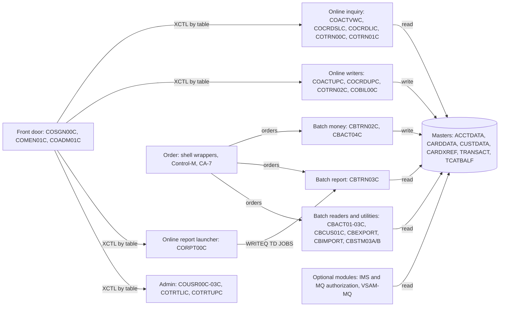

# 02 Coupling

Facts here come from `graph.json` and `02a-edge-tables.md`. Everything I added by reading source is inference in the plugin's sense, and each row carries the lines it rests on. The dependency-cartographer work was done inline, because the graph holds 28 computed calls, more than the 20 the skill sets as the limit for doing it by hand.

Scope: 44 COBOL programs (22,904 lines), 55 JCL jobs, 6 procs, 19 scheduler entries, 21 BMS maps and 62 copybooks. The three things the client said must not break are daily transaction posting, the account and card master refresh, and the transaction report.

## The three patterns that constrain the sequence

### 1. Four master files are written from both batch and online code

The data hubs decide the wave plan. Every writer of a master has to cut over at the same switch, or behind one access facade, because two implementations cannot both own the file.

| Dataset | Writers in the tree | Readers | Evidence |
|---|---|---|---|
| ACCTDATA (account master) | CBACT04C, CBTRN02C, COACTUPC, COBIL00C | 11 | `app/cbl/CBACT04C.cbl:356`, `app/cbl/CBTRN02C.cbl:554`, `app/cbl/COACTUPC.cbl:4064`, `app/cbl/COBIL00C.cbl:379` |
| TRANSACT (transaction master) | CBTRN02C, COBIL00C, COTRN02C | 11 | `app/cbl/CBTRN02C.cbl:564`, `app/cbl/COBIL00C.cbl:512`, `app/cbl/COTRN02C.cbl:713` |
| CUSTDATA (customer master) | COACTUPC | 7 | `app/cbl/COACTUPC.cbl:4086` |
| CARDDATA (card master) | COCRDUPC | 6 | `app/cbl/COCRDUPC.cbl:1478` |
| TCATBALF (category balances) | CBTRN02C | 4 | `app/cbl/CBTRN02C.cbl:510` |
| CARDXREF (card cross reference) | none. Only the reload job writes it | 8 | `app/jcl/XREFFILE.jcl:64` |

All six masters are also deleted and redefined by IDCAMS jobs (`app/jcl/ACCTFILE.jcl:25`, `app/jcl/CARDFILE.jcl:36`, `app/jcl/XREFFILE.jcl:25`, `app/jcl/CUSTFILE.jcl:35`, `app/jcl/TRANFILE.jcl:35`, `app/jcl/TCATBALF.jcl:25`) and reloaded from flat files that no job in the tree creates (`app/jcl/ACCTFILE.jcl:61`). Only the wave that owns the writers writes the masters. The other waves read them. That is why the plan puts every writer in one wave.

### 2. The record layouts that matter most are restated as numbers, not as copybooks

All 62 contract edges are `high`, because both sides COPY the same layout copybook. That is accurate and it hides the real exposure. Six places restate a layout as an offset or a length, where no copybook can be checked against them:

| Where the layout is restated | What it restates | Evidence |
|---|---|---|
| SORT symbols in the batch report job, and again inside the COBOL that builds the online report job | TRAN-CARD-NUM at byte 263, length 16, and TRAN-PROC-DT at byte 305, length 10 (CVTRA05Y) | `app/jcl/TRANREPT.jcl:41`, `app/jcl/TRANREPT.jcl:42`, `app/cbl/CORPT00C.cbl:100`, `app/cbl/CORPT00C.cbl:102`, `app/cpy/CVTRA05Y.cpy:16` |
| Alternate index keys in IDCAMS control cards | Account id at offset 16 of the card record, at offset 25 of the cross reference, and the processed timestamp at offset 304 of the transaction record | `app/jcl/CARDFILE.jcl:85`, `app/jcl/XREFFILE.jcl:74`, `app/jcl/TRANFILE.jcl:84`, `app/jcl/TRANIDX.jcl:27` |
| A Db2 unload whose SQL builds the type record by string concatenation | The 60-byte CVTRA03Y record: 2 bytes of type, 50 of description, 8 zeros | `app/app-transaction-type-db2/jcl/TRANEXTR.jcl:76`, `app/app-transaction-type-db2/jcl/TRANEXTR.jcl:80`, `app/cpy/CVTRA03Y.cpy:6` |
| The online account update program's private copy of the account record | It omits ACCT-ADDR-ZIP, so ACCT-UPDATE-GROUP-ID lands in the ZIP position and the real group id position is written as spaces | `app/cbl/COACTUPC.cbl:418`, `app/cbl/COACTUPC.cbl:432`, `app/cbl/COACTUPC.cbl:4064`, `app/cpy/CVACT01Y.cpy:15`, `app/cpy/CVACT01Y.cpy:16` |
| The statement job re-orders each transaction record with SORT before the statement program reads it | Card number moved to the front, then bytes 1 to 262, then bytes 279 to 328. The statement program reads that derived copy, TRXFL, not the transaction master | `app/jcl/CREASTMT.JCL:53`, `app/jcl/CREASTMT.JCL:54`, `app/jcl/CREASTMT.JCL:83`, `app/cpy/CVTRA05Y.cpy:15` |
| RECORDSIZE and KEYS in the master definitions | 300, 150, 50 and 350 byte records with key lengths 11, 16, 16 and 16 | `app/jcl/ACCTFILE.jcl:40`, `app/jcl/CARDFILE.jcl:54`, `app/jcl/XREFFILE.jcl:43`, `app/jcl/TRANFILE.jcl:53` |

The fourth row is the most serious. It is inference, from reading both layouts, and I did not run the program. If it is right, an account edited on line loses its ZIP and its group id, and CBACT04C then looks up an interest rate with a blank group (`app/cbl/CBACT04C.cbl:210`), gets not-found, and falls back to the DEFAULT group (`app/cbl/CBACT04C.cbl:437`). The month-end interest for edited accounts would then be computed at default rates, silently. A port must decide whether to reproduce this or fix it. It goes in the deviation register either way (see `06-test-strategy.md`).

### 3. Order lives in three places that disagree, and in a fourth the extractor did not read

| Source | Daily sequence it declares | Evidence |
|---|---|---|
| Shell wrapper `scripts/run_posting.sh` | CLOSEFIL, ACCTFILE, TCATBALF, TRANBKP, POSTTRAN, TRANIDX, OPENFIL | `scripts/run_posting.sh:13`, `scripts/run_posting.sh:17`, `scripts/run_posting.sh:26`, `scripts/run_posting.sh:34` |
| Control-M folder DAILY-TransactionBackup | CLOSEFIL, TRANBKP, WAITSTEP, OPENFIL. POSTTRAN is not in it | `app/scheduler/CardDemo.controlm:4`, `app/scheduler/CardDemo.controlm:8`, `app/scheduler/CardDemo.controlm:14`, `app/scheduler/CardDemo.controlm:20` |
| CA-7 listing (not parsed by the extractor) | CLOSEFIL triggers CBPAUP0J, which triggers POSTTRAN, then WAITSTEP, then OPENFIL. TRANBKP is not in it | `app/scheduler/CardDemo.ca7:18`, `app/scheduler/CardDemo.ca7:43`, `app/scheduler/CardDemo.ca7:70`, `app/scheduler/CardDemo.ca7:97`, `app/scheduler/CardDemo.ca7:124` |

Three more facts sit under the sequence:

- TRANBKP empties the transaction master. Its delete step has no COND, and only the define step carries `COND=(4,LT)`, so the master is deleted even when the backup step ends with a return code above zero (`app/jcl/TRANBKP.jcl:37`, `app/jcl/TRANBKP.jcl:51`). CBTRN02C then opens that master OUTPUT (`app/cbl/CBTRN02C.cbl:256`).
- COMBTRAN rebuilds the master from `BKUP(0)` and `SYSTRAN(0)` (`app/jcl/COMBTRAN.jcl:23`, `app/jcl/COMBTRAN.jcl:25`). TRANBKP writes `BKUP(+1)` (`app/jcl/TRANBKP.jcl:29`). The graph merges every generation into one dataset node, so it shows a dataset with three writers and three readers (`app/jcl/COMBTRAN.jcl:23`) and cannot say which generation a step touches. In `scripts/run_full_batch.sh` TRANBKP runs twice, at lines 29 and 55, so the meaning of generation 0 changes between them (inference).
- INTCALC passes a fixed PARM date that becomes the first ten characters of every system-generated transaction id (`app/jcl/INTCALC.jcl:22`, `app/cbl/CBACT04C.cbl:476`). Two runs with the same PARM would produce the same ids (inference).

## Clusters

## Strongly connected components

They move as a unit or not at all. The wave plan keeps each inside one wave.

| Members | Why | Evidence |
|---|---|---|
| COSGN00C, COMEN01C, COADM01C | Sign-on routes to both menus and each returns to sign-on | `app/cbl/COSGN00C.cbl:231`, `app/cbl/COSGN00C.cbl:236`, `app/cbl/COMEN01C.cbl:201`, `app/cbl/COADM01C.cbl:168` |
| COTRN00C, COTRN01C | The list transfers to the view and the view back to the list | `app/cbl/COTRN00C.cbl:188`, `app/cbl/COTRN01C.cbl:126` |
| COPAUS0C, COPAUS1C | Summary transfers to detail and detail back | `app/app-authorization-ims-db2-mq/cbl/COPAUS0C.cbl:316`, `app/app-authorization-ims-db2-mq/cbl/COPAUS1C.cbl:168` |

COCRDLIC and COPAUS0C also call themselves (`app/cbl/COCRDLIC.cbl:428`, `app/app-authorization-ims-db2-mq/cbl/COPAUS0C.cbl:192`).

## God modules

The extractor names none, because no program has high fan-in and high fan-out at once. COACTUPC is a size outlier all the same: 3,368 of 22,904 lines, 15 percent of the COBOL, 51 GO TO and 43 REDEFINES (first GO TO at `app/cbl/COACTUPC.cbl:973`). Treat it as a god module by size (inference). It is strangled behind the account access facade in wave 6, not ported line by line.

## Articulation points

The extractor lists them as candidate wave boundaries: CBACT01C, CBACT04C, CBEXPORT, CBIMPORT, CBSTM03A, CBTRN02C, CBTRN03C, COADM01C, COCRDSLC, COPAUS0C, COPAUS1C, COPAUS2C, COSGN00C and the datasets ACCTDATA, CARDDATA, CARDXREF, CUSTDATA and EXPORT.DATA (`02a-edge-tables.md`). The plan uses the datasets and the front door: the master datasets bound wave 6 and the three-program front door bounds wave 3.

## The honest boundary

The extractor gave up on 28 computed calls. They are all `EXEC CICS XCTL` through a program name held in a field. I worked every one. The table below is the result.

- Every computed call resolves inside the online programs. None can reach a batch program, so none keeps CBTRN01C alive.
- Eight of the 28 stay open only on one value: the program named in CDEMO-FROM-PROGRAM, or a value inherited in the COMMAREA, which a caller leaves there. Each of those still lands on a program in the same online set (inference).
- The COMMAREA layout (`app/cpy/COCOM01Y.cpy`) is a private contract between every online program. The extractor does not model `EXEC CICS RETURN TRANSID`, so the pseudo-conversational hand-offs are not in the graph.

| Site | Target field | Programs it can reach | Still open | Evidence | Confidence |
|---|---|---|---|---|---|
| COACTUPC:956 | CDEMO-TO-PROGRAM | COMEN01C, or whatever program name the caller left in CDEMO-FROM-PROGRAM | Which program called it. That value travels in the COMMAREA. | `app/cbl/COACTUPC.cbl:939`, `app/cbl/COACTUPC.cbl:941`, `app/cbl/COACTUPC.cbl:956` | medium |
| COACTVWC:349 | CDEMO-TO-PROGRAM | COMEN01C, or the caller named in CDEMO-FROM-PROGRAM | The caller. | `app/cbl/COACTVWC.cbl:336`, `app/cbl/COACTVWC.cbl:338`, `app/cbl/COACTVWC.cbl:349` | medium |
| COADM01C:145 | CDEMO-ADMIN-OPT-PGMNAME(WS-OPTION) | COUSR00C, COUSR01C, COUSR02C, COUSR03C, COTRTLIC, COTRTUPC. All six names are VALUE clauses. | Nothing. The table is closed. | `app/cbl/COADM01C.cbl:145`, `app/cpy/COADM02Y.cpy:29`, `app/cpy/COADM02Y.cpy:34`, `app/cpy/COADM02Y.cpy:39`, `app/cpy/COADM02Y.cpy:44`, `app/cpy/COADM02Y.cpy:49`, `app/cpy/COADM02Y.cpy:53` | high |
| COADM01C:168 | CDEMO-TO-PROGRAM | COSGN00C when the field is blank, otherwise the value inherited in the COMMAREA | The inherited value. | `app/cbl/COADM01C.cbl:101`, `app/cbl/COADM01C.cbl:166`, `app/cbl/COADM01C.cbl:168` | medium |
| COBIL00C:281 | CDEMO-TO-PROGRAM | COSGN00C, COMEN01C | Nothing found beyond these two literals. | `app/cbl/COBIL00C.cbl:130`, `app/cbl/COBIL00C.cbl:276`, `app/cbl/COBIL00C.cbl:281` | medium |
| COCRDLIC:538 | CCARD-NEXT-PROG | COCRDSLC (LIT-CARDDTLPGM) | Nothing. The constant is set on the line before. | `app/cbl/COCRDLIC.cbl:195`, `app/cbl/COCRDLIC.cbl:526`, `app/cbl/COCRDLIC.cbl:538` | high |
| COCRDLIC:566 | CCARD-NEXT-PROG | COCRDUPC (LIT-CARDUPDPGM) | Nothing. The constant is set on the line before. | `app/cbl/COCRDLIC.cbl:203`, `app/cbl/COCRDLIC.cbl:554`, `app/cbl/COCRDLIC.cbl:566` | high |
| COCRDSLC:331 | CDEMO-TO-PROGRAM | COMEN01C, or the caller named in CDEMO-FROM-PROGRAM | The caller. | `app/cbl/COCRDSLC.cbl:318`, `app/cbl/COCRDSLC.cbl:320`, `app/cbl/COCRDSLC.cbl:331` | medium |
| COCRDUPC:473 | CDEMO-TO-PROGRAM | COMEN01C, or the caller named in CDEMO-FROM-PROGRAM | The caller. | `app/cbl/COCRDUPC.cbl:451`, `app/cbl/COCRDUPC.cbl:453`, `app/cbl/COCRDUPC.cbl:473` | medium |
| COMEN01C:156 | CDEMO-MENU-OPT-PGMNAME(WS-OPTION) | COACTVWC, COACTUPC, COCRDLIC, COCRDSLC, COCRDUPC, COTRN00C, COTRN01C, COTRN02C, CORPT00C, COBIL00C, COPAUS0C. All eleven are VALUE clauses. | Nothing. COPAUS0C is guarded by an INQUIRE PROGRAM check, so it is optional at run time. | `app/cbl/COMEN01C.cbl:147`, `app/cbl/COMEN01C.cbl:156`, `app/cpy/COMEN02Y.cpy:28`, `app/cpy/COMEN02Y.cpy:34`, `app/cpy/COMEN02Y.cpy:40`, `app/cpy/COMEN02Y.cpy:46`, `app/cpy/COMEN02Y.cpy:52`, `app/cpy/COMEN02Y.cpy:58`, `app/cpy/COMEN02Y.cpy:64`, `app/cpy/COMEN02Y.cpy:71`, `app/cpy/COMEN02Y.cpy:77`, `app/cpy/COMEN02Y.cpy:83`, `app/cpy/COMEN02Y.cpy:89` | high |
| COMEN01C:184 | CDEMO-MENU-OPT-PGMNAME(WS-OPTION) | The same eleven programs as line 156 | Nothing. | `app/cbl/COMEN01C.cbl:184`, `app/cpy/COMEN02Y.cpy:28` | high |
| COMEN01C:201 | CDEMO-TO-PROGRAM | COSGN00C when blank, otherwise the inherited value | The inherited value. | `app/cbl/COMEN01C.cbl:97`, `app/cbl/COMEN01C.cbl:199`, `app/cbl/COMEN01C.cbl:201` | medium |
| COPAUS0C:322 | CDEMO-TO-PROGRAM | COPAUS1C (WS-PGM-AUTH-DTL) | Nothing. The constant is set on line 316. | `app/app-authorization-ims-db2-mq/cbl/COPAUS0C.cbl:34`, `app/app-authorization-ims-db2-mq/cbl/COPAUS0C.cbl:316`, `app/app-authorization-ims-db2-mq/cbl/COPAUS0C.cbl:322` | high |
| COPAUS0C:674 | CDEMO-TO-PROGRAM | COSGN00C, COMEN01C (WS-PGM-MENU) or COPAUS0C itself | Nothing found beyond these. | `app/app-authorization-ims-db2-mq/cbl/COPAUS0C.cbl:192`, `app/app-authorization-ims-db2-mq/cbl/COPAUS0C.cbl:236`, `app/app-authorization-ims-db2-mq/cbl/COPAUS0C.cbl:669`, `app/app-authorization-ims-db2-mq/cbl/COPAUS0C.cbl:674` | medium |
| COPAUS1C:367 | CDEMO-TO-PROGRAM | COPAUS0C (WS-PGM-AUTH-SMRY) | Nothing. | `app/app-authorization-ims-db2-mq/cbl/COPAUS1C.cbl:168`, `app/app-authorization-ims-db2-mq/cbl/COPAUS1C.cbl:185`, `app/app-authorization-ims-db2-mq/cbl/COPAUS1C.cbl:367` | high |
| CORPT00C:548 | CDEMO-TO-PROGRAM | COSGN00C, COMEN01C | Nothing found beyond these two literals. | `app/cbl/CORPT00C.cbl:188`, `app/cbl/CORPT00C.cbl:543`, `app/cbl/CORPT00C.cbl:548` | medium |
| COTRN00C:192 | CDEMO-TO-PROGRAM | COTRN01C | Nothing. The literal is set on line 188. | `app/cbl/COTRN00C.cbl:188`, `app/cbl/COTRN00C.cbl:192` | high |
| COTRN00C:518 | CDEMO-TO-PROGRAM | COSGN00C, COMEN01C | Nothing found beyond these two literals. | `app/cbl/COTRN00C.cbl:123`, `app/cbl/COTRN00C.cbl:513`, `app/cbl/COTRN00C.cbl:518` | medium |
| COTRN01C:205 | CDEMO-TO-PROGRAM | COSGN00C, COMEN01C, COTRN00C | Nothing found beyond these three literals. | `app/cbl/COTRN01C.cbl:117`, `app/cbl/COTRN01C.cbl:126`, `app/cbl/COTRN01C.cbl:200`, `app/cbl/COTRN01C.cbl:205` | medium |
| COTRN02C:508 | CDEMO-TO-PROGRAM | COSGN00C, COMEN01C | Nothing found beyond these two literals. | `app/cbl/COTRN02C.cbl:138`, `app/cbl/COTRN02C.cbl:503`, `app/cbl/COTRN02C.cbl:508` | medium |
| COTRTLIC:620 | CDEMO-TO-PROGRAM | COADM01C (LIT-ADMINPGM), COTRTUPC (LIT-ADDTPGM), or the caller named in CDEMO-FROM-PROGRAM | The caller. | `app/app-transaction-type-db2/cbl/COTRTLIC.cbl:47`, `app/app-transaction-type-db2/cbl/COTRTLIC.cbl:50`, `app/app-transaction-type-db2/cbl/COTRTLIC.cbl:603`, `app/app-transaction-type-db2/cbl/COTRTLIC.cbl:605`, `app/app-transaction-type-db2/cbl/COTRTLIC.cbl:638`, `app/app-transaction-type-db2/cbl/COTRTLIC.cbl:620` | medium |
| COTRTUPC:457 | CDEMO-TO-PROGRAM | COADM01C (LIT-ADMINPGM), or the caller named in CDEMO-FROM-PROGRAM | The caller. | `app/app-transaction-type-db2/cbl/COTRTUPC.cbl:209`, `app/app-transaction-type-db2/cbl/COTRTUPC.cbl:440`, `app/app-transaction-type-db2/cbl/COTRTUPC.cbl:442`, `app/app-transaction-type-db2/cbl/COTRTUPC.cbl:457` | medium |
| COUSR00C:196 | CDEMO-TO-PROGRAM | COUSR02C | Nothing. The literal is set on line 192. | `app/cbl/COUSR00C.cbl:192`, `app/cbl/COUSR00C.cbl:196` | high |
| COUSR00C:206 | CDEMO-TO-PROGRAM | COUSR03C | Nothing. The literal is set on line 202. | `app/cbl/COUSR00C.cbl:202`, `app/cbl/COUSR00C.cbl:206` | high |
| COUSR00C:514 | CDEMO-TO-PROGRAM | COSGN00C, COADM01C | Nothing found beyond these two literals. | `app/cbl/COUSR00C.cbl:126`, `app/cbl/COUSR00C.cbl:509`, `app/cbl/COUSR00C.cbl:514` | medium |
| COUSR01C:175 | CDEMO-TO-PROGRAM | COSGN00C, COADM01C | Nothing found beyond these two literals. | `app/cbl/COUSR01C.cbl:94`, `app/cbl/COUSR01C.cbl:168`, `app/cbl/COUSR01C.cbl:175` | medium |
| COUSR02C:258 | CDEMO-TO-PROGRAM | COSGN00C, COADM01C | Nothing found beyond these two literals. | `app/cbl/COUSR02C.cbl:114`, `app/cbl/COUSR02C.cbl:125`, `app/cbl/COUSR02C.cbl:253`, `app/cbl/COUSR02C.cbl:258` | medium |
| COUSR03C:205 | CDEMO-TO-PROGRAM | COSGN00C, COADM01C | Nothing found beyond these two literals. | `app/cbl/COUSR03C.cbl:113`, `app/cbl/COUSR03C.cbl:124`, `app/cbl/COUSR03C.cbl:200`, `app/cbl/COUSR03C.cbl:205` | medium |

## What the extractor does not model, found while reading

| Gap | What I found | Evidence |
|---|---|---|
| Programs named in a DFSRRC00 PARM or a TSO RUN PROGRAM card | CBPAUP0C, PAUDBLOD, PAUDBUNL, DBUNLDGS and COBTUPDT are run by JCL. The extractor lists them as unknown and reports their DDs as unmapped, although the JCL maps them | `app/app-authorization-ims-db2-mq/jcl/CBPAUP0J.jcl:25`, `app/app-authorization-ims-db2-mq/jcl/LOADPADB.JCL:27`, `app/app-authorization-ims-db2-mq/jcl/UNLDPADB.JCL:39`, `app/app-authorization-ims-db2-mq/jcl/UNLDGSAM.JCL:27`, `app/app-transaction-type-db2/jcl/MNTTRDB2.jcl:30` |
| JCL written as text inside a COBOL program and submitted through a transient data queue | CORPT00C builds a job that runs PROC=TRANREPT and writes it to queue JOBS. The extractor lists proc:TRANREPT as unreachable | `app/cbl/CORPT00C.cbl:94`, `app/cbl/CORPT00C.cbl:517`, `app/csd/CARDDEMO.CSD:499` |
| CA-7 listing | Names CBPAUP0J, READACCT, READCARD, READCUST, READXREF, CREASTMT, TXT2PDF1 and PRTCATBL as scheduled jobs. The extractor lists all eight as unscheduled. It also chains POSTTRAN after CBPAUP0J, which no Control-M folder does | `app/scheduler/CardDemo.ca7:43`, `app/scheduler/CardDemo.ca7:70`, `app/scheduler/CardDemo.ca7:340`, `app/scheduler/CardDemo.ca7:468`, `app/scheduler/CardDemo.ca7:537` |
| Assembler and macro source | COBDATFT is called from CBACT01C and is not in the graph | `app/cbl/CBACT01C.cbl:231`, `app/asm/COBDATFT.asm:17` |
| COPY REPLACING | Applied nowhere. COACTUPC expands CSSETATY three times with REPLACING | `app/cbl/COACTUPC.cbl:3208`, `app/cbl/COACTUPC.cbl:3214`, `app/cbl/COACTUPC.cbl:3220` |
| Job to job order through GDG generations | Relative generation numbers change meaning by run | `app/jcl/COMBTRAN.jcl:23`, `app/jcl/TRANBKP.jcl:29` |

## Contract edges to verify by hand

None of the 62 contract edges is `medium`, so the extractor left nothing open there. The exposure is in the second table above. Verify these first, in this order: the private account update layout, the report SORT offsets, the alternate index keys, then the Db2 unload record.
