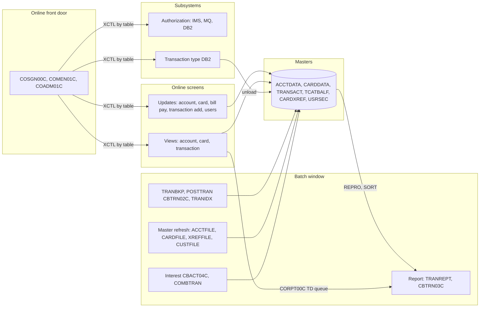

# 02 Coupling

Basis: `modernization-assessment/graph.json`, 543 nodes and 1,224 edges (318 call, 476 include, 235 data, 62 contract, 133 temporal). Every edge is in `modernization-assessment/02a-edge-tables.md`. This file holds the argument. There are more than 20 open edges (28 computed calls, 38 medium confidence program calls, 25 medium confidence job order edges), so I did the dependency-cartographer work inline. What that pass found is labeled `inference` and cited. Facts computed in the `analysis` block are labeled `analysis`.

## The three coupling patterns that constrain the sequence

### 1. The masters have writers on both sides of the batch and online line

| Finding | Confidence | Evidence |
|---|---|---|
| The account master ACCTDATA has 4 writers and 11 readers. The writers are CBACT04C (rewrite), CBTRN02C (rewrite), COACTUPC (online rewrite) and COBIL00C (online update). | high | `app/cbl/CBACT04C.cbl:356`, `app/cbl/CBTRN02C.cbl:554`, `app/cbl/COACTUPC.cbl:4066`, `app/cbl/COBIL00C.cbl:235` |
| The transaction master TRANSACT has 3 program writers and 11 readers: CBTRN02C in batch, COBIL00C and COTRN02C online. The jobs TRANBKP, COMBTRAN and TRANFILE also delete, define or reload it. | high | `app/cbl/CBTRN02C.cbl:564`, `app/cbl/COBIL00C.cbl:233`, `app/cbl/COTRN02C.cbl:466`, `app/jcl/TRANBKP.jcl:37`, `app/jcl/COMBTRAN.jcl:48` |
| All 62 contract edges are `high`, meaning both sides COPY the same layout. There is no `medium` contract edge. `high` means shared copybook, not proven equal bytes. | high | analysis `edge_counts` and `meta.limits` in `modernization-assessment/graph.json` |
| The contract between the posted transaction file and the report is not a contract edge. It runs through utility steps: REPRO to a backup generation, then a SORT that selects by byte offset 263 for the card number and 305 for the processed date, then CBTRN03C. Those offsets are typed by hand in JCL and match the layout only if the copybook never changes. | high | `app/jcl/TRANREPT.jcl:26`, `app/jcl/TRANREPT.jcl:41`, `app/jcl/TRANREPT.jcl:42`, `app/cpy/CVTRA05Y.cpy:15`, `app/cpy/CVTRA05Y.cpy:17` |
| The daily transaction input DALYTRAN.PS is read by the posting job and written by nothing in the tree. | high | `app/jcl/POSTTRAN.jcl:30`, `README.md:139` |

Consequence for the sequence: a wave that moves one writer of ACCTDATA, TRANSACT or TCATBALF while another writer stays behind creates two systems writing one dataset. The plan therefore keeps VSAM as the system of record until the last writer has moved (wave 6), and ports the wave 5 program logic behind a record level access facade. See `modernization-assessment/03-waves.md`.

### 2. Order lives in shell wrappers, in a scheduler the extractor cannot parse, and in GDG generations

| Finding | Confidence | Evidence |
|---|---|---|
| Posting is only correct after TRANBKP. TRANBKP backs the transaction master up, deletes it and redefines it empty, and CBTRN02C then opens the master for OUTPUT. If TRANBKP does not run first, the OPEN OUTPUT meets a full file. | high | `app/jcl/TRANBKP.jcl:37`, `app/jcl/TRANBKP.jcl:51`, `app/cbl/CBTRN02C.cbl:256`, `scripts/run_posting.sh:23`, `scripts/run_posting.sh:26` |
| In TRANBKP only the DEFINE step has a COND. The DELETE step has none, so a failed backup step does not stop the delete. The extractor does not model COND. | high | `app/jcl/TRANBKP.jcl:37`, `app/jcl/TRANBKP.jcl:51` |
| The posting wrapper runs ACCTFILE (delete, define, reload the account master from a flat file) and TCATBALF (same for category balances) before POSTTRAN. If that is the production flow, balances written by one posting run are replaced at the start of the next unless something regenerates ACCTDATA.PS. Nothing in the tree does. | medium | `scripts/run_posting.sh:16`, `scripts/run_posting.sh:19`, `scripts/run_posting.sh:26`, `app/jcl/ACCTFILE.jcl:61` |
| TRANREPT and TRANBKP both write a new generation of TRANSACT.BKUP, and COMBTRAN reads generation 0. A report run between TRANBKP and COMBTRAN changes which file COMBTRAN reads. The catalog keeps 5 generations. | medium | `app/jcl/TRANREPT.jcl:33`, `app/jcl/TRANBKP.jcl:33`, `app/jcl/COMBTRAN.jcl:24`, `app/catlg/LISTCAT.txt:1637` |
| CLOSEFIL and OPENFIL close and reopen TRANSACT, CCXREF, ACCTDAT, CXACAIX and USRSEC in the CICS region around the batch chain. Control-M chains CLOSEFIL, the work job, WAITSTEP, OPENFIL. WAITSTEP runs an assembler timer that the extractor did not read. | high | `app/jcl/CLOSEFIL.jcl:26`, `app/jcl/OPENFIL.jcl:26`, `app/scheduler/CardDemo.controlm:5`, `app/scheduler/CardDemo.controlm:21`, `app/cbl/COBSWAIT.cbl:38` |
| The CA-7 listing is a scheduler the extractor cannot parse. Read by eye it shows CLOSEFIL triggering CBPAUP0J, then POSTTRAN, then WAITSTEP, then OPENFIL. So the parsed Control-M file does not schedule POSTTRAN at all. | inference | `app/scheduler/CardDemo.ca7:43`, `app/scheduler/CardDemo.ca7:70`, `app/scheduler/CardDemo.ca7:97`, `app/scheduler/CardDemo.ca7:124` |
| The four shell wrappers give different orders for the same jobs: run_posting.sh does not run CARDFILE, XREFFILE or INTCALC, and run_full_batch.sh runs TRANBKP twice (before and after posting). | high | `scripts/run_posting.sh:13`, `scripts/run_full_batch.sh:29`, `scripts/run_full_batch.sh:55` |

Consequence for the sequence: the temporal edges are the port order inside wave 5, and the wave 5 harness has to keep them. Any orchestrator that replaces the wrappers must reproduce them.

### 3. Control flow goes through data that the graph cannot see

| Finding | Confidence | Evidence |
|---|---|---|
| The online report request builds a job stream in working storage and writes it to the JOBS transient data queue, which submits a batch job that runs proc TRANREPT. The graph has no edge from CORPT00C to the report chain. | high | `app/cbl/CORPT00C.cbl:94`, `app/cbl/CORPT00C.cbl:517`, `app/csd/CARDDEMO.CSD:409` |
| Sign-on, main menu and admin menu form one call cycle and every other online program XCTLs back to it (fan-in 12, 12 and 7). The menus dispatch by table. | high | analysis `sccs` and `fan_in`, `app/cbl/COMEN01C.cbl:184`, `app/cbl/COADM01C.cbl:145` |
| The transaction type descriptions on the report come from a DB2 table. TRANEXTR unloads it to a flat file, TRANTYPE loads that into VSAM, and CBTRN03C reads the VSAM file. The DB2 side is wave 7, the report is wave 5. | high | `app/app-transaction-type-db2/jcl/TRANEXTR.jcl:72`, `app/jcl/TRANTYPE.jcl:54`, `app/jcl/TRANREPT.jcl:69` |

## Top level clusters

## Strongly connected components

They move as a unit or not at all. The wave plan keeps each one inside a single wave, and the validator checks it.

| Component | Wave | Confidence | Evidence |
|---|---|---|---|
| COADM01C, COMEN01C, COSGN00C | 3 | high | analysis `sccs`, `app/cbl/COSGN00C.cbl:231`, `app/cbl/COADM01C.cbl:168` |
| COTRN00C, COTRN01C | 3 | high | analysis `sccs`, `app/cbl/COTRN00C.cbl:192`, `app/cbl/COTRN01C.cbl:205` |
| COPAUS0C, COPAUS1C | 7 | high | analysis `sccs`, `app/app-authorization-ims-db2-mq/cbl/COPAUS0C.cbl:322`, `app/app-authorization-ims-db2-mq/cbl/COPAUS1C.cbl:367` |

Self recursive: COCRDLIC and COPAUS0C (analysis `self_recursive`).

## God modules and hubs

The extractor flags COPAUS0C, COTRN00C and COTRN01C as god modules (analysis `god_modules`). I do not think that is the useful reading of this tree. Their fan-in is 1 and their fan-out is 3, so they rank at the top of a small graph without being hubs. The real hubs are:

| Unit | Why it is a hub | Confidence | Evidence |
|---|---|---|---|
| COMEN01C and COSGN00C | Fan-in 12 each. Every online program returns to them. They cannot move until a routing shim exists in front of the menu table. | high | analysis `fan_in`, `app/cpy/COMEN02Y.cpy:28` |
| COACTUPC | 3,368 lines, 43 REDEFINES, 51 GO TO, and it writes the account master. It is the largest single port and a candidate to strangle behind a facade, not port whole. | medium | `app/cbl/COACTUPC.cbl:4066`, `app/cbl/COACTUPC.cbl:573` |
| CBTRN02C | One program that writes the three masters the whole system reads. | high | `app/cbl/CBTRN02C.cbl:256`, analysis `data_hubs` |

The god module rule in the skill says these cannot move in one wave and are strangled behind a facade. COPAUS0C is in wave 7 with its component. COTRN00C and COTRN01C are small read-only screens in wave 3, so I did not treat them as strangler candidates.

## Articulation points

The extractor lists CBACT01C, CBACT04C, CBEXPORT, CBIMPORT, CBSTM03A, CBTRN02C, CBTRN03C, COADM01C, COCRDSLC, COPAUS0C, COPAUS1C, COPAUS2C, COSGN00C and five datasets (analysis `articulation_points`). The programs among them are mostly the single program in front of its own output files. They are boundaries in the graph but not clean wave boundaries, because the shared masters (ACCTDATA, CARDDATA, CARDXREF, CUSTDATA, EXPORT.DATA) are articulation points as well and have writers on both sides. I used this to decide not to cut wave 5.

## The honest boundary

| Item | What it means | Confidence | Evidence |
|---|---|---|---|
| 28 computed calls in 20 online programs | The extractor could not resolve them. My pass below bounds all of them to online programs already in the tree. It does not prove it. | medium | analysis `unresolved_dynamic` |
| CA-7 listing not parsed | The daily chain that schedules POSTTRAN is in the unparsed file. | high | `app/scheduler/CardDemo.ca7:70` |
| DB2 DDL, DCLGEN, IMS DBD and PSB, control cards, assembler and macros not parsed | The whole authorization subsystem (wave 7) and the DB2 create and load steps are unexamined. Assembler COBDATFT is called by CBACT01C and MVSWAIT by COBSWAIT. | high | `app/cbl/CBACT01C.cbl:231`, `app/cbl/COBSWAIT.cbl:38` |
| SORT, COND and nested procs are not modeled | The report chain and TRANBKP depend on all three. | high | `app/jcl/TRANREPT.jcl:37`, `app/jcl/TRANBKP.jcl:51`, `app/proc/TRANREPT.prc:21` |
| CSD transaction CDV1 names a program with no source | One entry point has no code in the tree. | high | `app/csd/CARDDEMO.CSD:388` |

## Dependency-cartographer pass (inline, inference)

### Computed calls

Every computed call is an XCTL through a variable. Three groups, with the values that can reach each.

| Group | Calls | What can reach it | Still open | Confidence | Evidence |
|---|---|---|---|---|---|
| Main menu table | COMEN01C lines 156 and 184 | The 11 entries of the menu table: COACTVWC, COACTUPC, COCRDLIC, COCRDSLC, COCRDUPC, COTRN00C, COTRN01C, COTRN02C, CORPT00C, COBIL00C, COPAUS0C. All are online programs already reached. | Whether the table is the only source: it is copied from the same copybook in the tree. | high | `app/cpy/COMEN02Y.cpy:28`, `app/cpy/COMEN02Y.cpy:89`, `app/cbl/COMEN01C.cbl:156` |
| Admin menu table | COADM01C line 145 | COUSR00C, COUSR01C, COUSR02C, COUSR03C, COTRTLIC, COTRTUPC. | None found. | high | `app/cpy/COADM02Y.cpy:29`, `app/cpy/COADM02Y.cpy:53`, `app/cbl/COADM01C.cbl:145` |
| Return and next program variables (CDEMO-TO-PROGRAM, CCARD-NEXT-PROG) | The other 25 calls, listed below | Literals moved into the variable across the tree: COSGN00C (23 places), COADM01C (6), COMEN01C (5), COTRN00C, COTRN01C, COUSR02C, COUSR03C, and constants for the authorization and card programs. Three places copy CDEMO-FROM-PROGRAM, which each program sets to its own name. Every value names an online program. | The value also travels in the COMMAREA from the caller, so a program that sets it from data would not show in a literal search. I found none. | medium | `app/cbl/COSGN00C.cbl:231`, `app/cbl/COCRDLIC.cbl:538`, `app/cbl/COBIL00C.cbl:276` |

No literal, table entry, JCL step, CSD entry or scheduler entry in the tree names CBTRN01C, so none of the 28 calls is known to reach it. It stays in the unknown bucket because the bound is inference.

### Medium confidence contract edges

There are none. The check the agent instructions call for (compare layouts field by field for a medium contract edge) does not apply. The layouts that matter are the transaction record (`app/cpy/CVTRA05Y.cpy:4`) and the account record (`app/cpy/CVACT01Y.cpy:4`), and those are shared by copybook. The risk is elsewhere: SORT keys typed as byte offsets in JCL (see pattern 1) and DDs the JCL never maps.

### Datasets with `resolved: false`

| Program | Dataset | Reading | Confidence | Evidence |
|---|---|---|---|---|
| CBSTM03B | ACCTFILE, CUSTFILE, TRNXFILE, XREFFILE | It is a called subprogram. Its files belong to the caller CBSTM03A's step, so the DDs are in job CREASTMT. | medium | `app/cbl/CBSTM03B.CBL:31`, `app/cbl/CBSTM03A.CBL:351`, `app/jcl/CREASTMT.JCL:1` |
| CBTRN01C | DALYTRAN, TRANFILE, ACCTFILE, CARDFILE, CUSTFILE, XREFFILE | No JCL step runs this program, so no DD maps. Nothing in the tree runs it. | high | `app/cbl/CBTRN01C.cbl:29` |
| CBIMPORT | CARDOUT | An output DD with no JCL mapping. The JCL for the import may be missing, or CARDOUT is unused. | medium | `app/cbl/CBIMPORT.cbl:63`, `app/jcl/CBIMPORT.jcl:1` |
| COBTUPDT, PAUDBLOD, PAUDBUNL | INPFILE, INFILE1, INFILE2, OUTFIL1, OUTFIL2 | These programs run under IKJEFT01 or an IMS region, and their DDs are in JCL that the extractor reads only in part. | medium | `app/app-transaction-type-db2/cbl/COBTUPDT.cbl:31`, `app/app-transaction-type-db2/jcl/MNTTRDB2.jcl:27` |

### What the extractor does not model, found while reading

| Item | Effect | Confidence | Evidence |
|---|---|---|---|
| Internal reader through a transient data queue | CORPT00C submits the report job. The graph has no edge. | high | `app/cbl/CORPT00C.cbl:517` |
| Internal reader through IEBGENER | INTRDRJ1 submits INTRDRJ2. | high | `app/jcl/INTRDRJ1.JCL:17`, `app/jcl/INTRDRJ1.JCL:18` |
| JCL COND | TRANBKP delete step is unconditional. | high | `app/jcl/TRANBKP.jcl:37`, `app/jcl/TRANBKP.jcl:51` |
| Nested proc | The report proc calls proc REPROC, and the proc's own first line names itself REPROC although the member is TRANREPT. | medium | `app/proc/TRANREPT.prc:1`, `app/proc/TRANREPT.prc:21` |
| Duplicate step names | TRANREPT.jcl uses STEP05R twice, and DEFCUST.jcl uses STEP05 twice. Whether the jobs run as written is a question for the client. | high | `app/jcl/TRANREPT.jcl:23`, `app/jcl/TRANREPT.jcl:37`, `app/jcl/DEFCUST.jcl:22`, `app/jcl/DEFCUST.jcl:32` |
| Control cards | The REPRO statement used by TRANBKP, TRANREPT and PRTCATBL sits in an unparsed control member. | high | `app/ctl/REPROCT.ctl:15`, `app/proc/REPROC.prc:27` |
| RETURN TRANSID, START, SEND MAP | Not edges. Not examined beyond the XCTL calls above. | inference | `app/cbl/COMEN01C.cbl:184` |
| IMS, DB2 and MQ | Outside what this plugin analyzes: wave 7 confidence is low. | high | `app/app-authorization-ims-db2-mq/cbl/COPAUA0C.cbl:35` |

### The 25 return and next program calls

| Caller | Line | Bound | Evidence |
|---|---|---|---|
| COACTUPC | 956 | Literals found for this program: COMEN01C. | `app/cbl/COACTUPC.cbl:956` |
| COACTVWC | 349 | Literals found for this program: COMEN01C. | `app/cbl/COACTVWC.cbl:349` |
| COADM01C | 168 | Literals found for this program: COSGN00C. | `app/cbl/COADM01C.cbl:168` |
| COBIL00C | 281 | Literals found for this program: COMEN01C, COSGN00C. | `app/cbl/COBIL00C.cbl:281` |
| COCRDLIC | 538 | Literals found for this program: COCRDLIC, COCRDSLC, COCRDUPC. | `app/cbl/COCRDLIC.cbl:538` |
| COCRDLIC | 566 | Literals found for this program: COCRDLIC, COCRDSLC, COCRDUPC. | `app/cbl/COCRDLIC.cbl:566` |
| COCRDSLC | 331 | Literals found for this program: COMEN01C. | `app/cbl/COCRDSLC.cbl:331` |
| COCRDUPC | 473 | Literals found for this program: COMEN01C. | `app/cbl/COCRDUPC.cbl:473` |
| COMEN01C | 201 | Literals found for this program: COSGN00C. | `app/cbl/COMEN01C.cbl:201` |
| COPAUS0C | 322 | Literals found for this program: COMEN01C, COPAUS0C, COPAUS1C, COSGN00C. | `app/app-authorization-ims-db2-mq/cbl/COPAUS0C.cbl:322` |
| COPAUS0C | 674 | Literals found for this program: COMEN01C, COPAUS0C, COPAUS1C, COSGN00C. | `app/app-authorization-ims-db2-mq/cbl/COPAUS0C.cbl:674` |
| COPAUS1C | 367 | Literals found for this program: COPAUS0C. | `app/app-authorization-ims-db2-mq/cbl/COPAUS1C.cbl:367` |
| CORPT00C | 548 | Literals found for this program: COMEN01C, COSGN00C. | `app/cbl/CORPT00C.cbl:548` |
| COTRN00C | 192 | Literals found for this program: COMEN01C, COSGN00C, COTRN01C. | `app/cbl/COTRN00C.cbl:192` |
| COTRN00C | 518 | Literals found for this program: COMEN01C, COSGN00C, COTRN01C. | `app/cbl/COTRN00C.cbl:518` |
| COTRN01C | 205 | Literals found for this program: COMEN01C, COSGN00C, COTRN00C. | `app/cbl/COTRN01C.cbl:205` |
| COTRN02C | 508 | Literals found for this program: COMEN01C, COSGN00C. | `app/cbl/COTRN02C.cbl:508` |
| COTRTLIC | 620 | Literals found for this program: COADM01C. | `app/app-transaction-type-db2/cbl/COTRTLIC.cbl:620` |
| COTRTUPC | 457 | Literals found for this program: COADM01C. | `app/app-transaction-type-db2/cbl/COTRTUPC.cbl:457` |
| COUSR00C | 196 | Literals found for this program: COADM01C, COSGN00C, COUSR02C, COUSR03C. | `app/cbl/COUSR00C.cbl:196` |
| COUSR00C | 206 | Literals found for this program: COADM01C, COSGN00C, COUSR02C, COUSR03C. | `app/cbl/COUSR00C.cbl:206` |
| COUSR00C | 514 | Literals found for this program: COADM01C, COSGN00C, COUSR02C, COUSR03C. | `app/cbl/COUSR00C.cbl:514` |
| COUSR01C | 175 | Literals found for this program: COADM01C, COSGN00C. | `app/cbl/COUSR01C.cbl:175` |
| COUSR02C | 258 | Literals found for this program: COADM01C, COSGN00C. | `app/cbl/COUSR02C.cbl:258` |
| COUSR03C | 205 | Literals found for this program: COADM01C, COSGN00C. | `app/cbl/COUSR03C.cbl:205` |
