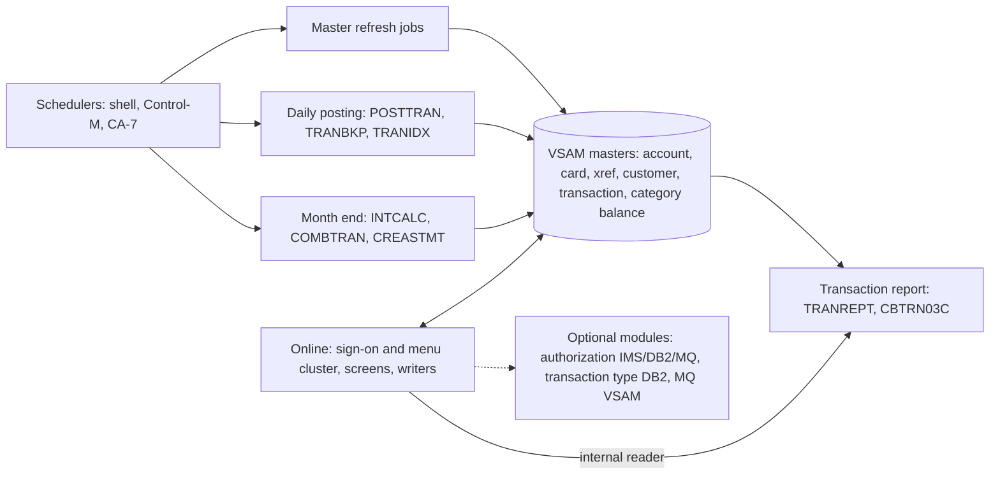

# 02 Coupling

The full edge list is in `02a-edge-tables.md` and was generated from `graph.json`. This file is the argument. Facts from the extractor are cited to file and line. Anything I added by reading source is labeled `inference` and cited.

Target state is refactor. The must-not-break list is daily transaction posting, the account and card master refresh, and the transaction report. All three are batch, and all three touch the same VSAM masters that the online programs use.

## The three coupling patterns that constrain the sequence

### 1. Batch and online share the VSAM masters, and only a console command keeps them apart

`graph.json` shows two data hubs that matter. The account master has 4 writers and 11 readers. The transaction master has 3 writers and 11 readers. The writers are:

- Account master: CBACT04C, CBTRN02C, COACTUPC and COBIL00C.
- Transaction master: CBTRN02C, COBIL00C and COTRN02C.

Both batch and online programs write the same files, using the same layout copybooks. CVACT01Y is included by 14 programs. CVACT03Y is included by 14. CVTRA05Y is included by 11. Those copybooks are the real API of this system. One example of the shared writes is `app/cbl/CBTRN02C.cbl:554`, which rewrites the account record that `app/cbl/COBIL00C.cbl:41` also reads under the same copybook.

What stops a batch writer colliding with an online writer is `CLOSEFIL`. It closes five CICS files and no others (`app/jcl/CLOSEFIL.jcl:26`, `app/jcl/CLOSEFIL.jcl:30`). The card and customer masters are not in that list. `app/jcl/CARDFILE.jcl:26` and `app/jcl/CUSTFILE.jcl:26` close their own files, and `app/jcl/ACCTFILE.jcl:22` and `app/jcl/XREFFILE.jcl:22` do not, so they rely on `CLOSEFIL` having run first (inference: no step in either job closes the file).

One limit in the graph matters here. The extractor takes dataset modes on IDCAMS steps from DISP only. The four refresh jobs delete, define and REPRO into the masters, but the graph records them as reads (`app/jcl/ACCTFILE.jcl:61`). The real writer count on the account master is higher than 4.

What this does to the sequence: the posting program cannot leave the shared files on its own. Either the new posting writes to the same VSAM, or it runs in parallel on copies and is cut over per cycle, and the online writers move last. That is why wave 6 (posting) is a parallel run, and wave 8 (online writers) is the last core wave.

### 2. The transaction master is emptied and rebuilt every cycle, and three schedulers disagree about the order

`TRANBKP` backs the transaction master up and then deletes and redefines it (`app/jcl/TRANBKP.jcl:40`, `app/jcl/TRANBKP.jcl:54`). The posting program then opens it for output (`app/cbl/CBTRN02C.cbl:256`), which only works on an empty file. `COMBTRAN` reloads it from two generations (`app/jcl/COMBTRAN.jcl:48`), and `TRANIDX` rebuilds its alternate index (`app/jcl/TRANIDX.jcl:27`).

Two online programs pick the next TRAN-ID as the highest key plus one (`app/cbl/COBIL00C.cbl:212`, `app/cbl/COTRN02C.cbl:444`). So the online ID sequence depends on what those batch jobs left in the file.

There is a data loss path in `TRANBKP` (inference). The delete step at `app/jcl/TRANBKP.jcl:37` has no COND, while the define step at `app/jcl/TRANBKP.jcl:51` does. If the REPRO backup at `app/jcl/TRANBKP.jcl:23` fails, the delete still runs.

The transaction report also writes to this cycle. Each run of the report job, and each run submitted from the online menu, writes a new generation of the same backup group that `TRANBKP` writes (`app/jcl/TRANBKP.jcl:33`, `app/jcl/TRANREPT.jcl:33`, `app/proc/TRANREPT.prc:31`). `COMBTRAN` reads that group as generation 0 (`app/jcl/COMBTRAN.jcl:24`), and the group keeps only 5 generations (`app/jcl/DEFGDGB.jcl:25`, `app/jcl/DEFGDGB.jcl:27`). A report run between `TRANBKP` and `COMBTRAN` therefore changes what `COMBTRAN` combines (inference: nothing in the tree stops it). The report is not the read-only job it looks like.

The order of these jobs is defined three different ways:

| Source | What it says | Evidence |
|---|---|---|
| Shell wrapper for posting | CLOSEFIL, ACCTFILE, TCATBALF, TRANBKP, POSTTRAN, TRANIDX, OPENFIL | `scripts/run_posting.sh:13`, `scripts/run_posting.sh:26`, `scripts/run_posting.sh:34` |
| Control-M DAILY folder | CLOSEFIL, TRANBKP, WAITSTEP, OPENFIL. POSTTRAN is not in the folder | `app/scheduler/CardDemo.controlm:4`, `app/scheduler/CardDemo.controlm:8`, `app/scheduler/CardDemo.controlm:20` |
| CA-7 listing (not parsed by the extractor) | CLOSEFIL triggers CBPAUP0J, which triggers POSTTRAN, which triggers WAITSTEP, then OPENFIL. inference | `app/scheduler/CardDemo.ca7:24`, `app/scheduler/CardDemo.ca7:43`, `app/scheduler/CardDemo.ca7:70` |

Under Control-M alone the daily backup empties the online transaction file and nothing in that folder refills it (inference). Under CA-7 an IMS authorization purge sits ahead of posting, which the other two do not have. The plan cannot assume a single order until the client says which one is live.

The extractor also cannot see two things that drive this order. The shell wrappers use `sleep` between submits (`scripts/run_posting.sh:14`, `scripts/run_posting.sh:27`), so the order is enforced by waiting, not by completion. And `WAITSTEP` is a fixed 36 second pause (`app/jcl/WAITSTEP.jcl:26`).

### 3. Column offsets are typed into JCL and COBOL strings outside any copybook

The extractor reports 62 contract edges, all with high confidence. That is because it reads COBOL and DD statements, and it does not read in-stream control cards. There are more contracts than that, and they are the medium confidence kind: two places agree on a byte offset that no copybook enforces. They agree today. A change to a layout copybook would not reach them.

| Offset | Where it is typed | Layout it must match | Evidence |
|---|---|---|---|
| Card number at byte 263, length 16 | `TRANREPT.jcl`, the `TRANREPT` proc and the JCL text inside CORPT00C | TRAN-CARD-NUM in CVTRA05Y. Fields before it total 262 bytes | `app/jcl/TRANREPT.jcl:41`, `app/proc/TRANREPT.prc:39`, `app/cbl/CORPT00C.cbl:100`, `app/cpy/CVTRA05Y.cpy:15` |
| Processing date at byte 305, length 10 | same three places | TRAN-PROC-TS in CVTRA05Y | `app/jcl/TRANREPT.jcl:42`, `app/proc/TRANREPT.prc:40`, `app/cbl/CORPT00C.cbl:102`, `app/cpy/CVTRA05Y.cpy:17` |
| Statement sort on card number at 263 | CREASTMT | CVTRA05Y | `app/jcl/CREASTMT.JCL:53`, `app/jcl/CREASTMT.JCL:54` |
| Alternate index KEYS(26 304) | TRANIDX and TRANFILE | TRAN-PROC-TS, zero based offset | `app/jcl/TRANIDX.jcl:27`, `app/jcl/TRANFILE.jcl:84` |
| Alternate index KEYS(11 16) | CARDFILE | CARD-ACCT-ID in CVACT02Y | `app/jcl/CARDFILE.jcl:85`, `app/cpy/CVACT02Y.cpy:6` |
| Alternate index KEYS(11,25) | XREFFILE | XREF-ACCT-ID in CVACT03Y | `app/jcl/XREFFILE.jcl:74`, `app/cpy/CVACT03Y.cpy:7` |
| Key of 17 bytes | TCATBALF | account 11, type 2, category 4 in CVTRA01Y | `app/jcl/TCATBALF.jcl:40`, `app/cpy/CVTRA01Y.cpy:6` |
| Sort on a 16 byte transaction ID at byte 1 | COMBTRAN | TRAN-ID in CVTRA05Y | `app/jcl/COMBTRAN.jcl:28`, `app/cpy/CVTRA05Y.cpy:5` |

The report logic exists three times. The job carries it inline, the proc carries it, and CORPT00C builds the same JCL as text at run time and writes it to a TDQ named JOBS (`app/cbl/CORPT00C.cbl:94`, `app/cbl/CORPT00C.cbl:517`, `app/csd/CARDDEMO.CSD:499`). The proc file is named TRANREPT but its first line declares a proc named REPROC (`app/proc/TRANREPT.prc:1`), and the job calls a different proc file that really is called REPROC (`app/jcl/TRANREPT.jcl:23`). The extractor lists `proc:TRANREPT` as unreachable. It is live, because CORPT00C runs `EXEC PROC=TRANREPT` from a COBOL string (`app/cbl/CORPT00C.cbl:94`). See `05-dead-code.md`.

## Clusters

## Strongly connected components

A wave plan that splits one of these is wrong. The validator rejects it. All three are online programs.

| Members | Why they are one unit | Evidence |
|---|---|---|
| COSGN00C, COMEN01C, COADM01C | Sign-on transfers to both menus, and each menu transfers back to sign-on | `app/cbl/COSGN00C.cbl:231`, `app/cbl/COSGN00C.cbl:236`, `app/cbl/COMEN01C.cbl:201`, `app/cbl/COADM01C.cbl:168` |
| COTRN00C, COTRN01C | The list transfers to the detail view, and the detail returns to the list | `app/cbl/COTRN00C.cbl:188`, `app/cbl/COTRN01C.cbl:126` |
| COPAUS0C, COPAUS1C | The summary and detail screens transfer to each other, and the summary is self-recursive | `app/app-authorization-ims-db2-mq/cbl/COPAUS0C.cbl:316`, `app/app-authorization-ims-db2-mq/cbl/COPAUS1C.cbl:168` |

Two other programs are self-recursive: COCRDLIC (`app/cbl/COCRDLIC.cbl:538`) and COPAUS0C.

## God modules and articulation points

The extractor found no god modules. That is a fact about call edges only, since the batch programs do not call each other. The real hubs here are data: the account master and the transaction master, and the layout copybooks that describe them. COACTUPC is the largest program in the tree at 3368 lines, but only the main menu transfers to it.

The articulation points are natural wave boundaries. The waves in `03-waves.md` are cut at these: CBACT01C, CBTRN02C, CBTRN03C, CBACT04C, CBSTM03A, CBEXPORT, CBIMPORT, and among the online programs COSGN00C, COADM01C and COCRDSLC.

## Open edges worked inline (the dependency-cartographer task)

`graph.json` has 28 computed calls, above the threshold of about 20, so this is the work the dependency-cartographer agent does. I did it inline because I cannot start the agent here. Everything below is inference and is cited to the lines that support it.

Every one of the 28 is an `EXEC CICS XCTL` in an online program. The finding that matters most: **every program name that can reach these calls is an online program.** The two menu tables name 17 online programs and no batch program. The other 25 sites take their value from literals in the same program or from the COMMAREA. No batch program is a possible target. That is the reason the six programs the extractor puts in the unknown bucket stay there without being treated as targets. See `05-dead-code.md`.

| Caller and site | What the code shows | Programs it can reach | Status | Evidence |
|---|---|---|---|---|
| COMEN01C 156 and 184 | Table lookup by the selected option | The 11 programs in the main menu table: COACTVWC, COACTUPC, COCRDLIC, COCRDSLC, COCRDUPC, COTRN00C, COTRN01C, COTRN02C, CORPT00C, COBIL00C, COPAUS0C | Proven from the table | `app/cbl/COMEN01C.cbl:156`, `app/cbl/COMEN01C.cbl:184`, `app/cpy/COMEN02Y.cpy:28-89` |
| COMEN01C 201 | Sign-on when the target is blank, else whatever the COMMAREA holds | COSGN00C, plus a carried over value | Open | `app/cbl/COMEN01C.cbl:199`, `app/cbl/COMEN01C.cbl:201` |
| COADM01C 145 | Table lookup, and names starting DUMMY are skipped | COUSR00C, COUSR01C, COUSR02C, COUSR03C, COTRTLIC, COTRTUPC | Proven from the table | `app/cbl/COADM01C.cbl:141`, `app/cbl/COADM01C.cbl:145`, `app/cpy/COADM02Y.cpy:29-53` |
| COADM01C 168 | Literal COSGN00C | COSGN00C | Proven for the literal, open for carry over | `app/cbl/COADM01C.cbl:166`, `app/cbl/COADM01C.cbl:168` |
| COACTUPC 956 | LIT-MENUPGM or the calling program from the COMMAREA | COMEN01C. The only caller is the menu, option 2 | Bounded by the caller set | `app/cbl/COACTUPC.cbl:939`, `app/cbl/COACTUPC.cbl:941`, `app/cbl/COACTUPC.cbl:956`, `app/cpy/COMEN02Y.cpy:34` |
| COACTVWC 349 | Same pattern | COMEN01C. The only caller is the menu, option 1 | Bounded by the caller set | `app/cbl/COACTVWC.cbl:336`, `app/cbl/COACTVWC.cbl:338`, `app/cbl/COACTVWC.cbl:349`, `app/cpy/COMEN02Y.cpy:28` |
| COBIL00C 281 | Two literals | COSGN00C, COMEN01C | Proven for the literals | `app/cbl/COBIL00C.cbl:130`, `app/cbl/COBIL00C.cbl:276`, `app/cbl/COBIL00C.cbl:281` |
| COCRDLIC 538 and 566 | CCARD-NEXT-PROG set from constants | COCRDLIC, COCRDSLC, COCRDUPC, and COMEN01C for the return | Proven for the constants | `app/cbl/COCRDLIC.cbl:392`, `app/cbl/COCRDLIC.cbl:526`, `app/cbl/COCRDLIC.cbl:538`, `app/cbl/COCRDLIC.cbl:554`, `app/cbl/COCRDLIC.cbl:566` |
| COCRDSLC 331 | LIT-MENUPGM or the calling program | COMEN01C or the card list that called it | Bounded by the caller set | `app/cbl/COCRDSLC.cbl:318`, `app/cbl/COCRDSLC.cbl:320`, `app/cbl/COCRDSLC.cbl:331` |
| COCRDUPC 473 | Same pattern | COMEN01C or the card list | Bounded by the caller set | `app/cbl/COCRDUPC.cbl:451`, `app/cbl/COCRDUPC.cbl:453`, `app/cbl/COCRDUPC.cbl:473` |
| COPAUS0C 322 and 674 | Four constants | COPAUS0C, COPAUS1C, COMEN01C, COSGN00C | Proven for the constants | `app/app-authorization-ims-db2-mq/cbl/COPAUS0C.cbl:33`, `app/app-authorization-ims-db2-mq/cbl/COPAUS0C.cbl:34`, `app/app-authorization-ims-db2-mq/cbl/COPAUS0C.cbl:35`, `app/app-authorization-ims-db2-mq/cbl/COPAUS0C.cbl:669` |
| COPAUS1C 367 | Constant for the summary program | COPAUS0C | Proven for the constant | `app/app-authorization-ims-db2-mq/cbl/COPAUS1C.cbl:168`, `app/app-authorization-ims-db2-mq/cbl/COPAUS1C.cbl:185`, `app/app-authorization-ims-db2-mq/cbl/COPAUS1C.cbl:367` |
| CORPT00C 548 | Two literals | COSGN00C, COMEN01C | Proven for the literals | `app/cbl/CORPT00C.cbl:173`, `app/cbl/CORPT00C.cbl:188`, `app/cbl/CORPT00C.cbl:548` |
| COTRN00C 192 and 518 | Three literals | COTRN01C, COSGN00C, COMEN01C | Proven for the literals | `app/cbl/COTRN00C.cbl:108`, `app/cbl/COTRN00C.cbl:123`, `app/cbl/COTRN00C.cbl:188`, `app/cbl/COTRN00C.cbl:192` |
| COTRN01C 205 | Three literals | COMEN01C, COTRN00C, COSGN00C | Proven for the literals | `app/cbl/COTRN01C.cbl:95`, `app/cbl/COTRN01C.cbl:117`, `app/cbl/COTRN01C.cbl:126`, `app/cbl/COTRN01C.cbl:205` |
| COTRN02C 508 | Two literals | COSGN00C, COMEN01C | Proven for the literals | `app/cbl/COTRN02C.cbl:116`, `app/cbl/COTRN02C.cbl:138`, `app/cbl/COTRN02C.cbl:508` |
| COTRTLIC 620 | Admin menu, the add program, or the calling program | COADM01C, COTRTUPC, or the caller | Bounded by the caller set | `app/app-transaction-type-db2/cbl/COTRTLIC.cbl:603`, `app/app-transaction-type-db2/cbl/COTRTLIC.cbl:605`, `app/app-transaction-type-db2/cbl/COTRTLIC.cbl:638`, `app/app-transaction-type-db2/cbl/COTRTLIC.cbl:620` |
| COTRTUPC 457 | Admin menu or the calling program | COADM01C or the caller | Bounded by the caller set | `app/app-transaction-type-db2/cbl/COTRTUPC.cbl:440`, `app/app-transaction-type-db2/cbl/COTRTUPC.cbl:442`, `app/app-transaction-type-db2/cbl/COTRTUPC.cbl:457` |
| COUSR00C 196, 206 and 514 | Four literals | COUSR02C, COUSR03C, COADM01C, COSGN00C | Proven for the literals | `app/cbl/COUSR00C.cbl:126`, `app/cbl/COUSR00C.cbl:192`, `app/cbl/COUSR00C.cbl:202`, `app/cbl/COUSR00C.cbl:206` |
| COUSR01C 175, COUSR02C 258, COUSR03C 205 | Sign-on or the admin menu | COSGN00C, COADM01C | Proven for the literals | `app/cbl/COUSR01C.cbl:94`, `app/cbl/COUSR01C.cbl:175`, `app/cbl/COUSR02C.cbl:125`, `app/cbl/COUSR02C.cbl:258`, `app/cbl/COUSR03C.cbl:124`, `app/cbl/COUSR03C.cbl:205` |

What is still open on all of them: the COMMAREA field CDEMO-TO-PROGRAM travels between programs and can carry a value set by an earlier program. Whether every path clears it is not provable from the source. It stays open, but it can only hold an online program name, because no assignment anywhere in the tree sets it to a batch program.

### Contract edges the extractor marked medium

None. All 62 contract edges are high. The medium contracts are the positional ones in the table under pattern 3, which the extractor cannot see because they live in in-stream control cards and COBOL strings.

### Things the extractor does not model that matter here (inference)

| Item | Why it matters | Evidence |
|---|---|---|
| Job submitted through the internal reader from CICS | Report submission from the online menu reaches the report proc without any static edge | `app/cbl/CORPT00C.cbl:517`, `app/csd/CARDDEMO.CSD:499` |
| IMS batch launched by PARM | CBPAUP0C, PAUDBLOD, PAUDBUNL and DBUNLDGS are run through DFSRRC00 PARM, so they look unreached | `app/app-authorization-ims-db2-mq/jcl/CBPAUP0J.jcl:25`, `app/app-authorization-ims-db2-mq/jcl/LOADPADB.JCL:27`, `app/app-authorization-ims-db2-mq/jcl/UNLDPADB.JCL:39`, `app/app-authorization-ims-db2-mq/jcl/UNLDGSAM.JCL:27` |
| DB2 program run by a DSN command | COBTUPDT looks unreached | `app/app-transaction-type-db2/jcl/MNTTRDB2.jcl:30` |
| JCL COND on steps | Step skipping changes what runs | `app/jcl/CREASTMT.JCL:56`, `app/jcl/CREASTMT.JCL:79`, `app/jcl/TRANBKP.jcl:51` |
| Jobs no parsed scheduler names | 35 jobs, including TRANREPT, are not named by Control-M or a shell wrapper. The unparsed CA-7 listing does name some of them, for example READACCT and CREASTMT | `app/scheduler/CardDemo.ca7:340`, `app/scheduler/CardDemo.ca7:468` |
| Assembler, DDL, IMS DBD and PSB, DCLGEN and control card files | Present in the tree, not read by the extractor, and not listed in its unparsed list | `app/asm/COBDATFT.asm:1`, `app/asm/MVSWAIT.asm:1`, `app/ctl/REPROCT.ctl:1` |
