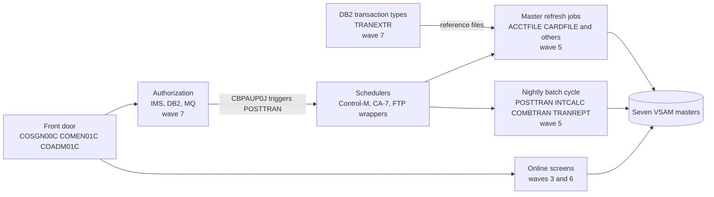

# 02 Coupling

Target state is refactor. The full edge list is in `modernization-assessment/02a-edge-tables.md`. This file is the argument. Facts come from `graph.json` (543 nodes, 1,224 edges). Anything I read by hand to settle an open edge is labeled `inference`.

The extractor left 28 computed calls open, more than the 20 that call for the dependency-cartographer agent. I could not start that agent here, so I did its work inline, following `agents/dependency-cartographer.md`. The result is in the last section.

## The four patterns that constrain the sequence

### 1. The masters have writers on both sides of the batch and online line

Data coupling is where this plan is most likely to break. Seven VSAM masters carry the business state. Batch programs write them in wave 5 and online programs write them in wave 6, so during coexistence both platforms must update one copy of each file.

| Dataset | Program writers (wave) | Job writers (wave) | Readers | Confidence | Evidence |
|---|---|---|---|---|---|
| AWS.M2.CARDDEMO.ACCTDATA.VSAM.KSDS | CBTRN02C (5), CBACT04C (5), COACTUPC (6), COBIL00C (6) | job:ACCTFILE (5) | 11 | high | `app/cbl/CBTRN02C.cbl:554`, `app/cbl/CBACT04C.cbl:356`, `app/cbl/COBIL00C.cbl:379`, `app/jcl/ACCTFILE.jcl:25`, analysis field data_hubs |
| AWS.M2.CARDDEMO.TRANSACT.VSAM.KSDS | CBTRN02C (5), COTRN02C (6), COBIL00C (6) | job:TRANBKP, job:COMBTRAN, job:TRANFILE (all 5) | 11 | high | `app/cbl/CBTRN02C.cbl:256`, `app/cbl/COTRN02C.cbl:713`, `app/jcl/TRANBKP.jcl:40`, `app/jcl/COMBTRAN.jcl:48`, analysis field data_hubs |
| AWS.M2.CARDDEMO.TCATBALF.VSAM.KSDS | CBTRN02C (5) | job:TCATBALF (5) | 4 | high | `app/cbl/CBTRN02C.cbl:528`, `app/jcl/TCATBALF.jcl:25`, analysis field data_hubs |
| AWS.M2.CARDDEMO.CUSTDATA.VSAM.KSDS | COACTUPC (6) | job:CUSTFILE (5) | 7 | high | `app/cbl/COACTUPC.cbl:575`, `app/jcl/CUSTFILE.jcl:35`, analysis field data_hubs |
| AWS.M2.CARDDEMO.CARDDATA.VSAM.KSDS | COCRDUPC (6) | job:CARDFILE (5) | 6 | high | `app/cbl/COCRDUPC.cbl:251`, `app/jcl/CARDFILE.jcl:36`, analysis field data_hubs |
| AWS.M2.CARDDEMO.CARDXREF.VSAM.KSDS | none | job:XREFFILE (5) | 8 | high | `app/jcl/XREFFILE.jcl:25`, analysis field data_hubs |
| AWS.M2.CARDDEMO.USRSEC.VSAM.KSDS | COUSR01C, COUSR02C, COUSR03C (6) | job:DUSRSECJ (5) | 5 | high | `app/cbl/COUSR01C.cbl:39`, `app/jcl/DUSRSECJ.jcl:62`, analysis field data_hubs |

All 62 contract edges are `high`, which means both sides copy the same layout copybook. There is no `medium` contract edge to review, and that is not comfort. The extractor states that high means shared layout, not proven equal. CBTRN03C copies CVTRA05Y and still reads its input through a private split of 304, 26 and 20 bytes (`app/cbl/CBTRN03C.cbl:63`). The contracts that matter most are the ones the extractor does not see. They are in pattern 3.

Two rules for the plan follow. First, the masters go behind a data-access facade before wave 5, so that new batch writers and legacy CICS writers touch one copy. Second, three writers allocate keys in one file with no written rule. COBIL00C and COTRN02C read the highest TRANSACT key with READPREV and add one (`app/cbl/COBIL00C.cbl:212`, `app/cbl/COTRN02C.cbl:444`). CBTRN02C posts the id that arrives on the daily feed (`app/cbl/CBTRN02C.cbl:425`). CBACT04C builds ids from the PARM date and a counter (`app/cbl/CBACT04C.cbl:476`). A port that keeps one of these and changes another can produce collisions that nothing reports. This is inference from reading the four programs.

### 2. The state of the transaction master is set by job order and GDG generation, and four artifacts disagree about the order

Posting is not one program. It is a sequence in which the transaction master is copied, deleted, redefined, loaded and rebuilt, and where files are addressed by generation number. No program holds that logic.

| Source | Order it defines | Runs POSTTRAN | Confidence | Evidence |
|---|---|---|---|---|
| Control-M folder DAILY-TransactionBackup (parsed) | CLOSEFIL, TRANBKP, WAITSTEP, OPENFIL | no | high | `app/scheduler/CardDemo.controlm:5`, `app/scheduler/CardDemo.controlm:11`, `app/scheduler/CardDemo.controlm:17` |
| CA-7 listing (not parsed, read by hand) | CLOSEFIL, CBPAUP0J, POSTTRAN, WAITSTEP, OPENFIL | yes, no TRANBKP | medium | `app/scheduler/CardDemo.ca7:43`, `app/scheduler/CardDemo.ca7:70`, `app/scheduler/CardDemo.ca7:97`, `app/scheduler/CardDemo.ca7:124`, inference |
| scripts/run_posting.sh | CLOSEFIL, ACCTFILE, TCATBALF, TRANBKP, POSTTRAN, TRANIDX, OPENFIL | yes | high | `scripts/run_posting.sh:13`, `scripts/run_posting.sh:17`, `scripts/run_posting.sh:23`, `scripts/run_posting.sh:26`, `scripts/run_posting.sh:34` |
| scripts/run_full_batch.sh | all reloads, POSTTRAN, INTCALC, TRANBKP, COMBTRAN, TRANIDX, OPENFIL, with TRANBKP twice | yes | high | `scripts/run_full_batch.sh:29`, `scripts/run_full_batch.sh:47`, `scripts/run_full_batch.sh:55`, `scripts/run_full_batch.sh:58` |

What each step does to the transaction master, from the JCL and the program:

| Step | Effect | Confidence | Evidence |
|---|---|---|---|
| TRANBKP | Copies the master to BKUP(+1) through the REPROC proc, then deletes and redefines the cluster, leaving it empty | high | `app/jcl/TRANBKP.jcl:33`, `app/jcl/TRANBKP.jcl:40`, `app/jcl/TRANBKP.jcl:54` |
| POSTTRAN, CBTRN02C | Opens the transaction file for OUTPUT and writes each posted record | high | `app/cbl/CBTRN02C.cbl:256` |
| INTCALC, CBACT04C | Writes interest transactions to SYSTRAN(+1), a sequential file, not to the master | high | `app/jcl/INTCALC.jcl:37`, `app/cbl/CBACT04C.cbl:500` |
| COMBTRAN | Merges BKUP(0) and SYSTRAN(0) sorted by id, then REPROs the result into the master | high | `app/jcl/COMBTRAN.jcl:24`, `app/jcl/COMBTRAN.jcl:26`, `app/jcl/COMBTRAN.jcl:48` |
| TRANREPT, first step | Also copies the master to BKUP(+1), the same GDG that COMBTRAN reads as (0) | medium | `app/jcl/TRANREPT.jcl:33`, `app/proc/REPROC.prc:27`, `app/ctl/REPROCT.ctl:15` |

The last row is the hazard. Running the report creates a newer BKUP generation than the one TRANBKP made. If it runs between TRANBKP and COMBTRAN, COMBTRAN merges the wrong generation. The extractor sees only a dataset with three writers and three readers. It cannot model relative generations. This is inference from reading the jobs. I did not run them. The GDG bases hold five generations, and one base is defined twice with different limits (`app/jcl/DEFGDGB.jcl:37`, `app/jcl/REPTFILE.jcl:27`).

### 3. Byte-offset contracts live in SORT cards and in JCL text inside COBOL

The extractor does not read SORT control cards or JCL held in a COBOL literal. Several jobs address the transaction record by fixed column. They break silently if the record layout changes, and the extractor cannot see them.

| Where | Offsets it depends on | Layout it assumes | Confidence | Evidence |
|---|---|---|---|---|
| TRANREPT job | card number at byte 263 for 16, process date at 305 for 10 | CVTRA05Y | high | `app/jcl/TRANREPT.jcl:41`, `app/jcl/TRANREPT.jcl:42` |
| TRANREPT proc | same offsets | CVTRA05Y | high | `app/proc/TRANREPT.prc:39`, `app/proc/TRANREPT.prc:40` |
| CORPT00C embedded job | same offsets, in a COBOL literal | CVTRA05Y | high | `app/cbl/CORPT00C.cbl:100` |
| CREASTMT | sort keys at 263 and 1, output records rebuilt by column | CVTRA05Y | high | `app/jcl/CREASTMT.JCL:53`, `app/jcl/CREASTMT.JCL:54` |
| PRTCATBL | fields at 1, 12, 14 and 18 | CVTRA01Y | high | `app/jcl/PRTCATBL.jcl:47`, `app/jcl/PRTCATBL.jcl:50` |
| COMBTRAN | transaction id at byte 1 for 16 | CVTRA05Y | high | `app/jcl/COMBTRAN.jcl:28` |
| TRANIDX | alternate index key of 26 bytes at offset 304, which is the process timestamp | CVTRA05Y | medium | `app/jcl/TRANIDX.jcl:27` |

The report is also defined three times: the batch job, the proc and the literal that CORPT00C submits. The job and the proc carry the same fixed 2022 dates (`app/jcl/TRANREPT.jcl:43`, `app/proc/TRANREPT.prc:41`). CORPT00C overrides them with the dates the user types. CBTRN03C then applies a second date filter from the DATEPARM file (`app/cbl/CBTRN03C.cbl:173`), and no program or job in the tree writes DATEPARM. If the two ranges differ, the program's own filter and its NEXT SENTENCE (`app/cbl/CBTRN03C.cbl:177`) decide what prints. That is inference. Someone has to run it to know.

### 4. The front door is a call cycle that everything returns to, and the dispatch is bounded

COSGN00C, COMEN01C and COADM01C call each other. Twelve programs transfer control to COMEN01C and twelve to COSGN00C by literal name (analysis field fan_in). Twenty-one call edges from waves 5, 6 and 7 point into this cycle in wave 3, so the legacy menu must stay installed for returns until the last legacy transaction is gone. The cycle cannot be split. The validator rejects a plan that splits it. The dispatch is table-driven and closed: the menu table lists 11 programs and the admin table lists 6 (`app/cpy/COMEN02Y.cpy:28`, `app/cpy/COADM02Y.cpy:29`).

## Cluster view

## Strongly connected components

They move whole or not at all. The plan keeps each in one wave, and the validator checks it.

| Component | Wave | Why it is one unit | Confidence | Evidence |
|---|---|---|---|---|
| COADM01C, COMEN01C, COSGN00C | 3 | Sign-on and both menus transfer control to each other | high | analysis field sccs, `app/cbl/COSGN00C.cbl:231`, `app/cbl/COSGN00C.cbl:236` |
| COTRN00C, COTRN01C | 3 | Transaction list and detail return to each other | high | analysis field sccs, `app/cbl/COTRN00C.cbl:188`, `app/cbl/COTRN01C.cbl:126` |
| COPAUS0C, COPAUS1C | 7 | Authorization summary and detail return to each other | high | analysis field sccs, `app/app-authorization-ims-db2-mq/cbl/COPAUS0C.cbl:316`, `app/app-authorization-ims-db2-mq/cbl/COPAUS1C.cbl:185` |

## God modules and articulation points

The analysis names COPAUS0C, COTRN00C and COTRN01C as god modules (top decile of fan-in and fan-out). I do not treat COTRN00C and COTRN01C as strangle candidates. They are 529 and 231 lines. The ranking picks three programs out of 43, and these two sit in a screen call cycle. COPAUS0C is 792 lines, self-recursive and carries two computed calls. It is the one to strangle if the client keeps the authorization subsystem.

The articulation points are candidate wave boundaries. Seven of them are batch programs (CBACT01C, CBACT04C, CBEXPORT, CBIMPORT, CBSTM03A, CBTRN02C, CBTRN03C). Six are datasets: the account, card, cross-reference and customer masters, the export file and the DB2 transaction-type table. The plan does not cut at the batch programs, because the scheduler order and the shared generations tie them together (pattern 2). Four of the seven masters (account, card, cross-reference, customer) are articulation points, so the data facade from pattern 1 is the natural seam. Evidence: analysis field articulation_points.

## The honest boundary: 28 computed calls, bounded by hand

Every computed call is a CICS transfer of control to a program name held in a variable. I read the source at each site. The set each can reach follows. All of this is inference.

| Caller and site | Variable | Set it can reach | Confidence | Evidence |
|---|---|---|---|---|
| COMEN01C 156 and 184 | menu table entry | the 11 programs in COMEN02Y | high | `app/cbl/COMEN01C.cbl:185`, `app/cpy/COMEN02Y.cpy:28`, `app/cpy/COMEN02Y.cpy:89` |
| COADM01C 145 | admin table entry | the 6 programs in COADM02Y | high | `app/cbl/COADM01C.cbl:146`, `app/cpy/COADM02Y.cpy:29`, `app/cpy/COADM02Y.cpy:49` |
| COMEN01C 201, COADM01C 168, COBIL00C 281, CORPT00C 548, COTRN02C 508 | CDEMO-TO-PROGRAM | COSGN00C or COMEN01C, moved as literals | medium | `app/cbl/COMEN01C.cbl:199`, `app/cbl/COADM01C.cbl:166`, `app/cbl/COBIL00C.cbl:130`, `app/cbl/CORPT00C.cbl:188`, `app/cbl/COTRN02C.cbl:138` |
| COACTUPC 956, COACTVWC 349, COCRDSLC 331, COCRDUPC 473 | CDEMO-TO-PROGRAM | the menu, or the program that called it (CDEMO-FROM-PROGRAM, set by the caller) | medium | `app/cbl/COACTUPC.cbl:939`, `app/cbl/COACTUPC.cbl:941`, `app/cbl/COACTVWC.cbl:336`, `app/cbl/COCRDUPC.cbl:451` |
| COCRDLIC 538 and 566 | CCARD-NEXT-PROG | itself, COCRDSLC, COCRDUPC, or the menu | medium | `app/cbl/COCRDLIC.cbl:526`, `app/cbl/COCRDLIC.cbl:554`, `app/cbl/COCRDLIC.cbl:392` |
| COTRN00C 192 and 518, COTRN01C 205 | CDEMO-TO-PROGRAM | COTRN01C, COTRN00C, COMEN01C or COSGN00C | medium | `app/cbl/COTRN00C.cbl:188`, `app/cbl/COTRN01C.cbl:126` |
| COUSR00C 196, 206 and 514, COUSR01C 175, COUSR02C 258, COUSR03C 205 | CDEMO-TO-PROGRAM | COUSR02C, COUSR03C, COADM01C or COSGN00C | medium | `app/cbl/COUSR00C.cbl:192`, `app/cbl/COUSR00C.cbl:202`, `app/cbl/COUSR01C.cbl:94` |
| COPAUS0C 322 and 674, COPAUS1C 367 | CDEMO-TO-PROGRAM | COPAUS0C, COPAUS1C, COMEN01C or COSGN00C | medium | `app/app-authorization-ims-db2-mq/cbl/COPAUS0C.cbl:33`, `app/app-authorization-ims-db2-mq/cbl/COPAUS1C.cbl:34` |
| COTRTLIC 620, COTRTUPC 457 | CDEMO-TO-PROGRAM | COADM01C, COTRTUPC or the caller | medium | `app/app-transaction-type-db2/cbl/COTRTLIC.cbl:47`, `app/app-transaction-type-db2/cbl/COTRTLIC.cbl:50` |

What is still open: CDEMO-FROM-PROGRAM is set by the caller, so the return target depends on the runtime path and not on this program alone. No computed call in the tree can reach a batch program. That matters for the dead-code register (`modernization-assessment/05-dead-code.md`). It does not change any wave, since each cycle above already sits in one wave.

## Things the extractor does not model that I found

All inference unless a citation says otherwise. None is an edge in `graph.json`.

| Finding | Why it matters to the sequence | Confidence | Evidence |
|---|---|---|---|
| CORPT00C writes a job to transient data queue JOBS, which the CSD maps to the internal reader | The online report is a job submission. The target has no internal reader | high | `app/cbl/CORPT00C.cbl:517`, `app/csd/CARDDEMO.CSD:499` |
| INTRDRJ1 copies INTRDRJ2 to the internal reader | A hidden job-to-job trigger | high | `app/jcl/INTRDRJ1.JCL:17`, `app/jcl/INTRDRJ1.JCL:18` |
| The TRANREPT proc calls REPROC in a nested step | Nested procs are not followed | high | `app/proc/TRANREPT.prc:21` |
| CA-7 triggers POSTTRAN only after CBPAUP0J, an IMS job | A wave 5 must-not-break job waits for a wave 7 job | medium | `app/scheduler/CardDemo.ca7:69`, `app/scheduler/CardDemo.ca7:70` |
| Weekly Control-M refresh waits for the DB2 job MNTTRDB2 | Another wave 5 to wave 7 order | high | `app/scheduler/CardDemo.controlm:28`, `app/scheduler/CardDemo.controlm:34` |
| TRANEXTR unloads DB2 to the files that TRANTYPE and TRANCATG load into the VSAM files CBTRN03C reads | The transaction report's reference data comes from DB2 | medium | `app/app-transaction-type-db2/jcl/TRANEXTR.jcl:73`, `app/jcl/TRANTYPE.jcl:57`, `app/cbl/CBTRN03C.cbl:39` |
| CBACT01C and COBSWAIT call assembler modules that are not parsed | Two unread modules sit under wave 2 and wave 5 units | high | `app/cbl/CBACT01C.cbl:231`, `app/cbl/COBSWAIT.cbl:38` |
| CSUTLDTC wraps the Language Environment date service CEEDAYS | The target must reproduce its accept and reject decisions | high | `app/cbl/CSUTLDTC.cbl:116` |
| CICS transaction CDV1 runs COCRDSEC, a program with no source in the tree | An online entry point nobody can read | high | `app/csd/CARDDEMO.CSD:388`, `app/csd/CARDDEMO.CSD:390` |
| The card cross-reference and the transaction file each have an alternate index that CARDFILE, XREFFILE, TRANFILE and TRANIDX drop and rebuild | Online screens that read through the index fail while a refresh runs | medium | `app/jcl/CARDFILE.jcl:39`, `app/jcl/TRANFILE.jcl:38`, `app/jcl/TRANIDX.jcl:25` |
