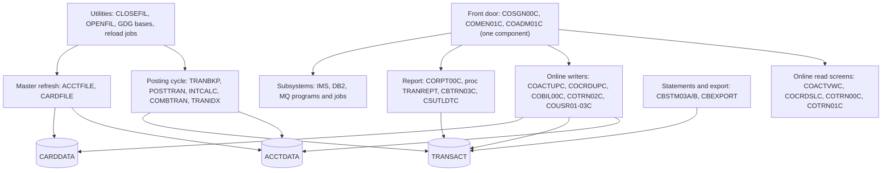

# 02 Coupling

Target state is refactor. The facts are in `modernization-assessment/graph.json` (543 nodes, 1,224 edges: 318 call, 476 include, 235 data, 62 contract, 133 temporal, from `analysis.edge_counts`) and in `modernization-assessment/02a-edge-tables.md`. This file is the argument. Where I settled something the extractor could not, I say `inference` and cite the line. The 28 computed calls are more than 20, so the work of the dependency-cartographer agent is done inline in the section "The honest boundary", following `agents/dependency-cartographer.md`.

## The patterns that will constrain the sequence

| # | Pattern | What is coupled | What it does to the waves | Confidence | Evidence |
|---|---|---|---|---|---|
| 1 | The posting cycle is a data and time chain, and the client's three must-not-break items sit on it | `scripts/run_full_batch.sh` runs CLOSEFIL, the master refreshes, POSTTRAN, INTCALC, TRANBKP, COMBTRAN, TRANIDX, OPENFIL in that order. CBTRN02C opens the TRANSACT KSDS for OUTPUT, and TRANBKP is what backs the file up and rebuilds it empty. COMBTRAN reloads it and TRANIDX rebuilds its alternate index. | POSTTRAN, TRANBKP, COMBTRAN, TRANIDX, ACCTFILE and CARDFILE cut over together. I moved them into one wave (see deviations in `modernization-assessment/03-waves.md`). | high | `scripts/run_full_batch.sh:47`, `scripts/run_full_batch.sh:55`, `app/cbl/CBTRN02C.cbl:256`, `app/jcl/TRANBKP.jcl:40`, `app/jcl/COMBTRAN.jcl:48`, `app/jcl/TRANIDX.jcl:25` |
| 2 | Two masters are written from both sides, batch and online | ACCTDATA has four program writers (CBACT04C, CBTRN02C in batch, COACTUPC, COBIL00C online) and eleven readers. TRANSACT has three writers (CBTRN02C, COBIL00C, COTRN02C) and eleven readers. 46 of the 62 contract edges join programs in different waves. | Batch and online cannot be split without a data facade or a replica for at least one wave. Waves 5 and 6 have to agree who owns each master. | high | `analysis` (fields `data_hubs` and `sccs`), `app/cbl/CBACT04C.cbl:41`, `app/cbl/CBTRN02C.cbl:51`, `app/cbl/COACTUPC.cbl:573`, `app/cbl/COBIL00C.cbl:41`, `app/cbl/COTRN02C.cbl:39` |
| 3 | The menu is a table-driven facade | COMEN01C dispatches through an 11 row table and COADM01C through a 6 row table. Nearly every other online program XCTLs back to COMEN01C, COSGN00C or COADM01C. Of the 24 program-to-program call edges that cross a wave boundary, 22 go from waves 5, 6 and 7 back into wave 3. | The wave 3 menu must route each option to a new or a legacy program until wave 7. The menu is the facade for the online side. | high | `app/cpy/COMEN02Y.cpy:28`, `app/cpy/COMEN02Y.cpy:89`, `app/cpy/COADM02Y.cpy:29`, `app/cpy/COADM02Y.cpy:53`, `app/cbl/COMEN01C.cbl:156` |
| 4 | The transaction report has three couplings the graph cannot show | (a) CORPT00C builds JCL text that runs PROC=TRANREPT and writes it to the JOBS TD queue. (b) The SORT step reads the transaction record by byte offset (card number at 263, processing date at 305), so the report is coupled to the TRAN-RECORD layout in a JCL control card. (c) The batch job TRANREPT carries a copy of the proc's steps, both with a 2022 date window. | CORPT00C, proc TRANREPT, job TRANREPT, CBTRN03C and CSUTLDTC move together. The equivalence harness has to cover the online path and the batch path. | high | `app/cbl/CORPT00C.cbl:94`, `app/cbl/CORPT00C.cbl:518`, `app/csd/CARDDEMO.CSD:499`, `app/jcl/TRANREPT.jcl:41`, `app/jcl/TRANREPT.jcl:42`, `app/proc/TRANREPT.prc:40` |
| 5 | Scheduling lives in five places and they disagree | Control-M (three folders), a CA-7 listing the extractor did not parse, four shell wrappers, an internal reader submit from one job to another, and a CICS TD queue. CA-7 chains CBPAUP0J ahead of POSTTRAN. The wrappers run ACCTFILE, TCATBALF and TRANBKP ahead of it. | A plan built without the temporal edges is not a plan. Which order is production is a question for the client. | medium | `app/scheduler/CardDemo.ca7:43`, `app/scheduler/CardDemo.ca7:70`, `scripts/run_posting.sh:17`, `scripts/run_posting.sh:26`, `app/jcl/INTRDRJ1.JCL:17` |

### Pattern 1 in detail

The wrapper order is CLOSEFIL, ACCTFILE, CARDFILE, XREFFILE, CUSTFILE, TRANBKP, DISCGRP, TCATBALF, TRANTYPE, DUSRSECJ, POSTTRAN, INTCALC, TRANBKP again, COMBTRAN, TRANIDX, OPENFIL (`scripts/run_full_batch.sh:13` to `scripts/run_full_batch.sh:66`). Read with the JCL, the life of the TRANSACT file in one cycle is (inference, from the lines cited):

1. TRANBKP copies it to a GDG generation, deletes the cluster and its alternate index, and defines it empty (`app/jcl/TRANBKP.jcl:33`, `app/jcl/TRANBKP.jcl:40`, `app/jcl/TRANBKP.jcl:43`, `app/jcl/TRANBKP.jcl:54`).
2. POSTTRAN loads the day's postings into it. CBTRN02C opens it for OUTPUT (`app/cbl/CBTRN02C.cbl:256`) and reads the daily transaction file (`app/cbl/CBTRN02C.cbl:29`).
3. INTCALC writes a separate SYSTRAN generation, not TRANSACT (`app/jcl/INTCALC.jcl:41`).
4. TRANBKP runs again and captures the posted file (`scripts/run_full_batch.sh:55`).
5. COMBTRAN merges that backup with SYSTRAN by transaction id and REPROs the result back into TRANSACT (`app/jcl/COMBTRAN.jcl:24`, `app/jcl/COMBTRAN.jcl:26`, `app/jcl/COMBTRAN.jcl:48`).
6. TRANIDX rebuilds the alternate index (`app/jcl/TRANIDX.jcl:52`).

Three consequences a port has to carry. The delete step in TRANBKP has no COND, while the define step has COND=(4,LT), so a failed backup does not stop the delete (`app/jcl/TRANBKP.jcl:37`, `app/jcl/TRANBKP.jcl:51`). The GDG behind the backup keeps five generations (`app/jcl/DEFGDGB.jcl:25`), and the report job also writes a generation of it (`app/jcl/TRANREPT.jcl:33`), so five report runs push a real daily backup off. The run date for INTCALC is a constant PARM that becomes the first ten bytes of every interest transaction id (`app/jcl/INTCALC.jcl:22`, `app/cbl/CBACT04C.cbl:476`).

No job or program in the tree writes the daily transaction input file that POSTTRAN reads (`app/jcl/POSTTRAN.jcl:31`). Its producer is outside what I was given.

## Cluster view

Cluster level only. A node per program would show 44 programs and 55 jobs and say nothing.

## Strongly connected components

They move as a unit or not at all. The validator rejects a plan that splits one.

| Component | Why it is a cycle | Wave | Confidence | Evidence |
|---|---|---|---|---|
| COADM01C, COMEN01C, COSGN00C | Sign-on XCTLs to the menu or admin menu, and each XCTLs back. These are control transfers, not recursion. | 3 | high | `app/cbl/COSGN00C.cbl:231`, `app/cbl/COSGN00C.cbl:236`, `app/cbl/COADM01C.cbl:166`, `app/cbl/COMEN01C.cbl:199` |
| COPAUS0C, COPAUS1C | The summary and detail screens call each other. | 7 | medium | `app/app-authorization-ims-db2-mq/cbl/COPAUS0C.cbl:316`, `app/app-authorization-ims-db2-mq/cbl/COPAUS1C.cbl:168` |
| COTRN00C, COTRN01C | The list and view screens call each other. | 3 | high | `app/cbl/COTRN00C.cbl:188`, `app/cbl/COTRN01C.cbl:126` |

COCRDLIC and COPAUS0C also call themselves (`analysis` field `self_recursive`), through a next-program field (`app/cbl/COCRDLIC.cbl:428`).

## God modules

None. `analysis.god_modules` is empty, and the fan-in leaders are the menus (COMEN01C 12, COSGN00C 12, COADM01C 7). That is a warning sign of its own, because it reflects the way the extractor counts XCTL. The programs everything depends on are the two masters and the menu table, not a hub program. There is nothing to strangle behind a facade at program level, and the facade is the data (pattern 2) and the menu (pattern 3).

## Articulation points

From `analysis.articulation_points` (computed over call and data edges among reachable programs). These are the natural wave boundaries.

| Point | What it separates | Used as a cut in the plan | Confidence | Evidence |
|---|---|---|---|---|
| CBTRN02C | The posting writer from the readers of TRANSACT | Named as the only candidate cut for wave 5, and rejected. See `modernization-assessment/03-waves.md`. | medium | `analysis` (field `articulation_points`), `app/cbl/CBTRN02C.cbl:34` |
| CBACT04C | Interest writer from the account and category balance files | No | medium | `analysis` (field `articulation_points`), `app/cbl/CBACT04C.cbl:41` |
| CBEXPORT, CBIMPORT | Export and import through one file layout | No | medium | `analysis` (field `articulation_points`), `app/cbl/CBEXPORT.cbl:65` |
| CBSTM03A, CBTRN03C | Statement and report read sides | No | medium | `analysis` (field `articulation_points`), `app/cbl/CBTRN03C.cbl:173` |
| COADM01C, COSGN00C | The front door component | No | medium | `analysis` (field `articulation_points`), `app/cbl/COSGN00C.cbl:231` |
| The ACCTDATA, CARDDATA, CARDXREF, CUSTDATA and EXPORT.DATA datasets | Every program on either side of a master | No. These are the ownership handovers. | medium | `analysis` (field `articulation_points`), `app/csd/CARDDEMO.CSD:2` |

## The honest boundary: computed calls

The extractor found 28 computed calls and never dropped them (`analysis.unresolved_dynamic`). All 28 are `EXEC CICS XCTL PROGRAM(field)`. I read each site and where the field gets its value. This section is the dependency-cartographer's work, done inline. Everything in the "What the source shows" column is inference from the lines cited.

| Sites | Target field | What the source shows | Still open | Confidence | Evidence |
|---|---|---|---|---|---|
| COMEN01C at 156 and 184 | CDEMO-MENU-OPT-PGMNAME(option) | An 11 row table: COACTVWC, COACTUPC, COCRDLIC, COCRDSLC, COCRDUPC, COTRN00C, COTRN01C, COTRN02C, CORPT00C, COBIL00C, COPAUS0C. | Nothing. It is bounded. Option 11 is in an optional module that has no PROGRAM definition in the CSD. | high | `app/cbl/COMEN01C.cbl:156`, `app/cbl/COMEN01C.cbl:184`, `app/cpy/COMEN02Y.cpy:28`, `app/cpy/COMEN02Y.cpy:89` |
| COADM01C at 145 | CDEMO-ADMIN-OPT-PGMNAME(option) | A 6 row table: COUSR00C, COUSR01C, COUSR02C, COUSR03C, COTRTLIC, COTRTUPC. | Nothing. It is bounded. The two DB2 rows were added later (see the comment on the count). | high | `app/cbl/COADM01C.cbl:145`, `app/cpy/COADM02Y.cpy:22`, `app/cpy/COADM02Y.cpy:49`, `app/cpy/COADM02Y.cpy:53` |
| COCRDLIC at 538 and 566 | CCARD-NEXT-PROG | Set to LIT-CARDDTLPGM (COCRDSLC) before 538 and LIT-CARDUPDPGM (COCRDUPC) before 566. It also takes LIT-THISPGM, itself. | Nothing. It is bounded. | high | `app/cbl/COCRDLIC.cbl:526`, `app/cbl/COCRDLIC.cbl:554`, `app/cbl/COCRDLIC.cbl:428` |
| COADM01C 168, COMEN01C 201, COBIL00C 281, COTRN00C 192 and 518, COTRN01C 205, COTRN02C 508, COUSR00C 196, 206 and 514, COUSR01C 175, COUSR02C 258, COUSR03C 205, CORPT00C 548 | CDEMO-TO-PROGRAM | Every assignment in the tree is a literal: COSGN00C, COMEN01C, COADM01C, or a screen name (COTRN01C, COUSR02C, COUSR03C). I found no other move into the field in the COBOL that these programs use. | Nothing inside the tree. The extractor already added the medium confidence edges for these literals. | high | `app/cbl/COMEN01C.cbl:199`, `app/cbl/COBIL00C.cbl:130`, `app/cbl/COTRN00C.cbl:188`, `app/cbl/COUSR00C.cbl:192`, `app/cbl/COUSR00C.cbl:202`, `app/cbl/CORPT00C.cbl:188` |
| COACTVWC 349, COACTUPC 956, COCRDSLC 331, COCRDUPC 473, COTRTLIC 620, COTRTUPC 457 | CDEMO-TO-PROGRAM | Either the menu or admin literal, or CDEMO-FROM-PROGRAM, which is the name of whichever program transferred into this one (each caller stores its own name). | Which callers exist. The set is COMEN01C, COADM01C and COCRDLIC in this tree. A program outside the tree, such as the CSD-defined COCRDSEC, could pass a different name. | medium | `app/cbl/COACTVWC.cbl:338`, `app/cbl/COACTUPC.cbl:941`, `app/cbl/COCRDSLC.cbl:320`, `app/cbl/COCRDUPC.cbl:453`, `app/app-transaction-type-db2/cbl/COTRTLIC.cbl:605`, `app/app-transaction-type-db2/cbl/COTRTUPC.cbl:442`, `app/cbl/COMEN01C.cbl:154` |
| COPAUS0C 322 and 674, COPAUS1C 367 | CDEMO-TO-PROGRAM | Working storage constants: COPAUS0C, COPAUS1C, COMEN01C, and the COSGN00C literal. | Nothing. It is bounded. | high | `app/app-authorization-ims-db2-mq/cbl/COPAUS0C.cbl:33`, `app/app-authorization-ims-db2-mq/cbl/COPAUS0C.cbl:34`, `app/app-authorization-ims-db2-mq/cbl/COPAUS0C.cbl:35`, `app/app-authorization-ims-db2-mq/cbl/COPAUS1C.cbl:34` |

What this means for the dead-code register. Every computed call targets a CICS program. None of the six batch programs in the unknown bucket has a PROGRAM definition in the CSD (`app/csd/CARDDEMO.CSD:173` to `app/csd/CARDDEMO.CSD:299`). That bounds the calls, but the validator and the skill rule keep those programs in unknown, and I left them there. See `modernization-assessment/05-dead-code.md`.

### Medium confidence contract edges

There are none. All 62 contract edges are high, which means only that both sides COPY the same layout copybook (`analysis` field `edge_counts`, `meta.limits`). It does not prove the layouts equal. Three places the graph has no contract edge and a layout coupling exists:

| Where | Why the extractor has no edge | Confidence | Evidence |
|---|---|---|---|
| SORT writes the transaction generation that CBTRN03C reads | SORT is not a program with source, and IDCAMS and SORT control cards are not read. The layout is fixed as byte offsets. | high | `app/jcl/TRANREPT.jcl:41`, `app/jcl/TRANREPT.jcl:42`, `app/cbl/CBTRN03C.cbl:29` |
| CBACT04C writes SYSTRAN and COMBTRAN merges it with the backup | The reader is a SORT step. The sort key is the first 16 bytes. | high | `app/jcl/INTCALC.jcl:41`, `app/jcl/COMBTRAN.jcl:28` |
| CBSTM03B reads four files | A called subprogram gets no DDs from its caller's step, so its four DDs show as unmapped. They belong to CBSTM03A's step in CREASTMT. | high | `app/cbl/CBSTM03B.CBL:31`, `app/jcl/CREASTMT.JCL:83` |

## What the extractor does not model, and what I found

| Item | Effect | Confidence | Evidence |
|---|---|---|---|
| Programs run through an IMS or DB2 command step | `EXEC PARM` of DFSRRC00 and `RUN PROGRAM` under IKJEFT01 are not read. Five batch programs show no caller. | high | `app/app-authorization-ims-db2-mq/jcl/CBPAUP0J.jcl:25`, `app/app-authorization-ims-db2-mq/jcl/LOADPADB.JCL:27`, `app/app-transaction-type-db2/jcl/MNTTRDB2.jcl:30` |
| A job that submits another job | INTRDRJ1 copies INTRDRJ2's JCL to the internal reader. No edge exists. | high | `app/jcl/INTRDRJ1.JCL:17` |
| CA-7 triggers | The listing shows CLOSEFIL triggering CBPAUP0J, CBPAUP0J triggering POSTTRAN, POSTTRAN triggering WAITSTEP and then OPENFIL. It also chains READACCT to READXREF, and CREASTMT to TXT2PDF1. The listing is truncated in places, and every job shows identical run counts and dates, so treat them as template values. | medium | `app/scheduler/CardDemo.ca7:43`, `app/scheduler/CardDemo.ca7:70`, `app/scheduler/CardDemo.ca7:97`, `app/scheduler/CardDemo.ca7:124`, `app/scheduler/CardDemo.ca7:24`, `app/scheduler/CardDemo.ca7:51` |
| RETURN TRANSID chains | Pseudo-conversational re-entry is not an edge, so the online call graph understates how the screens reach each other. | high | `app/cbl/COSGN00C.cbl:98`, `app/cbl/COSGN00C.cbl:99` |
| COPY REPLACING | Applied as written. Only the screen attribute copybook CSSETATY is replaced in the two update screens. | medium | `app/cbl/COACTUPC.cbl:3208` |
| COND on a step | Not modeled. TRANBKP relies on it for one step and not for another. | high | `app/jcl/TRANBKP.jcl:51` |
| Programs defined in the CSD with no source | COCRDSEC is defined to CICS and has no source in the tree. | high | `app/csd/CARDDEMO.CSD:211` |
| Programs in the tree with no CSD entry | COACCT01, CODATE01, COPAUA0C, COPAUS0C, COPAUS1C, COPAUS2C, COTRTLIC and COTRTUPC have no PROGRAM definition in this CSD. Their definitions are in another file that was not supplied, or they are not installed. | medium | `app/csd/CARDDEMO.CSD:173`, `app/csd/CARDDEMO.CSD:299` |

## Not parsed, and why it matters here

The extractor listed eight groups of files it did not read (`unparsed` in `graph.json`). Each becomes an open question in `modernization-assessment/00-summary.md`.

| Files | What sits in them | Effect on the sequence | Confidence | Evidence |
|---|---|---|---|---|
| `.ca7` scheduler listing | Production trigger chains | The unscheduled-jobs list is overstated, and the POSTTRAN predecessor is unknown | high | `app/scheduler/CardDemo.ca7:70` |
| IMS DBD and PSB (8 files) | The authorization database hierarchy and access paths | Wave 7 cannot be estimated tightly | high | `app/app-authorization-ims-db2-mq/ims/DBPAUTP0.dbd:1`, `app/app-authorization-ims-db2-mq/ims/DLIGSAMP.PSB:1` |
| DB2 DDL and DCLGEN (9 files) | The transaction type and fraud tables | Same, for the DB2 programs | high | `app/app-transaction-type-db2/ddl/TRNTYCAT.ddl:1`, `app/app-authorization-ims-db2-mq/dcl/AUTHFRDS.dcl:1` |
| Control cards `.ctl` (8 files) | DB2 utility control input | Same | medium | `app/app-transaction-type-db2/ctl/DB2CREAT.ctl:1` |
| Assembler `.asm` and macros `.mac` (4 files) | COBDATFT, MVSWAIT and their macros, called from CBACT01C and COBSWAIT | Two programs have logic in code nobody read | high | `app/asm/COBDATFT.asm:1`, `app/asm/MVSWAIT.asm:1`, `app/cbl/CBACT01C.cbl:231` |
