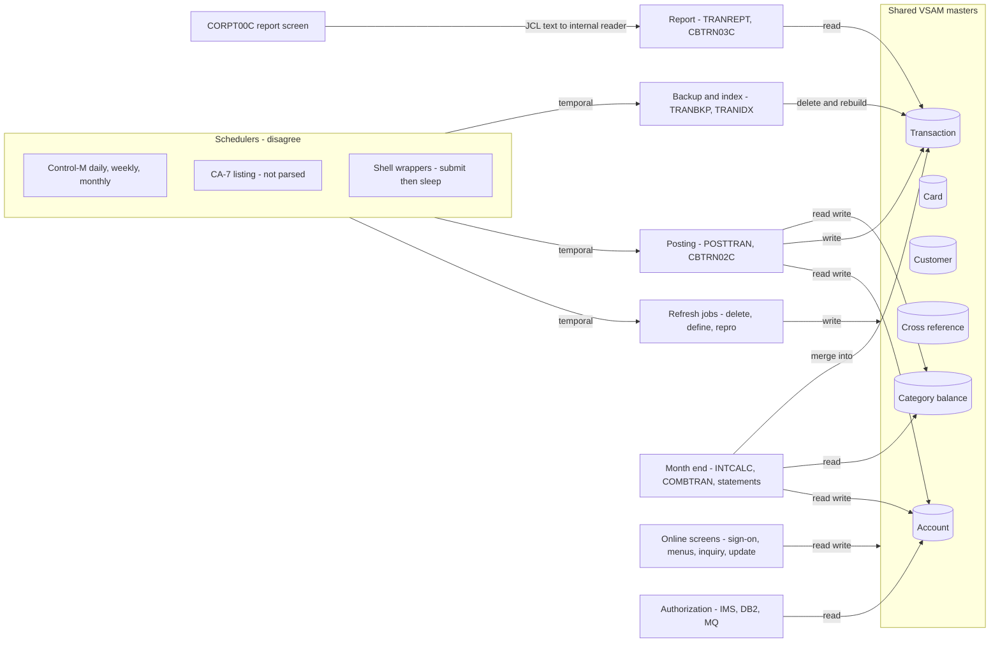

# 02 Coupling

The full edge list is in `02a-edge-tables.md`. This file is the argument: what the coupling does to the migration sequence. Target state is refactor. What must not break: daily transaction posting, the account and card master refresh, and the transaction report.

Facts come from `graph.json`. Where I read source to settle an edge or add one the extractor cannot make, the row says `inference`.

## The three patterns that constrain the sequence

### 1. The VSAM masters are shared by batch and online, and the extractor undercounts the writers

`analysis.data_hubs` in `graph.json` ranks the account master first (4 writers, 11 readers) and the transaction master second (3 writers, 11 readers). All 62 contract edges are `high`, because writers and readers include the same layout copybook. The account layout `CVACT01Y` is included by 14 programs and the transaction layout `CVTRA05Y` by 11.

| Master | Writers the extractor found | Readers | Evidence |
|---|---|---|---|
| Account master (ACCTDATA.VSAM.KSDS) | CBACT04C, CBTRN02C, COACTUPC, COBIL00C | CBACT01C, CBEXPORT, COACCT01, COACTVWC, COPAUA0C, COPAUS0C and the four writers | `app/cbl/CBTRN02C.cbl:51`, `app/cbl/COBIL00C.cbl:41`, `app/cbl/COACTUPC.cbl:573`, `app/cbl/CBACT04C.cbl:41` |
| Transaction master (TRANSACT.VSAM.KSDS) | CBTRN02C, COBIL00C, COTRN02C | CBEXPORT, COTRN00C, COTRN01C and the writers | `app/cbl/CBTRN02C.cbl:34`, `app/cbl/COBIL00C.cbl:40`, `app/cbl/COTRN02C.cbl:39` |
| Card master (CARDDATA.VSAM.KSDS) | COCRDUPC | CBACT02C, CBEXPORT, COCRDLIC, COCRDSLC | `app/cbl/COCRDUPC.cbl:251` |

The extractor reads dataset mode on utility steps from DISP only. So it labels the refresh steps as readers. `app/jcl/ACCTFILE.jcl:58` names the account master as the REPRO target at `app/jcl/ACCTFILE.jcl:61`. That is a write, and it is a full replace, because `app/jcl/ACCTFILE.jcl:25` deletes the cluster first. `app/jcl/TRANBKP.jcl:40` does the same to the transaction master. `app/jcl/CARDFILE.jcl:36` does it to the card master. So the account master has five writers, not four (inference). One of them wipes the file.

What this does to the sequence:

- Batch and online cannot sit on different platforms during waves 1 to 6 unless the masters are synchronized both ways. The plan assumes the masters stay where they are until wave 6 ends. That is the client's decision to confirm (open question 6 in `00-summary.md`).
- Three programs generate keys into one transaction key space. The online screens take the highest key and add one (`app/cbl/COBIL00C.cbl:212`, `app/cbl/COTRN02C.cbl:444`). Interest builds the key from a PARM date and a counter (`app/cbl/CBACT04C.cbl:476`). Posting takes the key from the daily file (`app/cbl/CBTRN02C.cbl:425`). Nothing in the tree keeps these apart (inference).
- The authorization module reads the balance that posting rewrites (`app/app-authorization-ims-db2-mq/cbl/COPAUA0C.cbl:35`). Wave 8 depends on the meaning of a balance settled in wave 4.

### 2. The order of the daily cycle is held in three places that disagree, and in sleeps

No single scheduler holds the whole cycle. Each holds a different slice.

| Source | What it runs, in order | Evidence |
|---|---|---|
| Control-M, DAILY folder | CLOSEFIL, TRANBKP, WAITSTEP, OPENFIL. It never names POSTTRAN. | `app/scheduler/CardDemo.controlm:4`, `app/scheduler/CardDemo.controlm:8`, `app/scheduler/CardDemo.controlm:14`, `app/scheduler/CardDemo.controlm:20` |
| CA-7 listing (not parsed by the extractor) | CLOSEFIL, CBPAUP0J, POSTTRAN, WAITSTEP, OPENFIL, each triggering the next | `app/scheduler/CardDemo.ca7:18`, `app/scheduler/CardDemo.ca7:43`, `app/scheduler/CardDemo.ca7:70`, `app/scheduler/CardDemo.ca7:97`, `app/scheduler/CardDemo.ca7:124` |
| `scripts/run_posting.sh` | CLOSEFIL, ACCTFILE, TCATBALF, TRANBKP, POSTTRAN, TRANIDX, OPENFIL | `scripts/run_posting.sh:13`, `scripts/run_posting.sh:17`, `scripts/run_posting.sh:20`, `scripts/run_posting.sh:23`, `scripts/run_posting.sh:26`, `scripts/run_posting.sh:30`, `scripts/run_posting.sh:34` |
| `scripts/run_full_batch.sh` | Refreshes, POSTTRAN, INTCALC, TRANBKP again, COMBTRAN, TRANIDX, OPENFIL | `scripts/run_full_batch.sh:47`, `scripts/run_full_batch.sh:51`, `scripts/run_full_batch.sh:55`, `scripts/run_full_batch.sh:58`, `scripts/run_full_batch.sh:62` |

Three facts make this worse.

- The shell scripts submit jobs to JES by FTP (`scripts/run_posting.sh:11`) and then sleep (`scripts/run_posting.sh:14`, `scripts/run_posting.sh:27`). They submit in order. They do not wait for one job to finish before the next is submitted (inference: `put` hands the job to JES and returns). There is no sleep between TRANBKP and POSTTRAN (`scripts/run_posting.sh:23`, `scripts/run_posting.sh:26`). TRANBKP deletes and redefines the transaction master (`app/jcl/TRANBKP.jcl:40`). Whether POSTTRAN opens the old cluster, the new one, or waits on a dataset lock is decided by the job queue at run time (inference).
- WAITSTEP is a timer. It sleeps 36 seconds (`app/jcl/WAITSTEP.jcl:26`) through `app/cbl/COBSWAIT.cbl:38`, which calls an assembler routine that the extractor does not read. Time stands in for a dependency.
- CLOSEFIL and OPENFIL close and open five CICS files by console command against a hard-coded region name (`app/jcl/CLOSEFIL.jcl:26`, `app/jcl/OPENFIL.jcl:26`). The card, customer and transaction refresh jobs each close and reopen their own files the same way (`app/jcl/CARDFILE.jcl:26`, `app/jcl/CUSTFILE.jcl:26`, `app/jcl/TRANFILE.jcl:26`). So the list of which CICS files are closed for which batch job lives in five jobs, and the shell scripts run CLOSEFIL first and then the per-file jobs again (`scripts/remote_refresh.sh:13`, `scripts/remote_refresh.sh:20`).

The extractor's `unscheduled_jobs` list has 35 entries. Eight of them are scheduled in the CA-7 listing that it did not parse: CBPAUP0J (`app/scheduler/CardDemo.ca7:43`), READACCT (`app/scheduler/CardDemo.ca7:340`), READCARD (`app/scheduler/CardDemo.ca7:367`), READCUST (`app/scheduler/CardDemo.ca7:394`), READXREF (`app/scheduler/CardDemo.ca7:421`), CREASTMT (`app/scheduler/CardDemo.ca7:468`), TXT2PDF1 (`app/scheduler/CardDemo.ca7:495`) and PRTCATBL (`app/scheduler/CardDemo.ca7:537`). Treat the rest of that list as unproven.

The temporal edges in `graph.json` (133) come from step order and script order. They are the orders the harness must keep. They are not proof that the production order is the one in any single file.

### 3. Contracts hide in control cards and in JCL text built by COBOL

The extractor makes contract edges between programs that share a dataset. It does not read SORT or IDCAMS control cards, and it does not follow jobs submitted through the internal reader. Both hide the same thing: the transaction record layout, copied as literal offsets.

| Where the layout is repeated | What it assumes | Evidence |
|---|---|---|
| SORT symbols in the report job | card number at column 263 for 16 bytes, processing date at 305 for 10 | `app/jcl/TRANREPT.jcl:41`, `app/jcl/TRANREPT.jcl:42` |
| The same symbols in the report proc | same offsets | `app/proc/TRANREPT.prc:39`, `app/proc/TRANREPT.prc:40` |
| The same symbols inside COBOL text that the online screen submits | same offsets | `app/cbl/CORPT00C.cbl:100`, `app/cbl/CORPT00C.cbl:102` |
| The statement job's SORT | key on card number then id | `app/jcl/CREASTMT.JCL:53` |
| The merge job's SORT | id at column 1 for 16 | `app/jcl/COMBTRAN.jcl:28` |
| The alternate index on the transaction master | key at offset 304 for 26 | `app/jcl/TRANIDX.jcl:27`, `app/jcl/TRANFILE.jcl:84` |
| The layout they all copy | card at 263, processing timestamp at 305 (from field widths) | `app/cpy/CVTRA05Y.cpy:15`, `app/cpy/CVTRA05Y.cpy:17` |

These are contract edges the extractor did not draw. A change to `CVTRA05Y` in a port breaks six places that no include edge connects (inference).

The online report screen builds a whole JCL job as COBOL text and writes it to the JOBS queue. The text runs `PROC=TRANREPT` (`app/cbl/CORPT00C.cbl:94`) and writes it with `app/cbl/CORPT00C.cbl:517`. This is why the extractor's claim that `proc:TRANREPT` is unreachable is wrong. It is the second way to run the must-not-break report, and it replaces the fixed dates that the batch job carries (`app/jcl/TRANREPT.jcl:43`, `app/jcl/TRANREPT.jcl:44`).

## Cluster map

The graph is at cluster level. A node per program would say nothing here.

## Strongly connected components

`analysis.sccs` lists three. A wave plan must not split any of them.

| Component | Why they cycle | Wave | Evidence |
|---|---|---|---|
| COADM01C, COMEN01C, COSGN00C | Sign-on goes to a menu, and every screen returns to sign-on or a menu | 5 | `app/cbl/COSGN00C.cbl:231`, `app/cbl/COSGN00C.cbl:236`, `app/cbl/COMEN01C.cbl:97`, `app/cbl/COADM01C.cbl:101` |
| COTRN00C, COTRN01C | List and detail call each other | 5 | `app/cbl/COTRN00C.cbl:188`, `app/cbl/COTRN01C.cbl:126` |
| COPAUS0C, COPAUS1C | Summary and detail call each other | 8 | `app/app-authorization-ims-db2-mq/cbl/COPAUS0C.cbl:34`, `app/app-authorization-ims-db2-mq/cbl/COPAUS1C.cbl:34` |

`analysis.self_recursive` adds COCRDLIC and COPAUS0C, which call themselves. They stay whole.

The extractor's cycles are probably too small (inference). The menu programs transfer control through a table, `PROGRAM(CDEMO-MENU-OPT-PGMNAME(WS-OPTION))` (`app/cbl/COMEN01C.cbl:156`). The table holds 11 program names (`app/cpy/COMEN02Y.cpy:28` to `app/cpy/COMEN02Y.cpy:89`). The admin menu holds 6 more (`app/cpy/COADM02Y.cpy:29` to `app/cpy/COADM02Y.cpy:53`). Every one of those screens returns to a menu. So the real online cycle likely holds all the online programs, and `graph.json` shows only three of them in a cycle because it did not resolve the table. The schema check passes this plan because it only knows the extractor's cycles. I split the online programs across waves 5, 6 and 8 anyway, on one condition: the menu table is a routing table, so a router that maps a table entry to the legacy or the new program lets a screen move alone. Wave 5 has to prove that router before wave 6 begins.

## God modules, hubs and articulation points

`analysis.god_modules` is empty. There is no program that meets the extractor's god-module rule. The heavy hubs are the sign-on and menu programs, by fan-in.

| Program | Fan-in | Why it matters | Evidence |
|---|---|---|---|
| COMEN01C | 12 | Every screen returns here | `app/cbl/COMEN01C.cbl:201` |
| COSGN00C | 12 | Every screen can fall back to sign-on | `app/cbl/COSGN00C.cbl:223` |
| COADM01C | 7 | Admin gateway | `app/cbl/COADM01C.cbl:145` |
| CSUTLDTC | 3 | Date validation for account update, report and add-transaction | `app/cbl/CSUTLDTC.cbl:116` |

COACTUPC has 3368 lines and fan-in 0. It is the largest program. It is not a god module by the extractor's rule, and I would still not port it in one piece (`app/cbl/COACTUPC.cbl:573`).

Articulation points are the natural wave boundaries. The batch ones are CBTRN02C, CBTRN03C, CBACT04C, CBACT01C, CBEXPORT, CBIMPORT and CBSTM03A, plus five datasets (account, card, cross-reference, customer and the export file). That fits the plan: each of those sits at the head of a wave or a cluster.

## The honest boundary

The extractor left 28 computed calls. All 28 are `EXEC CICS XCTL PROGRAM(variable)`. None is a COBOL CALL. The table below bounds each site from the literal MOVEs the extractor already turned into medium edges, and from the menu tables. Every row is `inference`, because I read the source for it.

| Program | Sites (lines) | Targets that can be reached | Evidence |
|---|---|---|---|
| COMEN01C | 156, 184 | The 11 programs in `COMEN02Y` | `app/cpy/COMEN02Y.cpy:28`, `app/cpy/COMEN02Y.cpy:89` |
| COMEN01C | 201 | COSGN00C | `app/cbl/COMEN01C.cbl:97` |
| COADM01C | 145 | The 6 programs in `COADM02Y` | `app/cpy/COADM02Y.cpy:29`, `app/cpy/COADM02Y.cpy:53` |
| COADM01C | 168 | COSGN00C | `app/cbl/COADM01C.cbl:101` |
| COACTUPC | 956 | COMEN01C | `app/cbl/COACTUPC.cbl:557` |
| COACTVWC | 349 | COMEN01C | `app/cbl/COACTVWC.cbl:168` |
| COBIL00C | 281 | COMEN01C, COSGN00C | `app/cbl/COBIL00C.cbl:108`, `app/cbl/COBIL00C.cbl:130` |
| COCRDLIC | 538, 566 | COCRDLIC, COCRDSLC, COCRDUPC, COMEN01C | `app/cbl/COCRDLIC.cbl:179`, `app/cbl/COCRDLIC.cbl:195`, `app/cbl/COCRDLIC.cbl:203` |
| COCRDSLC | 331 | COMEN01C | `app/cbl/COCRDSLC.cbl:179` |
| COCRDUPC | 473 | COMEN01C | `app/cbl/COCRDUPC.cbl:235` |
| CORPT00C | 548 | COMEN01C, COSGN00C | `app/cbl/CORPT00C.cbl:173`, `app/cbl/CORPT00C.cbl:188` |
| COTRN00C | 192, 518 | COMEN01C, COSGN00C, COTRN01C | `app/cbl/COTRN00C.cbl:108`, `app/cbl/COTRN00C.cbl:123`, `app/cbl/COTRN00C.cbl:188` |
| COTRN01C | 205 | COMEN01C, COSGN00C, COTRN00C | `app/cbl/COTRN01C.cbl:95`, `app/cbl/COTRN01C.cbl:117`, `app/cbl/COTRN01C.cbl:126` |
| COTRN02C | 508 | COMEN01C, COSGN00C | `app/cbl/COTRN02C.cbl:116`, `app/cbl/COTRN02C.cbl:138` |
| COUSR00C | 196, 206, 514 | COADM01C, COSGN00C, COUSR02C, COUSR03C | `app/cbl/COUSR00C.cbl:111`, `app/cbl/COUSR00C.cbl:126`, `app/cbl/COUSR00C.cbl:192` |
| COUSR01C | 175 | COADM01C, COSGN00C | `app/cbl/COUSR01C.cbl:79`, `app/cbl/COUSR01C.cbl:94` |
| COUSR02C | 258 | COADM01C, COSGN00C | `app/cbl/COUSR02C.cbl:91`, `app/cbl/COUSR02C.cbl:114` |
| COUSR03C | 205 | COADM01C, COSGN00C | `app/cbl/COUSR03C.cbl:91`, `app/cbl/COUSR03C.cbl:113` |
| COPAUS0C | 322, 674 | COMEN01C, COPAUS0C, COPAUS1C, COSGN00C | `app/app-authorization-ims-db2-mq/cbl/COPAUS0C.cbl:33`, `app/app-authorization-ims-db2-mq/cbl/COPAUS0C.cbl:34` |
| COPAUS1C | 367 | COPAUS0C, COPAUS2C | `app/app-authorization-ims-db2-mq/cbl/COPAUS1C.cbl:34`, `app/app-authorization-ims-db2-mq/cbl/COPAUS1C.cbl:35` |
| COTRTLIC | 620 | COADM01C, COTRTUPC | `app/app-transaction-type-db2/cbl/COTRTLIC.cbl:47`, `app/app-transaction-type-db2/cbl/COTRTLIC.cbl:50` |
| COTRTUPC | 457 | COADM01C | `app/app-transaction-type-db2/cbl/COTRTUPC.cbl:209` |

What this means for the rest of the plan:

- No computed call reaches a batch program. A CICS transfer cannot start a batch program, so the batch programs in the unknown dead-code bucket are not reached by these 28 sites (inference). I still keep them in the unknown bucket, because the rule is that only telemetry can move them.
- The bounded sets say every online program named in the two menu tables is reached from a menu. So the online programs are live by the tables, not only by the CSD entry point list.
- The values that arrive through the COMMAREA from a calling program are not bounded by this table. Each `CDEMO-TO-PROGRAM` value is set by the caller and read by the callee. That is why the same-COMMAREA layout (`app/cpy/COCOM01Y.cpy:19`) is an undocumented API between all screens, and a facade needs it as its contract.

## Dataset edges the extractor could not resolve

Sixteen data edges point at a DD that no JCL step maps (`resolved: false`). I read the JCL for each. Every row is `inference`.

| Program and DD | What I found | Evidence |
|---|---|---|
| CBSTM03B, four DDs (TRNXFILE, XREFFILE, ACCTFILE, CUSTFILE) | A called subprogram. Its files are served by the DDs of its caller's step, CBSTM03A in CREASTMT. TRNXFILE is not the transaction master. It is a re-keyed copy made in the same job. | `app/jcl/CREASTMT.JCL:83`, `app/jcl/CREASTMT.JCL:84`, `app/jcl/CREASTMT.JCL:85`, `app/jcl/CREASTMT.JCL:86` |
| PAUDBLOD, INFILE1 and INFILE2 | Mapped in LOADPADB, but the step runs DFSRRC00, so the extractor does not link the DDs to the program. They are the two IMS unload files. | `app/app-authorization-ims-db2-mq/jcl/LOADPADB.JCL:36`, `app/app-authorization-ims-db2-mq/jcl/LOADPADB.JCL:38` |
| PAUDBUNL, OUTFIL1 and OUTFIL2 | Mapped in UNLDPADB for the same reason. The same two files, written. | `app/app-authorization-ims-db2-mq/jcl/UNLDPADB.JCL:48`, `app/app-authorization-ims-db2-mq/jcl/UNLDPADB.JCL:53` |
| COBTUPDT, INPFILE | Mapped in MNTTRDB2, whose step runs the DSN command processor. The dataset is literally named INPFILE, which looks like a placeholder that each site must edit. | `app/app-transaction-type-db2/jcl/MNTTRDB2.jcl:27` |
| CBIMPORT, CARDOUT | A real gap. The program opens CARDOUT and reports an error if it cannot (`app/cbl/CBIMPORT.cbl:233`, `app/cbl/CBIMPORT.cbl:235`). The job maps customer, account, cross-reference, transaction and error outputs, and no card output. As shipped, the job cannot open that file. | `app/jcl/CBIMPORT.jcl:33`, `app/jcl/CBIMPORT.jcl:56`, `app/cbl/CBIMPORT.cbl:63` |
| CBTRN01C, six DDs | No JCL runs the program, so nothing can map them. Unresolved. | `app/cbl/CBTRN01C.cbl:29` |

Only the CBIMPORT row is a defect in what ships. The rest are limits of the extractor. A port of CBIMPORT has to decide what the card output was meant to be.

## What the extractor did not model, and what I found

| Not modeled | Found here | Evidence |
|---|---|---|
| `EXEC CICS RETURN TRANSID`, `START`, `SEND MAP` chains | Not read. Screens navigate by XCTL and COMMAREA as above. | `app/cbl/COMEN01C.cbl:156` |
| A job submitted through the internal reader | CORPT00C submits the report job. INTRDRJ1 and INTRDRJ2 also use it. | `app/cbl/CORPT00C.cbl:517`, `app/jcl/INTRDRJ1.JCL:20` |
| IMS, DB2 and MQ | Wave 8 is built on them. Scores there are low confidence. | `app/app-authorization-ims-db2-mq/jcl/CBPAUP0J.jcl:25` |
| JCL `IF/THEN/ELSE` and `COND=` | `COND=(4,LT)` guards the transaction master define in TRANBKP. If an earlier step returns more than 4, the define is skipped after the delete, and the master is gone. | `app/jcl/TRANBKP.jcl:51` |
| Duplicate step names | TRANREPT has two steps named STEP05R. DEFCUST has two named STEP05. The extractor renamed one `#2`. | `app/jcl/TRANREPT.jcl:23`, `app/jcl/TRANREPT.jcl:37`, `app/jcl/DEFCUST.jcl:22`, `app/jcl/DEFCUST.jcl:32` |
| Nested procs | TRANREPT.prc calls PROC=REPROC. The extractor does not follow it. | `app/proc/TRANREPT.prc:21` |
| Assembler | COBDATFT and MVSWAIT are called from COBOL. They are not listed as unparsed. | `app/cbl/CBACT01C.cbl:231`, `app/cbl/COBSWAIT.cbl:38`, `app/asm/COBDATFT.asm:1`, `app/asm/MVSWAIT.asm:1` |

The `COND` reading is inference: I read `COND=(4,LT)` as "skip this step when 4 is less than the return code of a prior step".
