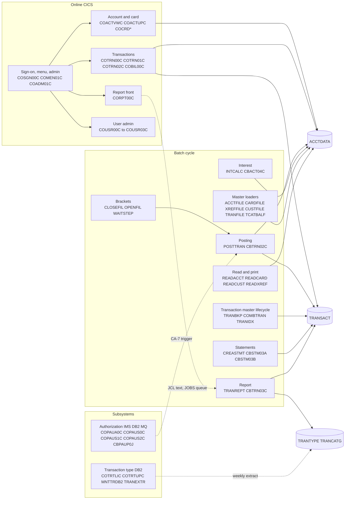

# 02 Coupling

Target state: refactor. Must not break: daily transaction posting, the account and card master refresh, the transaction report. Telemetry: none.

`02a-edge-tables.md` holds every edge the extractor found. This file holds the argument. Anything I found by reading source that is not an edge in `graph.json` is labeled inference and cited. The 28 computed calls are worked at the end, inline, as the dependency-cartographer would.

## The three patterns that constrain the sequence

### 1. Shared VSAM masters with writers on both sides of the batch and online split

The two files that posting touches have writers in batch and in online, and they are read by most of the system. This is data coupling and contract coupling at the same time. All 62 contract edges are `high`, which the extractor defines as "both sides COPY the same layout". It does not mean the layouts were proven equal (`meta.limits` in `graph.json`, analysis).

| Dataset | Writers | Readers | What it means for the sequence | Evidence |
|---|---|---|---|---|
| ACCTDATA.VSAM.KSDS | 4: CBTRN02C, CBACT04C, COACTUPC, COBIL00C | 11 | Posting and interest (wave 5) and account update and bill payment (wave 6) write the same records. Balances are the field they all touch. | `app/cbl/CBTRN02C.cbl:547`, `app/cbl/CBACT04C.cbl:352`, `app/cbl/COACTUPC.cbl:4066`, `app/cbl/COBIL00C.cbl:379` |
| TRANSACT.VSAM.KSDS | 3: CBTRN02C, COTRN02C, COBIL00C | 11 | The batch opens it OUTPUT and the online programs add records with the highest key plus 1. Three id schemes share one key space. | `app/cbl/CBTRN02C.cbl:256`, `app/cbl/COTRN02C.cbl:444`, `app/cbl/COBIL00C.cbl:212` |
| TCATBALF.VSAM.KSDS | 1 writer, 4 readers | 4 | Posting adds to it and interest reads it. The loader TCATBALF resets it before posting in `run_posting.sh`. | `app/cbl/CBTRN02C.cbl:508`, `scripts/run_posting.sh:20` |
| CUSTDATA.VSAM.KSDS | 1 writer (COACTUPC), 7 readers | 7 | The account update writes two masters in one task. | `app/cbl/COACTUPC.cbl:4086` |
| USRSEC.VSAM.KSDS | 3 writers, 5 readers | 5 | Sign-on reads what the user programs write. | `app/cbl/COSGN00C.cbl:212` |

The layout contract also lives in places the extractor does not read (`meta.limits`: in-stream IDCAMS and SORT cards are not read, and DCB and LRECL are not compared with copybooks). I read them by hand. Each is a place a copybook change breaks a port silently.

| Contract held outside the copybook | Where | Evidence |
|---|---|---|
| Account master key 11, record 300. Matches CVACT01Y (11 digit id, 300 bytes). | IDCAMS DEFINE in ACCTFILE | `app/jcl/ACCTFILE.jcl:40` |
| Card cross reference alternate index on the account id (key length 11 at offset 16) | IDCAMS DEFINE in CARDFILE | `app/jcl/CARDFILE.jcl:85` |
| Transaction record 350. The report sorts by card number at offset 263 and by processed date at offset 305, both hard-coded. They match CVTRA05Y (card number on line 15 of the copybook, processed timestamp on line 17). | SORT symbol cards in TRANREPT.jcl, the proc, and the JCL text in CORPT00C | `app/jcl/TRANREPT.jcl:41`, `app/proc/TRANREPT.prc:39`, `app/cpy/CVTRA05Y.cpy:15` |
| Transaction alternate index keys the timestamp at offset 304 (zero based) | IDCAMS DEFINE in TRANIDX | `app/jcl/TRANIDX.jcl:27` |
| Transaction id is the first 16 bytes. COMBTRAN merges on it. | SORT symbol card in COMBTRAN | `app/jcl/COMBTRAN.jcl:28` |
| Type and category reference records are 60 bytes built by SQL CAST and CONCAT with a REPEAT('0',8) pad. That is the layout the report's TRANTYPE and TRANCATG files get after the weekly extract. | In-stream SQL in TRANEXTR | `app/app-transaction-type-db2/jcl/TRANEXTR.jcl:65` |

No contract edge is `medium`, so there is no edge the extractor itself flagged as a layout risk. The risk is the ones it cannot see. The daily transaction file has no writer in the tree, and CBTRN02C translates it field by field from layout CVTRA06Y into CVTRA05Y before it writes (`app/cbl/CBTRN02C.cbl:425`). That is a layout contract with a producer outside the tree. Inference.

### 2. A hidden temporal protocol around the transaction master

Nothing in the call graph says posting depends on a backup job. It does. CBTRN02C opens the transaction master for OUTPUT (`app/cbl/CBTRN02C.cbl:256`). TRANBKP copies it to a GDG generation, then deletes and redefines it empty (`app/jcl/TRANBKP.jcl:40`). Then POSTTRAN fills it. COMBTRAN later merges the backup with the interest transactions and reloads it (`app/jcl/COMBTRAN.jcl:22`). So a port that treats CBTRN02C as "append transactions" changes the behavior of the cycle. That reading of OPEN OUTPUT on a VSAM file is inference: I did not run it.

Three shell wrappers hold three different orders of the same jobs. Control-M holds pieces. The CA-7 listing, which the extractor cannot parse, holds a fourth view.

| Order | Jobs in sequence | Evidence |
|---|---|---|
| `run_posting.sh` | CLOSEFIL, ACCTFILE, TCATBALF, TRANBKP, POSTTRAN, TRANIDX, OPENFIL | `scripts/run_posting.sh:13`, `scripts/run_posting.sh:26`, `scripts/run_posting.sh:34` |
| `run_full_batch.sh` | CLOSEFIL, the ten master reloads, POSTTRAN, INTCALC, TRANBKP, COMBTRAN, TRANIDX, OPENFIL. It submits TRANBKP twice, at Job 6 and Job 14. | `scripts/run_full_batch.sh:29`, `scripts/run_full_batch.sh:47`, `scripts/run_full_batch.sh:55`, `scripts/run_full_batch.sh:62` |
| `run_interest_calc.sh` | CLOSEFIL, INTCALC, TRANBKP, COMBTRAN, TRANIDX, OPENFIL | `scripts/run_interest_calc.sh:19`, `scripts/run_interest_calc.sh:23` |
| Control-M, daily | CLOSEFIL, TRANBKP, WAITSTEP, OPENFIL. POSTTRAN is not in it. | `app/scheduler/CardDemo.controlm:5`, `app/scheduler/CardDemo.controlm:11` |
| CA-7 listing (not parsed) | CLOSEFIL triggers CBPAUP0J, which triggers POSTTRAN, then WAITSTEP, then OPENFIL. An IMS purge job gates posting. | `app/scheduler/CardDemo.ca7:43`, `app/scheduler/CardDemo.ca7:70`, `app/scheduler/CardDemo.ca7:97`, `app/scheduler/CardDemo.ca7:124` |

Two consequences. First, the bracket jobs CLOSEFIL and OPENFIL are part of the data contract: every batch job that writes a VSAM master assumes CICS has closed it (`app/jcl/CLOSEFIL.jcl:26`). While any online writer is on CICS (until wave 6), the bracket has to stay. Second, POSTTRAN in wave 5 waits on CBPAUP0J, which belongs to wave 7. The scheduler has to keep orchestrating across the old and new platforms until wave 7 or the trigger has to be re-cut. That trigger is inference from a listing the extractor could not read.

### 3. Reach through text the extractor does not follow

The extractor makes no edge for JCL text inside COBOL, for in-stream `RUN PROGRAM` cards, or for a program named in a `PARM`. Each of these hides a real dependency. I found them by reading and they changed the wave plan.

| Hidden edge (inference) | What it changes | Evidence |
|---|---|---|
| CORPT00C builds a job that runs PROC=TRANREPT and writes it to the JOBS queue. The proc runs the sort and CBTRN03C. | The transaction report has an online front. CORPT00C is not a read-only screen. It moves with the report. | `app/cbl/CORPT00C.cbl:94`, `app/cbl/CORPT00C.cbl:517`, `app/proc/TRANREPT.prc:57` |
| MNTTRDB2 runs COBTUPDT from an in-stream DSN card. | A "utility" job is a DB2 batch program. COBTUPDT is live weekly, not unknown. | `app/app-transaction-type-db2/jcl/MNTTRDB2.jcl:30` |
| CBPAUP0J, LOADPADB, UNLDPADB, UNLDGSAM name their IMS programs in the driver PARM. | Four programs in the unknown bucket are run by jobs. | `app/app-authorization-ims-db2-mq/jcl/CBPAUP0J.jcl:25`, `app/app-authorization-ims-db2-mq/jcl/LOADPADB.JCL:27`, `app/app-authorization-ims-db2-mq/jcl/UNLDPADB.JCL:39`, `app/app-authorization-ims-db2-mq/jcl/UNLDGSAM.JCL:27` |
| TRANEXTR unloads the transaction type and category tables from DB2 to PS files. TRANTYPE and TRANCATG reload them into the VSAM files the report reads. | The report's reference data comes from DB2 (wave 7), one weekly cycle behind. A wave 5 test that ignores it uses stale reference data. | `app/app-transaction-type-db2/jcl/TRANEXTR.jcl:65`, `app/jcl/TRANREPT.jcl:69` |
| The weekly Control-M folder for the disclosure group refresh starts only after MNTTRDB2 finishes. | Two wave 1 and wave 4 scheduler jobs wait on a wave 7 job. The scheduler stays. | `app/scheduler/CardDemo.controlm:28`, `app/scheduler/CardDemo.controlm:34` |
| The CSD defines program and transaction COCRDSEC (CDV1). No source for it is in the tree. | A live entry point with no code to assess. | `app/csd/CARDDEMO.CSD:211`, `app/csd/CARDDEMO.CSD:390` |

## Clusters

The graph below is at cluster level on purpose. Solid arrows are calls or job steps. Dashed arrows are the hidden edges above.

## Strongly connected components

They move as a unit or not at all. The plan keeps each in one wave, and the validator checks it.

| Component | Members | Wave | Evidence |
|---|---|---|---|
| Sign-on, menu, admin | COADM01C, COMEN01C, COSGN00C | 3 | analysis: `sccs` in `graph.json` |
| Pending authorization view | COPAUS0C, COPAUS1C | 7 | analysis: `sccs` in `graph.json` |
| Transaction list and view | COTRN00C, COTRN01C | 3 | analysis: `sccs` in `graph.json` |

COCRDLIC and COPAUS0C also call themselves (`self_recursive`). COCRDLIC calls itself through CCARD-NEXT-PROG (`app/cbl/COCRDLIC.cbl:538`).

## God modules

The extractor finds none by fan-in and fan-out (analysis: `god_modules` is empty; the basis is the 38 reachable programs). Fan-in is small across the board. The highest are COMEN01C and COSGN00C with 12 callers each, and both return control through computed XCTL, so I would not call them god modules. Size is a different measure. COACTUPC has 3,368 lines and holds the account and customer update, the change detection and the locking in one program (`app/cbl/COACTUPC.cbl:4066`). It cannot be ported in one pass. It is the one unit I would strangle behind a facade rather than transliterate, and it sits in wave 6 for that reason.

## Articulation points

These are the natural wave boundaries. The basis is call edges between programs plus data edges from programs to datasets (analysis: `articulation_basis`).

| Point | Why it matters for the cut | Evidence |
|---|---|---|
| CBTRN02C, CBTRN03C, CBACT04C, CBSTM03A, CBEXPORT | The wave 5 batch programs are all articulation points. Wave 5 is cut where the seam is. | analysis: `articulation_points` |
| CBACT01C, CBIMPORT | Wave 2 read-only programs. | analysis: `articulation_points` |
| COSGN00C, COADM01C | The sign-on and admin entry of the wave 3 component. | analysis: `articulation_points` |
| COPAUS0C, COPAUS1C, COPAUS2C | The authorization chain in wave 7. | analysis: `articulation_points` |
| COCRDSLC | The card view program that COCRDLIC chains to. | analysis: `articulation_points` |
| ACCTDATA, CARDDATA, CARDXREF, CUSTDATA, EXPORT.DATA | Five datasets are articulation points. The data seam, not the call graph, decides how the system can be split. | analysis: `articulation_points` |

## The honest boundary: 28 computed calls

Every online program ends in an XCTL whose target is a variable. The extractor found the literals moved into some of them and left the rest as `?dynamic` nodes (28 sites, all `low`, `resolved: false`). Because there are more than 20, I worked them as the dependency-cartographer would. What I can prove and what stays open:

| Sites | Target field | What the source proves | What stays open | Evidence |
|---|---|---|---|---|
| COMEN01C 156, 184 | CDEMO-MENU-OPT-PGMNAME | The value is one of the 11 names in the menu table: COACTVWC, COACTUPC, COCRDLIC, COCRDSLC, COCRDUPC, COTRN00C, COTRN01C, COTRN02C, CORPT00C, COBIL00C, COPAUS0C. | Nothing. Bounded. | `app/cpy/COMEN02Y.cpy:21`, `app/cpy/COMEN02Y.cpy:28`, `app/cpy/COMEN02Y.cpy:89` |
| COADM01C 145 | CDEMO-ADMIN-OPT-PGMNAME | One of six: COUSR00C, COUSR01C, COUSR02C, COUSR03C, COTRTLIC, COTRTUPC. | Nothing. Bounded. | `app/cpy/COADM02Y.cpy:22`, `app/cpy/COADM02Y.cpy:29`, `app/cpy/COADM02Y.cpy:53` |
| COCRDLIC 538, 566 | CCARD-NEXT-PROG | One of COCRDSLC, COCRDUPC or COCRDLIC itself. | Nothing. Bounded. | `app/cbl/COCRDLIC.cbl:526`, `app/cbl/COCRDLIC.cbl:554`, `app/cbl/COCRDLIC.cbl:600` |
| The other 23 sites (COACTUPC 956, COACTVWC 349, COADM01C 168, COBIL00C 281, COCRDSLC 331, COCRDUPC 473, COMEN01C 201, COPAUS0C 322 and 674, COPAUS1C 367, CORPT00C 548, COTRN00C 192 and 518, COTRN01C 205, COTRN02C 508, COTRTLIC 620, COTRTUPC 457, COUSR00C 196, 206 and 514, COUSR01C 175, COUSR02C 258, COUSR03C 205) | CDEMO-TO-PROGRAM | The program either moves in a literal (COSGN00C, COMEN01C, COADM01C or a sibling) or copies CDEMO-FROM-PROGRAM, the name the caller left in the COMMAREA. | The COMMAREA value comes from whichever program transferred in. It is bounded to programs that record their own name before an XCTL, which is the online set, but it cannot be proved from one program's source. | `app/cbl/COACTUPC.cbl:941`, `app/cbl/COTRN01C.cbl:119`, `app/cbl/COUSR02C.cbl:116`, `app/cbl/COMEN01C.cbl:199` |

What follows for dead code: a CICS XCTL can only reach a program that has a CSD definition. The CSD defines the online programs (`app/csd/CARDDEMO.CSD:173`) and does not define CBTRN01C or any other batch program. So I infer that none of the 28 sites reaches an unknown-bucket batch program. The extractor cannot say that and the validator will not let me move a program to unreachable on it, so the unknown bucket stays as it is.

What the extractor does not model, and I did not chase further:

| Not modeled | Where it shows | Evidence |
|---|---|---|
| RETURN TRANSID chains between transactions | Sign-on returns with a transaction id chosen at run time | `app/cbl/COSGN00C.cbl:99` |
| Submit through the internal reader from a program | CORPT00C, covered above | `app/cbl/CORPT00C.cbl:462` |
| JCL COND on a step | TRANBKP defines the new master only if the earlier steps return 4 or less. TRANEXTR steps also carry COND. | `app/jcl/TRANBKP.jcl:51`, `app/app-transaction-type-db2/jcl/TRANEXTR.jcl:65` |
| Nested procs | TRANREPT.prc calls REPROC, and REPROC reads its control card from a library member | `app/proc/TRANREPT.prc:21`, `app/proc/REPROC.prc:28` |
