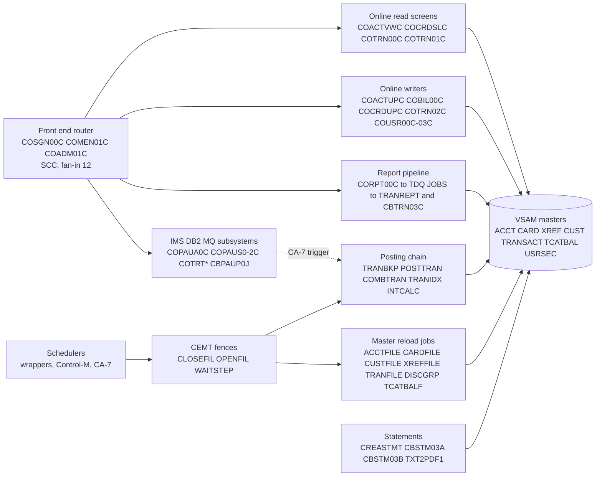

# 02 Coupling

`modernization-assessment/02a-edge-tables.md` holds every edge the extractor found. This file is the argument: what the coupling does to the sequence. The extractor's facts are cited to source. What I settled by reading source is labeled `inference` in the Evidence column. Target state is refactor, must-not-break is "daily transaction posting, the account and card master refresh, and the transaction report", telemetry is none.

Scale: 44 programs, 55 JCL jobs, 110 dataset nodes and 1,224 edges (318 call, 62 contract, 235 data, 476 include, 133 temporal). Of the edges, 254 are medium or low confidence or unresolved. Of those, 28 are computed calls and 16 are unmapped DDs, which I worked by hand below.

## The three patterns that constrain the sequence

| # | Pattern | Why it constrains the waves | Confidence | Evidence |
|---|---|---|---|---|
| 1 | Shared VSAM masters written from three different waves | The account master has 4 writer programs and 11 readers, and the transaction master has 3 writers and 11 readers. Account master writers: CBTRN02C and CBACT04C (wave 5), COACTUPC and COBIL00C (wave 6). Transaction master writers: CBTRN02C (wave 5), COBIL00C and COTRN02C (wave 6). A wave 5 port of the batch writers cannot own the file alone until wave 6 ends. A data access facade has to sit in front of these masters from wave 5 to the end of wave 6. | high | analysis: `data_hubs` (ds:AWS.M2.CARDDEMO.ACCTDATA.VSAM.KSDS, ds:AWS.M2.CARDDEMO.TRANSACT.VSAM.KSDS), `app/cbl/CBTRN02C.cbl:34`, `app/cbl/CBACT04C.cbl:356`, `app/cbl/COBIL00C.cbl:512`, `app/cbl/COTRN02C.cbl:713` |
| 2 | A hand built batch and online interlock, and rebuilds that destroy the master first | CLOSEFIL closes five CICS files and OPENFIL reopens them. CARDFILE, CUSTFILE and TRANFILE close and open their own files, but ACCTFILE and XREFFILE have no CEMT step and rely on CLOSEFIL. CBTRN02C opens the transaction master for OUTPUT, so posting only works on an empty file. TRANBKP makes it empty by deleting and redefining the cluster. The order TRANBKP, POSTTRAN, COMBTRAN is therefore a data dependency, not a preference. | high | `app/jcl/CLOSEFIL.jcl:26`, `app/jcl/ACCTFILE.jcl:25`, `app/jcl/CARDFILE.jcl:26`, `app/cbl/CBTRN02C.cbl:256`, `app/jcl/TRANBKP.jcl:40`, `app/jcl/COMBTRAN.jcl:24` |
| 3 | Three schedule descriptions that each cover a different part of one night | The wrapper script run_posting.sh runs CLOSEFIL, ACCTFILE, TCATBALF, TRANBKP, POSTTRAN, TRANIDX, OPENFIL. Control-M has a daily folder with CLOSEFIL, TRANBKP, WAITSTEP, OPENFIL and no POSTTRAN. The CA-7 listing has CLOSEFIL, CBPAUP0J, POSTTRAN, WAITSTEP, OPENFIL and no TRANBKP. Nothing in the tree says which one production uses. In CA-7 an IMS purge job (wave 7) triggers the posting job (wave 5). | medium | `scripts/run_posting.sh:13`, `app/scheduler/CardDemo.controlm:5`, `app/scheduler/CardDemo.ca7:43`, `app/scheduler/CardDemo.ca7:70` |

### Pattern 1 in detail: the contract is in JCL byte offsets as well as copybooks

All 62 contract edges are `high`: both sides copy the same layout copybook. That says the COBOL agrees with itself. It does not cover the JCL control cards, which the extractor does not read and which address the same records by byte position.

| Where the layout is used by offset | What it assumes | Confidence | Evidence |
|---|---|---|---|
| TRANREPT sort symbols | Card number at position 263 for 16 bytes and the processing date at position 305 for 10 bytes | high | `app/jcl/TRANREPT.jcl:41` |
| Statement job SORT and OUTREC | Moves the card number in front of the first 262 bytes, sorts on it, and copies 50 bytes from position 279 | high | `app/jcl/CREASTMT.JCL:53` |
| Alternate index on the transaction master | Key of 26 bytes at offset 304 (position 305) is the processing timestamp | high | `app/jcl/TRANIDX.jcl:27` |
| Combine job | Transaction id in positions 1 to 16 | high | `app/jcl/COMBTRAN.jcl:28` |
| Category balance print | Account at position 1 for 11 bytes, type at 12, category at 14, balance at 18 | high | `app/jcl/PRTCATBL.jcl:47` |

These offsets agree with the copybook today (`app/cpy/CVTRA05Y.cpy:5`). Any change to the transaction record in a port breaks all five silently. They are the first thing the harness in `modernization-assessment/06-test-strategy.md` must pin.

### Pattern 2 in detail: who closes what

| Job | Closes before it rewrites | Has its own CEMT step | Evidence |
|---|---|---|---|
| ACCTFILE (account master, must-not-break) | ACCTDAT, only if CLOSEFIL ran first | no | `app/jcl/ACCTFILE.jcl:25` |
| CARDFILE (card master, must-not-break) | CARDDAT and CARDAIX | yes | `app/jcl/CARDFILE.jcl:26` |
| CUSTFILE | CUSTDAT | yes | `app/jcl/CUSTFILE.jcl:26` |
| XREFFILE | CCXREF and CXACAIX, only if CLOSEFIL ran first | no | `app/jcl/XREFFILE.jcl:22` |
| TRANFILE | TRANSACT and CXACAIX | yes | `app/jcl/TRANFILE.jcl:26` |
| POSTTRAN | TRANSACT and ACCTDAT, only if CLOSEFIL ran first | no | `app/jcl/POSTTRAN.jcl:23` |

CLOSEFIL closes TRANSACT, CCXREF, ACCTDAT, CXACAIX and USRSEC (`app/jcl/CLOSEFIL.jcl:26`), so run alone ACCTFILE, XREFFILE and POSTTRAN rely on a fence that a scheduler or a wrapper has to have run. WAITSTEP is the only synchronisation: a fixed 36 seconds (`app/jcl/WAITSTEP.jcl:26`). The account master refresh deletes and redefines the cluster and reloads it from a flat file (`app/jcl/ACCTFILE.jcl:61`), so any balance posted since the flat file was cut is lost. That is the refresh's intended meaning only if this is a non-production copy. That has to be asked (see `modernization-assessment/00-summary.md`).

### Pattern 3 in detail: the schedulers disagree

| Scheduler artifact | Chain it defines | What is missing | Confidence | Evidence |
|---|---|---|---|---|
| Wrapper `scripts/run_posting.sh` | CLOSEFIL, ACCTFILE, TCATBALF, TRANBKP, POSTTRAN, TRANIDX, OPENFIL | none of the interest jobs | medium | `scripts/run_posting.sh:13` |
| Wrapper `scripts/run_full_batch.sh` | Refresh jobs, POSTTRAN, INTCALC, TRANBKP, COMBTRAN, TRANIDX, OPENFIL. Step "Refresh Transaction Data" runs TRANBKP, not TRANFILE. | TRANFILE and TRANCATG | medium | `scripts/run_full_batch.sh:29` |
| Control-M daily folder | CLOSEFIL, TRANBKP, WAITSTEP, OPENFIL | POSTTRAN | high | `app/scheduler/CardDemo.controlm:5` |
| Control-M monthly folder | CLOSEFIL, INTCALC, COMBTRAN, WAITSTEP, OPENFIL | TRANBKP between INTCALC and COMBTRAN, which the wrapper has | high | `app/scheduler/CardDemo.controlm:66`, `scripts/run_interest_calc.sh:23` |
| CA-7 listing (not parsed by the extractor) | CLOSEFIL, CBPAUP0J, POSTTRAN, WAITSTEP, OPENFIL; also READACCT, READCARD, READCUST, READXREF; CREASTMT then TXT2PDF1; PRTCATBL | TRANBKP, TRANIDX, ACCTFILE, CARDFILE, TRANREPT | medium | `app/scheduler/CardDemo.ca7:43` |
| Control-M weekly folders | The disclosure group folder starts only after the transaction type DB2 job MNTTRDB2 (a wave 7 unit) posts its condition | | high | `app/scheduler/CardDemo.controlm:28` |

The CA-7 rows are my reading of a listing the extractor could not parse (inference), taken from the TRIGGERED JOBS blocks: `app/scheduler/CardDemo.ca7:43`, `app/scheduler/CardDemo.ca7:70`, `app/scheduler/CardDemo.ca7:97`, `app/scheduler/CardDemo.ca7:124`. The same listing triggers jobs CLOSEFIL1 and CLOSEFIL2 (`app/scheduler/CardDemo.ca7:216`) that have no JCL in the tree.

## Cluster map

The dotted edge exists only in the unparsed CA-7 listing. It is inference.

## Strongly connected components, god modules, articulation points

| Fact | Units | What it means for the waves | Confidence | Evidence |
|---|---|---|---|---|
| Strongly connected component | COADM01C, COMEN01C, COSGN00C | Sign on and both menus call each other. They move as one unit, and they route to every online transaction. They need a facade that can still dispatch by name to legacy programs. | high | analysis: `sccs`, `app/cbl/COMEN01C.cbl:156` |
| Strongly connected component | COTRN00C, COTRN01C | List and view call each other. One unit. | high | analysis: `sccs`, `app/cbl/COTRN00C.cbl:192` |
| Strongly connected component | COPAUS0C, COPAUS1C | Summary and detail call each other. One unit, in wave 7. | high | analysis: `sccs`, `app/app-authorization-ims-db2-mq/cbl/COPAUS0C.cbl:322` |
| Self recursive | COCRDLIC, COPAUS0C | Cannot be ported as straight line code. Both are online screens. | high | analysis: `self_recursive`, `app/cbl/COCRDLIC.cbl:538` |
| God modules | COPAUS0C, COTRN00C, COTRN01C | Strangle behind a facade, never port wholesale. Caveat: each has fan-in 1 and fan-out 3, so the flag comes from a low percentile threshold on a small graph. The real hubs by fan-in are COMEN01C (12), COSGN00C (12) and COADM01C (7), which the flag misses because their fan-out is 1 or 2. | medium | analysis: `god_modules`, `fan_in` |
| Articulation points (programs) | CBACT01C, CBACT04C, CBEXPORT, CBIMPORT, CBSTM03A, CBTRN02C, CBTRN03C, COCRDSLC | Removing any of them disconnects part of the graph, so they are candidate cut points inside wave 5: CBTRN02C, CBACT04C, CBTRN03C and CBSTM03A. | medium | analysis: `articulation_points` |
| Articulation points (datasets) | ACCTDATA, CARDDATA, CARDXREF and CUSTDATA KSDS, EXPORT.DATA, the DB2 transaction type table | The masters are single points through which the parts of the graph connect. This is why the data facade is the first thing wave 5 needs. | medium | analysis: `articulation_points` |

## What the extractor could not settle, and what I settled by reading source

This is the work the extractor left. Every conclusion in this section is inference, and each row is cited to the lines it rests on.

### The 28 computed calls

All 28 are `EXEC CICS XCTL PROGRAM(variable)` in online programs. The variable is a field the program does not fix at compile time. Grouped by variable:

| Callers and lines | Variable | Values it can take | Basis | Evidence |
|---|---|---|---|---|
| COMEN01C (156, 184) | CDEMO-MENU-OPT-PGMNAME | 11 names: COACTVWC, COACTUPC, COCRDLIC, COCRDSLC, COCRDUPC, COTRN00C, COTRN01C, COTRN02C, CORPT00C, COBIL00C, COPAUS0C | Option index is checked against the count of 11 | inference: `app/cpy/COMEN02Y.cpy:28`, `app/cpy/COMEN02Y.cpy:89`, `app/cbl/COMEN01C.cbl:127` |
| COADM01C (145) | CDEMO-ADMIN-OPT-PGMNAME | 6 names: COUSR00C, COUSR01C, COUSR02C, COUSR03C, COTRTLIC, COTRTUPC | Option index is checked against the count of 6 | inference: `app/cpy/COADM02Y.cpy:29`, `app/cpy/COADM02Y.cpy:53`, `app/cbl/COADM01C.cbl:131` |
| COCRDLIC (538, 566) | CCARD-NEXT-PROG | COCRDSLC and COCRDUPC | Each XCTL follows a MOVE of a literal constant | inference: `app/cbl/COCRDLIC.cbl:526`, `app/cbl/COCRDLIC.cbl:554` |
| COMEN01C 201, COADM01C 168, COBIL00C 281, CORPT00C 548, COTRN00C 192 and 518, COTRN01C 205, COTRN02C 508, COUSR00C 196, 206 and 514, COUSR01C 175, COUSR02C 258, COUSR03C 205 | CDEMO-TO-PROGRAM | COSGN00C, COMEN01C, COADM01C, and from list programs COTRN01C, COTRN00C, COUSR02C and COUSR03C | Every value is a literal MOVE in the same program | inference: `app/cbl/COTRN00C.cbl:188`, `app/cbl/COTRN01C.cbl:126`, `app/cbl/COUSR00C.cbl:192`, `app/cbl/COUSR00C.cbl:202` |
| COACTVWC 349, COACTUPC 956, COCRDSLC 331, COCRDUPC 473, COTRTLIC 620, COTRTUPC 457 | CDEMO-TO-PROGRAM | The menu or admin program, or the calling program's name copied from the COMMAREA | Set from CDEMO-FROM-PROGRAM, which callers fill with their own name. The COMMAREA path is not provable from source alone | inference: `app/cbl/COACTVWC.cbl:336`, `app/cbl/COACTVWC.cbl:338`, `app/cbl/COMEN01C.cbl:154` |
| COPAUS0C 322 and 674, COPAUS1C 367 | CDEMO-TO-PROGRAM | COPAUS1C, COMEN01C, COPAUS0C, COSGN00C and COPAUS2C | Working storage constants WS-PGM-AUTH-SMRY, WS-PGM-MENU and WS-PGM-AUTH-DTL, and a literal | inference: `app/app-authorization-ims-db2-mq/cbl/COPAUS0C.cbl:192`, `app/app-authorization-ims-db2-mq/cbl/COPAUS0C.cbl:316`, `app/app-authorization-ims-db2-mq/cbl/COPAUS1C.cbl:185` |

Result. Every value I can find is the name of an online program that one of the four CSD files defines (`app/csd/CARDDEMO.CSD:173`, `app/app-authorization-ims-db2-mq/csd/CRDDEMO2.csd:18`, `app/app-transaction-type-db2/csd/CRDDEMOD.csd:11`). No computed call can reach a batch program, and no source, CSD or JCL file names CBTRN01C. The one part I cannot prove is the COMMAREA path, so I do not move any dead code item toward unreachable (see `modernization-assessment/05-dead-code.md`). The menu names COPAUS0C and the two DB2 admin programs, so the front end in wave 3 routes into waves 6 and 7.

### The 16 unmapped DDs

| Program and DDs | What is really true | Evidence |
|---|---|---|
| CBSTM03B (TRNXFILE, XREFFILE, ACCTFILE, CUSTFILE) | A called subprogram uses the caller step's DDs. CREASTMT step 040 maps all four. So the statement job reads the rebuilt transaction copy, the cross reference, the account master and the customer master, and the graph does not show those reads. | `app/jcl/CREASTMT.JCL:83` |
| CBIMPORT (CARDOUT) | The job defines CUSTOUT, ACCTOUT, XREFOUT, TRNXOUT and ERROUT but not CARDOUT, which the program opens. As written the job cannot run. | `app/cbl/CBIMPORT.cbl:63`, `app/jcl/CBIMPORT.jcl:43` |
| CBTRN01C (six DDs) | No JCL of any kind runs it. | `app/cbl/CBTRN01C.cbl:29` |
| COBTUPDT (INPFILE) | The DSN step maps INPFILE to a dataset that is itself named INPFILE, which looks like a placeholder. | `app/app-transaction-type-db2/jcl/MNTTRDB2.jcl:27` |
| PAUDBLOD (INFILE1, INFILE2) | Mapped in the job that starts it through DFSRRC00. | `app/app-authorization-ims-db2-mq/jcl/LOADPADB.JCL:36` |
| PAUDBUNL (OUTFIL1, OUTFIL2) | Mapped in the job that starts it through DFSRRC00. | `app/app-authorization-ims-db2-mq/jcl/UNLDPADB.JCL:48` |

### What is not modeled and matters

| Item | Why it matters | Evidence |
|---|---|---|
| Online report submit through a transient data queue | CORPT00C writes 80 byte JCL lines to queue JOBS, defined as an extra partition on DD INREADER. The report job is submitted by the online system, so there is a batch job with no scheduler entry at all. | `app/cbl/CORPT00C.cbl:517`, `app/csd/CARDDEMO.CSD:499` |
| Nested proc | Proc TRANREPT calls proc REPROC, and its own first line is `//REPROC PROC`. Nested calls are not followed. | `app/proc/TRANREPT.prc:1`, `app/proc/TRANREPT.prc:21` |
| IF and COND in JCL | Step order in the graph is file order. COND=(4,LT) on the TRANBKP define step and COND=(0,NE) on CREASTMT steps change which steps run. | `app/jcl/TRANBKP.jcl:51`, `app/jcl/CREASTMT.JCL:56` |
| Assembler and macros | COBDATFT, MVSWAIT and the macros are not parsed. CBACT01C and COBSWAIT call them. | `app/cbl/CBACT01C.cbl:231`, `app/cbl/COBSWAIT.cbl:38` |
| DB2, IMS and MQ | DDL, DCLGEN, DBD, PSB and control cards are not read, so wave 7 coupling is a lower bound. | `app/app-transaction-type-db2/jcl/CREADB21.jcl:52`, `app/app-authorization-ims-db2-mq/jcl/CBPAUP0J.jcl:24` |
| Generation data set retention | Bases are defined twice with different limits: TRANREPT with 10 and with 5. Whichever job ran first wins. | `app/jcl/REPTFILE.jcl:27`, `app/jcl/DEFGDGB.jcl:38` |
| Job defects that a port would copy | TRANREPT has a repeated step name and a hard coded 2022 date window. INTCALC passes a fixed date as its PARM. | `app/jcl/TRANREPT.jcl:37`, `app/jcl/TRANREPT.jcl:43`, `app/jcl/INTCALC.jcl:22` |

## The honest boundary

The graph is a lower bound for wave 7 (IMS, DB2, MQ), for the online navigation that runs through the COMMAREA, and for anything a program submits at run time. It is close to complete for the batch posting, reload and report chain, and that is where the must-not-break items live. Eight entries on the not-parsed list, covering 30 files, are not read (see `modernization-assessment/01-inventory.md`). The CA-7 listing among them names eight jobs that the extractor's unscheduled list counts as unscheduled.
