# 02 Coupling

The full edge tables are in `02a-edge-tables.md`. This file is the argument. Facts that come from
`graph.json` are cited by source line or marked `analysis` with the field named. What I read in
the source to settle open edges is marked `inference`. The open-edge work below is the
dependency-cartographer's job, done inline, because 28 computed calls is more than the 20 that
justify a hand-off.

## The three patterns that constrain the sequence

### 1. The nightly cycle rebuilds the masters, and the order lives in four places that disagree

The transaction master is not appended to. `TRANBKP` copies it to a new generation, deletes the
cluster and defines an empty one. `POSTTRAN` then opens it for output and loads the day's
transactions. `COMBTRAN` merges the previous generation and the interest file back in.

| Step | What it does | Evidence |
|---|---|---|
| TRANBKP copy | REPRO of the master to `TRANSACT.BKUP(+1)` | `app/jcl/TRANBKP.jcl:33` |
| TRANBKP delete | DELETE CLUSTER of the master, unconditional | `app/jcl/TRANBKP.jcl:40` |
| TRANBKP define | DEFINE CLUSTER, skipped if an earlier step ended above 4 | `app/jcl/TRANBKP.jcl:51` |
| POSTTRAN load | `OPEN OUTPUT TRANSACT-FILE` on the empty cluster | `app/cbl/CBTRN02C.cbl:256` |
| COMBTRAN merge | SORT of `TRANSACT.BKUP(0)` with `SYSTRAN(0)`, then REPRO into the master | `app/jcl/COMBTRAN.jcl:24` |
| TRANREPT side effect | The report job also writes `TRANSACT.BKUP(+1)`, the generation COMBTRAN reads as (0) | `app/jcl/TRANREPT.jcl:33` |
| Sample jobs | REPRTEST writes the same generation base | `samples/jcl/REPRTEST.jcl:33` |
| Failure path | If the copy step ends above 4 the delete still runs and the define is skipped. Inference from the JCL: the master would be gone with no fresh backup | `app/jcl/TRANBKP.jcl:51` |

Four sources say what the daily order is, and they differ:

| Source | Order | Evidence |
|---|---|---|
| `run_posting.sh` | CLOSEFIL, ACCTFILE, TCATBALF, TRANBKP, POSTTRAN, TRANIDX, OPENFIL | `scripts/run_posting.sh:13` |
| `run_full_batch.sh` | CLOSEFIL, nine refresh jobs, POSTTRAN, INTCALC, TRANBKP, COMBTRAN, TRANIDX, OPENFIL. TRANBKP appears twice | `scripts/run_full_batch.sh:29` |
| Control-M DAILY folder | CLOSEFIL, TRANBKP, WAITSTEP, OPENFIL. POSTTRAN is not in it | `app/scheduler/CardDemo.controlm:3` |
| CA-7 listing (not parsed by the extractor) | CLOSEFIL, CBPAUP0J, POSTTRAN, WAITSTEP, OPENFIL. Inference from reading the listing | `app/scheduler/CardDemo.ca7:43` |

The CA-7 chain puts an IMS purge job, `CBPAUP0J`, in front of posting (`app/scheduler/CardDemo.ca7:70`).
That job is in wave 7. A port of `POSTTRAN` that ignores the trigger changes when posting runs.

The two masters this cycle rebuilds are the two biggest data hubs. `AWS.M2.CARDDEMO.ACCTDATA.VSAM.KSDS`
has 4 writers and 11 readers, and `AWS.M2.CARDDEMO.TRANSACT.VSAM.KSDS` has 3 writers and 11 readers
(`analysis`, field `data_hubs`). The temporal edges the extractor found from the wrapper scripts
are all `medium` confidence and their note reads "order of submits"
(`modernization-assessment/02a-edge-tables.md:164`).

### 2. The record layouts are also carried as byte offsets, outside every COPY

All 62 contract edges are `high`, which means both sides COPY the same layout (`analysis`, the
edge confidence in `graph.json`). That is true and it is not enough. The extractor does not read SORT cards or
alternate index definitions (`meta.limits`), and these carry the same layouts as numbers:

| Where | What it hard-codes | Evidence |
|---|---|---|
| TRANREPT job | card number at byte 263 length 16, processing date at 305 length 10 | `app/jcl/TRANREPT.jcl:41` |
| TRANREPT proc | the same two offsets | `app/proc/TRANREPT.prc:39` |
| CORPT00C | the same two offsets, inside COBOL literals that are sent to the internal reader | `app/cbl/CORPT00C.cbl:100` |
| CREASTMT | SORT and OUTREC by offset, feeding a re-keyed copy of the transaction master | `app/jcl/CREASTMT.JCL:53` |
| PRTCATBL | category balance fields at bytes 1, 12, 14 and 18 | `app/jcl/PRTCATBL.jcl:47` |
| COMBTRAN | transaction id at byte 1 length 16 | `app/jcl/COMBTRAN.jcl:28` |
| Sample SORT job | the two TRANREPT offsets again | `samples/jcl/SORTTEST.jcl:23` |
| Card alternate index | `KEYS(11 16)`, the account id inside the card record | `app/jcl/CARDFILE.jcl:85` |
| Xref alternate index | `KEYS(11,25)` | `app/jcl/XREFFILE.jcl:74` |
| Transaction alternate index | `KEYS(26 304)`, the processing timestamp | `app/jcl/TRANIDX.jcl:27` |

I added up the PIC clauses of `app/cpy/CVTRA05Y.cpy:5` by hand (inference). The card number does
start at byte 263 and the processing timestamp at 305, so today the offsets agree with the
copybook. The DEFINE record sizes also agree with the copybooks: 300 for the account master
(`app/jcl/ACCTFILE.jcl:41`, `app/cpy/CVACT01Y.cpy:4`), 350 for the transaction master
(`app/jcl/TRANFILE.jcl:54`) and 50 for the category balance (`app/jcl/TCATBALF.jcl:41`). Change one
field width in a port and eleven places break without a compile error.

### 3. Batch and online both write the same two masters, in both directions

Of the 62 contract edges, 46 cross a wave boundary (`analysis`, computed from `waves.json` and
`graph.json`). Between wave 5 (nightly batch) and wave 6 (online writers) there are 8 edges from
wave 6 writers to wave 5 readers and 5 the other way. `ACCTDATA` is written by `CBTRN02C` and
`CBACT04C` and by `COACTUPC` and `COBIL00C`. `TRANSACT` is written by `CBTRN02C`, `COBIL00C` and
`COTRN02C`.

The online region has to be told to let go of the files while the batch reloads them:
`CLOSEFIL` closes five CICS files and `OPENFIL` reopens them (`app/jcl/CLOSEFIL.jcl:26`,
`app/jcl/OPENFIL.jcl:26`).

Three programs create transaction ids by three different rules in one key space:

| Writer | Id rule | Evidence |
|---|---|---|
| Online add and bill pay | read the highest key and add one | `app/cbl/COBIL00C.cbl:212`, `app/cbl/COTRN02C.cbl:444` |
| Posting | copies the id from the daily input file | `app/cbl/CBTRN02C.cbl:425` |
| Interest | the PARM date plus a counter, with the PARM hard-coded in the job | `app/cbl/CBACT04C.cbl:476`, `app/jcl/INTCALC.jcl:22` |

The reload in pattern 1 changes which key is highest, so the online rule depends on the batch order (inference).

## Other couplings the extractor cannot see

| Coupling | What I found | Confidence | Evidence |
| --- | --- | --- | --- |
| Online to batch by queue | CORPT00C writes a JCL deck to the transaction data queue JOBS. The deck names proc TRANREPT and carries the date range | high | `app/cbl/CORPT00C.cbl:517` |
| Job submits job | INTRDRJ1 copies a member to the internal reader, which starts INTRDRJ2 | high | `app/jcl/INTRDRJ1.JCL:17` |
| Nested proc | TRANREPT calls proc REPROC. The proc file's first line is `//REPROC PROC`, though the member is TRANREPT | high | `app/proc/TRANREPT.prc:1` |
| Assembler callees | CBACT01C calls COBDATFT and COBSWAIT calls MVSWAIT. Both are assembler and are not parsed | high | `app/cbl/CBACT01C.cbl:231`, `app/cbl/COBSWAIT.cbl:38` |
| Conditional steps | `COND=(4,LT)` and `IF MAXCC` change which steps run and are not modeled | medium | `app/jcl/TRANBKP.jcl:51` |
| External REXX | TXT2PDF1 runs an exec from a library that is not in the tree | high | `app/jcl/TXT2PDF1.JCL:31` |
| Pseudo-conversational chains | `EXEC CICS RETURN TRANSID` links every screen to the next. These are not edges | high | `app/cbl/CORPT00C.cbl:199` |

## Clusters

```mermaid
flowchart LR
  subgraph Online["Online estate (CICS)"]
    FD["Front door: COSGN00C, COMEN01C, COADM01C"]
    OR["Read views: COACTVWC, COCRDSLC, COTRN00C, COTRN01C"]
    OW["Writers: COACTUPC, COCRDUPC, COBIL00C, COTRN02C, COUSR01-03C"]
    RS["Report submit: CORPT00C"]
  end
  subgraph Cycle["Nightly cycle (wave 5)"]
    RL["Reload jobs: ACCTFILE, CARDFILE, XREFFILE, CUSTFILE, TCATBALF"]
    PT["Posting: TRANBKP, POSTTRAN, COMBTRAN"]
    IC["Interest: INTCALC"]
    RP["Report and statements: TRANREPT, CREASTMT"]
  end
  subgraph Sub["IMS, DB2, MQ (wave 7)"]
    AU["Authorization: COPAUA0C, COPAUS0C-2C, CBPAUP0C"]
    TT["Transaction types in DB2"]
  end
  ACC[("ACCTDATA")]
  TRN[("TRANSACT")]
  FD --> OR
  FD --> OW
  FD --> RS
  RL --> ACC
  PT --> TRN
  PT --> ACC
  IC --> ACC
  OW --> ACC
  OW --> TRN
  OR --> ACC
  OR --> TRN
  RS -. "TDQ JOBS, JCL text" .-> RP
  RP --> TRN
  AU -. "CA-7 trigger, inference" .-> PT
  FD --> AU
  FD --> TT
```

## Strongly connected components

They move as a unit. The validator rejects a plan that splits one, and this plan does not.

| Component | Why it is one | Wave | Evidence |
|---|---|---|---|
| COSGN00C, COMEN01C, COADM01C | Sign-on transfers to both menus and both menus return to it | 3 | `app/cbl/COSGN00C.cbl:231`, `app/cbl/COMEN01C.cbl:199` |
| COTRN00C, COTRN01C | The list drills into the view and the view returns to the list | 3 | `app/cbl/COTRN00C.cbl:188`, `app/cbl/COTRN01C.cbl:126` |
| COPAUS0C, COPAUS1C | The summary drills into the detail and the detail returns | 7 | `app/app-authorization-ims-db2-mq/cbl/COPAUS0C.cbl:316`, `app/app-authorization-ims-db2-mq/cbl/COPAUS1C.cbl:168` |

`COCRDLIC` and `COPAUS0C` also call themselves (`analysis`, field `self_recursive`).

## God modules

`COPAUS0C`, `COTRN00C` and `COTRN01C` (`analysis`, field `god_modules`). The extractor's test is
fan-in and fan-out over call edges, so this is a graph fact and not a size claim: `COTRN01C` has
231 lines. I would treat the two transaction programs as small strangle candidates behind the
menu and `COPAUS0C` as the real one, because it also holds IMS browsing, a self call and a
call cycle (`app/app-authorization-ims-db2-mq/cbl/COPAUS0C.cbl:322`).

## Articulation points

`analysis`, field `articulation_points`, computed over call edges and program-to-dataset edges.
The programs are `CBACT01C`, `CBACT04C`, `CBEXPORT`, `CBIMPORT`, `CBSTM03A`, `CBTRN02C`,
`CBTRN03C`, `COADM01C`, `COCRDSLC`, `COPAUS0C`, `COPAUS1C`, `COPAUS2C` and `COSGN00C`. The datasets
are the account, card, xref and customer masters, the export file and the DB2 transaction type
table. Five of these are the seams of wave 5: posting, interest, report, statements and export.
I used them to order the work inside wave 5 (see `03-waves.md`) and did not cut the wave.

## The honest boundary

### Computed calls, settled by reading the source (inference)

The extractor left 28 computed calls open (`analysis`, field `unresolved_dynamic`). Every one is
an `EXEC CICS XCTL` or `LINK` whose target is a data name. They fall into four groups.

| Sites | Reach | Basis | Confidence | Evidence |
|---|---|---|---|---|
| COMEN01C line 156 | COPAUS0C only | The branch is guarded by an equality test on that name | high | `app/cbl/COMEN01C.cbl:147`, `app/cbl/COMEN01C.cbl:156` |
| COMEN01C line 184 | The other ten menu programs: COACTVWC, COACTUPC, COCRDLIC, COCRDSLC, COCRDUPC, COTRN00C, COTRN01C, COTRN02C, CORPT00C, COBIL00C | Table lookup by option number. Entries starting with DUMMY are excluded by line 169 | medium | `app/cbl/COMEN01C.cbl:184`, `app/cpy/COMEN02Y.cpy:28`, `app/cpy/COMEN02Y.cpy:89` |
| COADM01C line 145 | COUSR00C, COUSR01C, COUSR02C, COUSR03C, COTRTLIC, COTRTUPC | Table lookup by option number | medium | `app/cbl/COADM01C.cbl:146`, `app/cpy/COADM02Y.cpy:29`, `app/cpy/COADM02Y.cpy:53` |
| COTRN00C line 192, COUSR00C lines 196 and 206, COCRDLIC lines 538 and 566, COPAUS0C line 322 | One named program each: COTRN01C, COUSR02C, COUSR03C, COCRDSLC or COCRDUPC, COPAUS1C | A literal or constant is moved to the field a few lines above the call | high | `app/cbl/COTRN00C.cbl:188`, `app/cbl/COUSR00C.cbl:192`, `app/cbl/COUSR00C.cbl:202`, `app/cbl/COCRDLIC.cbl:526`, `app/cbl/COCRDLIC.cbl:554`, `app/app-authorization-ims-db2-mq/cbl/COPAUS0C.cbl:316` |
| Return-to-caller at COACTUPC 956, COACTVWC 349, COCRDSLC 331, COCRDUPC 473 | The program in CDEMO-FROM-PROGRAM, else COMEN01C | A one deep back stack in the COMMAREA | medium | `app/cbl/COACTUPC.cbl:937`, `app/cbl/COACTVWC.cbl:334`, `app/cbl/COCRDSLC.cbl:316`, `app/cbl/COCRDUPC.cbl:449` |
| Return-to-previous at COMEN01C 201, COADM01C 168, COBIL00C 281, CORPT00C 548, COTRN00C 518, COTRN01C 205, COTRN02C 508, COUSR00C 514, COUSR01C 175, COUSR02C 258, COUSR03C 205, COPAUS0C 674, COPAUS1C 367, COTRTLIC 620, COTRTUPC 457 | COSGN00C when the field is blank, otherwise the value the caller left in the COMMAREA | Default guard on the field, then an XCTL. The full set is the set of programs that transfer to each of these | low | `app/cbl/COTRN00C.cbl:512`, `app/cbl/COMEN01C.cbl:198`, `app/cbl/COADM01C.cbl:165` |

Two things follow. First, the menu tables bound the online reach: every online transaction is
reachable from a menu, so nothing in the online estate is dead on static evidence. Second, the
last row cannot be bounded from the source at those lines. It is bounded by the union of static
callers, which is a wave-3 problem: the router must carry the COMMAREA back stack.

### Data edges with `resolved: false`

Sixteen DD nodes are mapped by no JCL step (`analysis`, the 16 `data` edges with
`resolved: false`, listed in `01-inventory.md`). They fall into five causes.

| DDs | Cause | Evidence |
|---|---|---|
| CBSTM03B four DDs | A called subprogram gets no DDs from its caller's step. The caller's step maps them | `app/jcl/CREASTMT.JCL:79` |
| PAUDBLOD, PAUDBUNL four DDs | The step is an IMS region step and the extractor does not map DDs for it. The JCL does | `app/app-authorization-ims-db2-mq/jcl/LOADPADB.JCL:36`, `app/app-authorization-ims-db2-mq/jcl/UNLDPADB.JCL:48` |
| COBTUPDT INPFILE | A TSO step. The DD is in the JCL with a dataset named INPFILE | `app/app-transaction-type-db2/jcl/MNTTRDB2.jcl:27` |
| CBTRN01C six DDs | No JCL runs it | `app/cbl/CBTRN01C.cbl:29` |
| CBIMPORT CARDOUT | The program opens it and the job has no DD for it. This one is real | `app/cbl/CBIMPORT.cbl:233` |

### Not parsed

Eight groups of files were not read. They are listed in `00-summary.md` and they change what
wave 7 and the scheduler picture mean.
